# Readout and Calibration-Update Audits for First-Order Probes

## False Alarms, Detection Sensitivity, and Decision Coverage under Source Shifts and Calibration Contamination

Kentaro Sato  
English manuscript V1.0 / 30 October 2026  
Article license: [CC BY 4.0](LICENSE-CC-BY-4.0.txt)

## Abstract

Sensors measuring the same input can produce different normal records because their response times differ. Physical-model residuals help account for these differences, while alarms from finite records additionally require thresholds calibrated to normal fluctuations. When thresholds are updated after a change in source statistics, fault contamination in the candidate data can reduce both false alarms and detection sensitivity. For a pair of calibrated first-order probes, we construct an evaluation procedure that separates readout, candidate-update auditing, and normal-condition validation of the adopted calibration. The procedure uses a signed moment residual, a cross-relation residual, and their fixed linear fusion. Analysis of the response model, simulation-based mechanism studies, and a confirmation experiment with 50 independently regenerated reference–calibration–evaluation replicates establish three findings. First, retaining intermediate representations makes it possible to trace alarm suppression at the upper limit of finite ranks. Direct calibration avoids this restriction in some conditions, but also incurs detection losses in others. Second, positive- and negative-gain contamination can cancel in a mean residual. Adding private-input records—records with an independent signal entering only one probe—can make a candidate more likely to be withheld from threshold updating while further reducing the sensitivity of thresholds fitted to that candidate. Third, decision deferral and recovery based on independent normal data affect false-alarm evidence, sensitivity, and decision coverage separately. In the primary recovery condition, a clean calibration provided decisions in 45 of 50 replicates; 10% of records remained without a decision. Relative to continued use of the old calibration, all-record detection of positive and negative gain faults decreased, while the difference in all-record private-input detection remained unresolved after multiplicity adjustment. The study provides a traceable inspection procedure and evaluates its benefits and costs separately under specified conditions.

**Keywords:** first-order response; covariance consistency; cross-relation; linear fusion; calibration contamination; false-positive rate; decision deferral

## 1. Introduction

### 1.1 Different response times to a common input

Consider two sensors with different response speeds measuring the same time-varying input. Both follow slow variations, whereas the slower sensor suppresses rapid variations more strongly. Their output amplitudes, variances, and zero-lag correlations therefore differ even under normal operation. A change in the speed of the common input can itself alter these differences. Using record distances or correlations as fault indicators requires separating changes caused by the input and response dynamics from the faults of interest.

We ask whether two outputs are consistent with known response models and a common input. A first-order lag provides a minimal setting in which response times are explicit and both input-eliminating relations and output second-moment constraints can be studied. Work on dynamic temperature measurement with two thermocouples has used common-input relations for response identification and compensated the bias due to measurement noise. [Hung et al., 2007](https://doi.org/10.1115/1.2431814); [Gillespie et al., 2016](https://doi.org/10.1016/j.ifacol.2016.07.087)

Here, response parameters are independently calibrated, and the task is to audit consistency from output records. Normal operation is defined by a model of the common input, probe responses, and acquisition noise. Changes in the correlation time or variance of the common input are treated as normal source shifts when response and acquisition-noise conditions remain fixed. The target faults are a change in one signal gain and the addition of a private input. A private input is an additional signal, independent of the common input, that enters only one probe. This definition separates tolerance of normal environmental changes from absorption of a fault into the normal calibration.

### 1.2 From a physical residual to a reliable alarm

Eliminating the common input yields a residual without reconstructing its unknown waveform or spectrum. Separating residual generation from decision-making is a basic principle of fault diagnosis using analytical redundancy. [Chow and Willsky, 1984](https://doi.org/10.1109/TAC.1984.1103593) Even normal residuals fluctuate over finite windows, and their distributions and tails depend on input statistics, acquisition noise, and window length. Establishing the false-alarm rate of a fixed threshold therefore requires calibration of these fluctuations in addition to the physical relation.

We treat the moment method M and the cross-relation method CR as two instruments measuring different aspects of consistency. M measures the balance between variances and covariance. CR compares two time series after each has been passed through the other probe's response. We then linearly fuse their signed residuals using normal fluctuations and fault-response directions derived from the physical model. The resulting LF (linear fusion) scores are converted into alarms through ranks or direct thresholds.

This separation makes an absent alarm diagnosable. An unchanged residual, a distinction lost in a projection, and a rank–threshold combination that makes firing impossible call for different inspections. Retaining continuous intermediate scores, signs, ranks, and branch activations alongside the final alarm allows these mechanisms to be distinguished.

### 1.3 Updating and reverting both require evidence

The quantities updated in this study are alarm thresholds. Probe response parameters remain at their independent calibration values. LF weights, centers, and rank references remain at values constructed from normal records of the baseline source. Thresholds alone are refitted to the source condition. This division allows us to study alarm calibration and update decisions while keeping the physical response and fusion rule fixed.

Updating thresholds with recent normal records is a natural response to a source shift. If candidate records contain faults, however, calibration can absorb the change that the detector is intended to find. Fewer alarms can represent both fewer false alarms and lost detections; these effects need separate measurement. Conservative type-I error and loss of power under contaminated reference data have also been analyzed in conformal outlier detection. [Bashari et al., 2025](https://proceedings.mlr.press/v267/bashari25a.html)

A candidate hold blocks adoption of the candidate thresholds. A separate policy then selects the calibration to use or defers decisions. We call the calibration constructed at the baseline source and retained after a source shift the old calibration F. Its false-positive rate can also change with the source. Continuing with F, deferring decisions when evidence is insufficient, and recovering with an independent clean calibration have different costs. Deferral withholds decisions for both normal and faulty records.

We therefore measure candidate acceptance, the false-positive rate of the calibration actually used, fault sensitivity, and the fraction of records receiving a decision separately. Independent normal validation data and clean recovery calibration data are supplied as available resources, allowing their evidential reach and operational costs to be evaluated.

### 1.4 Related work and the contribution of this study

We construct two signed statistics: M from a state-covariance constraint and CR from input elimination. State-covariance theory and finite-sample structured covariance estimation provide the foundation for M; CR uses the cross-relation employed in two-thermocouple response identification. [Georgiou, 2002](https://doi.org/10.1109/TAC.2002.800643); [Lin and Jovanović, 2009](https://doi.org/10.1109/TAC.2009.2017976); [Zorzi and Ferrante, 2012](https://doi.org/10.1016/j.automatica.2012.05.057); [Gillespie et al., 2016](https://doi.org/10.1016/j.ifacol.2016.07.087)

LF uses deflection maximization: a large mean shift relative to normal variance. [Picinbono, 1995](https://doi.org/10.1109/7.395235) Linear fusion of local statistics is also used, for example, in cooperative spectrum sensing. [Quan et al., 2008](https://doi.org/10.1109/JSTSP.2007.914882) Here, we derive M/CR fault-response directions from the physical model and construct weights using only a normal reference. We then evaluate finite-normal-sample rank/order-statistic calibration separately from independent risk validation of a fixed calibration. [Bates et al., 2023](https://doi.org/10.1214/22-AOS2244); [Tong et al., 2018](https://doi.org/10.1126/sciadv.aao1659); [Angelopoulos et al., 2025](https://doi.org/10.1214/24-AOAS1998)

Calibration updates also connect to power loss under reference contamination, adaptation to distribution shifts, and error–rejection tradeoffs. [Bashari et al., 2025](https://proceedings.mlr.press/v267/bashari25a.html); [Gibbs and Candès, 2021](https://papers.neurips.cc/paper_files/paper/2021/hash/0d441de75945e5acbc865406fc9a2559-Abstract.html); [Chow, 1970](https://doi.org/10.1109/TIT.1970.1054406) Our setting is batch-level threshold updating for first-order probes, including the choice of calibration after a candidate is held. Performance is measured through normal-condition false alarms, fault sensitivity, and decision coverage.

**Table 1. Inspection stages and evaluation targets.**

| Stage | Relation or procedure used | Quantity examined here |
|---|---|---|
| Physical residuals M/CR | State-covariance constraints, cross-relations, noise controls | Signed residuals for fixed responses and their use in candidate auditing |
| Linear readout LF | Normal covariance and physical fault-response directions | Representations and decision regions between two coordinates and an alarm |
| Finite-normal-sample calibration | Error control under specified exchangeability and related conditions | Rank caps, direct calibration, and independent normal validation |
| Calibration contamination | Conservatism, power loss, and cleaning | Balanced gain mixtures, added private-input records, and cross-fault losses under each calibration |
| Adaptation and deferral | Distribution adaptation and error–rejection tradeoffs | Accounting for old calibration, independent recovery, and deferred decisions after source shifts |

Our contribution is a traceable inspection procedure from physical statistics to decisions after a calibration update, together with an evaluation of disagreement conditions and costs in a common experimental system. We address three questions.

- **C1: Readout auditing.** Can saved intermediate quantities locate the stage at which a decision changes between residual and alarm?
- **C2: Separating candidates from adopted calibrations.** How far does detecting a suspicious update candidate explain the false-alarm rate and sensitivity of the calibration actually used?
- **C3: Separating false-alarm evidence, sensitivity, and coverage.** What do stopping and recovery preserve, and which detections and decision opportunities do they lose?

Section 2 derives the instruments, and Section 3 defines data roles and inference. Sections 4–6 address C1–C3, respectively; Section 7 discusses scope.

## 2. Methods: reading physical consistency as an alarm

### 2.1 Record model and second moments

Digital first-order responses to a common zero-mean input \(x_t\) are

\[
y_{\ell,t}=a_\ell y_{\ell,t-1}+b_\ell x_t,\qquad
a_\ell=e^{-\Delta/\tau_\ell},\qquad b_\ell=1-a_\ell,\quad
0<a_\ell<1,\quad \ell\in\{i,j\}
\tag{1}
\]

where \(\Delta\) is the sampling interval and \(\tau_\ell\) is the known response time. Each update retains a fraction \(a_\ell\) of the previous output and incorporates a fraction \(b_\ell\) of the current input, so different response times produce different waveforms from the same input. Our model is the digital first-order response specified by (1). Supplement S0 collects assumptions and scope shared by the model, calibration, and inference.

The observations are \(u_{\ell,t}=y_{\ell,t}+n_{\ell,t}\). Acquisition noise is zero-mean and independent of the signal; \(c_{\ell,t}\) denotes a corresponding independent noise control. In the experiment, n and c are separate Gaussian white-noise realizations with equal variance within each channel, generated independently across channels, time points, and observation/control roles. The control thus represents the mean second-moment contribution of acquisition noise, including after identical filtering. For a length-N window, let \(\langle v\rangle_N=N^{-1}\sum_{t=1}^N v_t\), and compute

\[
\widehat V_\ell=\langle u_\ell^2\rangle_N-\langle c_\ell^2\rangle_N,\qquad
\widehat C_{ij}=\langle u_i u_j\rangle_N-\langle c_i c_j\rangle_N
\tag{2}
\]

Hats denote finite-record estimates, while \(V_\ell=E[y_\ell^2]\) and \(C_{ij}=E[y_i y_j]\) are population quantities. We use the known zero mean and compute raw second moments within each window. Noise-control differences can be negative in finite samples; their signs are retained in the residuals.

**Table 2. Main notation and units of decision-making.**

| Symbol | Meaning |
|---|---|
| \(x,y,u,c\) | Common input, signal output, observed record, independent noise control |
| N, T=NΔ | Number of time points per record and evaluation-window length |
| \(V_i,V_j,C_{ij}\) | Population signal variances and covariance |
| \(q_M,q_C\) | Signed M and CR residuals for one record |
| \(s_g,s_p\) | Two signed projections of fixed LF |
| \(m_A,m\) | Numbers of records in a candidate-audit batch and a threshold-calibration batch |
| F, U, C | Context IDs for old, candidate, and clean recovery calibrations |
| \(\mathcal D_C\) | Recovery-calibration data, distinct from covariance \(C_{ij}\) |
| α, FPR | Nominal alarm budget; actual normal-condition false-positive probability or its empirical estimate |

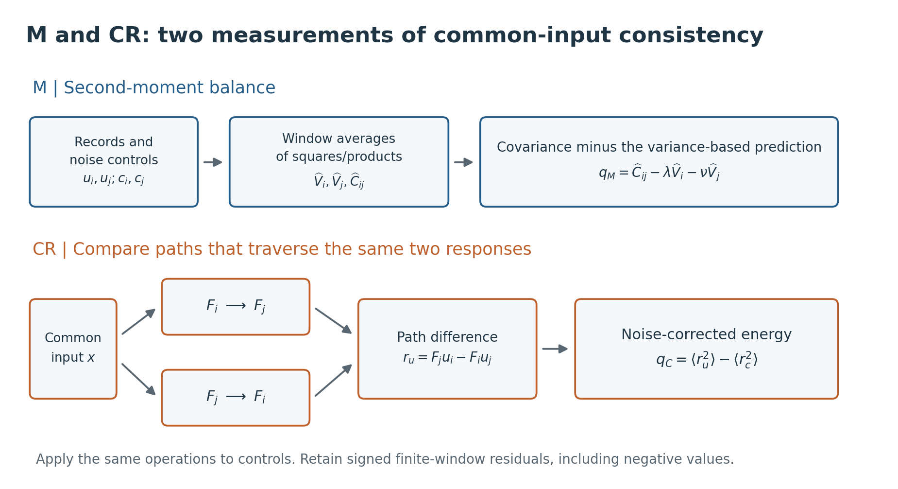

Figure 1. Schematic of the quantities compared by M and CR. The upper path represents second-moment balance; the two lower paths show the ideal signal relation. Computations use observations containing acquisition noise after each probe, and apply the same operations to noise controls.

### 2.2 Moment method M: covariance relative to its variance-based prediction

M expresses the first-order state-covariance constraint as a balance between variances and covariance. [Georgiou, 2002](https://doi.org/10.1109/TAC.2002.800643); [Zorzi and Ferrante, 2012](https://doi.org/10.1016/j.automatica.2012.05.057) Equation (1) shows why the residual can be formed without explicitly estimating the common-input spectrum. Assume stationarity and finite second moments, and set \(V_x=E[x_t^2]\) and \(L_\ell=E[y_{\ell,t-1}x_t]\). Taking expectations of squares and products gives

\[
\begin{aligned}
(1-a_i^2)V_i&=2a_i b_i L_i+b_i^2V_x,\\
(1-a_j^2)V_j&=2a_j b_j L_j+b_j^2V_x,\\
(1-a_i a_j)C_{ij}&=a_i b_jL_i+a_j b_iL_j+b_i b_jV_x.
\end{aligned}
\tag{3}
\]

Eliminating \(L_i,L_j\) using the first two equations also cancels the input-variance term in the third. Hence

\[
C_{ij}=\lambda V_i+\nu V_j,\qquad
\lambda=\frac{(1+a_i)(1-a_j)}{2(1-a_i a_j)},\quad
\nu=\frac{(1+a_j)(1-a_i)}{2(1-a_i a_j)},\quad
\lambda+\nu=1.
\tag{4}
\]

Substitution of measured quantities yields

\[
q_M=\widehat C_{ij}-\lambda\widehat V_i-\nu\widehat V_j
\tag{5}
\]

A positive residual means that covariance exceeds the variance-based prediction; a negative residual means that it falls below the prediction. The sign identifies the direction of this imbalance.

Equation (4) is a population relation for stationary inputs with finite second moments. The finite-window statistic (5) fluctuates around it, with source-dependent width and tails. Normal records calibrate these fluctuations and determine alarm thresholds.

M compresses information into window-level second moments. Applying the same temporal permutation to all series leaves (2) unchanged, so this statistic alone cannot recover temporal arrangement. This motivates using CR, which retains a temporal relation, alongside M.

### 2.3 Cross-relation method CR: comparing paths through the same two responses

Let \(F_\ell\) be the filter in (1). Following cross-relation input elimination, apply the j filter to the i output and the i filter to the j output. [Gillespie et al., 2016](https://doi.org/10.1016/j.ifacol.2016.07.087) With compatible histories and initialization, linear convolutions commute:

\[
F_jy_i=F_jF_ix=F_iF_jx=F_iy_j.
\tag{6}
\]

Passing both outputs through the same pair of responses makes their common-input responses comparable. Construct cross residuals for the observations and controls, and define

\[
r_u=F_ju_i-F_iu_j,\quad r_c=F_jc_i-F_ic_j,\qquad
q_C=\langle r_u^2\rangle_N-\langle r_c^2\rangle_N
\tag{7}
\]

CR abbreviates cross-relation. Formally, writing the input-elimination error as \(e=F_i^{-1}y_i-F_j^{-1}y_j\) gives \(r=F_iF_je\). The implementation uses forward cross-filtering.

The ideal relation (6) and its finite-record implementation have different initialization conditions. The additional CR filters are initialized at zero over the acquisition interval. We discard the first \(w=\lceil20\max(\tau_i,\tau_j)/\Delta\rceil\) time points and aggregate the following N points. Here, w=400, corresponding to a 0.8 s warm-up; moments in (2) use the same evaluation interval. Residual transients after finite warm-up are included in normal calibration. Equation (7), being a difference of two energies, can also be negative. LF centers it using a mean estimated from the normal reference.

CR measures temporal disagreement, with reduced sensitivity possible at frequencies suppressed by the cross-filters. Averaging squared residuals also discards waveform sign, event timing, and frequency-specific location. M and CR are thus complementary compressions that retain different information.

**Table 3. Roles of the two residuals.**

| | M | CR |
|---|---|---|
| Comparison | Observed covariance versus its variance-based prediction | Two time series after applying the other probe's response |
| Basis of normal relation | First-order recursion and stationary second moments | Commutativity of filters |
| Retained information | Signed second-moment imbalance | Corrected energy of band-limited disagreement |
| Compressed information | Temporal arrangement within the window | Residual sign, timing, and frequency-specific location |

### 2.4 Fault-response directions in the two coordinates

The pair \(q=(q_M,q_C)^{\mathsf T}\) obtained from a record is correlated even under normal operation. Simply adding the coordinates can favor the component with larger scale or fluctuations. To determine LF weights, we first examine the direction in which physical changes move the two coordinates.

Apply a gain change δ to the j signal and add a private input formed from an independent copy \(y'_j\) with the same statistics:

\[
y_j\longmapsto(1+\delta)y_j+\sqrt h\,y'_j,\qquad h\geq0
\tag{8}
\]

Here h is the private-input variance ratio. Acquisition noise is added afterward, with its absolute variance fixed. Equation (8) expresses both effects together; evaluation conditions generate gain faults and private-input faults separately.

For M, covariance becomes \((1+\delta)C_{ij}\), and the j variance becomes \(((1+\delta)^2+h)V_j\). The change from the normal mean is

\[
\Delta E[q_M]
=\delta(C_{ij}-2\nu V_j)-(\delta^2+h)\nu V_j.
\tag{9}
\]

For CR, let \(A=F_jy_i\), \(B=F_iy_j\), and define normal quantities incorporating finite initialization and the evaluation window:
\(P_i=E[\langle A^2\rangle_N]\), \(P_j=E[\langle B^2\rangle_N]\), and \(P_{ij}=E[\langle AB\rangle_N]\).
Expanding the squared residual gives

\[
\Delta E[q_C]
=2\delta(P_j-P_{ij})+(\delta^2+h)P_j.
\tag{10}
\]

Thus

\[
\Delta E[q]=\delta d_g+(\delta^2+h)d_p,\quad
d_g=\begin{pmatrix}C_{ij}-2\nu V_j\\2(P_j-P_{ij})\end{pmatrix},\quad
d_p=\begin{pmatrix}-\nu V_j\\P_j\end{pmatrix}.
\tag{11}
\]

The vector \(d_g\) is the first-order gain direction, while \(d_p\) is shared by private input and the quadratic gain term. Ideally, \(A=B\) gives \(P_i=P_j=P_{ij}=P\): the first-order gain term in CR vanishes, leaving \((\delta^2+h)P\). M generally retains a first-order term. This difference between first- and second-order responses helps explain complementary sensitivities.

Equation (11) also explains positive/negative gain asymmetry. Reversing δ reverses only the first-order term; the quadratic term adds in the same direction. Asymmetry can therefore arise already in signed projections. Likewise, balanced contamination by equal-strength positive and negative faults can cancel the batch mean's first-order term while leaving the quadratic term. This second direction provides another way to inspect mixtures.

### 2.5 LF: a linear readout accounting for normal fluctuations

LF reads changes in the two coordinates relative to their normal variance and correlation. For each branch f,

\[
s_f=w_{f,M}(q_M-\widehat\mu_M)+w_{f,C}(q_C-\widehat\mu_C)
=w_f^{\mathsf T}(q-\widehat\mu_0),\quad f\in\{g,p\}.
\tag{12}
\]

The normal reference R provides estimates of \(\widehat\mu_0\), the two-coordinate sample covariance \(\widehat\Omega_0\), and \(\widehat d_f\) in (11). The required \(V_j,C_{ij},P_j,P_{ij}\) are also estimated from noise-corrected moments in R. Weight estimation uses normal reference records and known probe responses.

Weights are determined by deflection maximization for a linear detector. [Picinbono, 1995](https://doi.org/10.1109/7.395235) With positive-definite population covariance, the ratio of squared mean change in direction \(d_f\) to normal projection variance satisfies

\[
D_f(w)=\frac{(w^{\mathsf T}d_f)^2}{w^{\mathsf T}\Omega_0w}
\leq d_f^{\mathsf T}\Omega_0^{-1}d_f.
\tag{13}
\]

Write the numerator as \(\{(\Omega_0^{1/2}w)^{\mathsf T}(\Omega_0^{-1/2}d_f)\}^2\) and apply Cauchy–Schwarz. Equality holds along \(w\propto\Omega_0^{-1}d_f\). The weighting adjusts contributions that fluctuate strongly under normal operation or are predictable from the other coordinate, measuring the fault direction relative to normal variation.

For finite R, we use fixed shrinkage:

\[
\widehat\Omega_\varepsilon
=(1-\varepsilon)\widehat\Omega_0+
\varepsilon\operatorname{diag}(\widehat\Omega_0),\quad
w_f=\frac{\widehat\Omega_\varepsilon^{-1}\widehat d_f}
{\sqrt{\widehat d_f^{\mathsf T}\widehat\Omega_\varepsilon^{-1}\widehat d_f}},
\quad\varepsilon=10^{-6}
\tag{14}
\]

The operator diag retains the diagonal entries only. Zero-direction branches are disabled; nonzero directions are retained regardless of their magnitude. Weights and centers remain fixed after a source shift.

The optimized quantity in (13) is the ratio of squared mean change to normal variance. Actual alarms use finite-sample score distributions, with thresholds determined by the normal calibration described next.

If both signed projections are retained and the weight matrix W has rank 2, the inverse \(q=\widehat\mu_0+W^{-1}s\) recovers the two coordinates. Thus a rank-2 pair of projections is an information-preserving change of coordinates, in contrast to compression into a single projection.

### 2.6 Reading the same LF through ranks or direct thresholds

LF0 uses left-insertion ranks of \((|s_g|,s_p)\) against the normal reference R. With \(z_{g,R}=|s_{g,R}|\) and \(z_{p,R}=s_{p,R}\),

\[
r_f(z)=\#\{z_{f,R}<z\},\qquad
L=\max\{r_g(|s_g|),r_p(s_p)\},\qquad
\mathrm{alarm}\iff L>t_L.
\tag{15}
\]

An independent normal calibration sample determines the upper threshold of L. Each rank is an integer from 0 to \(n_R\). If \(t_L=n_R\), no evaluation score can trigger an alarm. The combination of this cap and the comparison rule produces the structural non-firing examined below.

The direct-calibration readout W0 uses fixed branch budgets and places three thresholds on the same projections:

\[
\mathrm{alarm}\iff
s_g>t_+\ \lor\ -s_g>t_-\ \lor\ s_p>t_p,\qquad
(\alpha_+,\alpha_-,\alpha_p)=(\alpha/4,\alpha/4,\alpha/2).
\tag{16}
\]

Activations of G+, G−, and P are retained before the final OR produces one alarm. The 1:1:2 allocation was selected using design-stage simulation findings and fixed before generating the evaluation experiments. P denotes the response direction shared by private input and the quadratic gain term in (11).

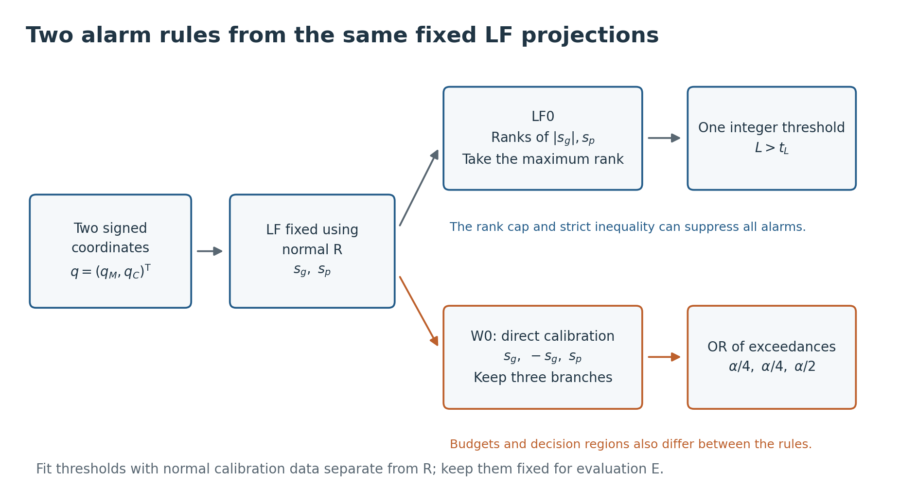

Figure 2. Shared residuals and projections can lead to different decision regions. LF0 combines the absolute-gain and P ranks into their maximum. W0 separates positive and negative gain and calibrates three thresholds with fixed budgets. Score representation and alarm-budget allocation both differ. Schematic.

For m normal calibration scores sorted in ascending order, set

\[
k_b=\lceil(m+1)(1-\alpha_b)\rceil,\qquad
t_b=\begin{cases}z_{(k_b)},&k_b\leq m,\\+\infty,&k_b>m,\end{cases}
\qquad \mathrm{alarm}\iff z>t_b
\tag{17}
\]

Ties do not trigger alarms. The same order-statistic calibration is applied to LF0's L. Conditional on fixed R and rules, if normal calibration scores and the next normal record are exchangeable, each branch's marginal false-alarm probability is at most its budget. A union bound gives an OR probability at most α without assuming branch independence. This guarantee averages over calibration-sample randomness. [Bates et al., 2023](https://doi.org/10.1214/22-AOS2244) Neyman–Pearson calibration also uses a normal holdout and order statistics to control type-I error with high probability. [Tong et al., 2018](https://doi.org/10.1126/sciadv.aao1659) Here, (17) constructs thresholds, and independent normal validation in Section 3 assesses the FPR of each fixed calibration.

Direct calibration also produces an infinite threshold when \(\alpha_b<1/(m+1)\). Finite calibration-sample resolution and LF0's finite-reference rank cap are distinct restrictions.

### 2.7 Candidate-batch auditing is a separate decision from a single-window alarm

We now move from alarming on one record to deciding whether many records should be accepted for a threshold update. Batch A audits the candidate acquisition process through average residuals. Its acceptance decision is transferred to a separate threshold-fitting batch U from the same process. The batch size \(m_A\) counts records in A and differs from the N time points within each record. Section 3.1 specifies the composition and separation of A and U.

\[
T_M=\sqrt{m_A}\frac{|\overline q_M|}{\widehat{\mathrm{SD}}_A(q_M)},\qquad
T_C=\sqrt{m_A}\frac{\overline q_C}{\widehat{\mathrm{SD}}_A(q_C)},\qquad
G\text{-M}:T_M,\quad G\text{-MC}:\max(T_M,T_C).
\tag{18}
\]

Each gate holds a candidate when its score strictly exceeds a threshold fixed at the maximum score of design-stage normal batches. This setting passes all development samples and is specified separately from the single-record alarm budget α. Section 3.3 gives the source conditions and thresholds. Because the two gates have separate thresholds, either gate can hold a candidate that the other passes.

The distinction between \(|\overline q_M|\) and \(\overline{|q_M|}\) is important. Equal positive and negative values can average to zero while their absolute values do not. Equation (18) uses the former, allowing mean cancellation under mixed signs. W0's single-record alarm is an OR of sign-separated branches; candidate auditing tests batch means. Non-finite values and zero standard deviations are accounted for separately as technical invalidity.

## 3. Evaluation design: data for constructing rules and data for assessing them

### 3.1 Data roles and independence

A record is an N-point measurement window producing one M/CR residual pair and one alarm decision. A batch contains many such records for candidate auditing or threshold calibration. An outer replicate regenerates the entire reference, calibration, candidate, normal-validation, and final-evaluation set. For each replicate, source group, candidate, nominal α, and policy, a calibration or deferral state is selected once and applied to all corresponding E records.

The numerical results come from two experiments with different purposes. The **instrument-evaluation experiment** comprises 50 outer replicates and evaluates single-fault contamination, candidate auditing, and the FPR of old calibration. It includes prespecified comparisons and post-hoc analyses of readout structure. The **mixture–recovery confirmation experiment**, also with 50 outer replicates, evaluates balanced-gain cancellation, added private-input records, and stopping–recovery tradeoffs. Their reproducibility IDs are PR-0009 and PR-0012, respectively.

Conditions and primary contrasts for mixture–recovery confirmation were chosen using the instrument-evaluation experiment and design-stage analyses, then frozen before generating its samples. The two experiments use separate random streams. Supplement S6 maps the supporting materials, including design analyses.

Section 3 and Sections 5.2–6 describe the mixture–recovery confirmation design and results. The readout analysis in Section 4.1 and single-contamination comparison in Section 5.1 use the instrument-evaluation experiment. Within each replicate, normal reference, calibration, candidate audit, normal validation, and final evaluation are separate. Methods share the same E within a replicate for paired gain/loss comparisons.

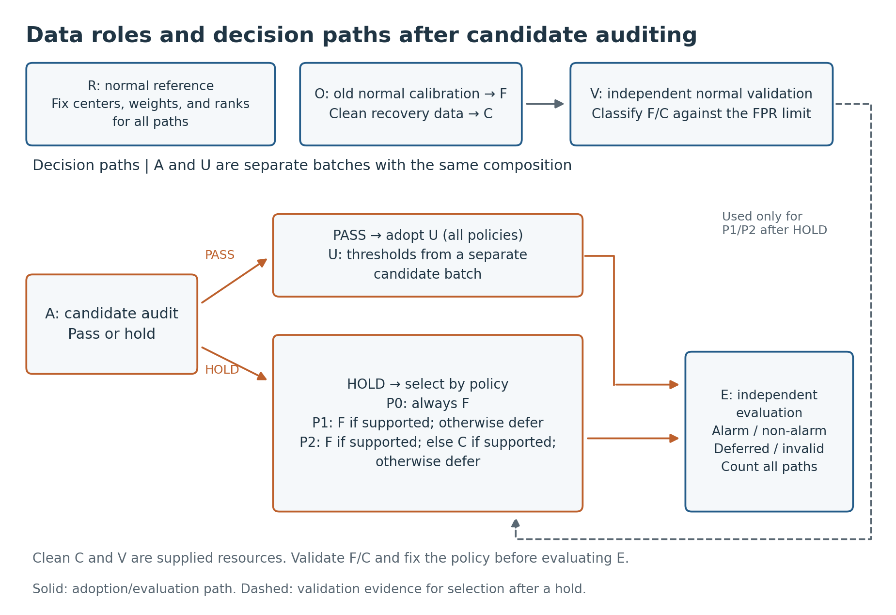

Figure 3. Separation of rule-construction and evaluation data. Candidate paths are “A passes → adopt U → evaluate on E” and “A holds → select F/C/DEFER by policy → evaluate on E.” After a hold, P0 returns to F; P1/P2 use V evidence for F/C as specified in Table 7. V validates fixed F/C, while E measures every adopted path, including accepted U. Clean C and V are supplied-resource assumptions. Schematic.

**Table 4. Data roles per replicate in mixture–recovery confirmation. Counts are numbers of records.**

| Role | Count | Purpose and separation |
|---|---:|---|
| R: normal reference | 9,999 per window length | Fix LF centers, weights, and rank tables at the baseline source |
| O: old normal calibration | 15,999 per window length | Acquired separately from R; construct old thresholds F |
| A: candidate audit | 15,999 per group/candidate | Determine G-M/G-MC pass/hold decisions |
| U: update-calibration candidate | 15,999 per group/candidate | Same composition as A, but separate records and ordering; construct candidate thresholds |
| \(\mathcal D_C\): clean recovery calibration | 15,999 per group | Acquired separately from clean U; construct current-source thresholds C |
| V: normal validation | 20,000 per group | Assess FPR evidence for fixed F/C |
| E: final evaluation | 20,000 normal and 5,000 per fault, per group | Measure FPR, detection, and coverage without reselecting rules or thresholds |

A audits the candidate acquisition process; U is a separate threshold-fitting batch from that process. A and U have the same normal/fault composition, and acceptance of A determines adoption of U. This includes the variability of transferring a decision to a different finite batch.

Within each role, candidate batches share normal/fault pools as planned for paired comparisons. The A and U roles are independently acquired. F/C thresholds are fixed before V is assessed, and E is generated after the policy-selection record is saved. E is reserved for evaluating fixed thresholds, projections, allocations, and policies.

### 3.2 Sources, responses, acquisition noise, and faults

The source is an AR(1) sequence corresponding to samples of a stationary OU process:

\[
x_t=\phi x_{t-1}+\sqrt{v_x(1-\phi^2)}\,\xi_t,\qquad
\phi=e^{-\kappa\Delta},\qquad \xi_t\stackrel{\mathrm{iid}}{\sim}N(0,1)
\tag{19}
\]

The source and signal probes are initialized jointly from their stationary distribution. The sampling interval is 0.002 s, with \(\tau_i=0.04\) s and \(\tau_j=0.01\) s. The baseline source has \(\kappa=20\ {\rm s}^{-1},v_x=1\). Independent Gaussian acquisition-noise variance in each channel is fixed at 10% of that channel's baseline-source signal variance and remains fixed in absolute terms after a source shift. Source shifts can therefore also alter relative SNR.

**Table 5. Four source groups in mixture–recovery confirmation.**

| Group | Description | κ (s⁻¹) | Source variance ratio | Window T (s) | N |
|---|---|---:|---:|---:|---:|
| B_L | Baseline source, long window | 20 | 1 | 8.192 | 4,096 |
| K2_M | Slow source, medium window | 2 | 1 | 2.048 | 1,024 |
| K200_L | Fast source, long window | 200 | 1 | 8.192 | 4,096 |
| V05_L | Half source variance, long window | 20 | 0.5 | 8.192 | 4,096 |

R and O are acquired at the baseline source for each of the medium and long windows. Faults are −5% gain (GM05), +5% gain (GP05), and independent private input with a 2% signal-variance ratio (P02), acting on the j signal. The private input has the same source statistics and j response and is added with amplitude multiplier \(\sqrt{0.02}\). Gain faults act on the signal component; acquisition-noise magnitude remains fixed.

**Table 6. Candidate-batch composition. Remaining records are normal at the current source.**

| Candidate | Negative-gain count | Positive-gain count | Private-input count | Total contamination |
|---|---:|---:|---:|---:|
| clean | 0 | 0 | 0 | 0 |
| GM800 | 800 | 0 | 0 | 800 |
| GP800 | 0 | 800 | 0 | 800 |
| BAL800 | 400 | 400 | 0 | 800 |
| BAL400 | 200 | 200 | 0 | 400 |
| TRI800 | 200 | 200 | 400 | 800 |

Mixtures combine records with different faults within a batch. TRI800 replaces 400 otherwise normal records with private-input-fault records, keeping the batch size and BAL400's gain-fault records and positions fixed. BAL400 is thus the control containing the same gain records for the private-input addition. The 2% fault strength and the proportion of faulty records in a candidate are distinct quantities.

### 3.3 Fixed readouts, gates, and three policies

W0 is the primary readout, LF0 the auxiliary comparator, α=1% the primary level, and 0.1% the prespecified low-level secondary analysis. G-MC is the primary candidate gate; G-M is the cancellation-mechanism comparator. Gate development data comprise 25 normal replicates across six source groups. For each window length and gate, the threshold is the maximum score over the two medium-window groups B_M/K2_M or the four long-window groups B_L/K200_L/V05_L/V15_L. B_M is the medium-window baseline source; V15_L has κ=20 s⁻¹ and source variance ratio 1.5 in the long window. Other conditions correspond to Table 5. The fixed medium-window threshold is 2.3338904456 for both gates; long-window thresholds are 2.4547144557 and 3.0310874379 for G-M and G-MC. This rule was adopted after inspecting development samples and fixed before generating the instrument-evaluation and mixture–recovery confirmation data. Normal false holds and contaminated-candidate holds in each experiment measure the performance of these fixed gates.

To separate candidate acceptance from selection after a hold, all three policies share adoption of U when the candidate passes. They differ only after a hold: returning to F, deferring, or adopting C. Clean C is supplied as an available resource for evaluating the recovery path after a hold. Table 7 specifies the selection.

**Table 7. Policies after a candidate hold. FPR support for F takes priority.**

| V evidence for F/C | P0: return to old calibration | P1: defer without support | P2: conditional recovery |
|---|---|---|---|
| F supported | F | F | F |
| F unsupported, C supported | F | DEFER | C |
| Both unsupported | F | DEFER | DEFER |

Unsupported means either “exceeds” or “unresolved.” DEFER denotes a withheld decision. V validates F/C; accepted U is evaluated on independent E. This separation measures candidate auditing and the properties of the selected calibration independently.

### 3.4 Normal validation V and performance accounting

For the primary W0 readout, we apply Clopper–Pearson intervals to fixed F/C alarm counts on V, with an FPR tolerance of 1.25α. [Clopper and Pearson, 1934](https://doi.org/10.1093/biomet/26.4.404) Within each source group and replicate, \(\eta=0.00625\) is assigned to each of eight endpoints: F/C × two levels × upper/lower bounds. An upper bound at most 1.25α gives “supported”; a lower bound above 1.25α gives “exceeds”; other cases are “unresolved.” Support here is statistical evidence that the particular fixed calibration's FPR is within the tolerance. With V=20,000, α=1% is supported at 211 or fewer alarms and exceeded at 291 or more; at α=0.1%, the corresponding counts are 12 and 39. This validation family comprises the eight endpoints for fixed F/C within one group and replicate.

For \(N_E\) planned evaluation records, let a denote alarms, q provided non-alarms, d deferred decisions, and x technical invalidity. Then

\[
N_E=a+q+d+x,\qquad
\mathrm{coverage}=\frac{a+q}{N_E},\qquad
\mathrm{alarm}_{\rm all}=\frac{a}{N_E},\qquad
\mathrm{alarm}_{\rm provided}=\frac{a}{a+q}.
\tag{20}
\]

On normal E, the alarm rate among provided decisions is the provided-decision FPR. On faulty E, the all-record alarm rate is the all-record detection rate. For faulty records, \(q/N_E\) is the fraction of all planned records receiving an incorrect non-alarm decision (the all-record nondeferred-miss fraction). The deferred fraction \(d/N_E\) is reported separately. A conditional rate with zero provided decisions is NA.

### 3.5 Evidence categories and the unit of inference

**Table 8. Analysis purposes and inferential status.**

| Category | Target | Interpretation |
|---|---|---|
| Confirmatory primary contrasts | The 13 primary mixture–recovery contrasts and fixed primary instrument-evaluation comparisons | Independent samples generated after contrast specification; families defined separately for each experiment |
| Prespecified secondary analyses | LF0/W0, source-specific FPR and sensitivity, and related summaries | Auxiliary evaluations reported separately from the primary 13 |
| Post-hoc exploration | Instrument-evaluation compression analysis; accepted strata and path decomposition in mixture–recovery confirmation | Mechanistic descriptions of the same samples used for fixed comparisons |
| Algebra and implementation checks | Equations, invertibility, equivalent decisions, reconstruction from saved values | Checks of mathematical relations and computational consistency |

The primary family comprises M01–M08 for mixtures/private-input addition and R01–R05 for recovery/policy differences. A Bonferroni allocation of 0.05/13 per contrast was fixed in advance. M01–M04 use conservative paired-binary CP difference intervals, R01 a CP interval for recovery probability, and the eight rate differences a paired t approximation over 50 outer replicates (49 degrees of freedom). R01 requires an adjusted lower bound above 50% for majority recovery. Supplement S4 gives interval constructions and tail allocations. The inferential replicate is the outer replicate defined in Section 3.1.

Mixture–recovery confirmation completed 23,999,200 records across 50 replicates. Calibration, decisions, and policy aggregates were checked against saved second-order statistics. Scientific missingness, non-finite rows, INVALID states, and exclusions were all zero. Twelve of the 13 primary contrasts supported their prespecified directions; one remained unresolved. Supported directions include anticipated detection losses. The outer-replicate count was fixed at 50 before the experiment, and all contrasts are reported under the same rules regardless of outcome. Each experiment uses its own 50 replicates for inference. Table 14 lists every primary contrast.

## 4. Results I: where readout decisions change

### 4.1 Separating coordinate changes from information compression

Post-hoc analysis of the instrument-evaluation experiment found that the pair of fixed LF projections had rank 2 in all 100 models, corresponding to 50 replicates and two window lengths. The transformation from two residual coordinates to two signed projections was therefore invertible and retained their information. In contrast, taking absolute values discards sign; finite ranks discard within-bin distances and differences beyond the reference maximum; taking a maximum discards the smaller value; and the final OR discards the identities of firing branches.

We also checked this distinction at the implementation level. For sorted reference values \(a_{f,0},\ldots,a_{f,n_R-1}\) and an integer threshold \(c<n_R\),

\[
r_f(z)>c\quad\Longleftrightarrow\quad z>a_{f,c}.
\tag{21}
\]

For \(c=n_R\), the threshold on the right is infinity. This equivalent continuous-threshold representation reproduced LF0 decisions, including ties. Removing the rank search at inference time alone changes neither performance nor non-firing. Switching to W0 instead changes branch budgets and sign-specific calibration.

This analysis concerns representations and decision rules between the two coordinates and the alarm. Invertibility calculations and equivalent-decision checks explain the mechanism; Supplement S2 links the analysis materials.

### 4.2 Normal variation can suppress alarms at the finite-rank cap

With \(n_R=9,999,m=15,999\), LF0's calibration order at α=0.1% is \(k=15,984\). If at least 16 normal calibration records attain the maximum rank, the threshold becomes the cap, 9,999. Every subsequent evaluation rank is then non-firing. These outputs are counted as non-alarms, regardless of fault-score magnitude, and retained in the detection-rate denominator.

A source shift that pushes more normal projection values beyond the reference range makes this condition easier to reach with the fixed reference. Because LF0 compares the maximum of two ranks with one threshold, normal variation in one branch can suppress alarms from the other. This mechanism illustrates the value of separating residuals, projections, ranks, and thresholds.

### 4.3 Detection recovered by direct calibration, and losses in the other direction

In the prespecified secondary analysis of mixture–recovery confirmation, LF0 was structurally non-firing in 45/50 replicates for K2_M, independent C, and α=0.1%. W0 directly calibrates the same LF projections and retained private-input detection without the rank-cap restriction. For the fast-source, long-window K200_L condition, however, LF0 had higher detection.

**Table 9. Readout comparison with independent C at α=0.1%. Means over 50 replicates, in %.**

| Group | Private-input detection W0 | Private-input detection LF0 | Normal FPR W0 | Normal FPR LF0 |
|---|---:|---:|---:|---:|
| K2_M | 93.9660 | 9.1440 | 0.1001 | 0.0089 |
| K200_L | 39.8824 | 44.9924 | 0.0951 | 0.0848 |

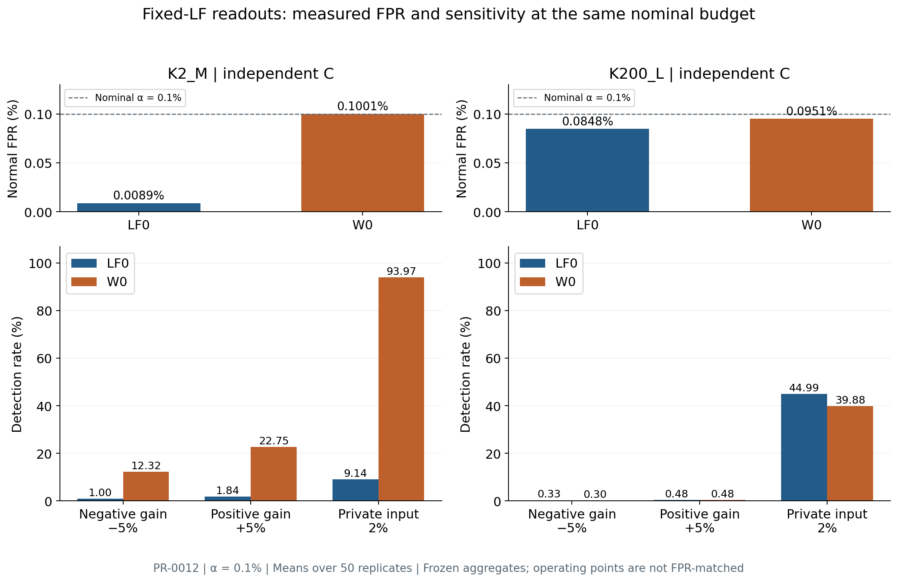

Figure 4. LF0 and W0 at the same nominal α. The upper panels show normal FPR; lower panels show negative-gain, positive-gain, and private-input detection. Independent C, α=0.1%, and means over 50 mixture–recovery confirmation replicates. Prespecified secondary analysis.

The large K2_M detection difference accompanies a change in normal FPR from 0.0089% to 0.1001%. This is an operating-point comparison at the same nominal α. In K200_L, LF0 private-input detection was 5.1100 percentage points (pp) higher; benefits and losses from changing readout depend on the condition.

## 5. Results II: finding suspicious candidates and choosing a calibration

### 5.1 Returning to old calibration is also a choice to evaluate

In the instrument-evaluation experiment, for K2_M with 800 records contaminated by private input at a 2% signal-variance ratio (P02), W0, and α=1%, holding the candidate with G-MC and returning to F increased detection of the same private-input fault by 81.540 pp relative to unconditional use of contaminated U. Normal FPR simultaneously increased by 3.553 pp. This coexistence of recovered detection and increased false alarms motivates separate evaluation of candidate acceptance and the fallback calibration. Sections 5.2 onward use mixture–recovery confirmation to examine mixed-sign cancellation and effects on the adopted calibration.

### 5.2 Mixed positive and negative gains cancel in a signed mean

For baseline-source, long-window B_L, G-M held the single-fault candidates GM800 and GP800 in 50/50 replicates each, but held BAL800, with 400 records of each gain sign, in 0/50. G-MC held the same BAL800 candidate in 50/50. Primary contrasts M01–M03 supported these directional differences.

The first-order term in (11) reverses with gain sign. Its contribution can cancel in the batch mean used by G-M, while the quadratic term and the CR response remain. A single-fault candidate and its mixed counterpart can therefore elicit different responses from the same gate.

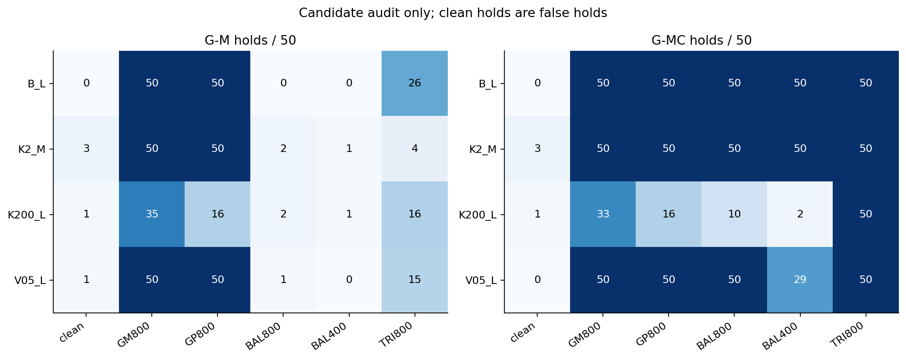

Figure 5. G-M/G-MC hold counts across four groups and six candidates. Each cell has 50 outer replicates. A clean-candidate hold is a false hold; a contaminated-candidate hold detects contamination. All mixture–recovery confirmation conditions are shown. Cells outside the primary contrasts are descriptive secondary results.

G-MC's contamination sensitivity also depends on the source. It held K200_L/BAL800 in only 10/50 replicates, passing 40/50. For GM800, G-M held 35/50 and G-MC 33/50, illustrating non-nested hold sets due to their separate thresholds. Clean-candidate false holds also occurred.

**Table 10. Clean-candidate false holds and BAL800 passes under G-MC. Each denominator is 50.**

| Group | Clean false holds | BAL800 holds | BAL800 passes |
|---|---:|---:|---:|
| B_L | 0 | 50 | 0 |
| K2_M | 3 | 50 | 0 |
| K200_L | 1 | 10 | 40 |
| V05_L | 0 | 50 | 0 |

These are observed frequencies over 50 replicates per group. Zero observed false holds still carries finite-sample uncertainty. Passed contaminated candidates are counted as gate misses.

### 5.3 Added private-input records act in opposite directions on auditing and calibration

In fast-source, long-window K200_L, adding 400 private-input records to BAL400, which contains 200 gain-fault records of each sign, produces TRI800. G-MC holds rose from 2/50 to 50/50: the added component made the candidate easier to detect. If that contaminated U were used for threshold calibration, however, detection would fall as shown in Table 11.

**Table 11. Evaluation with U hypothetically adopted: K200_L, W0, α=1%. Rates in %, differences in pp.**

| Evaluation target | BAL400 | TRI800 | TRI800−BAL400 |
|---|---:|---:|---:|
| Normal FPR | 0.9152 | 0.4572 | −0.4580 |
| Negative-gain detection | 2.0552 | 0.7372 | −1.3180 |
| Positive-gain detection | 3.0344 | 1.2332 | −1.8012 |
| Private-input detection | 62.6496 | 20.9316 | −41.7180 |

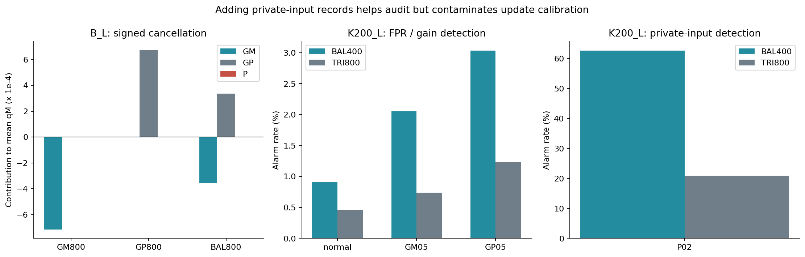

Figure 6. Left: cancellation of the signed M component in B_L. Center and right: shadow evaluation of U when changing BAL400 to TRI800 in K200_L, with normal FPR/gain detection and private-input detection in separate panels. The left panel describes a mechanism; rate differences in the other panels correspond to primary contrasts M05–M08. Fifty mixture–recovery confirmation replicates. Shadow evaluation means performance under hypothetical use of U.

Lower normal FPR accompanied lower private-input and positive/negative gain detection. Private-input contamination changes sensitivity to multiple faults together, consistently with the shared private-input/quadratic-gain direction in (11).

Under the actual policies, G-MC held TRI800 in every group and all 50 replicates, selecting F/C/DEFER according to Table 7. Table 11 shows the sensitivity loss under hypothetical use of U. The benefits and costs of the subsequent choice among F, C, and deferral are evaluated separately in the next section.

## 6. Results III: false-alarm evidence, sensitivity, and decision coverage

### 6.1 FPR support differs between calibrations

**Table 12. Independent-V FPR support for fixed F/C under the primary W0 readout. Each denominator is 50.**

| Group | F supported: 1% | C supported: 1% | F supported: 0.1% | C supported: 0.1% |
|---|---:|---:|---:|---:|
| B_L | 33 | 37 | 9 | 6 |
| K2_M | 0 | 45 | 0 | 9 |
| K200_L | 50 | 33 | 41 | 3 |
| V05_L | 50 | 37 | 40 | 3 |

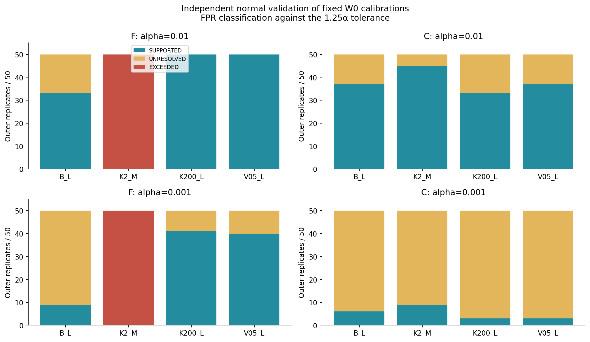

Figure 7. Classification of fixed F/C under the primary W0 readout using V=20,000 and tolerance 1.25α. The validation family contains eight endpoints within each group and replicate. Prespecified secondary mixture–recovery analysis. Table 12 lists supported cases; the figure also includes exceedances and unresolved cases.

K2_M/F exceeded the limit in 50/50 replicates at both α levels. C obtained support in 45/50 at the primary level but only 9/50 at low α. Support therefore requires both constructing a clean calibration and estimating a sufficiently tight FPR upper bound from finite V.

K200_L/F was supported in 50/50 at the primary level, while negative- and positive-gain detection were only 1.3996% and 1.9012%. This combination illustrates why normal false alarms must be measured on V and fault sensitivity on faulty E. V and independent E classifications also exhibit finite-sample variation: one K200_L/C/α=0.1% replicate was unresolved on V but exceeded the limit on E.

### 6.2 Clean-C decisions still incur detection loss and deferral

The primary recovery condition is slow-source, medium-window K2_M with TRI800—200 gain-fault records of each sign plus 400 private-input records—and α=1%. Recovery here denotes adopting clean C after a hold and providing decisions through that path. Every candidate was held, and F had no V support. P1 deferred in every replicate. P2 recovered in the 45 replicates with C support and deferred in the remaining five. The multiplicity-adjusted recovery-probability interval was [72.0564%, 98.2247%], meeting the majority-recovery criterion.

**Table 13. Policy performance in the primary recovery condition. Fifty replicates, in %.**

| Policy | Coverage | Normal all-record alarms | Provided-decision FPR | Negative-gain all-record detection | Positive-gain all-record detection | Private-input all-record detection | Deferred |
|---|---:|---:|---:|---:|---:|---:|---:|
| P0 | 100.0000 | 3.7304 | 3.7304 | 41.5476 | 50.2792 | 96.9272 | 0.0000 |
| P1 | 0.0000 | 0.0000 | NA | 0.0000 | 0.0000 | 0.0000 | 100.0000 |
| P2 | 90.0000 | 0.8591 | 0.9546 | 23.5208 | 33.7016 | 86.9304 | 10.0000 |

Equal E counts per replicate make P2's 45 recovered and five deferred replicates correspond to 90% all-record coverage and 10% deferral. P1's zero alarm rate results from withholding every decision. P2's normal all-record alarm rate of 0.8591% includes deferral, so it is reported with the provided-decision FPR of 0.9546%. P0 combines high detection with a normal FPR of 3.7304%. Policies are compared through this triple of FPR, detection, and coverage.

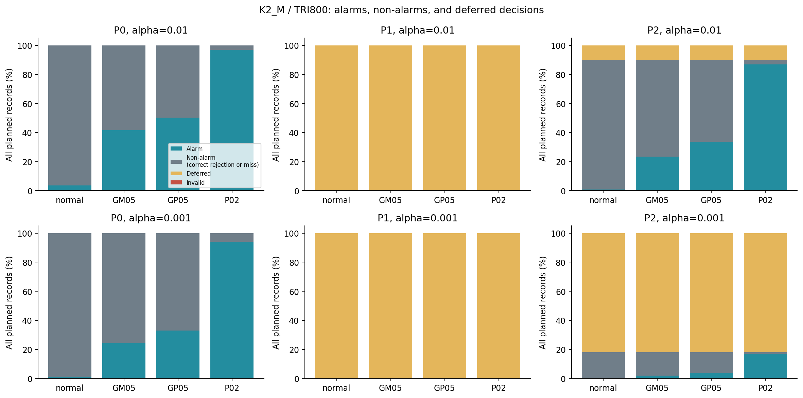

Figure 8. Policy accounting for K2_M/TRI800. Alarms, provided non-alarms, and deferred decisions are counted separately. An alarm is a false alarm under normal operation and a detection under a fault. Mixture–recovery confirmation at α=1% and 0.1%.

At the primary α, P2's all-record nondeferred-miss fractions were 66.4792% for negative gain, 56.2984% for positive gain, and 3.0696% for private input, each with a separate 10% deferred fraction. At α=0.1%, recovery fell to 9/50, coverage to 18%, and deferral rose to 82%. Stricter false-alarm requirements have costs in both detection thresholds and the resources needed to support decision provision.

### 6.3 All 13 primary contrasts and their paired gains and losses

**Table 14. The 13 prespecified primary contrasts. Differences in pp; R01 is a probability in %. All use primary α=1%.**

| ID | Contrast | Estimate | Multiplicity-adjusted interval | Directional conclusion |
|---|---|---:|---|---|
| M01 | B_L G-M holds: BAL800−GM800 | −100.0000 | [−100.0000, −74.0561] | Supported |
| M02 | B_L G-M holds: BAL800−GP800 | −100.0000 | [−100.0000, −74.0561] | Supported |
| M03 | B_L BAL800 holds: G-MC−G-M | 100.0000 | [74.0561, 100.0000] | Supported |
| M04 | K200_L G-MC holds: TRI800−BAL400 | 96.0000 | [66.4625, 99.9101] | Supported |
| M05 | K200_L U: TRI800−BAL400, normal | −0.4580 | [−0.4880, −0.4280] | Supported |
| M06 | Same, negative gain | −1.3180 | [−1.4133, −1.2227] | Supported |
| M07 | Same, positive gain | −1.8012 | [−1.9210, −1.6814] | Supported |
| M08 | Same, private input | −41.7180 | [−42.7025, −40.7335] | Supported |
| R01 | K2_M TRI800 P2 probability of recovery using C | 90.0000 | [72.0564, 98.2247] | Majority supported |
| R02 | K2_M TRI800 P2−P0, normal all-record alarms | −2.8713 | [−3.0357, −2.7069] | Supported |
| R03 | Same, negative-gain all-record detection | −18.0268 | [−21.4257, −14.6279] | Supported |
| R04 | Same, positive-gain all-record detection | −16.5776 | [−21.5738, −11.5814] | Supported |
| R05 | Same, private-input all-record detection | −9.9968 | [−22.5661, 2.5725] | Unresolved |

“Supported” in Table 14 refers to the prespecified direction of a contrast and includes confirmation of anticipated detection losses. “FPR support” in Section 3.4 and Table 12 concerns a fixed calibration's false-positive rate being within tolerance. Intervals follow the prespecified adjustment rules in Section 3.5.

R03/R04 show lower all-record positive/negative gain detection under P2 than P0. The mean private-input difference R05 is also negative, but its adjusted interval crosses zero. Because the interval includes both loss and the opposite direction, neither the sign of the difference nor equivalence is established.

Counting records on which only one policy alarms, using the same E, separates gains and losses that cancel in a mean difference.

**Table 15. P2 versus P0 in the primary recovery condition. All-record denominator, in pp.**

| Evaluation target | P2-only alarms | P0-only alarms | Difference |
|---|---:|---:|---:|
| Normal | 0.0124 | 2.8837 | −2.8713 |
| Negative gain | 0.0636 | 18.0904 | −18.0268 |
| Positive gain | 0.0744 | 16.6520 | −16.5776 |
| Private input | 0.0220 | 10.0188 | −9.9968 |

Additional normal alarms are additional false alarms, the opposite of newly detected faulty records. This all-record comparison includes alarms lost through deferral; output accounting still separates deferred decisions from incorrect non-alarm decisions.

### 6.4 R05 variability tracked recovery and deferral paths

A post-hoc decomposition of the same 50 replicates separated R05 by path. Across the 45 recovered replicates, the mean private-input detection change from P0 to P2 was −0.3329 pp; in the five deferred replicates, P2 provided no decisions. Their weighted contributions to the overall −9.9968 pp difference were −0.2996 pp for recovery and −9.6972 pp for deferral.

Writing the replicate difference as Δ and the path as S, the empirical variance decomposition is

\[
\operatorname{Var}(\Delta)
=E[\operatorname{Var}(\Delta\mid S)]
+\operatorname{Var}(E[\Delta\mid S])
\tag{22}
\]

The between-path term accounted for 99.9965% of the empirical variance across the 50 replicates. This descriptive variance weights the 50 observations equally and has a different role from the unbiased sample variance used for primary inference.

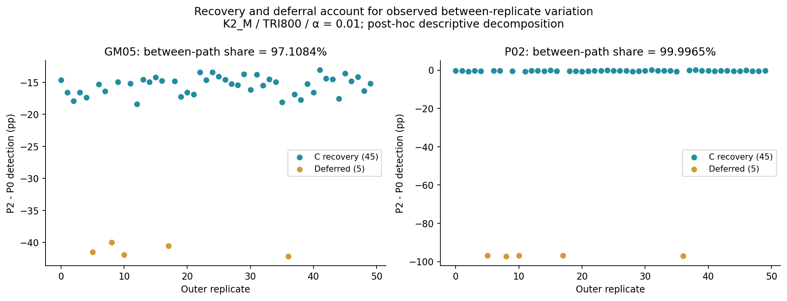

Figure 9. Replicate-level policy differences, including R05. Recovery and deferral form distinct groups. Post-hoc exploration of the 50 mixture–recovery confirmation replicates. Variance fractions describe this empirical sample; Table 14 gives the primary inferential results.

Record-level evaluation precision and path-selection uncertainty are separate components to consider when allocating sample budgets.

### 6.5 Continued operation after acceptance can still lose sensitivity

We also examined the accepted-U path, separately from the cost of deferral. For half-variance, long-window V05_L with BAL400, G-MC passed 21/50 replicates. Comparing contaminated U with its corresponding clean U on the same E within those same 21 replicates gives Table 16.

**Table 16. The 21 accepted V05_L/BAL400 replicates, W0, α=1%. Post-hoc exploration.**

| Evaluation target | Clean U (%) | Contaminated U (%) | Difference (pp) |
|---|---:|---:|---:|
| Normal FPR | 0.9840 | 0.4062 | −0.5779 |
| Negative-gain detection | 30.9343 | 17.9638 | −12.9705 |
| Positive-gain detection | 43.7686 | 24.8971 | −18.8714 |
| Private-input detection | 99.9038 | 99.8562 | −0.0476 |

Differences are calculated before rounding. In this stratum, all three policies adopt U with 100% coverage, separating calibration-induced sensitivity loss from deferral costs. Empirical normal E FPR was at most 1.25α in every one of the 21 replicates, yet gain sensitivity was below clean U. The U FPRs reported here are empirical independent-E values; V support applies to F/C.

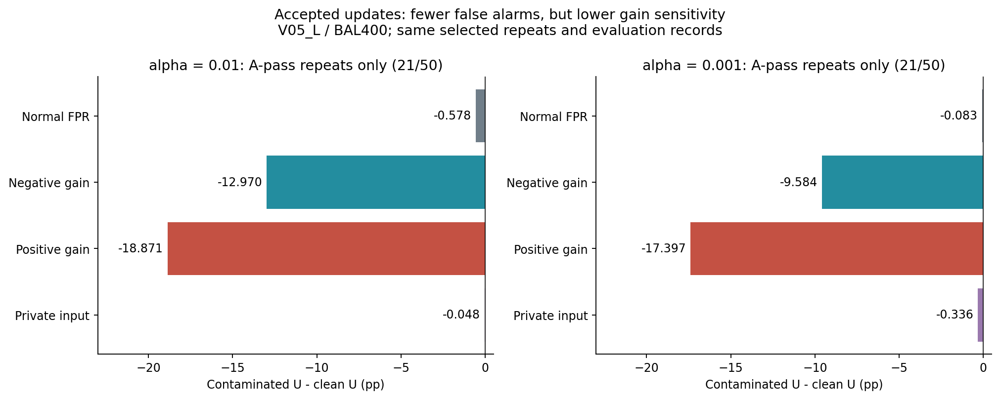

Figure 10. Clean and contaminated U compared within the same 21 accepted replicates. Both α levels are displayed, separating normal FPR, positive/negative gain, and private input. Post-hoc analysis of a selected stratum, comparing operating points at the same nominal α.

Applying the same G-MC gate in shadow mode to the composition-matched but separately sampled U produced A/U disagreement in 31/50 V05_L/BAL400 replicates. Of the 21 passed by A, 17 would have been held when the gate was hypothetically applied to U. The actual policy remains gated by A; shadow U decisions describe between-batch variability. Passing A provides information about the candidate acquisition process, while finite batches from that process can still differ in this way.

## 7. Discussion

### 7.1 Why the decisions are measured separately

Physical residuals measure consistency with the response model, normal validation V assesses a fixed calibration's FPR, and faulty E measures sensitivity. After a candidate hold, the fallback calibration and decision coverage must also be evaluated. Preserving and verifying this correspondence separated the benefits and costs accompanying fewer alarms, candidate rejection, and operational recovery.

The reusable specification is a record structure that makes each decision's basis traceable. It retains the physical model and noise controls; signed residuals; reference and projection versions; calibration provenance and thresholds; branch activations; candidate acceptance; the selected calibration context; normal-validation classifications; and counts of alarms, non-alarms, deferrals, and technical invalidity. This supports inspection of different paths that would otherwise collapse into the same alarm rate.

### 7.2 Decision-preserving simplification versus changed decision regions

The equivalence in Section 4.1 shows that rank searches can be removed while preserving LF0 alarms. Such checks identify the decision-preserving scope of an implementation simplification.

Changing to W0 alters decision regions through branch budgets and sign-specific calibration. We observed both avoidance of rank-cap non-firing and detection lost relative to LF0. These findings motivate inspecting score representation, alarm budgets, and calibration conditions before increasing fusion complexity.

For candidate gates, combining M and CR improved sensitivity to balanced mixtures in some conditions, while separate thresholds also produced different hold sets. Normal-source false holds and contamination misses need paired evaluation. Moreover, the P direction in (11) responds to both private input and quadratic gain changes. Branch activation is interpreted as a response in that physical direction.

### 7.3 Scope and identifiability

Supplement S0, Table S1 collects model, statistical, and policy assumptions and the judgments each supports. Here we clarify what can be distinguished using the available information.

Discrimination depends on the information available to the test. If an allowed normal distribution and the distribution under an inconsistency coincide on that information, distinguishing them requires additional measurements. A shared component entering at the common-input location and absorbed into an allowed source shift is one example. By contrast, CR responses remained after cancellation of the M mean in mixed-sign candidates. Distinguishing equality of means from equality of the full available distribution is essential for locating a test's blind spots.

Source groups, window lengths, and fault strengths were chosen using design analyses and the instrument-evaluation experiment, then fixed for mixture–recovery confirmation. Results therefore characterize the selected condition set. Fixed absolute acquisition-noise variance also makes source shifts alter relative SNR. These conditions, including matched A/U composition, are stated in Supplement S0.

### 7.4 Further requirements depend on the intended claim

Our policy evaluation assumes access to independent clean calibration and normal validation. Application in operation requires resources and evaluation designs matched to the desired guarantee.

Guaranteeing sensitivity after an update requires specified fault-sensitivity requirements and independent fault-control resources in addition to normal V. Validating FPR across all adopted paths requires a selection-aware procedure that includes accepted U. Where clean C/V are unavailable, the measurement procedure establishing their provenance itself needs validation. Continuous monitoring with overlapping windows requires sequential evaluation that accounts for window dependence and repeated selection.

These extensions require data separate from the evaluation E used here.

## 8. Conclusion

We treated first-order probe consistency auditing as a single verifiable path from physical residuals to decisions after calibration updates. Using signed M/CR and fixed LF, we established three findings. First, intermediate representations made rank-induced non-firing and the gains and losses of changed decision rules traceable. Second, the prespecified mixture–recovery confirmation experiment showed that candidate-audit sensitivity to balanced gain mixtures and added private-input records is distinct from the FPR and fault sensitivity of the adopted calibration. Third, stopping and conditional recovery using independent normal validation supported operation with FPR evidence in some conditions, while incurring detection losses and deferred decisions.

This is a methodological evaluation under specified digital first-order responses, source conditions, fault locations, and finite normal-data resources. Reporting residual consistency, candidate acceptance, FPR, sensitivity, and decision coverage together—including direct calibration's reverse-direction losses and the unresolved R05 contrast—is central to auditable calibration updating.

## Data, code, and reproducibility

The research package contains prespecified research plans, implementations, second-order statistics, aggregate tables, and analysis code. A public archive identifier has not yet been assigned; the links below refer to files within the package. Supplement S6 maps numerical results and figures to their sources.

For the current confirmation implementation, the [readable FIX1 code guide](numerics/experiments/pr0012_fix1/README.md) provides the reading order, equation-to-code map, and instructions for checks and Colab execution.

Mixture–recovery conditions are specified in the [research plan](audits/prereg/PR-0012_mixture_recovery_confirmation.md) and [numerical-preflight technical specification](audits/prereg/PR-0012_A01_preflight_boundary_fix.md); aggregates are documented in the [confirmation analysis](numerics/analysis/pr0012_64bf0f2c7697_confirmation_v1/PR0012_CONFIRMATION_REPORT_JA.md). Reproducibility checks covered archive integrity and recomputation of calibration, decisions, and policy aggregates from saved second-order statistics. Supplement S6 describes retained evidence and numerical-boundary handling.

The package also contains [diagram and readout-plot code](numerics/scripts/draw_manuscript_ja_v1_figures.py), [decision-path and English-figure code](numerics/scripts/draw_manuscript_bilingual_v1_figures.py), [manuscript figure-label code](numerics/scripts/draw_manuscript_ja_v5_en_v2_labels.py), sources of the result figures, and the [manuscript-to-evidence check](provenance/MANUSCRIPT_CHECK.md). LLM assistance was used in code development and checking. Numerical results derive from fixed computational conditions and saved execution outputs; code, random settings, and verification records are included for reproduction. The article is provided under CC BY 4.0 and code under [Apache 2.0](LICENSE).

## Acknowledgments and disclosure of LLM use

During the research and manuscript preparation, the author used ChatGPT and Codex (OpenAI) to assist with research questions and mathematical formulations, literature searches, code development and checking, organization of analysis results, and writing revision. Claude (Anthropic) was used to critique drafts. The author bears final responsibility for the entire article, including research decisions, adopted methods and code, citations, interpretation of results, and manuscript text.

## Supplementary material

### S0. Shared assumptions and scope

This study evaluates finite-record alarms and calibration updates for two recorders with calibrated digital first-order responses. The population moment relation for M assumes stationarity and finite second moments. Numerical experiments use sampled stationary Gaussian OU sources, independent Gaussian acquisition noise, and independent records. Response parameters and LF projections remain fixed after source shifts. Acquisition noise and noise controls retain their baseline absolute variances, with independent noise realizations for observations and controls.

**Table S1. Assumptions by component and the quantities evaluated.**

| Component | Conditions and operations in this study | Evaluation and interpretation |
|---|---|---|
| Digital response | First-order recursion (1), known response times, stationary input | Consistency with the specified discrete-response model |
| M | Known-zero-mean second moments, independent noise controls, signed corrections | Population covariance constraint and finite-window residual fluctuations |
| CR | Forward cross-filters, finite warm-up, identically processed controls | Disagreement energy calibrated with residual transients included |
| LF | Directions and covariance estimated from normal R; fixed linear weights | Squared mean-change/normal-variance ratio (13); alarm performance measured on normal/faulty E |
| LF0/W0 | Fixed reference, specified rank rule or 1:1:2 budget, independent threshold calibration | Operating points at the same nominal α; measured FPR and detection reported together |
| Normal-threshold probability guarantee | Fixed R and rules; exchangeable normal calibration and next normal record | Marginal false-alarm probability averaging over calibration randomness |
| Candidate audit | Composition-matched, separately sampled A/U; acceptance from A batch means | Contamination sensitivity, false holds under normal source shifts, and transfer to another batch |
| Normal validation V | Clean V at the current source; fixed F/C; specified sample count and validation family | Support, exceedance, or unresolved evidence concerning F/C FPR bounds |
| Stopping and recovery | Independent clean recovery calibration C and V supplied as resources | F/U/C/DEFER selection and tradeoffs in false alarms, sensitivity, and coverage |
| Inference | 50 outer replicates per experiment, prespecified contrasts and multiplicity rules, separated roles | Paired differences over the specified condition set; post-hoc descriptions of mechanisms and selected paths |

FPR for an individual calibration realization, fault sensitivity, and candidate cleanliness are separate evaluation targets. V support concerns the normal-condition FPR of fixed F/C; accepted U is described by empirical FPR and sensitivity on independent E. Clean C/V provenance is a supplied-resource condition, with the procedure for establishing normality to be provided at the application site.

The information scope also has distinct stages: compression from waveforms to two coordinates, invertible transformation by two rank-2 projections, and compression through absolute values, ranks, maxima, and OR. Identifiability results in this paper concern the specified representations and fault model. Extensions to physical instruments, nonstationary or non-Gaussian sources, sequential overlapping-window monitoring, and time-varying A/U composition require evaluations matched to those settings.

### S1. Physical statistics and finite windows

M and CR can be represented as quadratic forms, while their population-mean relations and finite-window statistics have different roles. For ideal continuous-time first-order responses \(\tau_\ell\dot y_\ell+y_\ell=x\), defining \(Z=\tau_i y_i-\tau_j y_j\) gives \(\dot Z=y_j-y_i\). Consequently,

\[
\widehat{\mathcal R}(T)
=\frac1T\int_0^T\bigl[(\tau_i+\tau_j)y_iy_j-\tau_i y_i^2-\tau_jy_j^2\bigr]\,dt
=\frac{Z(T)^2-Z(0)^2}{2T}.
\tag{S1}
\]

The right-hand side follows by integrating \(Z\dot Z\) after eliminating the common input. For a stationary zero-mean Gaussian process, with \(\sigma_Z^2=E[Z^2]\) and \(\rho_Z(T)=E[Z(T)Z(0)]/\sigma_Z^2\),

\[
\widehat{\mathcal R}(T)\overset d=
\frac{\sigma_Z^2\sqrt{1-\rho_Z(T)^2}}{T}\,UV,\qquad
U,V\stackrel{\rm iid}{\sim}N(0,1).
\tag{S2}
\]

This follows by normalizing the sum and difference of the endpoints into independent standard normal variables. In the degenerate case of perfectly correlated endpoints, the residual is zero. Equation (S2) applies to ideal continuous-time signals. For the discrete responses and acquisition noise remaining after control subtraction in this study, we use empirical normal calibration (17).

Detailed fault-response derivations and quadratic-form organization are included in the [instrument specification](numerics/theory/M_CR_LF_INSTRUMENT_SPECIFICATION_v1_JA.md) and [quadratic-form/fusion note](numerics/theory/THEORY_NOTE_M_CR_QUADRATIC_FUSION_v1_JA.md). The [Lean supplement](lean/SUPPLEMENT.md) formally verifies the algebraic propositions specified there. Statistical procedures, implementation, and policy performance are assessed through numerical checks and experiments.

### S2. Readouts and alarm budgets

The [instrument-evaluation readout analysis](numerics/analysis/pr0009_9adfa7a8c6e0_compression_v1/PR0009_COMPRESSION_REPORT_JA.md) documents two-projection invertibility, equivalent LF0 half-planes, rank collisions, source-specific thresholds, and positive/negative gain branch decompositions. It is a post-hoc analysis of that experiment's 50 replicates. The clean calibration labeled C in those materials and Figure S1 denotes clean U. In mixture–recovery confirmation, C is instead a recovery calibration acquired separately from clean U; the two provenances are retained explicitly.

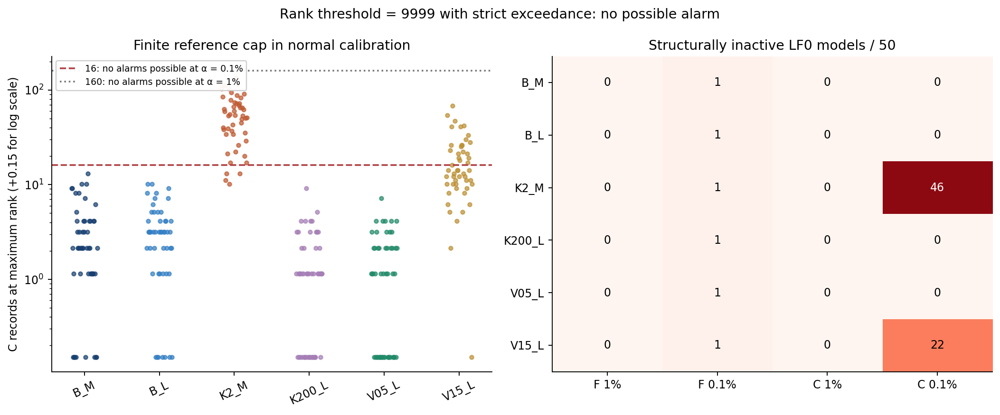

Figure S1. Concentration of normal calibration records at the rank cap and non-firing in the instrument-evaluation experiment. Post-hoc mechanism analysis of 50 replicates from a different experiment than Figure 4. In addition to the four groups in Table 5, B_M is the baseline source (κ=20 s⁻¹, variance ratio 1) with medium window T=2.048 s; V15_L has source variance ratio 1.5 (κ=20 s⁻¹) with long window T=8.192 s. Sampling interval and probe responses match Section 3.2. C denotes clean U in that experiment. Each experiment is aggregated over its own replicate units.

The [alarm-budget design analysis](numerics/analysis/pr0006_6f23fc7946f8_performance_v2/PR0006_BUDGET_REPORT_JA.md) gives allocation-specific gains and losses relative to LF0, and the [complete calibration tables](numerics/analysis/pr0012_64bf0f2c7697_confirmation_v1/ALL_CALIBRATIONS.md) cover all readout conditions in mixture–recovery confirmation. Allocations trade sensitivity between faults; W0 is the fixed comparison point used here.

### S3. Contamination, candidate audits, and A/U

The [mixture-composition design analysis](numerics/analysis/pr0010_9adfa7a8c6e0_mixture_v1/PR0010_MIXTURE_REPORT_JA.md) is a post-hoc analysis of instrument-evaluation data. It distinguishes exchanging components at fixed total contamination from retaining the same gain records and adding separate private-input fault records to the batch. These findings informed the frozen mixture–recovery confirmation conditions, whose [complete gate/support tables](numerics/analysis/pr0012_64bf0f2c7697_confirmation_v1/ALL_GATES_AND_SUPPORT.md) report all cases.

The [post-hoc mixture–recovery analysis](numerics/analysis/pr0012_64bf0f2c7697_exploration_v2/PR0012_EXPLORATORY_INSIGHTS_JA.md) describes decision differences between composition-matched A/U, sensitivity of accepted U, and cross-fault sensitivity of the P branch. Policies remain gated by A; applying a gate to U is a shadow evaluation.

### S4. Normal-validation resources and provenance

The [normal-validation sample-size analysis](numerics/analysis/pr0009_9adfa7a8c6e0_v_budget_v1/PR0009_V_BUDGET_REPORT_JA.md) is a post-hoc comparison of fixed subsets of 500–20,000 V records from the instrument-evaluation experiment. It assesses support, exceedance, and unresolved outcomes at each size and their correspondence to independent E.

Normal validation uses clean V corresponding to the source being evaluated. Normal V from before a source shift and V whose acquisition or inclusion depends on candidate selection have different provenance and are treated separately. Mixture–recovery confirmation fixed the V count and validation family, separating F/C evidence from policy performance. Testing the risk of fixed candidates with independent data and using the results for selection also connects to Learn then Test. [Angelopoulos et al., 2025](https://doi.org/10.1214/24-AOAS1998) Our validation targets are the F/C calibrations specified in Section 3.4. Sequentially increasing the sample size and stopping when support is obtained belongs to the extensions in Section 7.4.

The primary 13 contrasts use familywise Bonferroni adjustment at 0.05, separately from V's eight endpoints. For M01–M04, CP limits with each tail 0.05/(4×13) are formed for the two paired-discordance probabilities, then combined into difference bounds. R01 uses a CP interval with each tail 0.05/(2×13); the eight rate differences use paired t approximations with each tail 0.05/(2×13). A prespecified fallback for zero replicate standard deviation uses the difference range [−1,1] and the Hoeffding half-width \(\sqrt{2\log(2\times13/0.05)/50}\). Intervals are restricted to the possible ranges of the corresponding probabilities or differences. The [research plan](audits/prereg/PR-0012_mixture_recovery_confirmation.md) and [calibration/policy code](numerics/scripts/pr0012_methods.py) specify the rules and arithmetic.

### S5. Complete policy performance and path decomposition

The [complete policy tables](numerics/analysis/pr0012_64bf0f2c7697_confirmation_v1/ALL_POLICIES.md) provide absolute rates and paired gains/losses across all groups, candidates, and both α levels in mixture–recovery confirmation. The [complete exploratory tables](numerics/analysis/pr0012_64bf0f2c7697_exploration_v2/ALL_EXPLORATORY_RESULTS.md) give path contributions, accepted strata, A/U differences, and branch composition.

The [stopping–recovery policy design analysis](numerics/analysis/pr0011_9adfa7a8c6e0_recovery_v2/PR0011_STOP_RECOVERY_REPORT_JA.md) reuses the instrument-evaluation experiment's 50 replicates post hoc and constructs a recovery resource C0. Mixture–recovery confirmation instead uses independently acquired C. Each analysis remains linked to its data set, preserving this acquisition distinction. Primary R05 inference is in Table 14; its path-level explanation is in Section 6.4.

### S6. Mapping experiments to materials and the scope of reproduction

Experiment names in this paper map to reproducibility IDs as follows. IDs connect conditions, code, data, and analyses.

- **Instrument-evaluation experiment (PR-0009):** 50 outer replicates studying single-fault contamination, candidate auditing, and old-calibration FPR. Source of the post-hoc readout analysis in Section 4.1, fixed comparison in Section 5.1, and Figure S1.
- **Mixture–recovery confirmation experiment (PR-0012):** a separate 50 outer replicates studying mixed-sign cancellation and conditional recovery. Source of the primary 13, prespecified secondary analyses, and post-hoc path/accepted-stratum analyses of those same samples.
- **Mixture-composition and stopping–recovery design analyses (PR-0010/PR-0011):** post-hoc reuse of PR-0009 records to set mixture–recovery confirmation conditions.
- **Alarm-budget design analysis (PR-0006):** evidence on detection tradeoffs between allocations, used to select fixed W0.
- **M/CR complementarity analysis:** [ROC and long-window comparison](numerics/analysis/main_2ae37613a10478c8/ROC_AND_LONG_WINDOW_REPORT_JA.md), distinguishing post-hoc ROC at matched empirical FPR from operating points set by independent normal calibration.

Multiple analyses of the same experimental records are treated as shared-data analyses. Independence is defined by sample acquisition and reference/calibration/evaluation roles, rather than by the number of analysis names.

The [archive receipt](numerics/analysis/pr0012_64bf0f2c7697_confirmation_v1/receipt.json), [recomputation from saved statistics](numerics/analysis/pr0012_64bf0f2c7697_confirmation_v1/validation.json), and [separate-arithmetic-path check](numerics/analysis/pr0012_64bf0f2c7697_confirmation_v1/second_path_validation.json) document verification coverage for mixture–recovery confirmation, run ID 64bf0f2c7697. Retained evidence comprises second-order statistics, calibration and decision intermediates, aggregates, and logs; regeneration of all time-series waveforms is outside these checks. Technical preflight recorded two differing decision bits at CPU/GPU LF0 rank boundaries, classified as rounding-boundary uncertainty. Recomputing all decisions from saved statistics matched the saved outputs.

Primary-contrast estimates, intervals, and conclusions are in the [machine-readable table](numerics/analysis/pr0012_64bf0f2c7697_confirmation_v1/primary13.json). Statistical calculations, LF, and policies correspond to the [digital-statistics code](numerics/scripts/probe_backend_check_v1.py), [LF-weight code](numerics/scripts/pr0004_methods.py), and [calibration/policy code](numerics/scripts/pr0012_methods.py). Verification was author-side within the same research workflow, including checks through a separate arithmetic path. Third-party reproduction remains an independent validation task using the package.

## References

1. T. T. Georgiou, “The Structure of State Covariances and Its Relation to the Power Spectrum of the Input,” *IEEE Transactions on Automatic Control* **47**(7), 1056–1066 (2002). [DOI](https://doi.org/10.1109/TAC.2002.800643)
2. P. D. Gillespie, D. Gaida, P. C. Hung, R. J. Kee, and S. F. McLoone, “A Bias Compensated Cross-Relation Approach to Thermocouple Characterisation,” *IFAC-PapersOnLine* **49**(5), 43–48 (2016). [DOI](https://doi.org/10.1016/j.ifacol.2016.07.087) / [Author manuscript](https://pureadmin.qub.ac.uk/ws/portalfiles/portal/121129106/IFAC2016_v3.pdf)
3. S. Bates, E. Candès, L. Lei, Y. Romano, and M. Sesia, “Testing for Outliers with Conformal p-Values,” *The Annals of Statistics* **51**(1), 149–178 (2023). [DOI](https://doi.org/10.1214/22-AOS2244)
4. M. Bashari, M. Sesia, and Y. Romano, “Robust Conformal Outlier Detection under Contaminated Reference Data,” *Proceedings of the 42nd International Conference on Machine Learning*, PMLR **267**, 3091–3141 (2025). [Published version](https://proceedings.mlr.press/v267/bashari25a.html)
5. I. Gibbs and E. Candès, “Adaptive Conformal Inference Under Distribution Shift,” *Advances in Neural Information Processing Systems* **34** (2021). [Published version](https://papers.neurips.cc/paper_files/paper/2021/hash/0d441de75945e5acbc865406fc9a2559-Abstract.html)
6. C. K. Chow, “On Optimum Recognition Error and Reject Tradeoff,” *IEEE Transactions on Information Theory* **16**(1), 41–46 (1970). [DOI](https://doi.org/10.1109/TIT.1970.1054406)
7. F. Lin and M. R. Jovanović, “Least-Squares Approximation of Structured Covariances,” *IEEE Transactions on Automatic Control* **54**(7), 1643–1648 (2009). [DOI](https://doi.org/10.1109/TAC.2009.2017976)
8. M. Zorzi and A. Ferrante, “On the Estimation of Structured Covariance Matrices,” *Automatica* **48**(9), 2145–2151 (2012). [DOI](https://doi.org/10.1016/j.automatica.2012.05.057)
9. P. Hung, R. J. Kee, G. W. Irwin, and S. McLoone, “Blind Deconvolution for Two-Thermocouple Sensor Characterisation,” *Journal of Dynamic Systems, Measurement, and Control* **129**(2), 194–202 (2007). [DOI](https://doi.org/10.1115/1.2431814)
10. B. Picinbono, “On Deflection as a Performance Criterion in Detection,” *IEEE Transactions on Aerospace and Electronic Systems* **31**(3), 1072–1081 (1995). [DOI](https://doi.org/10.1109/7.395235)
11. Z. Quan, S. Cui, and A. H. Sayed, “Optimal Linear Cooperation for Spectrum Sensing in Cognitive Radio Networks,” *IEEE Journal of Selected Topics in Signal Processing* **2**(1), 28–40 (2008). [DOI](https://doi.org/10.1109/JSTSP.2007.914882)
12. X. Tong, Y. Feng, and J. J. Li, “Neyman–Pearson Classification Algorithms and NP Receiver Operating Characteristics,” *Science Advances* **4**(2), eaao1659 (2018). [DOI](https://doi.org/10.1126/sciadv.aao1659)
13. C. J. Clopper and E. S. Pearson, “The Use of Confidence or Fiducial Limits Illustrated in the Case of the Binomial,” *Biometrika* **26**(4), 404–413 (1934). [DOI](https://doi.org/10.1093/biomet/26.4.404)
14. A. N. Angelopoulos, S. Bates, E. J. Candès, M. I. Jordan, and L. Lei, “Learn then Test: Calibrating Predictive Algorithms to Achieve Risk Control,” *The Annals of Applied Statistics* **19**(2), 1641–1662 (2025). [DOI](https://doi.org/10.1214/24-AOAS1998)
15. E. Y. Chow and A. S. Willsky, “Analytical Redundancy and the Design of Robust Failure Detection Systems,” *IEEE Transactions on Automatic Control* **29**(7), 603–614 (1984). [DOI](https://doi.org/10.1109/TAC.1984.1103593)
