# 一次プローブの整合性監査における読出しと校正更新の検証

## 源統計変化・校正汚染下での誤警報、検出感度、判定提供率

Kentaro Sato  
日本語原稿 v5／2026年10月19日  
論文ライセンス：[CC BY 4.0](LICENSE-CC-BY-4.0.txt)

## 要旨

同じ入力を測る複数のセンサーでは、応答時間の違いによって正常な記録にも差が生じる。物理モデルに基づく残差はこの差を扱う手掛かりとなる。有限記録から警報を作るには、さらに正常時の揺らぎに合わせた閾値校正が要る。源統計の変化に対応して閾値を更新する際、候補へ故障記録が混入すると、誤警報の減少と検出感度の低下が同時に起こり得る。本研究は、校正済み一次プローブ対について、符号付きモーメント残差、交差関係残差、その固定線形融合を用い、読出し、更新候補の監査、採用校正の正常時検証を分離した評価手順を構成する。一次応答モデルの解析、シミュレーションによる機序評価、および参照・校正・評価を一式取り直す50反復の確認実験を通じて、三点を示す。第一に、警報までの中間表現を保存すると、有限順位の上端で警報が止まる現象を追跡できる。直接校正はこの制約を回避する条件がある一方、逆向きの検出損失もある。第二に、正負ゲイン混入は平均残差で相殺し得る。一方のプローブだけに加わる独立信号である私的入力を混ぜると、候補閾値の採用を保留しやすくなるが、その候補から作った校正の感度はさらに低下し得る。第三に、独立正常標本に基づく判定停止・回復では、誤警報の根拠、検出感度、判定を提供できる割合が別々に変わる。主回復条件では50反復中45反復で清浄校正を採用して判定を提供したが、未判定10%が残った。旧校正を使い続ける政策に比べ、正負ゲインの全件検出率は低下し、私的入力の全件検出率の差は多重比較調整後も未解決だった。本研究は、これらの判断を追跡できる検査手順を具体化し、指定条件下でその利益と費用を分離して検証する。

**キーワード**：一次応答、共分散整合性、交差関係、線形融合、校正汚染、誤警報率、判定保留

## 1. 序論

### 1.1 同じ入力に対する応答時間の違い

応答速度の異なる二つのセンサーで、同じ時間変動を測る場面を考える。ゆっくりした変動には両者とも追従するが、速い変動は応答の遅い側で強く抑えられる。そのため、出力の振幅、分散、同時刻の相関は正常でも異なる。共通入力の変動が速くなっただけでも、この差は変わる。記録同士の距離や相関を故障指標として用いるには、入力条件と応答速度による変化を区別する必要がある。

本稿が問うのは、二つの出力が既知の応答モデルと共通入力という説明に整合するかどうかである。一次遅れはこの問題を具体化する最小モデルとなる。応答時間を明示でき、未知入力を消去した関係と、出力の二次統計に課される制約を同時に扱える。二熱電対を用いた動的温度計測では、こうした共通入力の関係を応答同定に使い、測定雑音のバイアスを補償する研究がある。[Hungら, 2007](https://doi.org/10.1115/1.2431814)、[Gillespieら, 2016](https://doi.org/10.1016/j.ifacol.2016.07.087)

本稿では応答パラメータは独立に校正済みとし、出力記録から整合性を監査する問題を扱う。「正常」は共通入力、プローブ応答、取得雑音に対するモデルで定義する。共通入力の相関時間や分散の変化は、応答と取得雑音の条件が保たれる限り、正常な源変化として扱う。検出対象は一方の信号ゲインの変化と私的入力の付加である。私的入力は、一方のプローブだけに加わる、共通入力とは独立な追加信号を指す。この測定対象の設定により、正常な環境変化を許容することと、故障を正常として取り込むことを分けて考えられる。

### 1.2 物理的な残差から、信頼できる警報まで

共通入力を消去できれば、未知の波形やスペクトルを逐一復元せずに残差を作れる。残差の生成と、それに基づく判断を分ける構成は、解析的冗長性を用いた故障診断の基本となっている。[Chow・Willsky, 1984](https://doi.org/10.1109/TAC.1984.1103593) 正常な残差も有限窓では揺らぎ、その分布や裾は入力統計、取得雑音、窓長に依存する。固定閾値での誤警報率を定めるには、物理関係に加えて、この有限窓の揺らぎを校正する必要がある。

本研究では、モーメント法Mと交差関係法CRを、異なる整合性を測る二つの計器として扱う。Mは分散と共分散の釣り合いを、CRは相手側の応答を追加した二つの時系列の一致を測る。さらに、両者の符号付き残差を、正常時の揺らぎと物理的な故障応答方向を使って線形融合する。このLF（linear fusion）によって得たスコアを、順位または直接閾値で警報へ変える。

この段階分けによって、非発火の原因を具体的に調べられる。警報が出ないとき、残差に変化がないのか、射影で区別が失われたのか、有限順位と閾値の組合せが発火を不可能にしたのかでは、点検すべき対象が違う。最終警報だけでなく、中間の連続値、符号、順位、枝別発火を保持することで、この違いを調べられる。

### 1.3 校正を更新することにも、戻すことにも根拠が要る

本稿で更新するのは警報閾値である。プローブの応答パラメータは独立な校正値に、LFの重み・中心・順位参照は基準源の正常記録から作った値に固定する。その上で、源条件に合わせて閾値を作り直す。この役割分担によって、物理応答や融合則を保ったまま、警報の校正と更新判断が及ぼす影響を調べる。

源統計が変わったとき、最近の正常記録で閾値を更新するのは自然である。しかし、候補記録が故障を含んでいれば、検出したい変化を校正側が吸収する可能性がある。警報の減少には、誤警報の抑制と必要な検出の損失という二つの側面があり、それぞれを測る必要がある。汚染された参照による保守的な第一種過誤と検出力損失は、conformal外れ値検出でも分析されている。[Bashariら, 2025](https://proceedings.mlr.press/v267/bashari25a.html)

候補監査での保留は、その候補閾値の採用を差し止める判断である。その後に使う校正や判定を提供するかどうかは、別の政策で選ぶ。基準となる源条件で作成し、源変化後も保持する校正を、以下では旧校正Fと呼ぶ。源統計が変化すると、Fの誤警報率も変わり得る。旧校正で継続する、根拠が不足すれば判定を止める、独立した清浄校正へ回復する、という選択は異なる費用を持つ。停止時には正常・故障の両方に対して判定が未提供となる。

そこで本稿は、候補の採否、実際に使う校正の誤警報率、故障検出感度、判定を提供できる割合を別々に測る。独立した正常確認データと清浄な回復校正を利用可能な資源として与え、確認できる性質と運用上の費用を明らかにする。

### 1.4 関連研究と本研究の位置

本研究は、状態共分散の構造制約に基づくMと、入力消去に基づくCRを二つの符号付き統計量として構成する。状態共分散の理論と有限標本からの構造化共分散推定がMの土台となり、二熱電対の応答同定で用いられる交差関係をCRへ用いる。[Georgiou, 2002](https://doi.org/10.1109/TAC.2002.800643)、[Lin・Jovanović, 2009](https://doi.org/10.1109/TAC.2009.2017976)、[Zorzi・Ferrante, 2012](https://doi.org/10.1016/j.automatica.2012.05.057)、[Gillespieら, 2016](https://doi.org/10.1016/j.ifacol.2016.07.087)

LFには、正常時の分散に対する平均変化を大きくするdeflection最大化を用いる。[Picinbono, 1995](https://doi.org/10.1109/7.395235) 複数の局所統計量の線形融合は、たとえば協調スペクトル検出にも用いられている。[Quanら, 2008](https://doi.org/10.1109/JSTSP.2007.914882) 本稿では、M/CRの故障応答方向を物理モデルから求め、正常参照だけで重みを構成する。次に、有限正常標本による順位・順序統計量の校正と、固定した校正に対する独立なリスク確認を分けて評価する。[Batesら, 2023](https://doi.org/10.1214/22-AOS2244)、[Tongら, 2018](https://doi.org/10.1126/sciadv.aao1659)、[Angelopoulosら, 2025](https://doi.org/10.1214/24-AOAS1998)

校正更新は、汚染参照による検出力損失、分布変化への適応、棄却による誤りとの交換にも接続する。[Bashariら, 2025](https://proceedings.mlr.press/v267/bashari25a.html)、[Gibbs・Candès, 2021](https://papers.neurips.cc/paper_files/paper/2021/hash/0d441de75945e5acbc865406fc9a2559-Abstract.html)、[Chow, 1970](https://doi.org/10.1109/TIT.1970.1054406) 本稿の対象は、一次プローブの閾値更新と、保留後にどの校正で判定を提供するかというバッチ単位の選択である。その成績を、正常時の誤警報、故障感度、判定提供率で測る。

**表1　検査の各段階と評価対象。**

| 段階 | 用いる関係・手順 | 本稿で具体的に測る対象 |
|---|---|---|
| 物理残差M/CR | 状態共分散制約、交差関係、雑音対照 | 固定応答に対する符号付き残差と、候補監査への利用 |
| 線形読出しLF | 正常共分散と物理的故障応答方向 | 二座標から警報へ至る情報表現と判定領域 |
| 有限正常標本による校正 | 所定の交換可能性等の下での誤り制御 | 順位上端、直接校正、独立正常確認との相違 |
| 校正汚染 | 保守化と検出力損失、清浄化 | 正負混合・私的入力追加と、採用先ごとの交差損失 |
| 適応・判定保留 | 時変分布への適応、誤りと棄却の交換 | 源変化後の旧校正・独立回復・未判定の会計 |

本研究の貢献は、物理統計量から閾値更新後の判定までを追跡できる検査手順を構成し、同じ実験系で判断が食い違う条件と費用を検証することにある。三つの問いを置く。

- **C1：読出しの監査。** 残差から警報までのどの段で判定が変わるかを、保存された中間量から追跡できるか。
- **C2：候補と採用校正の分離。** 更新候補を見つけられることは、実際に使う校正の誤警報と感度をどこまで説明するか。
- **C3：誤警報根拠・感度・提供率の分離。** 停止・回復は何を救い、どの検出と判定機会を失うか。

第2節で計器を導出し、第3節でデータの役割と推論を定める。第4–6節がそれぞれC1–C3を扱い、第7節で適用範囲をまとめる。

## 2. 方法：物理的な整合性を、警報へ読み出す

### 2.1 記録モデルと二次モーメント

共通のゼロ平均入力 \(x_t\) を受けるデジタル一次応答を

\[
y_{\ell,t}=a_\ell y_{\ell,t-1}+b_\ell x_t,\qquad
a_\ell=e^{-\Delta/\tau_\ell},\qquad b_\ell=1-a_\ell,\quad
0<a_\ell<1,\quad \ell\in\{i,j\}
\tag{1}
\]

とする。\(\Delta\) は標本間隔、\(\tau_\ell\) は既知の応答時間である。前時刻の値を \(a_\ell\) だけ保持し、時点tの入力を \(b_\ell\) だけ取り込むので、応答時間が異なれば同じ入力に対する波形も異なる。本研究の対象は式(1)で指定したデジタル一次応答である。モデル、校正、推論に共通する前提と適用範囲は補足S0にまとめる。

観測を \(u_{\ell,t}=y_{\ell,t}+n_{\ell,t}\) とする。取得雑音はゼロ平均で信号と独立とし、対応する独立雑音対照を \(c_{\ell,t}\) とする。本実験のnとcは、各チャンネルで同じ分散を持つガウス白色雑音の別実現であり、チャンネル間・時点間・観測と対照の間で独立に生成する。この対応によって、対照は観測雑音の二次モーメントの平均寄与を表し、同じフィルタを施した後の寄与にも使える。長さNの窓平均を \(\langle v\rangle_N=N^{-1}\sum_{t=1}^N v_t\) とし、

\[
\widehat V_\ell=\langle u_\ell^2\rangle_N-\langle c_\ell^2\rangle_N,\qquad
\widehat C_{ij}=\langle u_i u_j\rangle_N-\langle c_i c_j\rangle_N
\tag{2}
\]

を計算する。帽子は有限記録からの推定値を表し、\(V_\ell=E[y_\ell^2]\)、\(C_{ij}=E[y_i y_j]\) は母量とする。既知ゼロ平均を使い、窓内の生の二次モーメントを計算する。雑音対照との差は有限標本では負になり得るため、その符号を保ったまま残差へ渡す。

**表2　主な記号と判断の単位。**

| 記号 | 意味 |
|---|---|
| \(x,y,u,c\) | 共通入力、信号出力、観測記録、独立雑音対照 |
| N、T=NΔ | 一記録の時点数と評価窓長 |
| \(V_i,V_j,C_{ij}\) | 信号の母分散・母共分散 |
| \(q_M,q_C\) | 一記録の符号付きM・CR残差 |
| \(s_g,s_p\) | 固定LFの二つの符号付き射影 |
| \(m_A,m\) | 候補監査バッチの記録数、閾値校正の記録数 |
| F、U、C | 旧校正、候補校正、清浄回復校正の文脈ID |
| \(\mathcal D_C\) | 回復校正に使うデータ。共分散 \(C_{ij}\) と区別 |
| α、FPR | 公称警報予算、正常時の実際の誤警報確率／その経験推定 |

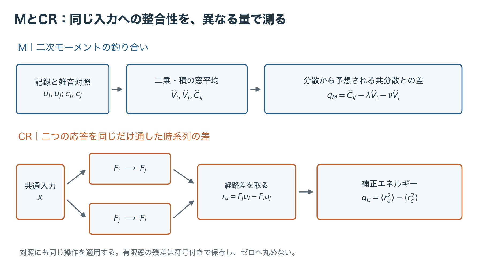

図1　MとCRが比較する対象の概念模式図。上段は二次モーメントの釣り合い、下段の二経路は信号に対する理想関係を示す。実計算では各プローブ後に取得雑音を含む観測を使い、雑音対照にも同じ操作を行う。

### 2.2 モーメント法M：分散から予想される共分散との差

Mは、一次応答の状態共分散制約を、分散と共分散の釣り合いとして用いる。[Georgiou, 2002](https://doi.org/10.1109/TAC.2002.800643)、[Zorzi・Ferrante, 2012](https://doi.org/10.1016/j.automatica.2012.05.057) 共通入力のスペクトルを陽に推定せずに残差を作れる理由を、式(1)から確かめる。定常性と有限二次モーメントを仮定し、\(V_x=E[x_t^2]\)、\(L_\ell=E[y_{\ell,t-1}x_t]\) と置く。二乗と積の期待値を取ると、

\[
\begin{aligned}
(1-a_i^2)V_i&=2a_i b_i L_i+b_i^2V_x,\\
(1-a_j^2)V_j&=2a_j b_j L_j+b_j^2V_x,\\
(1-a_i a_j)C_{ij}&=a_i b_jL_i+a_j b_iL_j+b_i b_jV_x.
\end{aligned}
\tag{3}
\]

最初の二式で \(L_i,L_j\) を消去すると、三式目の入力分散の項も打ち消される。したがって、

\[
C_{ij}=\lambda V_i+\nu V_j,\qquad
\lambda=\frac{(1+a_i)(1-a_j)}{2(1-a_i a_j)},\quad
\nu=\frac{(1+a_j)(1-a_i)}{2(1-a_i a_j)},\quad
\lambda+\nu=1.
\tag{4}
\]

この式に測定値を代入して、

\[
q_M=\widehat C_{ij}-\lambda\widehat V_i-\nu\widehat V_j
\tag{5}
\]

を得る。正の値は、出力分散から予想する量より共分散が大きいこと、負の値は小さいことを示す。符号が表すのは、この不均衡の向きである。

式(4)は有限二次モーメントを持つ定常入力に成立する母量の関係である。有限窓の式(5)はその周囲で揺らぎ、幅と裾は源統計に依存する。この揺らぎを正常記録で校正して、警報閾値を定める。

Mは窓内の二次モーメントへ情報を縮約する。全系列の時点を同じ順序で並べ替えても式(2)は変わらないので、時間配置の違いをこの統計だけで復元できない。この性質が、時間方向の関係を使うCRを併用する理由となる。

### 2.3 交差関係法CR：同じ二つの応答を通った経路を比べる

\(F_\ell\) を式(1)のフィルタとする。交差関係による入力消去に従い、i側の出力へj側のフィルタを、j側の出力へi側のフィルタを追加する。[Gillespieら, 2016](https://doi.org/10.1016/j.ifacol.2016.07.087) 履歴と初期化が適合する理想条件では、線形畳込みの順序を交換できるため、

\[
F_jy_i=F_jF_ix=F_iF_jx=F_iy_j.
\tag{6}
\]

両方の出力を同じ二段の応答へそろえることで、共通入力への応答を比較できる。観測と対照でそれぞれ交差残差を作り、

\[
r_u=F_ju_i-F_iu_j,\quad r_c=F_jc_i-F_ic_j,\qquad
q_C=\langle r_u^2\rangle_N-\langle r_c^2\rangle_N
\tag{7}
\]

と定義する。CRはcross-relation、すなわち交差関係を指す。入力消去誤差を \(e=F_i^{-1}y_i-F_j^{-1}y_j\) と形式的に書けば \(r=F_iF_je\) である。実装には順方向の交差フィルタを用いる。

理想式(6)と、有限記録への適用は区別する。本実験の追加CRフィルタは取得区間でゼロ初期化し、先頭の \(w=\lceil20\max(\tau_i,\tau_j)/\Delta\rceil\) 時点を除いたN時点を集計する。本条件ではw=400、0.8 sのウォームアップに相当し、式(2)のモーメントも同じ評価区間を用いる。有限ウォームアップ後の過渡も、正常時の残差に含めて扱う。また、式(7)は二つのエネルギーの差であり負にもなり得る。LFでは正常参照から推定した平均を使って中心化する。

CRは時間的な不一致を測る一方、交差フィルタが抑える周波数の不一致には弱くなり得る。二乗平均にすると残差波形の符号・出現時刻・周波数別の位置も失われる。MとCRは、このように保持する情報が異なる二つの縮約として併用する。

**表3　二つの残差の役割。**

| | M | CR |
|---|---|---|
| 比較する対象 | 分散から予想する共分散と観測共分散 | 相手側の応答を追加した二つの時系列 |
| 正常関係の根拠 | 一次再帰と定常二次モーメント | フィルタの順序交換 |
| 保持する情報 | 二次モーメントの符号付き不均衡 | 帯域制限された不一致の補正エネルギー |
| 縮約する情報 | 窓内の時間配置 | 残差の符号、時刻、周波数別配置 |

### 2.4 故障モデルから二座標の応答方向を求める

同じ記録から得る \(q=(q_M,q_C)^{\mathsf T}\) は、正常時にも相関する。単に足すと、単位や揺らぎの大きい側が支配し得る。LFの重みを定めるため、まず物理的な変化が二座標をどちらへ動かすかを調べる。

j側の信号にゲイン変化δと、独立な同統計コピー \(y'_j\) の私的入力を加え、

\[
y_j\longmapsto(1+\delta)y_j+\sqrt h\,y'_j,\qquad h\geq0
\tag{8}
\]

と表す。hは私的入力の分散比である。取得雑音はその後に加え、絶対量を固定する。式(8)は二つの作用をまとめて表す。評価条件はゲイン故障と私的入力故障に分け、それぞれを生成する。

Mでは、共分散が \((1+\delta)C_{ij}\)、j分散が \(((1+\delta)^2+h)V_j\) となる。正常平均からの変化は、

\[
\Delta E[q_M]
=\delta(C_{ij}-2\nu V_j)-(\delta^2+h)\nu V_j.
\tag{9}
\]

CRでは \(A=F_jy_i\)、\(B=F_iy_j\) とし、有限初期化と評価窓を含む正常時の量を
\(P_i=E[\langle A^2\rangle_N]\)、\(P_j=E[\langle B^2\rangle_N]\)、\(P_{ij}=E[\langle AB\rangle_N]\)
と置く。残差二乗を展開すると、

\[
\Delta E[q_C]
=2\delta(P_j-P_{ij})+(\delta^2+h)P_j.
\tag{10}
\]

したがって、

\[
\Delta E[q]=\delta d_g+(\delta^2+h)d_p,\quad
d_g=\begin{pmatrix}C_{ij}-2\nu V_j\\2(P_j-P_{ij})\end{pmatrix},\quad
d_p=\begin{pmatrix}-\nu V_j\\P_j\end{pmatrix}.
\tag{11}
\]

\(d_g\) はゲインの一次方向、\(d_p\) は私的入力とゲイン二次項が共有する方向である。理想的に \(A=B\) なら \(P_i=P_j=P_{ij}=P\) となり、CRのゲイン一次項は消えて \((\delta^2+h)P\) が残る。一方、Mには一般に一次項が残る。この一次項と二次項の違いが、感度の相補性を理解する手掛かりとなる。

式(11)は正負ゲインの非対称性も説明する。δの符号を反転すると一次項だけが反転し、二次項は同じ向きへ加わる。そのため、符号付き射影の段階から正負の応答に非対称性が生じ得る。また、同じ強度の正負故障を候補バッチ内に均衡して混ぜれば、平均の一次項は相殺しても二次項は残る。この二次方向の情報が、混合を調べるもう一つの手掛かりとなる。

### 2.5 LF：正常時の揺らぎを考慮した線形読出し

LFは二座標の変化を、正常時の分散と相関に照らして読む。各枝fのスコアは、

\[
s_f=w_{f,M}(q_M-\widehat\mu_M)+w_{f,C}(q_C-\widehat\mu_C)
=w_f^{\mathsf T}(q-\widehat\mu_0),\quad f\in\{g,p\}.
\tag{12}
\]

正常参照Rから \(\widehat\mu_0\)、二座標の標本共分散 \(\widehat\Omega_0\)、式(11)の \(\widehat d_f\) を推定する。方向に必要な \(V_j,C_{ij},P_j,P_{ij}\) も、Rの雑音補正モーメントから求める。重みの推定に使う情報は、正常参照Rの記録と既知のプローブ応答である。

重みは、線形検出器のdeflection最大化によって定める。[Picinbono, 1995](https://doi.org/10.1109/7.395235) 母共分散が正定値のとき、方向 \(d_f\) への平均変化の二乗を正常時の射影分散で割った比は、

\[
D_f(w)=\frac{(w^{\mathsf T}d_f)^2}{w^{\mathsf T}\Omega_0w}
\leq d_f^{\mathsf T}\Omega_0^{-1}d_f.
\tag{13}
\]

分子を
\(\{(\Omega_0^{1/2}w)^{\mathsf T}(\Omega_0^{-1/2}d_f)\}^2\)
と書き、Cauchy–Schwarzを適用すればよい。等号方向は \(w\propto\Omega_0^{-1}d_f\) である。正常時によく揺れる成分や、もう一方から予測できる成分の寄与を調整し、故障方向を正常変動に対して測る重みとなる。

有限Rでは固定の縮小を施し、

\[
\widehat\Omega_\varepsilon
=(1-\varepsilon)\widehat\Omega_0+
\varepsilon\operatorname{diag}(\widehat\Omega_0),\quad
w_f=\frac{\widehat\Omega_\varepsilon^{-1}\widehat d_f}
{\sqrt{\widehat d_f^{\mathsf T}\widehat\Omega_\varepsilon^{-1}\widehat d_f}},
\quad\varepsilon=10^{-6}
\tag{14}
\]

を使う。diagは対角だけを残す行列である。ゼロ方向の枝を無効化し、非ゼロの方向は強度によらず保持する。重みと中心は源変化後も固定する。

式(13)で最大化する量は、平均変化の二乗と正常分散の比である。実際の警報には有限標本から得るスコア分布を用い、次節の正常校正で閾値を定める。

二つの符号付き射影を一組として保存すれば、重み行列Wがランク2のとき \(q=\widehat\mu_0+W^{-1}s\) と逆変換できる。一つの射影へ縮約する操作に対し、ランク2の二射影の組は二座標の情報を保つ座標変換となる。

### 2.6 同じLFを、順位と直接閾値で読む

LF0は、正常参照Rに対する \((|s_g|,s_p)\) の左挿入順位を使う。\(z_{g,R}=|s_{g,R}|\)、\(z_{p,R}=s_{p,R}\) として、

\[
r_f(z)=\#\{z_{f,R}<z\},\qquad
L=\max\{r_g(|s_g|),r_p(s_p)\},\qquad
\mathrm{alarm}\iff L>t_L.
\tag{15}
\]

独立正常校正標本でLの上側閾値を決める。各順位は0から \(n_R\) の整数なので、\(t_L=n_R\) になると、全ての評価スコアが非発火となる。この上端と比較規則の結合が、後に調べる構造的非発火である。

固定配分の直接校正W0は、同じ射影に三つの閾値を置く。

\[
\mathrm{alarm}\iff
s_g>t_+\ \lor\ -s_g>t_-\ \lor\ s_p>t_p,\qquad
(\alpha_+,\alpha_-,\alpha_p)=(\alpha/4,\alpha/4,\alpha/2).
\tag{16}
\]

G+、G−、Pの三枝が発火したかを保存し、最後にORで単一警報にする。配分1:1:2は設計用シミュレーションの所見に基づき、評価実験のデータ生成前に固定した。Pは式(11)の私的入力とゲイン二次項が共有する応答方向を表す。

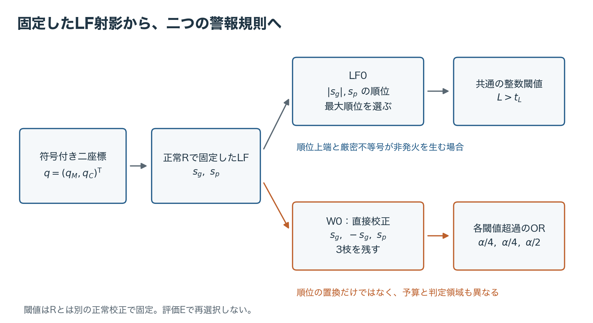

図2　残差から射影までを共有しても、読出しで判定領域は変わる。LF0は絶対ゲイン順位とP順位を共通の最大順位へまとめる。W0は正負ゲインを分け、固定予算で三閾値を校正する。両者はスコアの表現と警報予算の割当てが異なる。模式図。

各枝の正常校正値m件を昇順に並べ、

\[
k_b=\lceil(m+1)(1-\alpha_b)\rceil,\qquad
t_b=\begin{cases}z_{(k_b)},&k_b\leq m,\\+\infty,&k_b>m,\end{cases}
\qquad \mathrm{alarm}\iff z>t_b
\tag{17}
\]

とする。同値では発火しない。LF0のLにも同じ順序統計の校正を用いる。Rと規則を固定した下で、正常校正と次の正常記録が交換可能なら、各枝の周辺誤警報確率は予算以下となり、枝の独立性を仮定せず合併上界からORの確率もα以下となる。これは校正標本の偶然性を含む周辺誤警報確率に対する保証である。[Batesら, 2023](https://doi.org/10.1214/22-AOS2244) 正常ホールドアウトと順序統計量を用い、第一種過誤を高確率で制御するNP校正も研究されている。[Tongら, 2018](https://doi.org/10.1126/sciadv.aao1659) 本稿では式(17)で閾値を作成し、個々の固定校正のFPRを第3節の独立正常確認で評価する。

直接校正も \(\alpha_b<1/(m+1)\) では無限大の閾値となる。有限校正標本の分解能と、LF0固有の有限参照順位上端は別の制約である。

### 2.7 候補バッチの監査は、単窓の警報と別の判断である

ここからは、一記録に警報を出す判断から、多数の記録を閾値更新に採用するかという判断へ移る。候補取得過程を監査するバッチAを用意し、その平均的な残差を使う。採否は同じ過程から別に取得した閾値作成用バッチUへ引き継ぐ。\(m_A\) はAの記録数であり、各記録の時点数Nとは異なる。A/Uの組成と分離は第3.1節に示す。

\[
T_M=\sqrt{m_A}\frac{|\overline q_M|}{\widehat{\mathrm{SD}}_A(q_M)},\qquad
T_C=\sqrt{m_A}\frac{\overline q_C}{\widehat{\mathrm{SD}}_A(q_C)},\qquad
G\text{-M}:T_M,\quad G\text{-MC}:\max(T_M,T_C).
\tag{18}
\]

ゲートはそれぞれ、設計用正常バッチのスコア最大値として固定した閾値を厳密に超えたとき候補を保留する。この基準は開発標本を全て通過させる設定であり、単記録の警報予算αとは別に定める。用いた源条件と閾値を第3.3節に示す。二ゲートの閾値は別なので、G-Mだけが保留する場合と、G-MCだけが保留する場合の両方があり得る。

ここでは \(|\overline q_M|\) と \(\overline{|q_M|}\) が違うことが重要である。同じ大きさの正負値の平均はゼロになっても、絶対値の平均はゼロにならない。式(18)は前者を見るため、正負混入の平均相殺が起こり得る。主読出しW0の一記録警報は正負を分けた枝のOR、候補監査はバッチ平均に対する検査として役割を分ける。無効値や標準偏差ゼロは技術的な無効状態として別計上する。

## 3. 評価設計：何で規則を作り、何で成績を測るか

### 3.1 データの役割と独立性

一記録はN時点からなる測定窓であり、一つのM/CR残差対と警報を与える。一バッチは、そのような記録を多数集めたもので、候補監査や閾値校正に使う。一外側反復は、参照・校正・候補・正常確認・最終評価の一式を取り直す単位である。各反復・源群・候補・公称α・政策について採用校正または停止を一度決め、対応するEの全記録へ適用する。

本文で報告する数値結果は、目的の異なる二つの実験に基づく。**計器評価実験**は50外側反復からなり、単独故障の校正混入、候補監査、旧校正の誤警報率を評価する。この実験には事前固定の比較と、取得したデータを用いる読出し構造の事後解析がある。**混合・回復確認実験**も50外側反復からなり、正負ゲインの混合相殺、私的入力追加、停止・回復の交換を評価する。再現資料の識別子はそれぞれPR-0009、PR-0012である。

混合・回復確認実験の条件と主対比は、計器評価実験および設計用解析の所見に基づいて定め、その標本を生成する前に固定した。両実験は別々の乱数系列で取得する。設計用解析を含む資料の対応は補足S6に示す。

以下の第3節と第5.2–6節は、混合・回復確認実験の設計と結果を扱う。第4.1節の読出し構造と第5.1節の単独混入には、計器評価実験の結果を用いる。各反復で正常参照、校正、候補監査、正常確認、最終評価を分離し、同じ反復の各方式には共通のEを適用して得失を比較する。

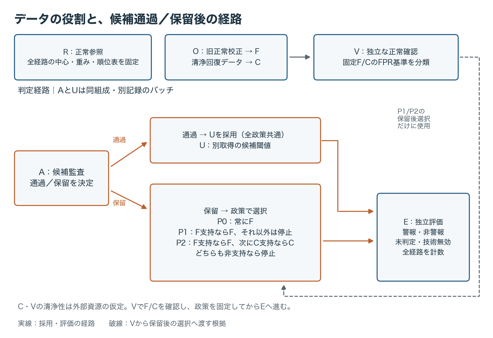

図3　規則を作るデータと評価するデータの分離。候補からの経路は「A通過→U採用→E評価」と「A保留→政策別のF/C/DEFER選択→E評価」に分かれる。保留時のP0はFへ戻り、P1/P2はVによるF/Cの根拠に従って選ぶ（表7）。Vが確認する対象は固定F/C、Eが測る対象は通過Uを含む各採用経路の成績である。CとVの清浄性は外部から与える資源仮定。模式図。

**表4　混合・回復確認実験の各反復でのデータ役割。件数は記録数。**

| 役割 | 件数 | 用途と分離 |
|---|---:|---|
| R：正常参照 | 窓長ごと9,999 | 基準源でLF中心・重み・順位表を固定 |
| O：旧正常校正 | 窓長ごと15,999 | Rとは別取得。旧閾値Fを作る |
| A：候補監査 | 群・候補ごと15,999 | G-M/G-MCの通過・保留を決める |
| U：更新校正候補 | 群・候補ごと15,999 | Aと同組成・別記録・別配置順序で候補閾値を作る |
| \(\mathcal D_C\)：清浄回復校正 | 群ごと15,999 | clean Uとも別取得。現在源の閾値Cを作る |
| V：正常確認 | 群ごと20,000 | 固定済みF/Cの誤警報根拠を評価 |
| E：最終評価 | 群ごと正常20,000、各故障5,000 | 規則や閾値を選び直さず、FPR・検出・提供を測る |

Aは候補取得過程の監査用バッチ、Uは同じ過程から別に得た閾値作成用バッチである。AとUには同じ正常・故障組成を設定し、Aの採否をUの採用へ引き継ぐ。この設計は、別の有限バッチへ判断を移す際の変動も評価に含める。

A内、U内では、候補同士で正常プール・故障プールを計画通り共有して対応比較を作る。AとUの役割間は独立に取得する。F/Cの閾値を固定してからVを評価し、政策選択の保存後にEを生成した。Eは固定済みの閾値・射影・配分・政策の性能評価に専用する。

### 3.2 源、応答、取得雑音、故障

源は定常OUの標本列に対応するAR(1)、

\[
x_t=\phi x_{t-1}+\sqrt{v_x(1-\phi^2)}\,\xi_t,\qquad
\phi=e^{-\kappa\Delta},\qquad \xi_t\stackrel{\mathrm{iid}}{\sim}N(0,1)
\tag{19}
\]

とする。信号プローブと源を同時定常分布から初期化する。標本間隔は0.002 s、応答時間は \(\tau_i=0.04\) s、\(\tau_j=0.01\) sである。基準源は \(\kappa=20\ {\rm s}^{-1},v_x=1\)。各チャンネルの独立なガウス取得雑音分散は、基準源での信号分散の10%に固定し、源変化後も絶対量を変えない。したがって源変化は相対SNRも変え得る。

**表5　混合・回復確認実験の四源群。**

| 群 | 説明 | κ (s⁻¹) | 源分散比 | 窓T (s) | N |
|---|---|---:|---:|---:|---:|
| B_L | 基準源・長窓 | 20 | 1 | 8.192 | 4,096 |
| K2_M | 遅い源・中窓 | 2 | 1 | 2.048 | 1,024 |
| K200_L | 速い源・長窓 | 200 | 1 | 8.192 | 4,096 |
| V05_L | 源分散半分・長窓 | 20 | 0.5 | 8.192 | 4,096 |

参照Rと旧校正Oは中窓・長窓それぞれの基準源で取得する。故障はj側信号の−5%ゲイン（GM05）、+5%ゲイン（GP05）、信号分散比2%の独立私的入力（P02）である。私的入力は同じ源統計とj応答を通し、振幅 \(\sqrt{0.02}\) 倍で加える。ゲイン故障の作用点は信号部分であり、取得雑音の絶対量は固定する。

**表6　候補バッチの組成。残りは現在源の正常記録。**

| 候補 | 負ゲイン件数 | 正ゲイン件数 | 私的入力件数 | 総混入件数 |
|---|---:|---:|---:|---:|
| clean | 0 | 0 | 0 | 0 |
| GM800 | 800 | 0 | 0 | 800 |
| GP800 | 0 | 800 | 0 | 800 |
| BAL800 | 400 | 400 | 0 | 800 |
| BAL400 | 200 | 200 | 0 | 400 |
| TRI800 | 200 | 200 | 400 | 800 |

候補の混合は、異なる故障記録をバッチ内に混在させて構成する。TRI800はバッチサイズとBAL400のゲイン記録・位置を保持し、正常記録400件を私的入力故障記録へ置換する。私的入力追加の対照は、同じゲイン記録を含むBAL400である。故障強度の2%と、候補内の故障記録割合も区別する。

### 3.3 固定した読出し、ゲート、三政策

主読出しはW0、補助対照はLF0、主水準はα=1%、低水準の指定副分析は0.1%とする。G-MCを主候補ゲート、G-Mを相殺機序の対照とする。ゲートの設計標本は正常25反復・六源群からなり、中窓のB_M/K2_Mの2群、長窓のB_L/K200_L/V05_L/V15_Lの4群について、窓長・ゲート別に全スコアの最大を取った。B_Mは基準源の中窓、V15_Lはκ=20 s⁻¹・源分散比1.5の長窓で、その他の条件は表5に対応する。固定閾値は中窓でG-M/G-MCとも2.3338904456、長窓で2.4547144557／3.0310874379である。開発標本の閲覧後にこの基準を採用し、計器評価実験と混合・回復確認実験のデータ生成前に固定した。各実験での正常誤保留と混入保留を、固定したゲートの成績として測る。

候補監査の採否と保留後の選択の影響を分けるため、候補通過時のU採用を三政策の共通経路とし、保留時だけF復帰・停止・C採用を比較する。清浄Cは、保留後の回復経路を評価するための利用可能な資源として与える。保留時の選択は表7の通りである。

**表7　候補保留後の政策。F支持を優先する。**

| VによるF/Cの根拠 | P0：旧校正へ復帰 | P1：根拠なしなら停止 | P2：条件付き回復 |
|---|---|---|---|
| F支持 | F | F | F |
| Fは非支持、C支持 | F | DEFER | C |
| F/Cとも非支持 | F | DEFER | DEFER |

ここで非支持は「超過」または「未解決」である。DEFERは判定未提供を表す出力である。V確認はF/Cに適用し、通過Uの性能は独立Eで評価する。この役割分担により、候補監査と採用先の性質を別々に測る。

### 3.4 正常確認Vと性能会計

主読出しW0の固定F/Cについて、V上の警報数にClopper–Pearson区間を用い、FPR許容上限を1.25αとする。[Clopper・Pearson, 1934](https://doi.org/10.1093/biomet/26.4.404) 各群・各反復内でF/C×2水準×上下端の8端に \(\eta=0.00625\) を割り当てる。上限が1.25α以下なら支持、下限が1.25αを超えれば超過、その他を未解決とする。ここでの「支持」は、当該固定校正のFPRが許容上限内にあることへの統計的根拠を表す。V=20,000では、α=1%の支持は警報数211以下、超過は291以上、α=0.1%では12以下／39以上である。この確認族は、各群・各反復の固定F/Cに対する8端である。

全予定評価記録数を \(N_E\)、警報をa、提供した非警報をq、未判定をd、技術無効をxとすると、

\[
N_E=a+q+d+x,\qquad
\mathrm{coverage}=\frac{a+q}{N_E},\qquad
\mathrm{alarm}_{\rm all}=\frac{a}{N_E},\qquad
\mathrm{alarm}_{\rm provided}=\frac{a}{a+q}.
\tag{20}
\]

正常Eの提供時警報率を提供時FPR、故障Eの全件警報率を全件検出率と呼ぶ。故障時の \(q/N_E\) は、全予定記録に占める、非警報を提供した見逃しの割合（全件分母の非警報見逃し率）である。\(d/N_E\) は未判定の割合であり、両者を別々に報告する。提供0の条件付き率はNAとする。

### 3.5 証拠の階層と推論単位

**表8　解析の目的と推論上の位置づけ。**

| ラベル | 対象 | 解釈 |
|---|---|---|
| 確認主対比 | 混合・回復確認実験の主13、および計器評価実験の固定主比較 | 対比固定後に取得した独立標本による評価。確認族は実験ごとに定義 |
| 指定副分析 | LF0/W0、源別FPR・感度等 | 事前に指定した補助評価。主13と区別して報告 |
| 事後探索 | 計器評価実験の圧縮分析、混合・回復確認実験の通過層・経路分解 | 固定比較に用いた標本に対する事後的な機序説明 |
| 代数・実装照合 | 数式、可逆性、等価判定、保存値の再構成 | 数学的関係と計算処理の整合性を検証 |

主13は、混合・私的入力追加に関するM01–M08と、回復・政策差に関するR01–R05からなる。全体を有意水準0.05の一つの族として、各対比へ0.05/13を割り当てるBonferroni調整を事前に固定した。M01–M04は対応二値の保守的CP差区間、R01は回復確率のCP区間、率差8対比は50外側反復の対応t近似（自由度49）を用いる。R01は調整下限が50%を超えることを過半回復の基準とした。区間構成と尾確率の詳細を補足S4に示す。推論の反復単位は第3.1節の外側反復である。

混合・回復確認実験は23,999,200記録、50反復を完了し、保存された二次統計量から校正・判定・政策集計を照合した。科学的欠損、非有限行、INVALID、除外はいずれも0だった。主13のうち12で事前に定めた対比の方向を支持し、1は未解決であり、方向の支持には予想した検出損失の確認も含む。外側反復数は実験前に50と固定し、支持・未解決にかかわらず同じ解析規則で報告する。計器評価実験と混合・回復確認実験の推論は、それぞれの50反復を単位とする。全対比は第6節の表14に示す。

## 4. 結果I：読出しのどこで判定が変わるか

### 4.1 座標変更と情報の縮約を分ける

計器評価実験の読出し構造を事後解析したところ、固定LFの二射影の組は100モデル全てでランク2だった。この100モデルは50反復と中窓・長窓の組合せに対応する。したがって、この二座標から符号付き二射影への変換は可逆で、二座標の情報を保持していた。これに対し、絶対値化は符号を、有限順位化は同じ順位区間内の距離と上端を超える強度差を、最大値化は小さい側の値を、最終ORは発火枝の内訳を捨てる。

この区別を実装面でも照合した。昇順の参照値を \(a_{f,0},\ldots,a_{f,n_R-1}\) とすると、整数閾値 \(c<n_R\) に対し、

\[
r_f(z)>c\quad\Longleftrightarrow\quad z>a_{f,c}.
\tag{21}
\]

\(c=n_R\) なら右辺の閾値を無限大にすればよい。この等価な連続閾値表現は、同値を含めて元LF0の判定と一致した。推論時の順位検索を取り除くだけでは、性能も非発火も変わらない。W0への変更はこの等価変形とは別で、枝予算と正負の校正を変更している。

この解析の対象は、二座標から警報までの情報表現と判定規則である。可逆性の計算と等価判定の照合を機序の説明として用い、補足S2に対応する解析資料を示す。

### 4.2 有限順位の上端で、正常な変動が警報を止める

\(n_R=9,999,m=15,999\) のLF0では、α=0.1%の校正順序は \(k=15,984\) である。正常校正の最大順位に16件以上が集まると、閾値は上端9,999となる。その後の全評価順位が非発火側となる。故障スコアの大きさによらず規則が返す非警報として計数し、検出率の分母に含める。

源統計が変化して正常射影の裾が参照範囲を超えやすくなると、同じ固定参照でもこの条件へ到達しやすくなる。しかもLF0では二枝の最大順位を共通閾値で読むため、一方の正常変動が他方の枝の発火まで止め得る。第2節で残差、射影、順位、閾値を分けた理由が、この具体的な非発火機序に現れる。

### 4.3 直接校正による検出回復と、逆向きの損失

混合・回復確認実験の指定副分析では、遅い源・中窓のK2_M、独立C、α=0.1%でLF0が45/50反復において構造的に非発火だった。W0は同じLF射影を直接校正するため、順位上端の制約を受けず私的入力の検出を保った。一方、速い源・長窓のK200_LではLF0の検出率の方が高かった。

**表9　独立C、α=0.1%の読出し比較。値は50反復平均、単位%。**

| 群 | 私的入力検出 W0 | 私的入力検出 LF0 | 正常FPR W0 | 正常FPR LF0 |
|---|---:|---:|---:|---:|
| K2_M | 93.9660 | 9.1440 | 0.1001 | 0.0089 |
| K200_L | 39.8824 | 44.9924 | 0.0951 | 0.0848 |

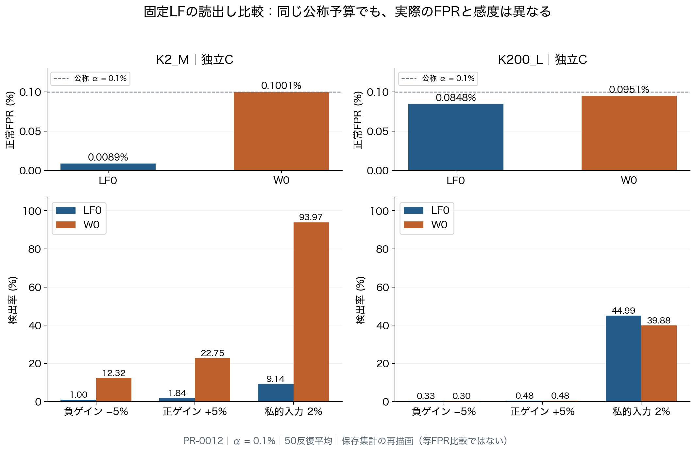

図4　同じ公称αでのLF0とW0。上段に正常FPR、下段に負ゲイン・正ゲイン・私的入力検出を分けて表示する。混合・回復確認実験の独立C、α=0.1%、50反復平均。事前指定の副分析。

K2_Mの大きな検出差には、正常FPRが0.0089%から0.1001%へ変わることが伴う。これは同じ公称αにおける運用点の比較である。K200_Lの私的入力ではLF0が5.1100 pp高く、読出し変更の利益と損失は条件によって入れ替わる。

## 5. 結果II：候補を見つけることと、良い校正を使うこと

### 5.1 旧校正への復帰も、評価すべき選択である

計器評価実験では、K2_M、信号分散比2%の私的入力（P02）800件混入、W0、α=1%において、G-MCで候補を保留しFへ戻すと、混入Uを無条件に使う場合より同じ私的入力故障の検出が81.540 pp増えた。同時に正常FPRも3.553 pp増えた。検出回復と誤警報増加が併存することは、候補の採否と戻り先の校正を別々に評価する理由となる。第5.2節以降では混合・回復確認実験を用い、混合相殺と採用校正への影響を調べる。

### 5.2 正負ゲインの混在は、符号付き平均で相殺する

基準源・長窓のB_LではGM800、GP800の単独混入をG-Mが各50/50で保留した一方、正負各400件のBAL800は0/50だった。同じBAL800をG-MCは50/50で保留した。この方向差は主対比M01–M03で支持された。

式(11)の一次項は正負で反転する。候補全体の平均を取るG-Mではその寄与が相殺しやすいが、二次項とCR側の応答は残る。このため、単独故障とその混合では、同じゲートに対する応答が異なる。

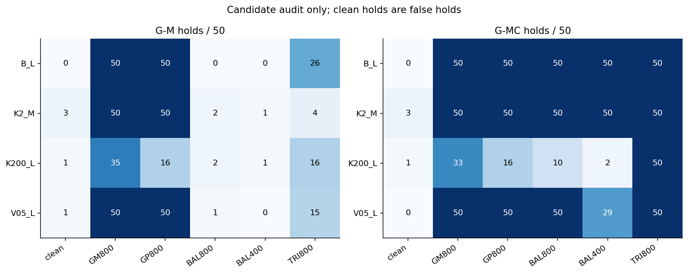

図5　四群・六候補についてのG-M/G-MC保留数。各セルの分母は50外側反復。cleanの保留は誤保留、混入候補の保留は混入検知に対応する。混合・回復確認実験の全条件を示す。主対比以外のセルは記述的な副分析。

G-MCの混入感度にも源条件による差がある。K200_LのBAL800は10/50しか保留されず、40/50が通過した。GM800ではG-Mの35/50に対しG-MCは33/50で、両者の別閾値による非包含性が現れる。cleanの誤保留も残る。

**表10　G-MCのclean誤保留とBAL800の通過。各分母50。**

| 群 | clean誤保留 | BAL800保留 | BAL800通過 |
|---|---:|---:|---:|
| B_L | 0 | 50 | 0 |
| K2_M | 3 | 50 | 0 |
| K200_L | 1 | 10 | 40 |
| V05_L | 0 | 50 | 0 |

保留数は各群50反復での観測度数であり、誤保留0件の群にも有限標本の不確実性がある。混入候補の通過は、ゲートが返したすり抜けとして計上した。

### 5.3 私的入力の追加は、監査と校正へ逆向きに作用する

速い源・長窓のK200_Lで、正負ゲイン各200件のBAL400へ私的入力400件を追加したTRI800では、G-MC保留が2/50から50/50へ増えた。追加成分によって候補が見えやすくなったのである。同じ混入Uをそのまま閾値校正に使った場合には、表11のように検出が低下する。

**表11　K200_L、W0、α=1%でUを仮採用した評価。単位%、差はpp。**

| 評価対象 | BAL400 | TRI800 | TRI800−BAL400 |
|---|---:|---:|---:|
| 正常FPR | 0.9152 | 0.4572 | −0.4580 |
| 負ゲイン検出 | 2.0552 | 0.7372 | −1.3180 |
| 正ゲイン検出 | 3.0344 | 1.2332 | −1.8012 |
| 私的入力検出 | 62.6496 | 20.9316 | −41.7180 |

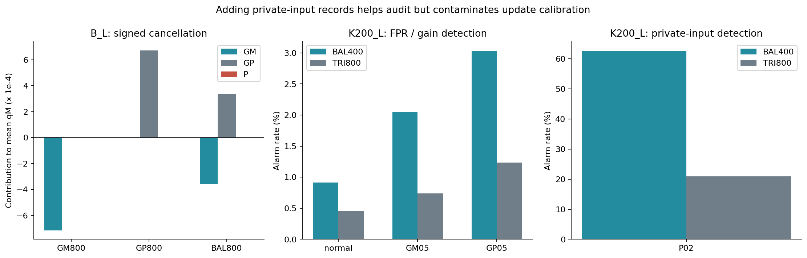

図6　左はB_Lでの符号付きM成分の相殺、中央・右はK200_LでのBAL400からTRI800への変更に伴うU影評価。正常FPR・ゲインと私的入力を別パネルに示す。左は機序の記述、中央・右の率差は主対比M05–M08に対応する。混合・回復確認実験の50反復。影評価はUを仮に適用した場合の成績を表す。

正常FPRの低下と同時に、私的入力および正負ゲインの検出が低下した。候補への私的入力混入は、複数の故障に対する感度をまとめて変えている。式(11)で私的入力方向がゲイン二次項にも使われることと整合する。

実際の政策では、TRI800は全群・全50反復でG-MCに保留され、表7に従ってF/C/DEFERへ分岐する。表11はUを仮に採用した場合の感度低下を示す。保留後に選ぶF/C/未判定の得失は、次節で別に評価する。

## 6. 結果III：誤警報の根拠、検出感度、判定提供の交換

### 6.1 正常確認の支持は、校正ごとに異なる

**表12　主読出しW0の固定F/Cに対する独立VのFPR支持反復数。各分母50。**

| 群 | F支持：1% | C支持：1% | F支持：0.1% | C支持：0.1% |
|---|---:|---:|---:|---:|
| B_L | 33 | 37 | 9 | 6 |
| K2_M | 0 | 45 | 0 | 9 |
| K200_L | 50 | 33 | 41 | 3 |
| V05_L | 50 | 37 | 40 | 3 |

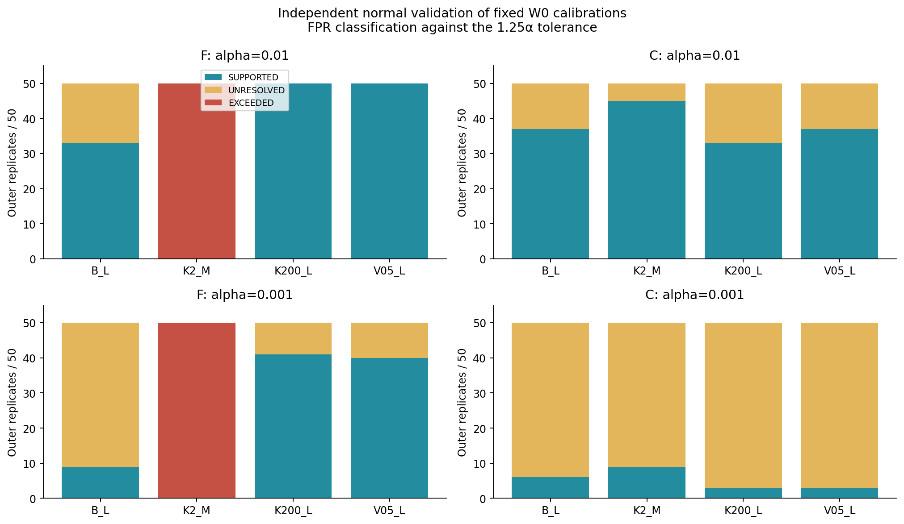

図7　主読出しW0の固定F/Cを、V=20,000、許容上限1.25αで分類した結果。確認族は各群・各反復の8端である。混合・回復確認実験の指定副分析。表12は支持のみ、図は超過・未解決も示す。

K2_MのFは両αで超過50/50であった。Cは主αで45/50の支持を得るが、低αでは9/50へ減る。清浄校正の作成に加え、有限VからFPR上界を狭く推定することが、支持判定の要件となる。

K200_LのFは主αで支持50/50であったが、負・正ゲイン検出は1.3996%・1.9012%に留まった。正常時の誤警報はV、故障感度は故障Eで測る必要性が、この組合せに現れる。Vと独立Eの分類にも有限標本の変動があり、K200_L/C/α=0.1%ではV未解決からE超過となる反復が1件あった。

### 6.2 清浄Cで判定を提供しても、検出損失と未判定が残る

主回復条件は、遅い源・中窓のK2_Mに正負ゲイン各200件と私的入力400件を混ぜたTRI800、α=1%である。ここで回復は、保留後に清浄Cを採用して判定を提供する経路を指す。候補は全て保留され、FのV支持はない。P1は全停止、P2はC支持が得られた45反復で回復し、残る5反復で停止した。回復確率の多重比較調整区間は[72.0564%, 98.2247%]で、過半回復の基準を満たした。

**表13　主回復条件の政策成績。50反復、単位%。**

| 政策 | 提供率 | 正常全件警報 | 提供時FPR | 負ゲイン全件検出 | 正ゲイン全件検出 | 私的入力全件検出 | 未判定 |
|---|---:|---:|---:|---:|---:|---:|---:|
| P0 | 100.0000 | 3.7304 | 3.7304 | 41.5476 | 50.2792 | 96.9272 | 0.0000 |
| P1 | 0.0000 | 0.0000 | NA | 0.0000 | 0.0000 | 0.0000 | 100.0000 |
| P2 | 90.0000 | 0.8591 | 0.9546 | 23.5208 | 33.7016 | 86.9304 | 10.0000 |

各反復のE件数は等しいため、P2の45反復での回復と5反復での停止が、全件分母の提供率90%・未判定10%に対応する。P1の警報0%は、全件で判定を停止した結果である。P2の正常全件警報0.8591%には停止が含まれるため、提供時FPR0.9546%と併記する。P0は高い故障検出と正常FPR3.7304%を併せ持つ。政策間の比較は、このFPR・検出・提供率の三つ組で行う。

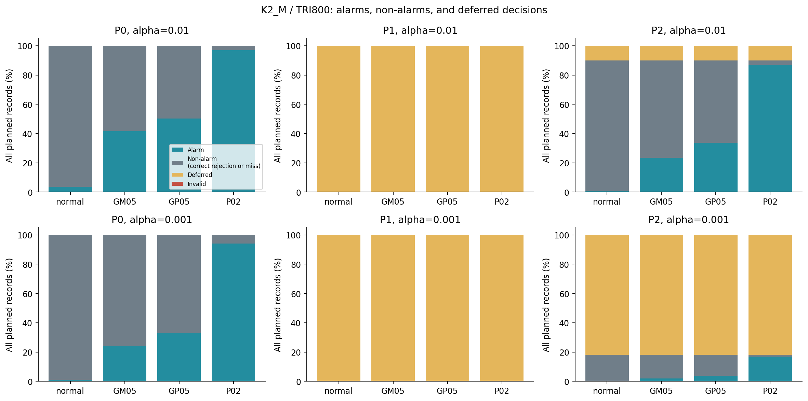

図8　K2_M/TRI800の政策会計。警報、提供下非警報、未判定を別に数える。正常時の警報は誤警報、故障時の警報は検出を意味する。混合・回復確認実験のα=1%と0.1%。

主αでP2の全件分母の非警報見逃し率は、負ゲイン66.4792%、正ゲイン56.2984%、私的入力3.0696%で、各々別に未判定10%がある。α=0.1%では回復9/50、提供18%、未判定82%となった。低い誤警報要求の費用は、検出閾値だけでなく判定提供の資源要件にも現れる。

### 6.3 主13対比の全件と、対応する得失

**表14　事前固定の主13対比。差はpp、R01のみ確率%。全て主α=1%。**

| ID | 対比 | 推定値 | 多重比較調整区間 | 対比方向の判定 |
|---|---|---:|---|---|
| M01 | B_L G-M保留：BAL800−GM800 | −100.0000 | [−100.0000, −74.0561] | 支持 |
| M02 | B_L G-M保留：BAL800−GP800 | −100.0000 | [−100.0000, −74.0561] | 支持 |
| M03 | B_L BAL800保留：G-MC−G-M | 100.0000 | [74.0561, 100.0000] | 支持 |
| M04 | K200_L G-MC保留：TRI800−BAL400 | 96.0000 | [66.4625, 99.9101] | 支持 |
| M05 | K200_L U：TRI800−BAL400、正常 | −0.4580 | [−0.4880, −0.4280] | 支持 |
| M06 | 同、負ゲイン | −1.3180 | [−1.4133, −1.2227] | 支持 |
| M07 | 同、正ゲイン | −1.8012 | [−1.9210, −1.6814] | 支持 |
| M08 | 同、私的入力 | −41.7180 | [−42.7025, −40.7335] | 支持 |
| R01 | K2_M TRI800 P2のC回復確率 | 90.0000 | [72.0564, 98.2247] | 過半を支持 |
| R02 | K2_M TRI800 P2−P0、正常全件警報 | −2.8713 | [−3.0357, −2.7069] | 支持 |
| R03 | 同、負ゲイン全件検出 | −18.0268 | [−21.4257, −14.6279] | 支持 |
| R04 | 同、正ゲイン全件検出 | −16.5776 | [−21.5738, −11.5814] | 支持 |
| R05 | 同、私的入力全件検出 | −9.9968 | [−22.5661, 2.5725] | 未解決 |

表14の「支持」は、事前に定めた対比の方向への支持を表し、予想した検出損失の確認も含む。第3.4節と表12の「FPR支持」は、固定校正の誤警報率が許容上限内にあることを指す。区間は第3.5節の事前固定した調整規則による。

R03/R04では、P0に比べてP2の正負ゲイン全件検出が低下した。R05の私的入力も平均は低下したが、調整区間はゼロをまたぐ。区間が損失方向と逆方向の両方を含むため、差の符号と同等性は未確定である。

平均差だけでなく、同じEで一方だけが警報した記録を数えると、相殺された得失を区別できる。

**表15　主回復条件のP2対P0。全件分母、単位pp。**

| 評価対象 | P2のみの警報 | P0のみの警報 | 差 |
|---|---:|---:|---:|
| 正常 | 0.0124 | 2.8837 | −2.8713 |
| 負ゲイン | 0.0636 | 18.0904 | −18.0268 |
| 正ゲイン | 0.0744 | 16.6520 | −16.5776 |
| 私的入力 | 0.0220 | 10.0188 | −9.9968 |

正常の追加警報は追加誤警報であり、故障の拾得とは逆の意味を持つ。提供停止により失った警報もこの全件比較に含めるが、出力会計では未判定と非警報を提供した見逃しを分離する。

### 6.4 R05のばらつきは、回復と停止の経路に対応した

同じ50反復の事後探索で、R05の差を経路別に分けた。回復45反復ではP0からP2への私的入力検出差が平均−0.3329 pp、停止5反復ではP2が何も提供しない。全体差−9.9968 ppへの加重寄与は、回復経路−0.2996 pp、停止経路−9.6972 ppだった。

反復別差をΔ、経路をSとした経験分散の分解、

\[
\operatorname{Var}(\Delta)
=E[\operatorname{Var}(\Delta\mid S)]
+\operatorname{Var}(E[\Delta\mid S])
\tag{22}
\]

では、50反復の分散の99.9965%が経路間の項に対応した。ここでは50個を等重みとする経験分散を使い、主推論の不偏標本分散とは役割を区別した。

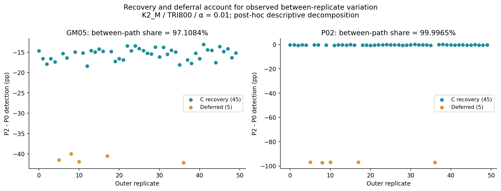

図9　R05を含む反復別の政策差。回復と停止が異なる集団を作る。混合・回復確認実験の50反復に対する事後探索。図中の分散比はこの経験標本の記述であり、主対比の推論結果は表14に示す。

記録レベルの評価精度と経路選択の不確実性は別々の成分であり、標本予算を検討する際の区別となる。

### 6.5 通過して運転を続けても、感度は低下し得る

停止の費用とは別に、通過Uで運転を継続する経路も調べた。源分散半分・長窓のV05_Lで正負ゲイン各200件を混ぜたBAL400では、G-MCが21/50を通過させた。同じ通過21反復、同じE上で、混入Uと対応するclean Uを比較すると表16となる。

**表16　V05_L/BAL400の通過21反復、W0、α=1%。事後探索。**

| 評価対象 | clean U (%) | 混入U (%) | 差 (pp) |
|---|---:|---:|---:|
| 正常FPR | 0.9840 | 0.4062 | −0.5779 |
| 負ゲイン検出 | 30.9343 | 17.9638 | −12.9705 |
| 正ゲイン検出 | 43.7686 | 24.8971 | −18.8714 |
| 私的入力検出 | 99.9038 | 99.8562 | −0.0476 |

差は丸め前の値から計算した。この層では三政策ともUを採用して提供率100%となり、校正による感度低下を停止の費用から分離できる。全21反復で正常Eの経験FPRは1.25α以下だったが、負・正ゲイン感度はclean Uより低かった。Uについて示したFPRは独立Eでの経験値であり、Vの支持判定はF/Cを対象とする。

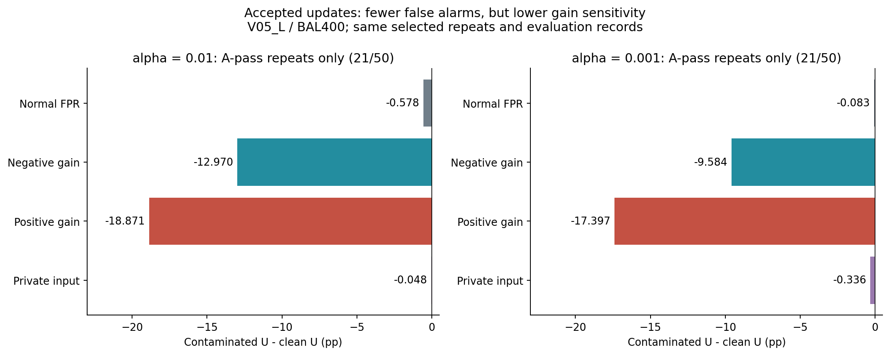

図10　同じ通過21反復に条件づけたclean Uと混入Uの比較。両αを表示し、正常FPRと正負ゲイン・私的入力を分ける。選択層に対する事後探索で、同じ公称αの運用点を比較する。

同組成・別記録のUへAと同じG-MCを影適用すると、V05_L/BAL400ではA/U判断が31/50で異なり、A通過21反復のうち17反復でUへの仮適用は保留相当となった。実政策のゲートはAに固定し、Uの影判定をバッチ間変動の解析に用いた。Aの通過が与えるのは候補取得過程に関する情報であり、有限バッチごとの実現にはこのような差が残る。

## 7. 考察

### 7.1 三つの判断を別々に測る意義

物理残差は応答モデルとの整合性を、正常確認Vは固定校正の誤警報率を、故障Eは検出感度を測る。候補保留後には戻り先の校正と判定提供率を評価する。この対応を保存・検証の単位にしたことで、警報の減少、候補の拒否、運転の回復に伴う利益と費用を分離できた。

再利用可能な仕様は、各段階の判断根拠を追跡できる記録構造である。物理モデルと雑音対照、符号付き残差、参照と射影の版、校正データの来歴と閾値、枝別発火、候補の採否、採用校正文脈、正常確認の分類、警報・非警報・未判定・技術無効の計数をそれぞれ残す。これにより、同じ警報率へ集約される異なる経路を調べられる。

### 7.2 判定を保つ単純化と、判定領域を変える変更

第4.1節の等価判定は、LF0の警報を保ったまま順位検索を省けることを示す。実装の簡約では、このように判定が保存される範囲を先に確認できる。

W0への変更は、枝予算と正負の扱いを通して判定領域を変える。順位上端による非発火を回避する条件と、LF0から検出を失う条件の両方が観測された。この結果は、融合の設計を検討する際に、スコア表現、警報予算、校正条件を先に点検する意義を示す。

候補ゲートでは、MとCRの併用が均衡混合への感度を高める条件があり、別閾値による保留集合の差もあった。正常源変化の誤保留と混入のすり抜けを対にして評価する必要がある。また、式(11)のP方向は私的入力とゲイン二次項に共通して応答する。枝の発火は、この物理的な応答方向として解釈する。

### 7.3 適用範囲と識別不能性

モデル・統計・政策の前提と、それぞれが与える判断の範囲を補足S0の表S1に整理する。ここでは、利用情報から区別できる対象を明確にする。

検査の識別能力は、利用できる情報に依存する。正常として許容する観測分布と、ある不整合下の観測分布がその情報上で同じなら、両者の識別には別の測定情報が必要となる。共通入力と同じ位置から入り、許容源変化へ吸収される共有成分が一例である。一方、正負混合におけるM平均の相殺後にはCR応答が残った。平均の一致と、利用可能な分布全体の一致を分けることが、検査の盲点を特定する上で重要となる。

源群・窓長・故障強度は、設計用解析と計器評価実験の所見に基づいて選び、混合・回復確認実験で固定評価した。したがって、得られた結果は選択した条件集合に対する性能を表す。取得雑音の絶対量固定により、源変化は相対SNRも変える。候補A/Uの同組成という設定を含め、これらの条件を補足S0に明示する。

### 7.4 次に必要なものは、主張に応じて異なる

本研究の政策評価は、独立した清浄校正と正常確認を利用できる条件を対象とした。実運用への適用には、要求する保証に応じた資源と評価設計が必要となる。

更新後の感度を保証したければ、正常Vとは別に、故障への要求感度と独立な対照資源を用意する必要がある。全採用経路のFPRを確認したければ、通過Uも対象にした選択依存を含む手順を設計する必要がある。清浄C/Vが得られない現場へ適用したければ、その来歴を確保する測定手順自体を検証しなければならない。重複窓の連続監視では、窓間依存と反復的な選択を組み込んだ逐次評価が必要となる。

これらの拡張は、本研究の評価Eと分離したデータで検証する課題となる。

## 8. 結論

一次プローブの整合性監査を、物理残差から校正更新後の判定まで一つの検証経路として扱った。符号付きM・CRと固定LFを用いた結果、第一に、中間表現を保存すると、有限順位による非発火と判定規則変更の得失を追跡できた。第二に、正負混合や私的入力追加に対する候補監査の感度は、採用校正のFPR・故障感度とは別の量であることを、事前固定した混合・回復確認実験で示した。第三に、独立正常確認に基づく停止・条件付き回復は誤警報の根拠を持つ運転を可能にする条件がある一方、検出損失と未判定を伴った。

本研究は、指定した一次デジタル応答、源条件、故障作用点、有限正常資源における方法論の検証である。直接校正の逆向きの損失とR05の未解決を含め、残差の整合性、候補の採否、FPR、感度、判定提供率を対応づけて報告することが、監査可能な校正更新の要点となる。

## データ・コードと再現性

条件を事前固定した研究計画、実装、二次統計量、集計表、解析コードを研究パッケージに収録する。公開アーカイブ識別子は未付与のため、以下のリンクはパッケージ内の参照を示す。数値結果と図の対応は、補足S6の資料一覧から追跡できる。

現在の確認実験の実装は、[可読FIX1コードの案内](numerics/experiments/pr0012_fix1/README.md)に読む順番、数式とコードの対応、点検とColab実行の手順をまとめる。

混合・回復確認実験の条件は[研究計画](audits/prereg/PR-0012_mixture_recovery_confirmation.md)と[数値点検の技術仕様](audits/prereg/PR-0012_A01_preflight_boundary_fix.md)、集計は[確認実験の解析資料](numerics/analysis/pr0012_64bf0f2c7697_confirmation_v1/PR0012_CONFIRMATION_REPORT_JA.md)に記載する。再現性の点検は、アーカイブの完全性確認と、保存した二次統計量からの校正・判定・政策集計の再計算によって行った。保存対象と数値境界の扱いは補足S6に示す。

模式図と読出し比較図の[作図コード](numerics/scripts/draw_manuscript_ja_v1_figures.py)、[判断経路図と英語図の作図コード](numerics/scripts/draw_manuscript_bilingual_v1_figures.py)、[論文用図ラベルの整備コード](numerics/scripts/draw_manuscript_ja_v5_en_v2_labels.py)、各結果図の生成元、[原稿と根拠の照合記録](provenance/MANUSCRIPT_CHECK.md)を併せて収録する。コードの作成・点検にはLLMの支援を用いた。数値結果は固定した計算条件と保存された実行出力に基づき、コード、乱数設定、照合記録を再現資料に含める。論文はCC BY 4.0、コードは[Apache 2.0](LICENSE)の条件で提供する。

## 謝辞・LLM利用の開示

本研究の遂行および原稿作成に際し、著者はChatGPTおよびCodex（OpenAI）を、研究課題と数式の検討、文献探索、コードの作成・点検、解析結果の整理、および文章の推敲の補助に利用した。また、Claude（Anthropic）を草稿への批評に利用した。研究上の判断、採用した手法とコード、引用、結果の解釈および本文を含む本論文の全内容について、最終的な責任は著者が負う。

## 補足資料

### S0. 共通前提と適用範囲

本研究は、校正済みのデジタル一次応答を持つ二つの記録器について、有限記録から作る警報と校正更新を評価する。Mの母モーメント関係は定常・有限二次モーメントを仮定し、数値実験では定常ガウスOU源の標本列、独立ガウス取得雑音、独立記録を用いる。応答パラメータとLF射影は源変化後も固定する。取得雑音と雑音対照は基準源で定めた絶対分散を保持し、観測と対照には独立な雑音実現を用いる。

**表S1　構成要素ごとの前提と、結果が表す量。**

| 構成要素 | 本研究で置く条件・操作 | 評価・解釈の対象 |
|---|---|---|
| デジタル応答 | 式(1)の一次再帰、既知の応答時間、定常入力 | 指定した離散応答モデルへの整合性 |
| M | 既知ゼロ平均の二次モーメント、独立雑音対照、符号を保持した補正 | 母平均の共分散制約と、有限窓残差の揺らぎ |
| CR | 順方向の交差フィルタ、有限ウォームアップ、同じ操作を施した対照 | 過渡を含めて校正した不一致エネルギー |
| LF | 正常Rによる方向・共分散推定、固定した線形重み | 式(13)の平均変化二乗／正常分散比。警報性能は正常・故障Eで評価 |
| LF0／W0 | 固定参照、指定の順位規則または1:1:2予算、独立閾値校正 | 同じ公称αでの運用点。実測FPRと検出率を対で報告 |
| 正常閾値の確率保証 | Rと規則を固定し、校正標本と次の正常記録の交換可能性を仮定 | 校正標本の偶然性を含む周辺誤警報確率 |
| 候補監査 | 同組成・別記録のA/U。採否はAのバッチ平均から決定 | 候補の混入感度、正常源変化の誤保留、別バッチへの判定移行 |
| 正常確認V | 現在源に対応する清浄V、固定F/C、所定の件数と確認族 | F/CのFPR上界に関する支持・超過・未解決 |
| 停止・回復 | 独立な清浄回復校正CとVを利用可能な資源として与える | F/U/C/DEFERの選択と、誤警報・感度・判定提供の交換 |
| 推論 | 実験ごとの50外側反復、事前固定の対比と多重比較、役割分離 | 指定条件集合での対応差。事後解析は機序と選択経路の記述 |

個々の校正実現に対するFPR、故障感度、候補の清浄性は、それぞれ別の評価対象である。Vの支持は固定F/Cの正常時FPRに関するもので、通過Uは独立Eの経験FPRと感度を報告する。清浄C/Vの来歴は外部から与える資源条件とし、正常性の認定手順そのものは適用先で用意する。

情報の範囲にも段階がある。波形から二座標への縮約、ランク2の二射影による可逆変換、絶対値・順位・最大値・ORによる縮約を区別する。本稿の識別に関する結果は、指定した情報表現と故障モデルに対応する。実機、非定常・非ガウス源、重複窓の逐次監視、A/Uの組成が時間変化する運用への拡張には、それぞれの条件に対応した評価を要する。

### S1. 物理統計と有限窓の位置づけ

MとCRは二次形式として表せるが、母平均関係と有限窓統計は別である。理想的な連続時間一次応答 \(\tau_\ell\dot y_\ell+y_\ell=x\) では、\(Z=\tau_i y_i-\tau_j y_j\) に対し \(\dot Z=y_j-y_i\) となる。したがって、

\[
\widehat{\mathcal R}(T)
=\frac1T\int_0^T\bigl[(\tau_i+\tau_j)y_iy_j-\tau_i y_i^2-\tau_jy_j^2\bigr]\,dt
=\frac{Z(T)^2-Z(0)^2}{2T}.
\tag{S1}
\]

右辺は共通入力を消去した \(Z\dot Z\) の積分から得られる。定常ゼロ平均ガウス過程では、\(\sigma_Z^2=E[Z^2]\)、\(\rho_Z(T)=E[Z(T)Z(0)]/\sigma_Z^2\) として、

\[
\widehat{\mathcal R}(T)\overset d=
\frac{\sigma_Z^2\sqrt{1-\rho_Z(T)^2}}{T}\,UV,\qquad
U,V\stackrel{\rm iid}{\sim}N(0,1).
\tag{S2}
\]

和と差を独立な標準正規へ規格化すれば得られ、端点が完全相関する退化条件では残差は0となる。式(S2)の適用対象は連続時間の理想信号である。離散応答と対照補正後の取得雑音を含む本研究の統計には、式(17)の経験的正常校正を用いる。

故障応答の詳証と二次形式の整理を[計器仕様書](numerics/theory/M_CR_LF_INSTRUMENT_SPECIFICATION_v1_JA.md)と[二次形式・融合の導出資料](numerics/theory/THEORY_NOTE_M_CR_QUADRATIC_FUSION_v1_JA.md)に収録する。[Lean補足](lean/SUPPLEMENT.md)は、そこに明示した代数命題を形式検証する。統計手順、実装、政策性能は、数値点検と実験評価で検証する。

### S2. 読出しと警報予算

[計器評価実験の読出し構造解析](numerics/analysis/pr0009_9adfa7a8c6e0_compression_v1/PR0009_COMPRESSION_REPORT_JA.md)には、二射影の可逆性、LF0の等価半平面、順位の衝突、源別閾値、正負ゲインの枝分解を収録する。これは同実験の50反復に対する事後解析である。当該資料と図S1でCと表示した清浄校正は、clean Uを指す。一方、混合・回復確認実験のCはclean Uとは別に取得した回復校正であり、両者の来歴を区別して報告する。

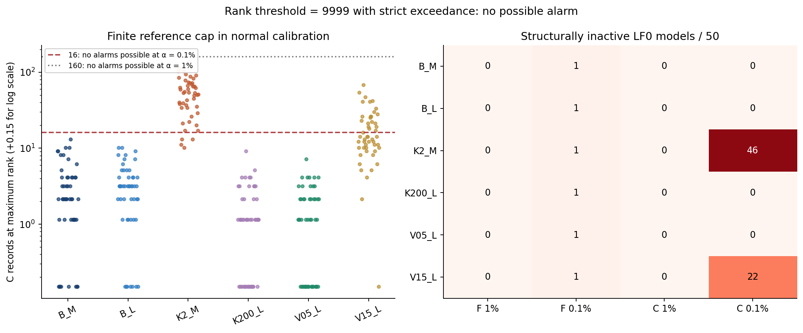

図S1　計器評価実験における、正常校正の上端順位集中と非発火。図4とは異なる実験の50反復を用いた機序の事後解析。表5の四群に加え、B_Mは基準源（κ=20 s⁻¹、源分散比1）の中窓T=2.048 s、V15_Lは源分散比1.5（κ=20 s⁻¹）の長窓T=8.192 sである。標本間隔とプローブ応答は第3.2節と共通。Cは当該実験のclean Uを指す。各実験の成績はそれぞれの反復単位で集計する。

[警報予算の設計解析](numerics/analysis/pr0006_6f23fc7946f8_performance_v2/PR0006_BUDGET_REPORT_JA.md)に配分ごとのLF0との得失を、[混合・回復確認実験の全校正表](numerics/analysis/pr0012_64bf0f2c7697_confirmation_v1/ALL_CALIBRATIONS.md)に全読出し条件を示す。配分には故障間の感度交換があり、本稿ではW0を固定した比較点として用いる。

### S3. 混入・候補監査・A/U

[混入組成の設計解析](numerics/analysis/pr0010_9adfa7a8c6e0_mixture_v1/PR0010_MIXTURE_REPORT_JA.md)は、計器評価実験のデータを用いた事後解析である。総混入数を固定した成分交換と、同じゲイン記録を保持し、別の私的入力故障記録をバッチへ加える対照を区別する。この所見を踏まえて条件を固定した混合・回復確認実験については、[全ゲート・支持表](numerics/analysis/pr0012_64bf0f2c7697_confirmation_v1/ALL_GATES_AND_SUPPORT.md)に全件を示す。

同組成A/Uの判定差、通過Uの感度、P枝の交差感度を、[混合・回復確認実験の事後解析](numerics/analysis/pr0012_64bf0f2c7697_exploration_v2/PR0012_EXPLORATORY_INSIGHTS_JA.md)に記載する。採否はAから決める政策のまま固定し、Uへのゲート適用は影評価として用いる。

### S4. 正常確認の資源と来歴

[正常確認の標本数解析](numerics/analysis/pr0009_9adfa7a8c6e0_v_budget_v1/PR0009_V_BUDGET_REPORT_JA.md)は、計器評価実験のVを500〜20,000件の固定部分標本で比較した事後解析である。各標本数での支持・超過・未解決と、独立Eとの対応を評価する。

正常確認には、評価する源条件に対応した清浄Vを用いる。源変化前の正常Vや、候補選択に依存して取得・採用されたVは、来歴が異なる資料として区別する。混合・回復確認実験ではV件数と確認族を固定し、F/Cの根拠と政策成績を分けて評価した。固定した候補のリスクを独立データで検定し、その結果を選択に用いる考え方はLearn then Testにも接続する。[Angelopoulosら, 2025](https://doi.org/10.1214/24-AOAS1998) 本稿の確認対象は第3.4節で指定したF/Cである。逐次的に標本数を増やして支持時に停止する運用は、第7.4節の拡張課題に属する。

主13対比には、Vの8端とは別に、族全体0.05のBonferroni調整を適用した。M01–M04では対応二値の二つの不一致確率に各尾0.05/(4×13)のCP限界を作り、その差の上下限を組み合わせる。R01は各尾0.05/(2×13)のCP区間、率差8対比は各尾0.05/(2×13)の対応t近似である。率差の反復標準偏差が0の場合は、差が[−1,1]に入ることを使うHoeffding半幅 \(\sqrt{2\log(2\times13/0.05)/50}\) へ切り替える規則を事前に固定した。区間は、対応する率・率差の取り得る範囲に制限する。固定仕様と算術は[研究計画](audits/prereg/PR-0012_mixture_recovery_confirmation.md)と[校正・政策コード](numerics/scripts/pr0012_methods.py)に収録する。

### S5. 政策の全成績と経路分解

[混合・回復確認実験の全政策表](numerics/analysis/pr0012_64bf0f2c7697_confirmation_v1/ALL_POLICIES.md)に全群・全候補・両αの絶対率と対応得失を収録する。[事後解析の全条件表](numerics/analysis/pr0012_64bf0f2c7697_exploration_v2/ALL_EXPLORATORY_RESULTS.md)には経路寄与、通過層、A/U差、枝構成を示す。

[停止・回復の政策設計解析](numerics/analysis/pr0011_9adfa7a8c6e0_recovery_v2/PR0011_STOP_RECOVERY_REPORT_JA.md)は、計器評価実験の同じ50反復を用いた事後解析であり、回復資源C0を構成する。混合・回復確認実験では独立に取得したCを用いる。この取得方法の違いを保ち、各解析を対応するデータ集合に結びつける。R05の主推論は表14、経路別の説明は第6.4節に示す。

### S6. 実験・解析資料の対応と再現範囲

本稿で用いる実験名と再現資料の識別子を、次のように対応づける。識別子は条件、コード、データ、解析を追跡するために用いる。

- **計器評価実験（PR-0009）**：単独混入、候補監査、旧校正のFPRを調べる50外側反復。第4.1節の読出し構造の事後解析、第5.1節の固定比較、図S1のデータ源。
- **混合・回復確認実験（PR-0012）**：混合相殺と条件付き回復を調べる別の50外側反復。主13対比、指定副分析、および同じ標本に対する経路・通過層の事後解析のデータ源。
- **混入組成・停止回復の設計解析（PR-0010／PR-0011）**：PR-0009の記録を再使用した事後解析。混合・回復確認実験の条件設定に用いる。
- **警報予算の設計解析（PR-0006）**：配分による検出の交換を調べ、固定W0を選ぶ際の資料。
- **M/CRの相補性解析**：[ROC・長窓比較](numerics/analysis/main_2ae37613a10478c8/ROC_AND_LONG_WINDOW_REPORT_JA.md)。同一経験FPRでの事後ROCと、独立正常校正による運用点を区別して示す。

同じ実験記録に対する複数の解析は、データを共有する分析として扱う。独立性は解析名の数によらず、標本の取得単位と参照・校正・評価の役割で定義する。

混合・回復確認実験の[アーカイブ照合](numerics/analysis/pr0012_64bf0f2c7697_confirmation_v1/receipt.json)、[保存統計からの再計算](numerics/analysis/pr0012_64bf0f2c7697_confirmation_v1/validation.json)、[別算術経路の点検](numerics/analysis/pr0012_64bf0f2c7697_confirmation_v1/second_path_validation.json)に検証範囲を示す。実行識別子は64bf0f2c7697である。保存対象は二次統計量、校正と判定の中間量、集計およびログであり、全時系列波形の再生成は検証範囲外とする。技術点検ではCPU/GPUのLF0順位境界に2bit差を記録し、丸め境界の不確定性として分類した。保存統計からの全判定再計算は一致した。

主13対比の点推定・区間・判定は[機械可読表](numerics/analysis/pr0012_64bf0f2c7697_confirmation_v1/primary13.json)、統計計算・LF・政策は[デジタル統計](numerics/scripts/probe_backend_check_v1.py)、[LF重み](numerics/scripts/pr0004_methods.py)、[校正・政策](numerics/scripts/pr0012_methods.py)に対応する。検証主体は同一研究作業内の著者側であり、別算術経路の照合によって自己監査を行った。第三者による再現は、このパッケージを用いる独立検証の課題となる。

## 参考文献

1. T. T. Georgiou, “The Structure of State Covariances and Its Relation to the Power Spectrum of the Input,” *IEEE Transactions on Automatic Control* **47**(7), 1056–1066 (2002). [DOI](https://doi.org/10.1109/TAC.2002.800643)
2. P. D. Gillespie, D. Gaida, P. C. Hung, R. J. Kee, and S. F. McLoone, “A Bias Compensated Cross-Relation Approach to Thermocouple Characterisation,” *IFAC-PapersOnLine* **49**(5), 43–48 (2016). [DOI](https://doi.org/10.1016/j.ifacol.2016.07.087)／[著者公開稿](https://pureadmin.qub.ac.uk/ws/portalfiles/portal/121129106/IFAC2016_v3.pdf)
3. S. Bates, E. Candès, L. Lei, Y. Romano, and M. Sesia, “Testing for Outliers with Conformal p-Values,” *The Annals of Statistics* **51**(1), 149–178 (2023). [DOI](https://doi.org/10.1214/22-AOS2244)
4. M. Bashari, M. Sesia, and Y. Romano, “Robust Conformal Outlier Detection under Contaminated Reference Data,” *Proceedings of the 42nd International Conference on Machine Learning*, PMLR **267**, 3091–3141 (2025). [正式掲載](https://proceedings.mlr.press/v267/bashari25a.html)
5. I. Gibbs and E. Candès, “Adaptive Conformal Inference Under Distribution Shift,” *Advances in Neural Information Processing Systems* **34** (2021). [正式掲載](https://papers.neurips.cc/paper_files/paper/2021/hash/0d441de75945e5acbc865406fc9a2559-Abstract.html)
6. C. K. Chow, “On Optimum Recognition Error and Reject Tradeoff,” *IEEE Transactions on Information Theory* **16**(1), 41–46 (1970). [DOI](https://doi.org/10.1109/TIT.1970.1054406)
7. F. Lin and M. R. Jovanović, “Least-Squares Approximation of Structured Covariances,” *IEEE Transactions on Automatic Control* **54**(7), 1643–1648 (2009). [DOI](https://doi.org/10.1109/TAC.2009.2017976)
8. M. Zorzi and A. Ferrante, “On the Estimation of Structured Covariance Matrices,” *Automatica* **48**(9), 2145–2151 (2012). [DOI](https://doi.org/10.1016/j.automatica.2012.05.057)
9. P. Hung, R. J. Kee, G. W. Irwin, and S. McLoone, “Blind Deconvolution for Two-Thermocouple Sensor Characterisation,” *Journal of Dynamic Systems, Measurement, and Control* **129**(2), 194–202 (2007). [DOI](https://doi.org/10.1115/1.2431814)
10. B. Picinbono, “On Deflection as a Performance Criterion in Detection,” *IEEE Transactions on Aerospace and Electronic Systems* **31**(3), 1072–1081 (1995). [DOI](https://doi.org/10.1109/7.395235)
11. Z. Quan, S. Cui, and A. H. Sayed, “Optimal Linear Cooperation for Spectrum Sensing in Cognitive Radio Networks,” *IEEE Journal of Selected Topics in Signal Processing* **2**(1), 28–40 (2008). [DOI](https://doi.org/10.1109/JSTSP.2007.914882)
12. X. Tong, Y. Feng, and J. J. Li, “Neyman–Pearson Classification Algorithms and NP Receiver Operating Characteristics,” *Science Advances* **4**(2), eaao1659 (2018). [DOI](https://doi.org/10.1126/sciadv.aao1659)
13. C. J. Clopper and E. S. Pearson, “The Use of Confidence or Fiducial Limits Illustrated in the Case of the Binomial,” *Biometrika* **26**(4), 404–413 (1934). [DOI](https://doi.org/10.1093/biomet/26.4.404)
14. A. N. Angelopoulos, S. Bates, E. J. Candès, M. I. Jordan, and L. Lei, “Learn then Test: Calibrating Predictive Algorithms to Achieve Risk Control,” *The Annals of Applied Statistics* **19**(2), 1641–1662 (2025). [DOI](https://doi.org/10.1214/24-AOAS1998)
15. E. Y. Chow and A. S. Willsky, “Analytical Redundancy and the Design of Robust Failure Detection Systems,” *IEEE Transactions on Automatic Control* **29**(7), 603–614 (1984). [DOI](https://doi.org/10.1109/TAC.1984.1103593)

