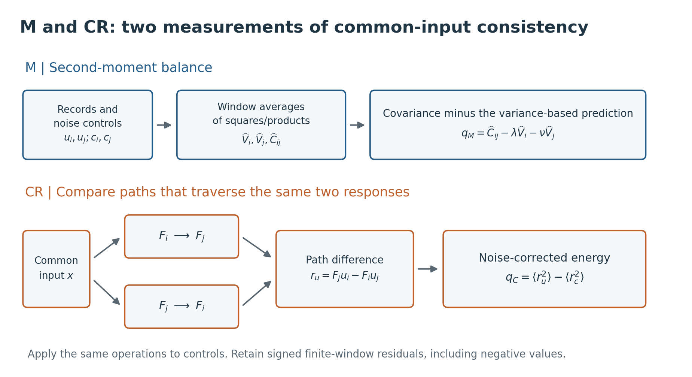

# Readout and Calibration-Update Audits for First-Order Probes

**How can we tell whether a sensor alarm system is still trustworthy after its thresholds are updated?** This project studies that question for two sensors measuring the same changing input. It follows the complete path from physical consistency checks to alarms, calibration updates, and decisions to stop or resume detection.

English V1.0: [PDF](Calibration_Update_Audits_for_First_Order_Probes_EN_v1.0.pdf) · [TeX source](Calibration_Update_Audits_for_First_Order_Probes_EN_v1.0.tex) · [Markdown](Calibration_Update_Audits_for_First_Order_Probes_EN_v1.0.md) | [Model → alarm](#from-the-model-to-an-alarm) · [日本語論文 V1.0（Markdown）](Calibration_Update_Audits_for_First_Order_Probes_JA_v1.0.md) · [日本語の概要](#日本語の概要) · [Code and reproduction](#start-here)

Research by **Kentaro Sato**. Unpublished working paper, V1.0 in both languages, 30 October 2026. This repository contains the manuscripts, readable code, figures, and saved analysis results.

**Original simulation data:** the 42 original archives are available from [Release v1.0 — Assets](https://github.com/metaSATOKEN/First-Order-Probes/releases/tag/v1.0) (about 14.7 GB in total). Start with the attached [RAW_DATA_README.md](https://github.com/metaSATOKEN/First-Order-Probes/releases/download/v1.0/RAW_DATA_README.md); see [download and restoration details](docs/DATA_AVAILABILITY.md#download-the-original-archives).

## Why this problem matters

Two healthy sensors can disagree simply because one responds more slowly. The slower sensor smooths rapid changes more strongly, so different amplitudes or correlations do not by themselves establish a fault. Even with known sensor responses, the normal fluctuations of a fault score can change when the measured process becomes faster, slower, stronger, or weaker.

An alarm threshold determines how large a score must be to trigger an alarm. Refitting that threshold to recent data can reduce false alarms on normal records. But if those data include faults, the update can also make faults harder to detect. Rejecting a suspicious update does not settle the problem either: the old threshold may no longer suit the current process.

The research therefore separates three questions: **Are the sensor records physically consistent? Are the proposed update data suspicious? Does the calibration actually used provide acceptable false alarms, useful fault detection, and enough decisions?**

## How the study works

We use a pair of digital first-order probes: simple sensor models with known response times. Both observe a common input, with acquisition noise treated through separate noise controls. The target faults are an increase or decrease in one signal gain, and an additional independent signal entering only one probe, called a *private input*.

| Component | What it measures | Role in the study |
|---|---|---|
| Moment method, M | Whether output variances and covariance satisfy the balance predicted by the response model | A signed summary of second-moment consistency |
| Cross-relation method, CR | Whether the records agree after each is filtered through the other probe's response | A noise-corrected measure of disagreement between the two time-series paths |
| Linear fusion, LF | Fixed projections combining signed M and CR statistics | Fault-oriented scores built from normal-reference fluctuations and response directions derived from the physical model |

These scores become alarms through either finite-reference ranks or directly calibrated thresholds. After the input statistics change, the probe responses and LF construction remain fixed; **alarm thresholds are the quantities updated**. Separate data are used to inspect update candidates, fit thresholds, validate normal-condition false alarms, and evaluate fault detection. This makes it possible to inspect each stage without using evaluation outcomes to choose the rule.

The contribution is an auditable evaluation procedure linking these established ingredients, together with experiments showing where apparently similar alarm outcomes come from different mechanisms. The [code guide](numerics/experiments/pr0012_fix1/README.md) connects the paper's equations to the implementation.

## From the model to an alarm

The following is a short reading guide to the paper's equations (1)–(17). It follows one measurement window through the calculation, then explains why updating an alarm requires additional checks.

### 1. Model: different waveforms from the same input

For probes $i$ and $j$, the digital response is

$$
y_{\ell,t}=a_\ell y_{\ell,t-1}+(1-a_\ell)x_t,
\qquad a_\ell=e^{-\Delta/\tau_\ell},\quad \ell\in\{i,j\}.
$$

Here $x_t$ is the common input, $\Delta$ is the sampling interval, and $\tau_\ell$ is a known response time. A slower probe retains more of its previous output, smoothing rapid changes more strongly. The consistency checks account for this difference before interpreting disagreement.

The observed record is $u_\ell=y_\ell+n_\ell$, where $n_\ell$ is acquisition noise. A separate noise control $c_\ell$ has matching noise statistics. In this experiment, signals have known zero means; observation/control noises are independent of the signals, each other, and those in the other channel. Let $\langle\cdot\rangle_N$ denote the average over the same $N$ time points in each record.

### 2. M: compare covariance with its variance-based prediction

For a stationary common input with finite second moments, the response model gives $C_{ij}=\lambda V_i+\nu V_j$. The finite-window residual is

$$
\begin{aligned}
q_M&=\widehat C_{ij}-\lambda\widehat V_i-\nu\widehat V_j,\\
\lambda&=\frac{(1+a_i)(1-a_j)}{2(1-a_i a_j)},\qquad
\nu=\frac{(1+a_j)(1-a_i)}{2(1-a_i a_j)}.
\end{aligned}
$$

The hats denote noise-corrected window estimates: $\widehat V_\ell=\langle u_\ell^2\rangle_N-\langle c_\ell^2\rangle_N$ and $\widehat C_{ij}=\langle u_i u_j\rangle_N-\langle c_i c_j\rangle_N$. A positive $q_M$ means covariance exceeds the variance-based prediction; a negative value means it falls below it. The coefficients depend on the probe responses, so constructing this residual requires no explicit estimate of the source spectrum. Its finite-window fluctuations still depend on source statistics and need normal calibration. M summarizes second moments and loses the temporal arrangement within the window.

### 3. CR: compare paths after matching their responses

Write $F_\ell$ for the digital filter above. Applying the other probe's filter to each signal gives, under compatible histories and initialization,

$$
F_jy_i=F_jF_ix=F_iF_jx=F_iy_j.
$$

Both paths now traverse the same two responses. On observed records and noise controls, compute

$$
\begin{aligned}
r_u&=F_ju_i-F_iu_j,\qquad r_c=F_jc_i-F_ic_j,\\
q_C&=\langle r_u^2\rangle_N-\langle r_c^2\rangle_N.
\end{aligned}
$$

Thus CR measures the noise-corrected energy of a time-series disagreement. The implementation discards a specified warm-up interval and includes remaining finite-window transients in normal calibration. Subtracting an independent control can give negative values, whose signs are retained. CR uses a temporal relation that M discards; its filtering and energy average in turn lose frequency-specific detail, residual sign, and event timing.



*Paper Figure 1. The lower paths show the ideal signal relation. The actual scores use noisy observations and apply identical operations to independent noise controls.*

### 4. LF: read the residual pair relative to normal fluctuations

For each record, retain $q=(q_M,q_C)^{\mathsf T}$. LF forms two signed scores:

$$
s_f=w_f^{\mathsf T}(q-\widehat\mu_0),\qquad
w_f\propto\widehat\Omega_\varepsilon^{-1}\widehat d_f,
\quad f\in\{g,p\}.
$$

Normal reference records supply the mean $\widehat\mu_0$, regularized covariance $\widehat\Omega_\varepsilon$, and the moments needed to estimate the physical response directions $\widehat d_f$. The weights account for the different scales and correlated fluctuations of M and CR; the paper specifies their normalization. The gain direction $g$ follows the first-order response to a gain change. The direction $p$ responds to private input and the quadratic gain term, so a branch activation identifies a response direction rather than a unique fault cause.

The linear weights maximize a mean-shift-to-normal-variance criterion in the stated population model. Actual detection is assessed after threshold calibration. **The LF centers and weights stay fixed when source statistics change.**

### 5. Readout and update: a score becomes a decision

The direct readout W0 allocates the nominal false-alarm budget $\alpha$ across three branches:

$$
\begin{aligned}
\mathrm{alarm}&\iff s_g>t_+\ \lor\ -s_g>t_-\ \lor\ s_p>t_p,\\
(\alpha_+,\alpha_-,\alpha_p)&=(\alpha/4,\alpha/4,\alpha/2).
\end{aligned}
$$

Each threshold is an upper order statistic from calibration scores, using its branch budget and a strict comparison. The three branches share a calibration batch, which is separate from the reference and evaluation data. For normal calibration and future normal records that are exchangeable, the finite-sample rule bounds the marginal alarm probability by $\alpha$, averaging over calibration randomness; branch independence is unnecessary. A particular fitted calibration's false-alarm rate can then be assessed on independent normal-validation data. The paper's equation (17) gives the exact order and the inactive-branch rule when calibration is too small for the requested budget.

The comparison readout LF0 ranks $|s_g|$ and $s_p$ against a finite normal reference and thresholds their maximum rank. If calibration places the threshold at the largest possible rank, strict exceedance becomes impossible. W0 changes both score representation and budget allocation, allowing gains and losses in detection to be measured separately.

This is where the study's main question enters: **which calibration should supply the thresholds after the source changes?** Candidate-audit data inspect suspected contamination; separate update data fit candidate thresholds. Independent normal validation checks the old and clean recovery calibrations considered by the stop/recovery policies. Evaluation data measure false alarms, fault detection, and deferred decisions. Rejecting a candidate and returning to an old threshold are therefore two distinct decisions with separately measured consequences.

For derivations and assumptions, read [paper §2 and Supplement S0](Calibration_Update_Audits_for_First_Order_Probes_EN_v1.0.md#2-methods-reading-physical-consistency-as-an-alarm). For the exact functions and saved quantities, follow the [equation-to-code map](numerics/experiments/pr0012_fix1/README.md#paper-equations--implementation). The [data-role diagram](figure/fig03_roles_en.png) shows how candidate auditing, calibration, validation, and evaluation are kept separate.

## What we found

1. **The representation between a score and an alarm matters.** A finite rank has an upper limit. If threshold calibration reaches that limit, even a very large fault score cannot trigger a strict rank-based alarm. Direct calibration avoids this restriction in some tested conditions, while losing detections relative to the rank-based rule in others. We report measured false-alarm rates alongside detection at the same nominal alarm budget.

2. **Detecting a contaminated candidate and obtaining a useful calibration are different tasks.** Positive- and negative-gain contamination can cancel in a signed mean. Adding private-input records can make the candidate easier to flag, yet further reduce detection sensitivity if thresholds are fitted to it. Candidate acceptance or rejection must therefore be evaluated separately from the calibration eventually used.

3. **Stopping and recovery have measurable costs.** Independent clean data can support resuming decisions under a specified false-alarm criterion. In the primary recovery condition, this provided decisions in 45 of 50 replicates, leaving 10% of records without a decision. Compared with continuing the old calibration, detection of positive- and negative-gain faults over all planned records decreased; the private-input detection difference remained unresolved after multiplicity adjustment.

The mixture–recovery confirmation experiment uses 50 independent outer replicates, each rebuilding the reference, calibration, and evaluation data. Of 13 prespecified primary contrasts, 12 support their specified directions and R05 remains unresolved. Mechanism studies and exploratory analyses are identified separately in the paper and [evidence index](numerics/README.md).

## Scope and intended use

This is a simulation-based methods study for readers working on sensor fault diagnosis, statistical calibration, and trustworthy adaptation of decision rules. It supplies a concrete model, traceable intermediate quantities, and accounting for false alarms, detected and missed faults, and deferred decisions.

The experiments use specified digital first-order responses, Gaussian source/noise models, selected source shifts and fault conditions, and independent records. Clean recovery and normal-validation data are supplied resources. Applying the procedure to hardware or continuous monitoring requires validating those resources, response assumptions, and temporal dependencies for the intended setting. The [paper](Calibration_Update_Audits_for_First_Order_Probes_EN_v1.0.md) explains these conditions and the resulting limits of identifiability.

## 日本語の概要

この研究の問いは、**「センサーの異常検知で、警報の閾値を更新したあとも、その判定を信頼できるか」**です。同じ対象を測る二つのセンサーでも、応答速度が違えば正常時の記録は異なります。さらに測定対象の変動が変わると、以前の閾値では誤警報が増えることがあります。一方、更新用データに故障が混ざると、警報が減っても、実は故障まで見逃すようになった可能性があります。

そこで、応答時間が既知の一次プローブ対を用い、分散と共分散の釣り合いを調べるM法、交差フィルタ後の時系列の不一致を調べるCR法、それらの符号付き統計量を固定の線形射影で組み合わせるLFを使います。応答モデルとLFは固定し、更新するのは警報の閾値です。更新候補の検査、閾値の作成、正常時の誤警報確認、故障検出の評価には、それぞれ分離したデータを使います。

結果の中心は三つです。第一に、有限の順位へ変換することで警報が発火できなくなる条件があり、直接閾値へ変えると救える検出と失う検出の両方があります。第二に、「混入を検知できること」と「その後に使う校正が妥当であること」は別です。正負の故障が平均で相殺する場合や、候補を疑いやすくなっても、その候補から作った閾値の感度がさらに落ちる場合を確認しました。第三に、独立した正常データを使って停止・回復しても、検出損失と未判定が残ります。

本研究は、この一連の判断を追跡する方法論とシミュレーションによる検証を提供します。**誤警報の少なさだけでなく、何を検出できなくなったか、どれだけ判定を提供できたかまで一緒に評価する**のが要点です。まずは[日本語論文V1.0](Calibration_Update_Audits_for_First_Order_Probes_JA_v1.0.md)、実装は[読む順番と式対応の案内](numerics/experiments/pr0012_fix1/README.md)から辿れます。

### 式と機序の読み方

[上の式付きガイド](#from-the-model-to-an-alarm)は、次の五段階で読めます。式は日英論文と同じ離散時間モデルです。

1. **応答モデル**：各センサーは前時刻の出力を一部残し、共通入力を取り込みます。応答時間が長ければ強く平滑化されるため、まずモデルで波形の違いを説明します。
2. **Mの残差**：$q_M=\widehat C_{ij}-\lambda\widehat V_i-\nu\widehat V_j$ は、観測共分散と、二つの分散から予想される共分散との差です。係数は既知の応答で決まり、帽子は独立雑音対照で補正した窓内推定値を表します。符号は不均衡の向きで、有限窓の正常な揺らぎは校正で扱います。
3. **CRの残差**：各出力へ相手側のフィルタをかけ、同じ二段の応答へそろえます。二経路の差を二乗平均し、同じ処理をした雑音対照の寄与を引いたものが$q_C$です。時間関係を使う一方、エネルギーへの集約で時刻などの情報は縮約されます。補正後の負値も保持します。
4. **LFの射影**：$s_f=w_f^{\mathsf T}(q-\widehat\mu_0)$ は、M・CRの二座標を正常時の平均で中心化し、正常変動の大きさ・相関と物理的な応答方向に合わせて読む式です。ゲイン方向と私的入力・ゲイン二次項に共通する方向の二つを保存し、源変化後も中心と重みを固定します。
5. **警報と更新**：W0は$s_g,-s_g,s_p$に1:1:2の警報予算を割り当て、独立した校正バッチから閾値を作ります。比較対象LF0は有限参照に対する順位を使い、その上端に閾値が達すると発火できなくなります。スコアの表現や閾値が変わると、拾える故障も失う検出も変わります。そこで、候補の混入検査、閾値の作成、採用校正の正常時誤警報確認、故障検出・未判定の評価を別のデータ役割として追跡します。

仕組みの図は[日本語のM・CR模式図](figure/fig01_moment_cr_ja.png)と[判断経路図](figure/fig03_roles_ja.png)、係数・有限標本の閾値・前提の詳細は[日本語論文の第2–3節と補足S0](Calibration_Update_Audits_for_First_Order_Probes_JA_v1.0.md)を参照してください。

## Start here

| Goal | Entry point |
|---|---|
| Read the paper | [English V1.0](Calibration_Update_Audits_for_First_Order_Probes_EN_v1.0.md) · [日本語 V1.0](Calibration_Update_Audits_for_First_Order_Probes_JA_v1.0.md) |
| Inspect the figures | [Figure index](figure/README.md) |
| Check the saved primary results without simulation | [Reproduction guide](docs/REPRODUCIBILITY.md#check-the-included-results) |
| Read the confirmation code and match it to the paper | [Readable PR-0012 FIX1 source, reading order, and equation map](numerics/experiments/pr0012_fix1/README.md) |
| Run the confirmation experiment in Colab | [Thin, check-first notebook](numerics/experiments/pr0012_fix1/run_colab.ipynb) · [Python entry](numerics/experiments/pr0012_fix1/run_colab.py) |
| Read or run an earlier experiment | [All readable bundles and their entry points](docs/READABLE_CODE.md) |
| Find experiments, reports, and code | [Numerical evidence index](numerics/README.md) |
| Download the original simulation archives | [Release v1.0 — Assets](https://github.com/metaSATOKEN/First-Order-Probes/releases/tag/v1.0) · [Verification and restoration](docs/DATA_AVAILABILITY.md#download-the-original-archives) |
| Understand what data are included | [Data availability](docs/DATA_AVAILABILITY.md) |
| Inspect the limited formal supplement | [Lean scope and saved checks](lean/SUPPLEMENT.md) |
| Map earlier draft labels to V1.0 | [Version history](docs/VERSION_HISTORY.md) |

## Package layout

```text
.
├── Calibration_Update_Audits_for_First_Order_Probes_EN_v1.0.md
├── Calibration_Update_Audits_for_First_Order_Probes_JA_v1.0.md
├── figure/                 # figures used by the current manuscripts
├── numerics/
│   ├── experiments/        # versioned readable sources + check-first entries
│   ├── colab/              # historical hash/identity metadata only
│   ├── scripts/            # historical simulation, scoring, and analysis code
│   ├── tests/              # historical technical tests
│   ├── tools/              # analysis tools and archived technical-check sources
│   ├── theory/             # instrument and fusion notes
│   └── analysis/           # selected complete analysis sets and summaries
├── audits/prereg/          # historical fixed protocols, portable links
├── lean/                   # limited algebraic supplement
├── tools/                  # package and saved-primary-result checks
├── docs/                   # reproduction and availability notes
└── provenance/             # hashes, frozen protocol originals, checks
```

The English PDF and its TeX source include the author's contact address. To rebuild the PDF, compile the English TeX file from the repository root with XeLaTeX (two passes), using the bundled `figure/` assets. The Japanese edition is distributed here in Markdown only.

Historical directory names are retained so code and evidence remain traceable. Original return ZIPs are distributed separately as [Release v1.0 assets](https://github.com/metaSATOKEN/First-Order-Probes/releases/tag/v1.0), not stored in the Git tree. The larger working archive, old manuscripts and their PDFs, and private workflow logs remain outside this distribution. References to omitted historical materials lead to an explicit [availability catalog](docs/OMITTED_MATERIALS.md).

The current main branch and future distributions use readable sources rather than compressed one-cell programs. The [readable-code guide](docs/READABLE_CODE.md) lists all experiments; each entry checks its frozen source identity before an explicitly requested run. Scientific source members and saved results retain their original bytes. The historical v1.0 tag and earlier Git history are retained and still contain the former launch format.

## Original-data downloads

Use the Release's **Assets** list for the original data. GitHub's automatic **Source code (zip)** and **Source code (tar.gz)** downloads contain the repository snapshot, not these data archives. The Release has **50 attached files**: 41 unchanged ZIPs, five ordered binary parts for the large PR-0004 ZIP, and four helper files. Every attached file is below decimal 1 GB. Download the helper files together with the required data and follow the [data guide](docs/DATA_AVAILABILITY.md#download-the-original-archives) to verify SHA-256 hashes and restore the original paths. Access follows the repository's visibility; while it is private, GitHub authorization is required.

日本語：原実験ZIP42件は[Release v1.0のAssets](https://github.com/metaSATOKEN/First-Order-Probes/releases/tag/v1.0)から取得できます。全量は約14.7GBで、大きいPR-0004のみ5分割、補助資料を含めて50添付です。まず添付の`RAW_DATA_README.md`を確認してください。「Source code (zip)」には原実験データは含まれません。privateの間は閲覧権限が必要です。

## Quick checks

From this directory, with Python 3.11 or newer:

```bash
python3 tools/verify_package.py
python3 -B tools/test_readable_bundles.py
python3 -B numerics/experiments/pr0012_fix1/run_colab.py --check
python3 -m venv .venv
source .venv/bin/activate
python -m pip install -r requirements.txt
python tools/check_primary_results.py
python -B numerics/experiments/pr0012_fix1/tests/test_readable_fix1.py
```

The package and bundle integrity checks use only the standard library. The primary-result check recomputes the 13 primary intervals/classifications and paired-count identities from included outer-replicate aggregates. The readable-source tests replay saved technical arrays and artificial statistics. None of these commands runs a time-series simulation. The dependency ranges are not a lockfile; historical environment records remain in the evidence directories.

## Citation and license

If you use this work, please cite the manuscript and identify the manuscript/code version and any experiment ID used. Suggested citation:

> Sato, Kentaro. *Readout and Calibration-Update Audits for First-Order Probes: False Alarms, Detection Sensitivity, and Decision Coverage under Source Shifts and Calibration Contamination*. Unpublished manuscript, V1.0 (English and Japanese), 30 October 2026.

English manuscript V1.0: [10.5281/zenodo.23972640](https://doi.org/10.5281/zenodo.23972640). This DOI is reserved for the Zenodo preprint and becomes active upon publication. It identifies the manuscript, not the software or raw archives. Machine-readable metadata are provided in [CITATION.cff](CITATION.cff).

- Original manuscripts, explanatory documents, and figures: [CC BY 4.0](LICENSE-CC-BY-4.0.txt).
- Original software, including Python, notebook code, and Lean sources: [Apache License 2.0](LICENSE).
- Included original numerical result files are distributed under CC BY 4.0 to the extent copyright applies. Third-party components retain their own terms; see [NOTICE](NOTICE).

The manuscript's acknowledgments describe LLM assistance and the author's responsibility for the work.
