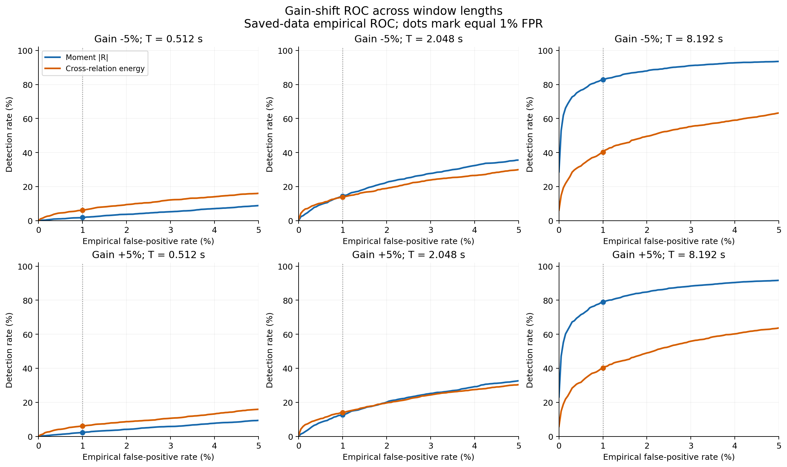
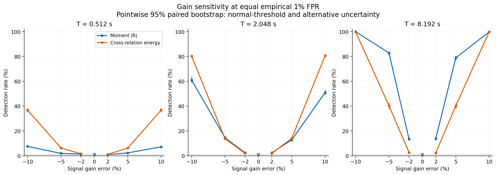
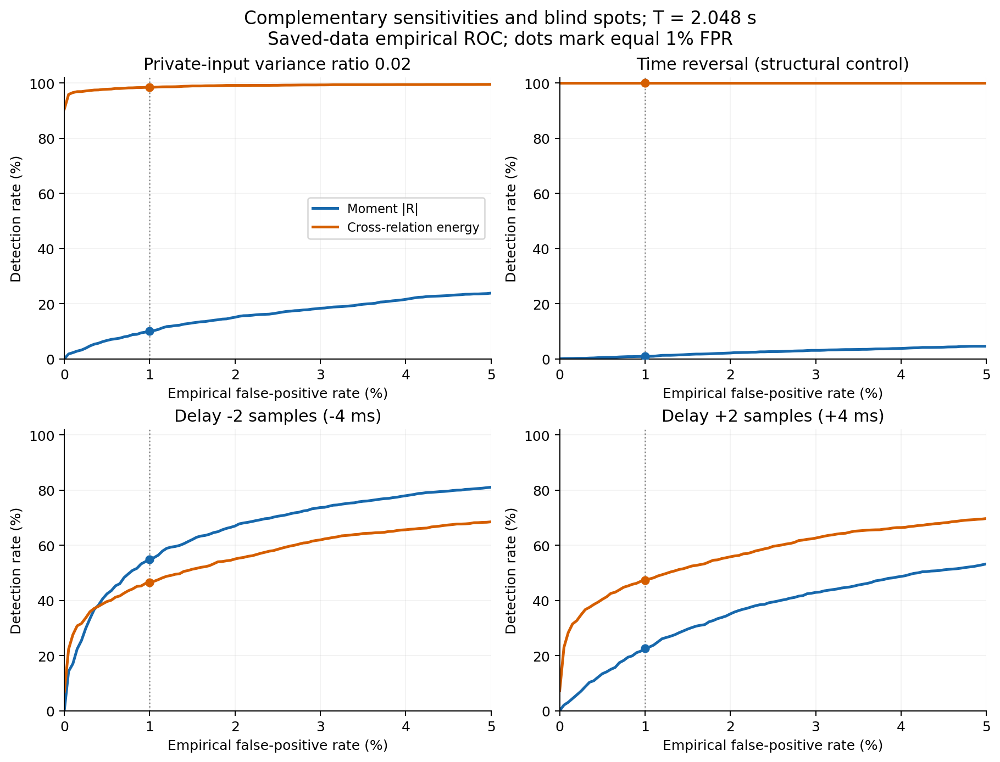

# 保存済みスコアによるROC比較と長窓感度の分析

**作成日：2026年10月17日**  
**対象：統合方法論原稿への反映前の事後分析**  
**データ：Colab本実行 `main_2ae37613a10478c8`**

## 要旨

保存済みの正常・異常スコアから、両手法の経験的誤警報率を同じ1%に揃えて再比較した。長窓での小さなゲイン変化に対するモーメント法の優位は残る。評価窓8.192秒、ゲイン−5%ではモーメント法82.80%、CR法40.26%、ゲイン＋5%では78.84%、40.22%となった。正常記録を校正用・確認用に分割したチェックでも、長窓での順位は維持された。

ただし、短窓では同じゲイン変化にCR法の方が強く、私的入力や時間反転でもCR法が大幅に優位である。さらに、小さなゲイン変化でも入力相関率・時定数比・読出し雑音の条件で順位が変わる。結果は「モーメント法がCR法より一般に優れる」という主張ではなく、両者の感度と情報の違いを示す。

前回の名目1%判定で報告した「ゲイン＋5%、8.192秒で80%検出」は、同率比較では**78.84%**に下がる。したがって、この条件で80%に到達したという表現は採用しない。

本分析は既存記録の再集計であり、新しいプローブ時系列は生成していない。論文MD・TeX・PDF、元ZIP、元Colabコードは変更していない。

## 1. データと監査

入力は [Colab完走ZIP](../../../docs/OMITTED_MATERIALS.md#item-7bac3f1fce5f)。解析コードは [analyze_covariance_roc.py](../../scripts/analyze_covariance_roc.py)。

| 項目 | 確認内容 |
|---|---|
| 元実行 | 146条件、197タスク、4,779,949記録 |
| 保存整合性 | 全8,024チャンクのSHA-256、連続した開始番号・件数、設定ハッシュを照合 |
| ソース整合性 | ZIP内ソースの計算エンジンハッシュが実行設定と一致。ソースは実行していない |
| 今回のROC対象 | 実験3の異常90条件：主要78、構造的対照6、頑健性6 |
| 正常データ | 条件対応する9群、各20,000記録 |
| 異常データ | 各条件5,000記録 |
| スコア | 同一記録から得た `abs(R_full)` と、符号を保持した `CR` |
| 元実行の時間 | 計算・集計694.01秒。ZIP化・ダウンロード時間は含まない |

元ZIPのSHA-256：

```text
ead4356ab3f54a58758002b6204e561e26ca87e566a14f680e82f793afe5418c
```

各異常条件は、同じ `reference_id` を持つ正常評価条件と対応させた。異なる入力相関率・時定数・雑音条件を一つの正常分布へ混ぜていない。読込スコアの件数と有限値を検査し、欠損・無限値の除外やスコアの方向反転は行っていない。詳しい実行記録は [audit.json](audit.json) に保存した。

## 2. 「誤警報率を揃える」の定義

### 2.1 主要分析：経験的ROC

モーメント法の判定スコアを $s_M=|\widehat R_{\rm full}|$、CR法を $s_C=\widehat E_{\rm CR}$ とし、どちらも $s>q$ で警報を出す。CRスコアは対照差なので負値もあり得るが、絶対値に変えてはいない。

各手法・各正常条件について、正常20,000記録のスコアを昇順に並べる。1%比較では上位200記録が警報となる境界を使った。正常スコアに同値がないことを確認したので、**この正常標本上では両手法とも厳密に200/20,000＝1%**である。閾値は正常スコアだけで決め、異常データを使って最適化していない。同一正常条件に対応する異常には同じ閾値を使う。

主要な評価点はFPR＝0.1%、0.5%、1%、2%、5%。ROC表示用には0〜10%を0.05パーセントポイント刻みで保存した。図は0〜5%を表示する。図中の線は保存したROC点を結んだもので、連続分布の真のROCそのものではない。

この分析は、元実行では評価用だった正常データを**ROC算出用に再利用する事後分析**である。正常標本上の1%は構成上の値であり、将来の正常記録でも1%になることを独立に実証したものではない。元の9,999正常参照による名目1%判定とは、閾値の作り方を明確に区別する。

### 2.2 補助分析：正常データの固定分割

正常20,000記録を、固定乱数種で10,000の校正用と10,000のホールドアウトへ分けた。両手法には同じ記録分割を適用した。校正用100/10,000＝1%を閾値とし、ホールドアウト正常記録の誤警報率と、独立に生成済みの異常5,000記録の検出率を計算した。

これにより、閾値決定と正常確認の役割は計算上分離される。ただしデータ一式はすでに前回の分析で閲覧しているため、新たな盲検試験・外部検証ではない。また、ホールドアウトでの両手法のFPRを再び一致させるような再調整は行っていない。

### 2.3 不確実性とAUC

1%比較では正常記録と異常記録をそれぞれ1,000回再標本化した。各再標本化で、両手法には同じ記録インデックスを使い、正常側の閾値も再推定した。報告する95%パーセンタイル区間は、**閾値推定と異常評価の両方のばらつき**を含む。元の固定閾値だけの区間より広くなり得る。これは条件ごとの区間であり、90条件を同時に覆う区間や多重比較補正済み判定ではない。

全域AUCは順位から直接計算した。低FPR側の比較には

$$
\overline{\mathrm{pAUC}}_{0.05}
=\frac{1}{0.05}\int_0^{0.05}\mathrm{TPR}(u)\,du
$$

を用いた。これは0〜5%のFPR帯で平均した検出率であり、ランダム性能を0.5へ補正する別流儀の「標準化pAUC」ではない。偶然水準のROCなら期待値は0.025、完全識別なら1になる。面積は表示用の粗いグリッドではなく、スコア順位から求めた。AUC・pAUC自体の信頼区間は今回計算していない。

## 3. 長窓でのゲイン検出

基準設定は $\tau_i=0.04$秒、$\tau_j=0.01$秒、$\kappa=20$、標本間隔0.002秒。独立読出し雑音の分散比は0.1、共有雑音は0、雑音対照と評価窓の長さ比は1。ゲイン変化はシミュレーション仕様どおり信号成分へ適用され、読出し雑音全体を同時に増幅する故障を表すものではない。

### 3.1 同じ1% FPRでの比較

| 評価窓T | ゲイン変化 | モーメント法 | CR法 | 差 M−CR（百分率ポイント、95%区間） |
|---:|---:|---:|---:|---:|
| 0.512秒 | −5% | 1.86% | 6.20% | −4.34［−5.28, −3.50］ |
| 0.512秒 | ＋5% | 2.28% | 6.16% | −3.88［−4.66, −2.92］ |
| 2.048秒 | −5% | 14.48% | 13.78% | ＋0.70［−1.08, ＋2.48］ |
| 2.048秒 | ＋5% | 12.70% | 13.96% | −1.26［−2.94, ＋0.54］ |
| 8.192秒 | −5% | **82.80%** | 40.26% | **＋42.54［＋39.54, ＋45.30］** |
| 8.192秒 | ＋5% | **78.84%** | 40.22% | **＋38.62［＋35.92, ＋41.58］** |

短窓ではCR法、中間窓では差が小さく、長窓ではモーメント法が優位となる。長窓の差は、前回の実測FPRがモーメント法1.225%、CR法1.030%だったことだけでは説明されない。同じ経験的1%へ合わせた後にも約39〜43ポイントの差が残っている。



*図1：上段−5%、下段＋5%。左右で評価窓を変え、各パネル内では同じ正常条件を使う。点は共通FPR＝1%。曲線の信頼帯は示していない。[SVG版](figures/roc_gain_by_window.svg)。*

### 3.2 長窓の結果は1%の一点だけではない

| T＝8.192秒 | 手法 | 全域AUC | 平均pAUC（FPR 0〜5%） |
|---|---|---:|---:|
| ゲイン−5% | モーメント | 0.9860 | 0.8681 |
| ゲイン−5% | CR | 0.9061 | 0.4935 |
| ゲイン＋5% | モーメント | 0.9814 | 0.8357 |
| ゲイン＋5% | CR | 0.9068 | 0.4961 |

低FPR帯全体を面積で見ても、長窓の小さなゲイン変化でモーメント法が高い。これはAUC差の有意性検定ではなく、この標本における記述的比較である。



*図2：±2%、±5%、±10%の保存済み異常条件。縦線は閾値推定も含む点ごとの95%区間。灰色の×は正常標本上の0%ゲイン誤差・FPR＝1%を表す。線は同符号の試験点を結ぶ補助線で、未試験の誤差に対する予測ではない。[SVG版](figures/gain_power_equal_fpr.svg)。*

### 3.3 「80%到達」の修正

前回の名目1%判定では、＋5%、8.192秒で80.32%だった。同率1%では78.84%となり、モーメント法単体の95%区間は76.92〜80.44%。したがって「この窓長で80%の検出性能を達成」とは結論しない。−5%では82.80%、区間81.08〜84.24%である。

どちらの場合も、試した窓長は0.512、2.048、8.192秒の3点だけであり、連続的な最小必要記録長は推定していない。Tは評価窓であって取得時間全体ではない。基準条件のデジタル処理には0.8秒のウォームアップが別にあり、独立雑音対照も使用している。

## 4. ホールドアウトによる確認

### 4.1 正常時の誤警報率

| 評価窓T | モーメント法の確認用FPR | CR法の確認用FPR |
|---:|---:|---:|
| 0.512秒 | 1.01%［0.83, 1.23］ | 0.99%［0.81, 1.20］ |
| 2.048秒 | 1.08%［0.90, 1.30］ | 0.80%［0.64, 0.99］ |
| 8.192秒 | 0.98%［0.81, 1.19］ | 1.01%［0.83, 1.23］ |

角括弧は固定された校正閾値に条件付けた95% Wilson区間。校正閾値自体の不確実性を統合した区間ではない。中間窓のCRでは1%より低い値が出ており、全ての条件で「正確に1%だった」とは扱わない。頑健性条件を含む18組の確認用FPRは0.80〜1.16%だった。

### 4.2 長窓の検出率

固定分割で得た閾値を異常記録へ適用すると、8.192秒で次の値となった。

| ゲイン変化 | モーメント法 | CR法 |
|---:|---:|---:|
| −5% | 82.66% | 40.42% |
| ＋5% | 78.74% | 40.32% |

この窓での確認用FPRは0.98%対1.01%であり、長窓の差は保たれている。ただし、同じ保存済み異常記録を再利用した補助確認で、独立な再実験ではない。

## 5. 優位でない条件と構造的な盲点

| 条件（T＝2.048秒、同率1%） | モーメント法 | CR法 | 差 M−CRの95%区間（百分率ポイント） |
|---|---:|---:|---:|
| 私的入力・分散比0.02 | 10.06% | **98.46%** | ［−89.66, −87.02］ |
| 時間反転 | 0.90% | **100.00%** | ［−99.36, −98.78］ |
| 相対遅延−2標本（−4 ms） | **54.80%** | 46.56% | ［＋5.12, ＋11.72］ |
| 相対遅延＋2標本（＋4 ms） | 22.52% | **47.36%** | ［−27.78, −21.42］ |
| 追加極・時定数比0.5 | 23.00% | **44.52%** | ［−24.80, −18.08］ |



*図3：同じFPRで比較しても私的入力・時間反転でのCR法の優位は消えない。遅延には符号による非対称性がある。[SVG版](figures/roc_complementary_cases.svg)。*

時間反転のモーメント法の全域AUCは0.4961で、偶然水準に近い。一方、CR法は保存された5,000記録で全件を検出した。時間順序を反転してもゼロラグの二次モーメントは保存されるため、これはモーメント法の情報上の限界と整合する。全件検出は将来の検出確率100%の保証ではない。全件成功・全件失敗付近の再標本化区間は退化し得るので、区間幅ゼロを確実性と解釈しない。

時定数誤差については、条件によって差があっても検出率そのものが低い場合がある。「CRより高い」と「実用上十分に検出できる」を区別する必要がある。全条件の数値をCSVに残し、図示した例だけで一般的な優劣を判定しない。

## 6. 基準条件からの一般化は限定的

ゲイン＋5%、T＝2.048秒の頑健性条件では、同率1%でも次のように順位が変わった。

| 基準からの変更 | モーメント法 | CR法 |
|---|---:|---:|
| 時定数比2 | 15.70% | 11.82% |
| 時定数比10 | 2.66% | 15.64% |
| 入力相関率κ＝2 | 23.20% | 19.54% |
| 入力相関率κ＝200 | 1.98% | 6.50% |
| 読出し雑音分散比0.01 | 26.12% | 99.48% |
| 読出し雑音分散比0.5 | 2.66% | 1.98% |

これは各条件に対応した正常データで閾値を作り直した比較である。低雑音条件ではCR法が大きく有利なので、「ゲイン誤差には常にモーメント法が強い」とは言えない。高雑音条件では両者とも検出率が低く、差の95%区間も0を含む。

**入力分布変化への耐性を実証したものでもない。** 元実行の固定参照κ＝20を使った正常入力の変化試験では、κ＝2でモーメント法の誤警報率4.81%、CR法1.06%、κ＝200で0%、0.945%だった。今回これらの変化先を再校正して問題を隠すことはしていない。同率ROCは同一正常分布内での感度比較であり、「入力スペクトルによらない恒等式」から「入力分布によらない検定閾値」は導けない。

## 7. 論文へ反映する際の判断

### 採用できる記述

- 本試験の基準条件では、評価窓が長くなるとゲイン±5%に対する検出順位が逆転し、8.192秒でモーメント法が高い検出率を示した。
- この差は、同じ正常標本上のFPRを1%に揃え、閾値推定の不確実性を含めても残った。低FPR帯の経験的ROC・pAUCも同じ傾向を示した。
- CR法は私的入力と時間反転に強く、二次モーメントへの圧縮で失われる時間方向の情報が実際の感度差として現れた。
- 正常分布と閾値校正、共有雑音補正、故障の種類を含めて、両検査の使い分けを記述するのが妥当である。

### 採用しない記述

- 「モーメント法はCR法より一般に高性能」「既存のパラメータ推定法を上回った」。比較対象は固定校正のクロスフィルタ・エネルギー検査であり、先行研究の推定器そのものではない。
- 「＋5%ゲインを8.192秒で80%以上検出する」。同率比較の点推定は78.84%。
- 「20,000記録上で1%なので未知データでも1%を保証する」「入力変化に再校正は不要」。
- 「時系列全体の整合性を二次モーメントだけで判定できる」。時間反転の対照が反例になる。

図1・図2を同率比較の主要図、図3を限界の図として候補にする。旧図をそのまま増やすのではなく、名目1%と経験的同率1%を混同しない構成へ置き換える。今回の図・分析表はまだ論文には挿入していない。

## 8. 適用範囲と残る確認

この再分析は一つの合成実行の事後解析で、OU入力・指定した線形プローブと雑音モデルの範囲に限られる。図の例は前回結果を見て選んでいるため、事前登録された確認的検定とは区別する。全90条件を保存することで結果の選別を追跡可能にしたが、それで新規データの役割を代替するわけではない。

正常分割は1回、ブートストラップは1,000回。区間は点ごとであり、共有正常群に由来する条件間依存もある。微小差を全条件横断で「有意な勝利」と数える使い方はしない。ROCのゼロFPR点は正常20,000記録での観測ゼロで、母集団の誤警報確率ゼロを意味しない。

追加実験を行うなら、今回特定した長窓・ゲイン条件を新しい独立乱数種で確認し、入力分布変化下での再校正方針を検証するのが優先となる。ただし、現在のデータを用いた限定的な方法比較の記述には、今回の結果と上記の制約をそのまま利用できる。新規性・実機での有用性・一般的性能保証は、この再集計だけでは判定しない。

## 9. 再現方法と成果物

数値集計はNumPy、描画はMatplotlibを使用する。乱数は保存済み記録の分割と再標本化にのみ使い、解析seedは `2026101702`。元実験seed `20261017` とは別である。NumPy等の環境、入力ハッシュ、解析コードのハッシュはJSONに記録している。

リポジトリのルートで、NumPyとMatplotlibのあるPython環境から実行する。

```sh
python3 numerics/scripts/analyze_covariance_roc.py
python3 -m unittest discover -s numerics/tests -p test_roc_analysis.py -v
python3 numerics/tools/verify_covariance_roc.py
```

集計と描画を分ける場合は `--analyze-only` と `--plots-only` を使う。`--archive` と `--out` で入力・出力を指定できる。スクリプトが再生成するのは派生CSV・図・JSONで、この説明用MDや論文は上書きしない。異なる入力で再生成した場合は、MDの数値・解釈も別途点検すること。

今回の出力は、同率比較900行のFPR・検出件数を元スコアと照合した。全180組のAUC・pAUCは、別手順の「正常・異常スコアを一緒に並べた経験的ROCの積分」と比較し、最大差は両者とも $2.23\times10^{-16}$ 未満だった。対応付き差90行、決定的テスト5件、ファイルリンクも確認した。[検証コード](../../tools/verify_covariance_roc.py) は今回の既定ZIP・出力先を対象とする。図3点は描画後に目視確認した。

| ファイル | 内容 |
|---|---|
| [matched_fpr_power.csv](tables/matched_fpr_power.csv) | 90条件×2手法×5 FPR点。1%では再標本化区間付き |
| [paired_power_difference.csv](tables/paired_power_difference.csv) | 1%に揃えた検出率差と対応付き区間 |
| [normal_thresholds.csv](tables/normal_thresholds.csv) | 正常9群の閾値と、実測FPR一致の記録 |
| [roc_grid.csv](tables/roc_grid.csv) | 全90条件のROC表示用グリッド |
| [auc.csv](tables/auc.csv) | 全域AUCと0〜5%の平均pAUC |
| [holdout_false_alarm.csv](tables/holdout_false_alarm.csv) | 校正・ホールドアウト分割後の正常FPR |
| [holdout_power.csv](tables/holdout_power.csv) | 分割校正閾値での異常検出率 |
| [audit.json](audit.json) | 元実行・入力整合性・解析設定・環境 |
| [figure_environment.json](figure_environment.json) | 描画環境 |
| [validation.json](validation.json) | 再集計後の独立照合と決定的テストの記録 |

本レポートと派生図表はリポジトリの研究資料ライセンス [CC BY 4.0](../../../LICENSE-CC-BY-4.0.txt)、解析コードは [Apache 2.0](../../../LICENSE) の対象とする。
