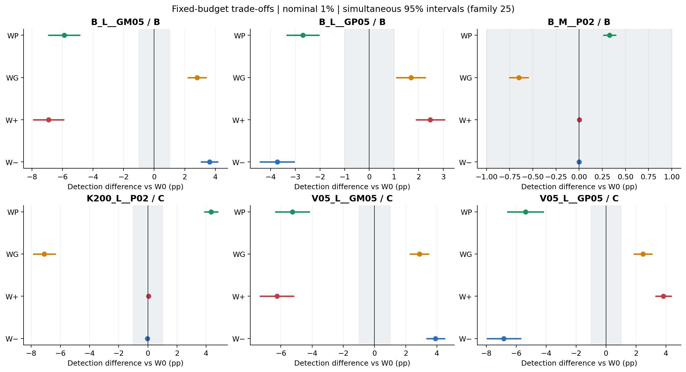
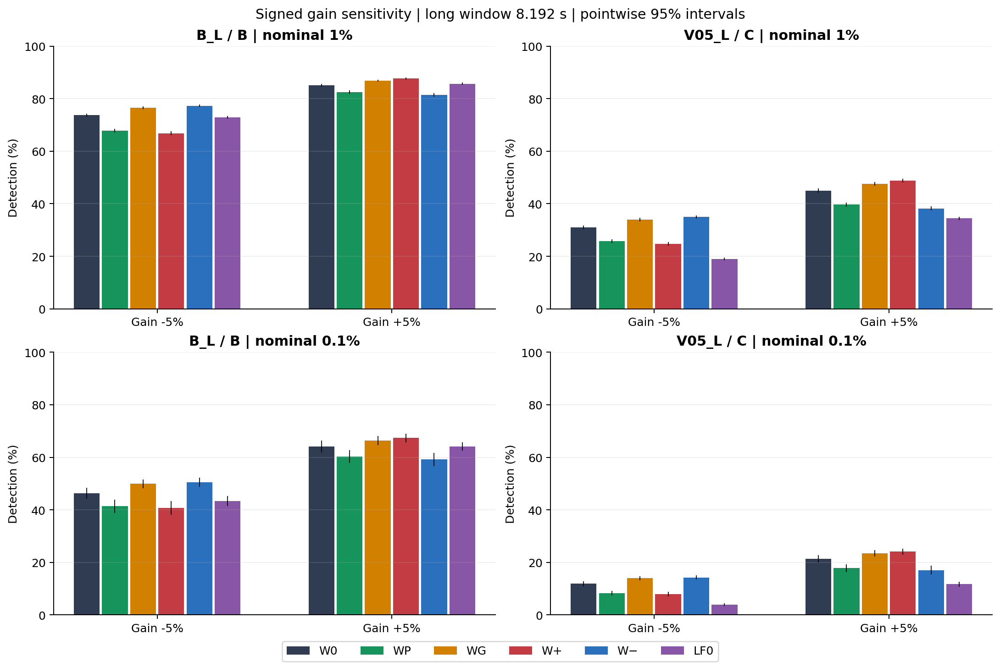
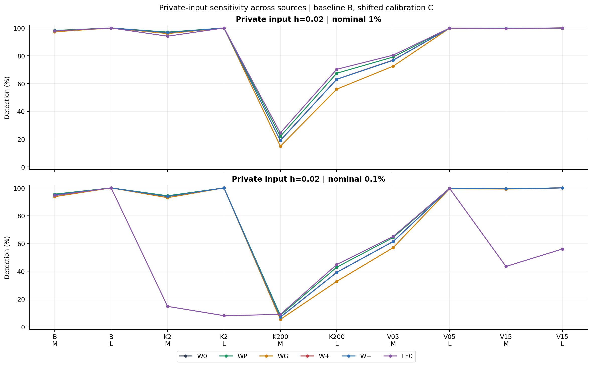
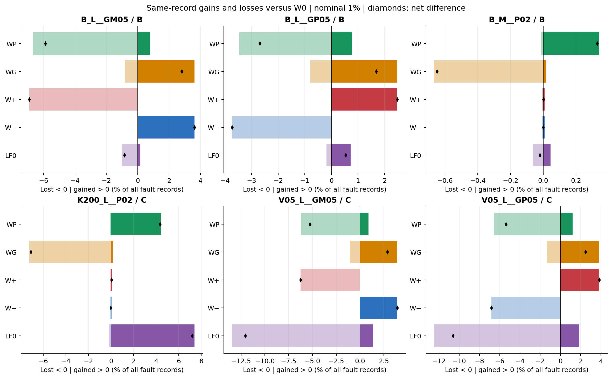
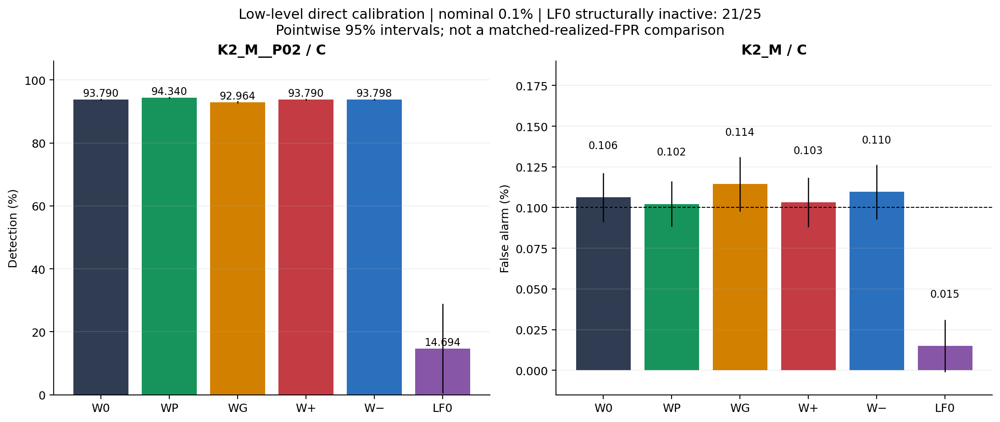
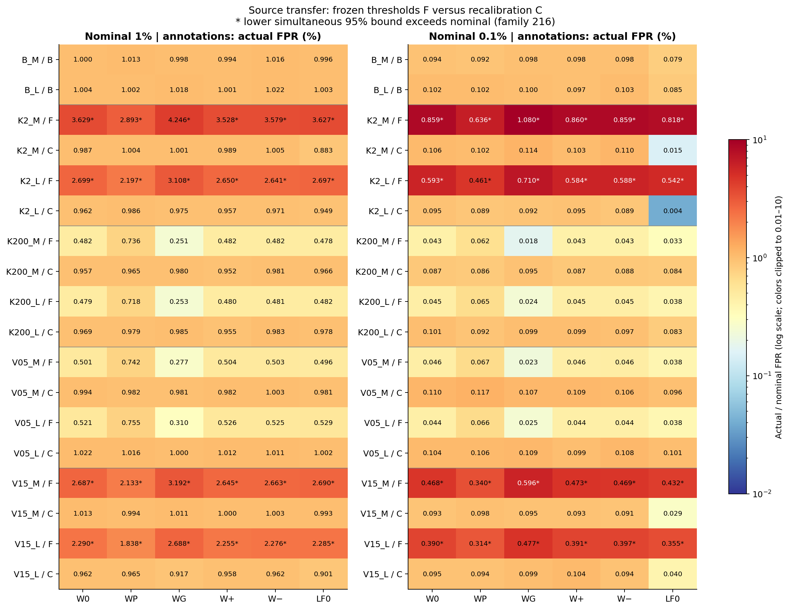
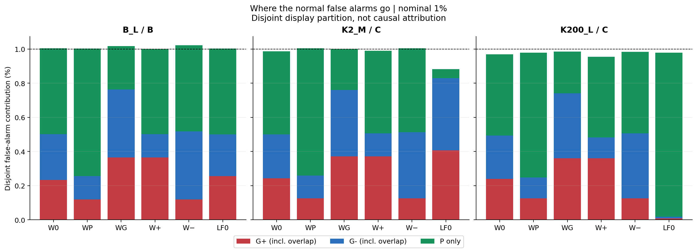

# PR-0006：警報予算の配分は、何を拾い、何を失うか

2026-10-18（JST）／保存済み25反復の再照合・性能分析。run `6f23fc7946f8`。原論文・融合則・科学条件は変更していない。

## 1. 結論

**固定LF射影のままでも、警報予算の配分でゲイン異常と私的入力の感度を交換できる。交換には明確な代償があり、5配分の一つが一律に最良という結果ではない。** 正負ゲインの優先配分も、実際の検出を予想された方向に動かした。

主な結果は次のとおり。

- 私的入力寄りWPは、高速源・長窓・閾値更新Cの私的入力でW0より **+4.3456 pp**。一方、基準長窓の−5%／+5%ゲインでは **−5.8920／−2.6936 pp**。
- 正側寄りW+は基準長窓の+5%ゲインで **+2.4760 pp**、−5%では **−6.9144 pp**。負側寄りW−はそれぞれ **−3.7304／+3.6184 pp**。同じ総予算をどう配るかが、そのまま感度交換になる。
- 低水準0.1%・低速源K2_M・Cの私的入力では、W0の検出率 **93.7896%**、LF0は **14.6936%**。ただし正常FPRも **0.1062%対0.0150%**で異なる。LF0は25反復中21反復で順位上限に達して常時非発火だった。これは直接校正の運用上の回復であって、実測FPRを揃えた識別優位ではない。
- 正常源移送のFPR超過フラグは、基準B・閾値更新Cで **0/120系列**、閾値据え置きFで **48/96系列**。配分を変えるだけでは源統計変化への再校正を代替できない。
- LF0にも強みが残る。高速源・長窓の私的入力では、1%でLF0 **70.2640%**、WP **67.4176%**、W0 **63.0720%**。直接校正を一様な上位互換としない。

保存された13,749,700記録、50参照モデル、250校正設定、195,000,000方式・水準判定を再照合した。最終警報ビットは全件一致し、科学的な不成立・非有限記録は0。監査側のt分位点照合の過剰な厳しさを1件訂正したが、元のデータや判定は変えていない（§9）。

## 2. 比較の読み方

設計正本は[PR-0006研究カード](../../../audits/prereg/PR-0006_lfdc_alarm_budget_confirmation.md)。過去PR-0004/0005の観察から選んだ仮説を、その後の新しい25反復で調べた、**同一シミュレーションモデル内の独立確認**である。実機確認ではない。本分析手順の[初稿](../../../docs/OMITTED_MATERIALS.md#item-392fef623db8)と[数値照合訂正](PROTOCOL.md)は実験後の記録として区別する。

全方式は同じ基準正常refから得たμ・Wを使い、符号付き射影を `sg, sp` とする。直接校正は `(sg, −sg, sp)` の3尾を独立正常calから校正する。

| 方式 | 正側G+ | 負側G− | 私的入力側P | 意味 |
|---|---:|---:|---:|---|
| W0 | 1/4 | 1/4 | 1/2 | 基準配分 |
| WP | 1/8 | 1/8 | 3/4 | 私的入力側を優先 |
| WG | 3/8 | 3/8 | 1/4 | 両符号ゲイン側を優先 |
| W+ | 3/8 | 1/8 | 1/2 | 正側を優先 |
| W− | 1/8 | 3/8 | 1/2 | 負側を優先 |
| LF0 | 固定比なし | 固定比なし | 固定比なし | ref内の `abs(sg), sp` の順位最大値をcalで全体校正 |

α=1%を主、0.1%を補足とする。calは各正常群15,999件。直接校正の順位は整数で決め、厳密な `>` で警報。同値のランダム化や予算の再配分はしない。5配分をさらにORしたシステムは評価していない。枝名は故障原因を確定するラベルではない。

Mは2.048秒、Lは8.192秒。dt=0.002秒、τi=0.04秒、τj=0.01秒。源はGaussian AR(1)。Bはκ=20・分散1、K2/K200はκ=2/200、V05/V15は分散0.5/1.5。ゲイン変化はj信号だけに適用し、私的入力は独立源をj応答に通す。読出し雑音の分散は基準信号に対して固定し、源の変化に追随して変えない。

- **B**：基準射影＋基準校正。
- **F**：基準射影・中心・順位表・閾値を移送先へ据え置く。
- **C**：射影・中心・LF0参照順位表を維持し、移送先正常calで閾値だけ更新する。再学習Rではない。

参照・校正・評価は別役割の記録で、評価結果で配分を選んでいない。同じ評価記録に6方式・両αを適用し、F/Cも同じ記録で比較する。外側25反復が推測単位で、195百万判定を独立標本数として扱わない。正常評価は1文脈あたり20,000×25=500,000件、故障・対照は5,000×25=125,000件。固有評価は9,250,000件、F/C適用後の延べ評価は16,250,000件である。

主要25差には家族25、正常FPR216系列には別家族216の両側Bonferroni95%外側t区間（df24）を用いる。その他は点95%の記述区間。1 ppは固定した記述上の目安であり、実用上の許容損失ではない。

## 3. 主結果：配分による感度交換

図1：公称1%でのW0との差。線は家族25の同時区間、灰色は±1 pp。各パネルの横軸範囲は異なる。25番目の低水準比較は§6に示す。[主要25比較の全数値](PRIMARY_RESULTS.md)を別表に保存した。

### 私的入力を優先する代償

K200_L__P02・Cでは、WP−W0は+4.3456 pp、同時区間[+3.8622,+4.8290] pp。WG−W0は−7.1024 pp、[−7.8851,−6.3197] ppだった。対して基準長窓の両符号ゲインでは、WPが損失、WGが改善する。**H1で指定した6つの符号予想は、それぞれ同時区間で支持された。**

ただし、基準Mの私的入力はW0ですでに97.9080%を検出している。WPの上積みは+0.3296 pp、WGの損失は−0.6504 ppで、どちらも同時区間全体が±1 pp内。統計的な差と大きな実用差は同じではない。W+／W−の差はここでは未確定だった。

### 正側と負側の交換

基準Lと分散半減V05_L・Cの両方で、正ゲインはW+が改善・W−が損失、負ゲインは逆となった。**H2の8つの符号予想を、それぞれ支持する。** 例えばV05_L・Cでは、W+が+5%ゲインを+3.8400 pp改善する一方、−5%ゲインを−6.2552 pp失う。W−では−5%を+3.9144 pp改善し、+5%を−6.8264 pp失う。

この交換は「符号を失わず残す」ことの具体的な用途を示す。一方、片側を優先したからといって両符号の感度が等しくなるわけではない。

## 4. 正負ゲイン：絶対検出率と小さい故障

図2：長窓の正負5%ゲイン。基準Bと分散半減V05・C、公称1%／0.1%。細線は点95%区間。下表は公称1%の検出率（%）。

| 条件・方針 | W0 | WP | WG | W+ | W− | LF0 |
|---|---:|---:|---:|---:|---:|---:|
| B_L −5%・B | 73.7040 | 67.8120 | 76.5144 | 66.7896 | 77.3224 | 72.8528 |
| B_L +5%・B | 85.1464 | 82.4528 | 86.8336 | 87.6224 | 81.4160 | 85.6792 |
| V05_L −5%・C | 31.0224 | 25.7592 | 33.9024 | 24.7672 | 34.9368 | 18.9624 |
| V05_L +5%・C | 45.0352 | 39.6536 | 47.5144 | 48.8752 | 38.2088 | 34.4400 |
| B_L −2%・B | 9.5000 | 6.7464 | 11.4792 | 6.4520 | 11.7904 | 9.0696 |
| B_L +2%・B | 12.3048 | 10.1160 | 14.2080 | 14.9200 | 9.3792 | 12.7896 |

小さい±2%ゲインは補足条件であり、どの配分でも検出率は約6–15%にとどまる。例えばW0の見逃しは−2%で90.5000%、+2%で87.6952%。配分で改善できる部分はあっても、「小さなゲイン変化を十分検出できる」と一般化できない。

V05_Lでは全5直接配分の平均検出率がLF0を上回った。しかし主比較として固定したのはW0に対する予算交換であり、このLF0対比は全条件付表に残した補足記述である。評価後に一番よかった配分を選んで確認済みの推奨方式と呼ぶことはしない。

## 5. 私的入力と、同じ記録での拾得・損失

図3：h=0.02の私的入力、全10正常群に対応する故障。基準はB、移送先はC。点は反復平均で、線は条件順の目印（連続補間ではない）。個々の区間は[全条件表](ALL_RESULTS.md)にある。

高速源では私的入力の検出が難しく、K200_L・C・1%でもW0は36.9280%、WPは32.5824%、LF0は29.7360%を見逃す。基準Mの小さいh=0.005も、W0 34.3688%、WP 37.8536%、WG 29.1008%の検出率にとどまる。全条件で簡単に100%近くになるわけではない。

図4：同じ故障記録でのW0に対する拾得（右）／損失（左）。黒い菱形は正味差。分母は全故障125,000記録で、W0の見逃し数や検出数を分母にした割合ではない。各パネルの横軸範囲は異なる。

| 条件・方針 | 左方式（対W0） | 左だけ検出 % | W0だけ検出 % | 正味差 pp | 両方見逃し % |
|---|---|---:|---:|---:|---:|
| K200_L P02・C | WP | 4.4544 | 0.1088 | +4.3456 | 32.4736 |
| K200_L P02・C | WG | 0.1432 | 7.2456 | −7.1024 | 36.7848 |
| K200_L P02・C | LF0 | 7.3872 | 0.1952 | +7.1920 | 29.5408 |
| B_L −5%・B | WP | 0.7752 | 6.6672 | −5.8920 | 25.5208 |
| B_L +5%・B | WG | 2.4760 | 0.7888 | +1.6872 | 12.3776 |
| V05_L −5%・C | LF0 | 1.3816 | 13.4416 | −12.0600 | 67.5960 |

重要なのは、改善した方式も既存検出を必ず全部保持するわけではないこと。K200_LのWPは5,568件を新たに拾い、136件を失って、正味5,432件を増やした。単なる検出率差ではこの交換が隠れる。[全15方式対の四分表](ALL_PAIRED_RESULTS.md)は正常も含めて保存した。正常における「追加」は追加誤警報であり、改善と数えない。

## 6. 0.1%での直接校正とLF0の順位上限

図5：H3の事前指定条件、K2_M・C。左はh=0.02検出、右は正常FPR。縦線は点95%外側区間。LF0のFPR区間が0未満へ出る部分も表示している。確率が負という意味ではなく、外側t近似の非有界性である。

| 方式 | 私的入力検出率 % | 見逃し率 % | 正常FPR % | 構造的な常時非発火反復 |
|---|---:|---:|---:|---:|
| W0 | 93.7896 | 6.2104 | 0.1062 | 0/25 |
| WP | 94.3400 | 5.6600 | 0.1022 | 0/25 |
| WG | 92.9640 | 7.0360 | 0.1144 | 0/25 |
| W+ | 93.7904 | 6.2096 | 0.1032 | 0/25 |
| W− | 93.7984 | 6.2016 | 0.1096 | 0/25 |
| LF0 | 14.6936 | 85.3064 | 0.0150 | 21/25 |

LF0は参照順位が9,999で頭打ちとなり、校正閾値も9,999になると厳密な `>` を満たせない。これは「評価で偶然0件だった」より強い、判定構造としての非発火である。W0は有限の直接閾値を維持した。参考として、低水準CのLF0はK2_Lで23/25、V15_Mで14/25、V15_Lで11/25反復が同様に非発火だった。

H3のW0−LF0は+79.0960 pp、家族25の同時区間は[+55.1747,+103.0173] ppで、指定した正方向を支持した。ただし上端が100 ppを超えるほどLF0の反復間変動が大きい。元の近似区間を無言で切り詰めず、平均だけでなく反復分布を残す。LF0の検出率q10/中央値/q90は0／0／90.6760%であり、低い平均は均一な弱性能ではなく「多くの反復で非発火、残りで高検出」という混合に由来する。

この結果は**有限参照順位の情報圧縮を避ける価値**を支持する。しかし直接校正はより多くの警報予算も実際に使っている。実測FPRを完全に揃えたROC優位、任意の源に対する最適性、順位法一般の欠陥という結論にはしない。

## 7. 源統計変化：配分より先に、閾値の移送を点検する

図6：全正常216系列。セル数値は実測FPR（%）、色は公称値に対する比（対数色、0.01–10で色だけ飽和）。`*`は家族216の同時区間下限が公称を超えた系列。右図の最大値1.0802%は公称0.1%の約10.8倍であり、色の上限で値を隠さない。

| 校正方針 | 公称1%のFPR範囲 %（6方式） | 公称0.1%のFPR範囲 %（6方式） | 超過フラグ／系列数（両α） |
|---|---:|---:|---:|
| B：基準 | 0.9938–1.0220 | 0.0794–0.1028 | 0/24 |
| F：据え置き移送 | 0.2512–4.2458 | 0.0176–1.0802 | 48/96 |
| C：移送先正常で閾値更新 | 0.8826–1.0224 | 0.0040–0.1174 | 0/96 |

Cの直接5配分だけなら、1%で0.9168–1.0224%、0.1%で0.0858–0.1174%。C全体の著しい過少警報は主にLF0の低水準順位上限に関連する。超過フラグがないことは、各反復・将来の正常率まで公称以下だと保証するものではない。

Fの超過はK2とV15のM/L、両α、全6方式に発生した。K200とV05では逆にFが過少警報になった。**H4は、固定した超過フラグ基準と源依存のFPR変動の両面で予想と整合する。** 配分を変えることでFのFPRも動くが、どの配分でもこの移送問題そのものは解決しなかった。

閾値更新は検出にも得失を生む。W0・1%のC−Fは、V05_Lの−5%／+5%ゲインで+17.9504／+19.8272 pp、V15_Lでは−5.4536／−1.8888 ppだった。前者は過少警報から検出を戻し、後者は過剰警報を抑える際の感度損失を伴う。これを無条件の検出能力向上／劣化とは呼ばない。全C−F差と区間は[全条件表](ALL_RESULTS.md)にある。

### 同じ総FPRでも、枝への実際の配分は違う

図7：正常警報をG+（Pとの重複を含む）・G−（同）・Pのみへ排他的に分解した表示。これは件数の分割であり、原因の寄与率ではない。

K200_L・C・1%のLF0は、全体FPR0.9780%に対してP枝の周辺発火率0.9602%。W0は全体0.9688%に対してP枝0.4788%、WPは全体0.9792%に対してP枝0.7332%。同じ程度の総FPRでも、LF0はここでP側へ大きく警報を配分する。LF0の私的入力検出がWPをなお上回るという§5の観察と整合するが、この内訳だけで因果的な性能差を一意に説明したとはしない。

## 8. ここまで言えること／まだ言えないこと

今回の主要結果は、**複雑な融合則を増やす前に、符号を保持したスコア表現と校正・警報予算を管理することに実測上の価値がある**、という読み方を支持する。固定射影から出る二つのスコアを保ち、三つの尾の校正だけを明示的に管理しても、再現する感度交換が得られた。

一方、固定配分は取引条件を見えるようにしたのであって、取引をなくしたのではない。LF0の有利な条件も残り、小ゲインや高速源の私的入力にはかなりの見逃しがある。どの損失を許すかは故障頻度・コスト・運転条件を置かないと決まらない。この評価集合の平均や最多勝で一つを採用しない。

限界はここへまとめる。

1. 同じGaussian AR(1)源・一次フィルタ・固定雑音モデルの25反復。非Gaussian源、モデル不一致、実機、別のτ、オンライン連続監視の誤警報連鎖は未評価。
2. 今回は再学習Rや新しい非線形融合を比較していない。「再学習が不要」や「これが最小十分統計」という最適性は示していない。
3. 正常calと評価の分離は保持したが、外側t区間は近似。特に低水準のLF0は離散的な非発火を多く含み、区間は非有界になりうる。SD=0の区間も未定義として保存した。時間反転対照は全方式・両αで全125,000記録を検出したが、完全保証ではない。
4. 同じ応答経路を通る上流共有成分など、観測記録上で正常源の変化と区別できない条件を、この配分交換で識別可能にしたわけではない。その種の識別不能性を実験的に解決したとは主張しない。
5. 保存物は17列統計・モデル・校正・判定で、全波形はない。今回の受入はそれらの再計算一致であり、GPUの波形生成や乱数独立性の波形レベル再実験ではない。同一エージェントによる別経路自己監査で、外部独立査読ではない。

次に選ぶなら、**融合則の追加ではなく、許容する見逃しと正常源更新の条件を定めてから、固定候補を前向きに選ぶ**方向を推奨する。これは次の設計候補であり、今回のデータで配分を学習・採用したものではない。新規追試・方式採択・論文反映は別裁定とする。

## 9. 再照合、監査訂正、追跡可能性

6 ZIPを再読込し、延べ6,909索引メンバーのサイズ・CRC・SHA-256、catalog、cell/run/spec、反復00–24の収録を確認した。全4,100チャンク・1,400役割タスク・13,749,700記録を再計数。モデル50、校正250、評価文脈1,900を再計算した。これは2水準×6方式で22,800評価組、195,000,000判定に相当する。

参照再推定と2×2逆行列の別計算を照合後、保存μ・W・参照順位表を正本として使用した。正常calからの別ソート経路の閾値最大差は8.88×10⁻¹⁶。判定ビット・枝・対応四分表・carryは完全一致。16,813個の外側区間を別算術経路でも照合した。非有限記録、無効モデル／校正、無効方向、評価不成立はいずれも0。数値再照合終了時の保護対象465ファイルは不変。作業終了記帳で、そのうち監査コーパス1件にQA-008を追記し、旧10,473 bytesの一致を確認した。残り464件は不変である。

初期v1監査は、SciPy1.16.3（Colab）と1.17.0（ローカル）のt分位点差により、集計区間端点の最大5.704×10⁻¹²差で停止した。60桁の不完全ベータ関数による照合で差の所在を確認し、**集計区間端点だけ**絶対1×10⁻¹⁰の比較許容差へ修正。v1失敗記録とソースは保持し、v2で全ZIPから再点検した。元の統計的判定基準、順位、検出ビット、仮説分類は変更していない。これは監査側のQA-008であり、実験の欠測・失敗・誤警報へ混ぜない。

成果物への入口：

- [主要25比較](PRIMARY_RESULTS.md)、[全率・FPR216・正負差・C−F差](ALL_RESULTS.md)、[全方式対の拾得／損失](ALL_PAIRED_RESULTS.md)、[全枝・8パターン](ALL_BRANCH_RESULTS.md)
- [再計算結果JSON](recomputed_results.json)、[再計算件数NPZ](recomputed_counts.npz)、[再照合JSON](validation.json)、[ZIP索引・全体ハッシュ](archive_inventory.json)、[t分位点点検](quantile_audit.json)
- [初期監査の訂正記録](../../../docs/OMITTED_MATERIALS.md#item-0a69fd22f7c4)、[納品点検](../../../docs/OMITTED_MATERIALS.md#item-1e32acbb517a)
- [解析本体](../../scripts/analyze_pr0006_budget.py)、[数値照合v2ラッパー](../../scripts/analyze_pr0006_budget_v2.py)、[図・全表生成](../../scripts/render_pr0006_budget.py)、[納品検証器](../../tools/verify_pr0006_analysis.py)

解析コードは保存データだけを読み、新規シミュレータを呼ばない。既存の成功出力への監査上書きを拒否し、実行時の保護アンカーも点検するため、再監査時は承認済み台帳追記を確認した別出力版を使う。図と表はJSONから再生成できる。論文・研究カード・凍結コード・原ZIPは変更していない。
