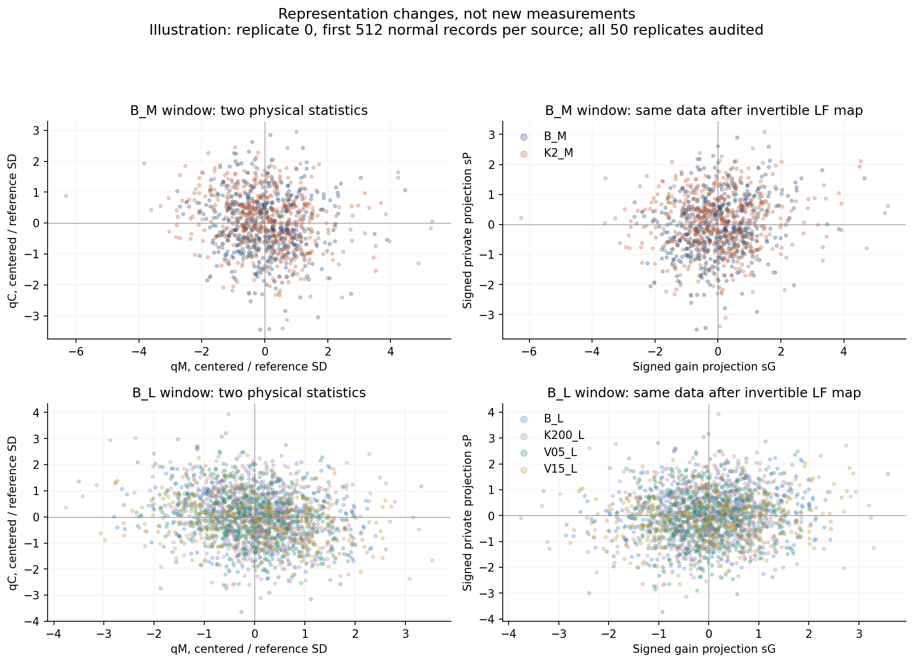
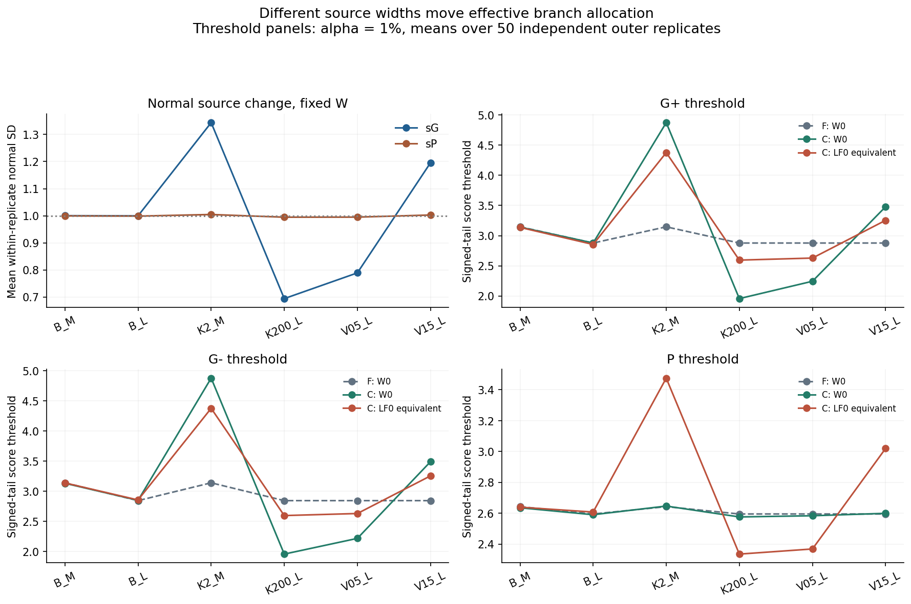
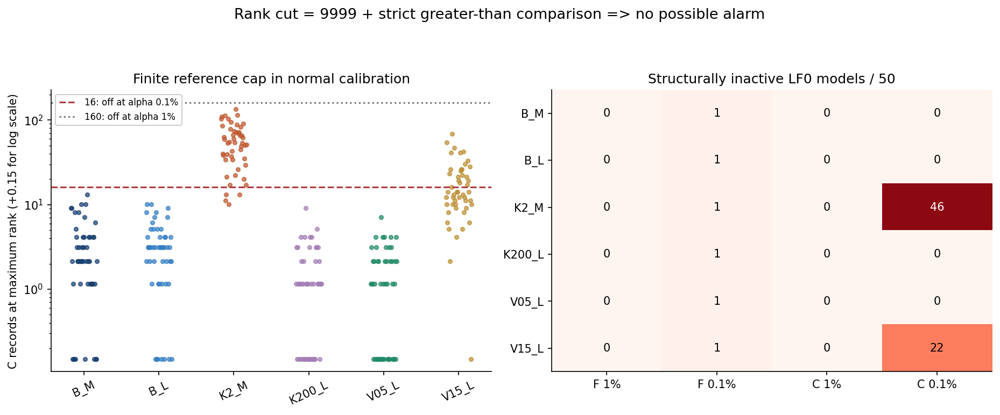
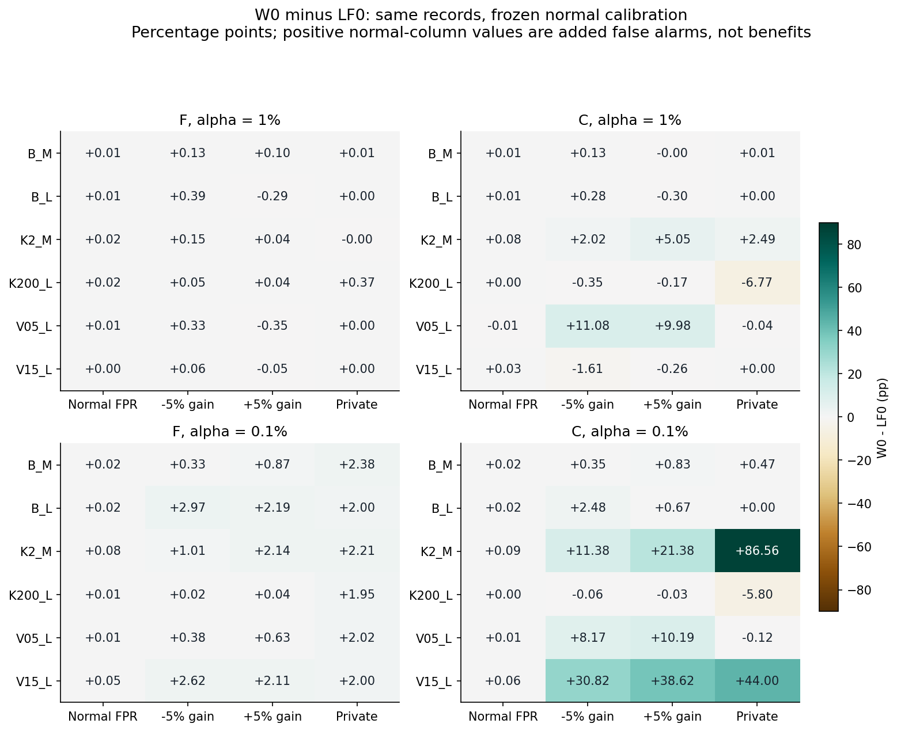
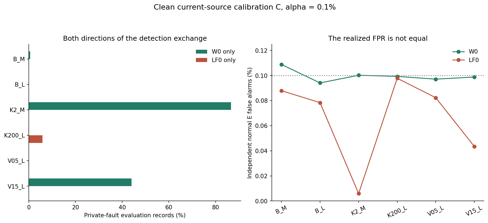
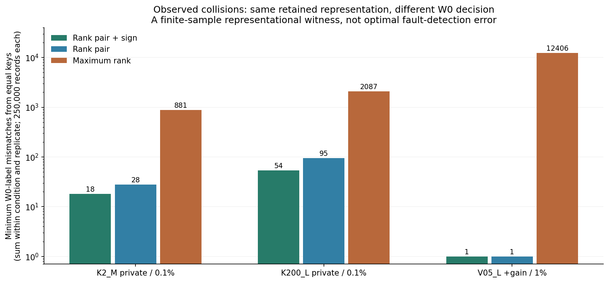
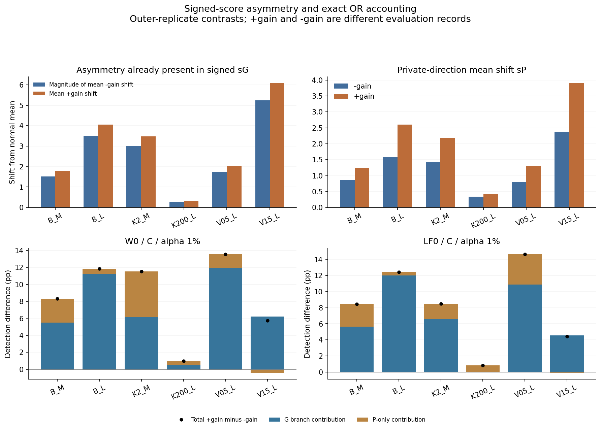

# どの段階で区別が失われるか：LFの情報圧縮と源変化

2026-10-18／PR-0009追加分析C v1。run `9adfa7a8c6e0`、50外側反復。保存データの事後的な機序分析であり、検出器・警報予算・校正を変更していない。

## 1. 結論

今回の経路を「二座標から順番に情報が減る」と捉えるのは正確ではなかった。**符号付きの二つのLF射影は全100モデルで可逆であり、最初の大きな境目は、その後の絶対値・有限順位化・最大値／閾値化にある。**

ただし、情報が失われることと、今回の検出率差の原因を同定することは別である。結果は次のように整理できる。

1. **二座標→符号付き二射影**は、今回のモデルでは情報を落としていない。射影から元二座標への再構成誤差は、参照SD単位で最大2.18×10⁻¹⁴だった。
2. **LF0の順位判定→等価な連続閾値**は、全対象記録で同じ判定になった。推論時の順位検索を外すだけでは性能も非発火も変わらない。
3. **LF0→直接校正W0**では、同じ射影でも判定が変わる。有限順位の上端、正負をまとめるか別々に校正するか、枝への警報配分の違いがある。順位化だけの寄与率には分解できない。
4. **低αの非発火は具体的な校正境界で説明できた。** K2_M・清浄更新C・0.1%では、正常校正の上端順位への集中によってLF0が46/50反復で常時非発火。私的入力検出はW0 93.8860%に対しLF0 7.3264%だった。ただしFPRも0.1002%対0.0059%と異なる。
5. **LF0が有利な条件も残る。** K200_L・C・0.1%の私的入力はLF0 45.8588%、W0 40.0620%。正負ゲイン差は絶対値化の前の符号付き射影にも現れ、最終ORではG枝とP-onlyの感度が合成される。

したがって今回の証拠は、まず**連続値・符号・枝別の境界と来歴を保持して監査する**ことを支持する。新たな複雑な融合則や、再学習の不要性を実証したものではない。

## 2. データと比較の単位

[範囲記録](PROTOCOL.md)を計算前に固定した。対象は6群（B_M、B_L、K2_M、K200_L、V05_L、V15_L）×旧校正F／清浄更新C×2水準（1%／0.1%）×正常／負5%ゲイン／正5%ゲイン／私的入力で、**全96比較セル**。各セルに50反復を残した。

群名の意味を以下に示す。源はOU過程、κは相関率、分散は基準源に対する比である。

| 群 | κ (s⁻¹) | 源分散比 | 評価窓T (s) |
|---|---|---|---|
| B_M | 20 | 1 | 2.048 |
| B_L | 20 | 1 | 8.192 |
| K2_M | 2 | 1 | 2.048 |
| K200_L | 200 | 1 | 8.192 |
| V05_L | 20 | 0.5 | 8.192 |
| V15_L | 20 | 1.5 | 8.192 |

プローブ時定数はτi=0.04 s、τj=0.01 s、標本間隔0.002 s。GM05／GP05はj側信号の−5%／+5%ゲイン変化、P02は同じ源統計・j応答を通る独立成分を振幅√0.02倍でj側へ加える条件（信号分散比2%）である。いずれも既存実験の固定条件で、今回追加生成していない。

各チャンネルの独立測定雑音の分散は基準源での信号分散の10%に固定され、源のκ・分散を変えた後もその絶対雑音量は同じである。独立雑音対照による補正も保存条件のまま。したがって源変化は信号の時間統計だけでなく相対的なSNRも変え得る条件であり、SNRを一定に揃えた比較ではない。

Fは基準源の独立旧校正、Cは現在源の独立清浄更新候補U（candidate 0）を指す。両方とも校正15,999件、参照順位表9,999件。F/Cで変えるのは校正境界だけで、LFの中心・重み・参照表は基準源のまま固定する。参照は中窓M／長窓L別である。正常評価Eは20,000件、各故障Eは5,000件／群／反復。

中心比較はW0（固定LF射影＋三方向直接校正、予算比1:1:2）と旧LF0（絶対ゲイン順位と私的入力順位の最大値を結合校正）。他4配分の保存成績も付表へ残した。混入U、ゲート選択、Vによる政策変更は扱わない。Eは記述集計に使うだけで、方向・閾値・配分を選び直していない。

すべて既知データの追加分析である。以下の差は記述値で、新しい確認仮説の有意性判定ではない。平均と外側SDを保存し、50反復を、記録数や条件数で水増ししない。正常での追加発火は「拾得」ではなく追加誤警報として読む。

## 3. 経路を分けて読む：表現の変更と判定の変更

保存二座標をq=(qM,qC)、固定中心をμ、二方向の重みをWとし、

\[
(s_G,s_P)^\mathsf T=W(q-\mu)
\]

と書く。qMは雑音対照で補正した一次プローブのモーメント残差、qCはCRエネルギーの測定値−対照値であり、両方とも符号付きである。負のqCを0へ丸めてはいない。

| 段階 | 今回確認したこと | 失われる区別／失われない区別 |
|---|---|---|
| 波形→二座標q | 今回は全波形なし。元17列とqの恒等式を確認 | 波形の時間配置などは既に圧縮済み。失った検出能力の量は本データから測れない |
| q→符号付き(sG,sP) | 100/100モデルでランク2。全Eで逆変換を確認 | Wとμを保持すれば可逆。各射影単独は1次元だが、二つの組を残せば別である |
| sG→絶対値 | LF0は正負を同じゲイン順位へ入れる | ゲイン射影の符号がスコアから消える。保存bitの枝名は元の符号から付与しており、研究記録全体から消えたわけではない |
| 連続値→有限順位対 | 左挿入順位、同値、参照範囲外の飽和を確認 | 同じ順位区間内の距離と、上端を超えた強度差を失う |
| 順位対→最大順位 | LF0のORと完全一致 | どちらの枝が大きいか、最大でない枝の値を失う |
| 連続三閾値→枝bit | W0とLF0等価閾値を同じ記録上で比較 | 超過量を失う。W0の直接校正はLF0等価変形とは違う規則 |
| 枝bit→OR | 8×8枝対応表とORの整数帳尻を確認 | どの枝が発火したかを失う。単一警報という目的には意図された集約 |

二座標や射影には、閾値を指定しない限り二値の「判定」がない。そこに新しいM単独／CR単独の検査器を置いて、今回の方式と戦わせることはしていない。調べたのは、固定された最終判定を各表現で再現できるか、既存二方式の境界がどこで違うかである。

### 可逆性の実測

列を参照qのSDで尺度調整した行列Wの条件数は、中窓で1.273〜1.379、長窓で1.333〜1.466。全100モデルで特異ではなく、今回のE 10,500,000記録を逆変換できた。最大再構成誤差2.18×10⁻¹⁴は参照qのSDで規格化した値であり、入力の絶対値誤差ではない。



散布図は反復0の先頭512正常記録／群を固定した表示例。中心と尺度を引き継いだ可逆な座標変更であり、新しい観測情報を加えてもいない。全体の可逆性確認は50反復すべてで行った。

### 順位検索を消しても同じLF0になる

昇順参照をa[j,0],…,a[j,N−1]、左挿入順位をrj(x)=#{i:a[j,i]<x}とする。整数cut c<Nなら、同値も含めて

\[
r_j(x)>c\iff x>a_{j,c}.
\]

c=Nなら等価閾値を∞とすれば常時非発火も一致する。したがってLF0は、\(s_G>t_G\) または \(-s_G>t_G\) または \(s_P>t_P\)という三つの半平面へ書き換えられる。**42,000,000記録×方式水準の比較で元の順位判定と一致した。** これは同じ判定の実装簡約であり、直接校正W0への性能改善ではない。

## 4. 源変化は、同じ射影の正常分布と実効的な枝配分を動かす

正常の射影平均は今回ほぼ0付近のままだが、幅は同じではない。表は反復内SDの50反復平均。

| 群 | 正常sGのSD | 正常sPのSD |
|---|---|---|
| B_M | 1.0003 | 0.9994 |
| B_L | 0.9998 | 0.9986 |
| K2_M | 1.3437 | 1.0046 |
| K200_L | 0.6941 | 0.9946 |
| V05_L | 0.7890 | 0.9949 |
| V15_L | 1.1954 | 1.0027 |

この範囲では源変化に対する幅の変化が主にsG側へ現れる。固定Wが源不変化を達成したわけではない。一方、平均が大きくずれたことだけで今回の差を説明するのも適切ではない。



V05_L・C・1%では、W0の三閾値の平均はG+ 2.243839、G− 2.215190、P 2.583374。LF0の等価閾値は両G 2.628233、P 2.367920だった。**LF0は相対的にゲインへ厳しく、Pへ緩い境界になる。** これが正負ゲインをW0より多く見逃す一方、私的入力への感度を残す構造と整合する。

K200_LでもW0はG+ 1.956490、G− 1.954258、P 2.575688、LF0は両G 2.594267、P 2.334701。共通の最大順位で全体校正するLF0と、三方向へ明示的に予算を置くW0では、源変化後の実効配分が同じにならない。

逆にK2_M・C・1%ではW0のG閾値が約4.87に上がり、LF0のG閾値は約4.38、P閾値は約3.48になる。どちらの方式が全枝で厳しい、という単一順序はない。判定差を「順位圧縮による損失何%」と因果的に割り当てず、実際の枝境界の交換として記述する。

## 5. 低αの非発火：上端順位に十分な正常校正記録が集まると何も鳴らない

参照件数はN=9,999、校正件数はm=15,999。LF0は校正最大順位の\(k=\lceil(m+1)(1-\alpha)\rceil\)番目をcutとし、評価ではそのcutを**厳密に超えた場合だけ**警報する。

0.1%ではk=15,984。校正の最大順位9,999に16件以上が集まるとcut=9,999になる。評価順位はこれより大きくなれず、強い故障であっても全て非発火になる。1%では同じ条件に160件以上が必要になる。これは今回の全校正で保存cut／非発火フラグと一致した。



| 群 | Cの上端順位件数：平均 | 同：最小〜最大 | F・0.1%の非発火 /50 | C・0.1%の非発火 /50 |
|---|---|---|---|---|
| B_M | 3.18 | 0〜13 | 1 | 0 |
| B_L | 3.28 | 0〜10 | 1 | 0 |
| K2_M | 56.64 | 10〜135 | 1 | 46 |
| K200_L | 1.46 | 0〜9 | 1 | 0 |
| V05_L | 1.44 | 0〜7 | 1 | 0 |
| V15_L | 18.56 | 0〜68 | 1 | 22 |

Fの非発火は中窓／長窓でそれぞれ1つの基準校正があり、それを源群へ共有したもの。表の各行を独立した故障モデル数として足してはいけない。1%での構造的非発火はF/Cの全群で0だった。

K2_Mでは正常sGが広がり、校正時の上端順位件数の平均56.64の大部分はゲイン順位側（平均55.26）から来る。**ゲイン側の正常変動が共通cutを上端へ押すと、私的入力側まで同時に止まる。** これは各枝を独立に止める規則ではなく、最大順位を共通cutで校正する構造による。

同じK2_Mの私的入力Eでは、P順位が上端にある記録は91.2732%、少なくとも一方が上端の記録は91.4720%。しかし上端到達は「異常確定」ではなく、cutも上端なら不発である。W0だけが拾った216,403/250,000記録のうち216,021件は、このLF0構造的非発火46反復に属した。残る382件はLF0が発火可能な4反復での差である。

これは単なる保存不備・参照失敗・数値NaNではない。すべて有効な判定として分母に残した。

## 6. 同じ記録での得失：非発火の回復と、逆向きの損失を両方見る



図はW0−LF0。正常列の正差は追加誤警報であり、故障列の正差と同じ「改善」色の意味にはしない。詳細は[全96条件表](ALL_COMPRESSION_RESULTS.md)。

次は清浄更新Cの代表例で、値は50反復平均。W0のみ／LF0のみは同一評価記録上で排他的に数えた。

| 群・故障 | α | W0検出 % | LF0検出 % | 差 pp | W0のみ % | LF0のみ % | 正常FPR W0/LF0 % |
|---|---|---|---|---|---|---|---|
| K2_M・P02 | 0.1% | 93.8860 | 7.3264 | +86.5596 | 86.5612 | 0.0016 | 0.1002/0.0059 |
| K200_L・P02 | 0.1% | 40.0620 | 45.8588 | −5.7968 | 0.0544 | 5.8512 | 0.0993/0.0978 |
| V05_L・GM05 | 1% | 30.7940 | 19.7152 | +11.0788 | 12.5192 | 1.4404 | 0.9882/0.9966 |
| V05_L・GP05 | 1% | 44.3444 | 34.3604 | +9.9840 | 11.9476 | 1.9636 | 0.9882/0.9966 |
| V15_L・P02 | 0.1% | 100.0000 | 56.0000 | +44.0000 | 44.0000 | 0.0000 | 0.0988/0.0434 |



K2_MやV15_Lでの大きな検出回復には、LF0の極端に低い実測FPRから公称付近へ戻る変化も伴う。同一実測FPRでの優越ではない。K200_Lの0.1%では実測FPRは近いが完全同一ではなく、LF0だけが拾う5.8512%がW0だけの0.0544%を上回る。W0を一様な上位互換とはしない。

### 枝ORが隠すもの

両方のORが警報でも、発火した枝が同じとは限らない。V05_L・C・1%・正ゲインでは11,345/250,000記録（4.5380%）で、W0とLF0のORはともに1だが枝パターンが違った。これは検出率差には現れないが、どの異常方向を根拠に警報したかの説明には影響する。

ORで警報そのものを失ったのではない。**最終1 bitだけを保存すると枝の違いを追えなくなる**という意味である。今回の保存物には枝bitとqがあるので遡って分析できる。

## 7. 有限順位が本当に区別を潰した例はあるか

同じ参照・校正・評価条件・反復の中で、次の表現が同じ記録をまとめ、W0の警報／非警報が両方ある同値群を数えた。

\[
K_1=(r_G,r_P,\operatorname{sign}s_G),\quad
K_2=(r_G,r_P),\quad K_3=\max(r_G,r_P).
\]

同値群jにW0警報n[j,1]件、非警報n[j,0]件があるとき、KだけからW0判定を完全再現することは不可能であり、少なくとも\(\sum_j\min(n_{j,1},n_{j,0})\)件の不一致が必要になる。この算術を診断に使い、新分類器を学習したり評価ラベルで規則を選んだりはしていない。



| Cの評価条件 | α | 符号付き順位対での最小不一致数 | 順位対のみ | 最大順位のみ |
|---|---|---|---|---|
| K2_M・P02 | 0.1% | 18 | 28 | 881 |
| K200_L・P02 | 0.1% | 54 | 95 | 2,087 |
| V05_L・GP05 | 1% | 1 | 1 | 12,406 |

各行250,000記録。**符号を残した順位対でも衝突がある**ので、有限順位区間内の距離が実際に判定に必要な例は存在する。順位対から最大値だけへ潰すと、不一致の下限がさらに増える。

ただし、この値は「最良の故障検出器が失う検出数」ではなく、**保存されたW0の二値関数をその表現だけで再現する際の、当該有限標本内の制約**である。正常／各故障条件の内側で別々に計算し、条件間の同値群衝突は合算していない。未知データへの性能や、最適な新判定器の存在を証明しない。

また、K2_Mの符号付き順位対の衝突下限18件と、LF0に対してW0だけが拾う216,403件は全く別の量。大きな検出差を18件の情報衝突で説明することも、差の全てを「情報が消えた」と呼ぶこともできない。後者の大部分は、既存LF0が共通cutを最大順位に置いたことによる構造的非発火として説明できる。

## 8. 正負ゲイン差はどこから現れるか

正負5%ゲインを絶対値化前のsG／sPで比較する。V05_Lでは正常平均からの変化が、

| 故障 | sG平均変化 | sP平均変化 |
|---|---|---|
| −5%ゲイン | −1.7451 | +0.7895 |
| +5%ゲイン | +2.0255 | +1.3003 |

となった。正側と負側は鏡像ではなく、P方向にも差がある。既存物理モデルの平均変化\(\delta d_G+\delta^2d_P\)を固定Wへ通すと、符号を変える項と変えない項が重なるため、このような非対称性は絶対値化の前から生じ得る。ここでは平均式を新しい故障推定器として使っていない。



Gを正負ゲイン枝のいずれかの発火、P-onlyをPだけの発火とすると、各条件で

\[
\Pr(\mathrm{OR})=\Pr(G)+\Pr(P\cap\neg G).
\]

よって正ゲイン−負ゲインの検出率差も、G差とP-only差へ厳密に分けられる。C・1%の例は次のとおり。

| 群 | 方式 | 正−負の検出差 pp | Gの寄与 pp | P-onlyの寄与 pp |
|---|---|---|---|---|
| B_L | W0 | 11.8316 | 11.2368 | 0.5948 |
| B_L | LF0 | 12.4120 | 11.9980 | 0.4140 |
| K2_M | W0 | 11.5352 | 6.1756 | 5.3596 |
| K2_M | LF0 | 8.4972 | 6.6076 | 1.8896 |
| V05_L | W0 | 13.5504 | 11.9752 | 1.5752 |
| V05_L | LF0 | 14.6452 | 10.8876 | 3.7576 |

単に「絶対値で符号が消えたから正負差が出た」とは言えない。元の物理的平均・分布、固定射影、正負閾値、P枝との重複が重なる。上の分解は判定の帳尻であり、各部品を交換したときの因果的な性能寄与ではない。正負ゲインは別のE記録なので、同じ波形のゲイン符号だけを反転した対応実験とも区別する。

## 9. 今回の分析が示す最小限の設計上の含意

今回もっとも直接的に裏付けられたのは、**二座標と符号付き射影を保持し、参照表の範囲・校正cut・枝別発火を別々に監査する**ことだった。

順位表は単位を揃える役割を持つが、有限表現の上端と共通cutが結び付くと非発火を作る。直接校正はその上端制約を回避する一方、固定された警報配分によってLF0から失う検出もある。ORだけではその交換や、同じ警報の内訳の変化が見えない。

このため次の判断材料は、新しい複雑なカーネルを増やす前に、**保持するスコア表現・警報予算・校正の適用条件**を管理することにある。ただし、別配分の採用、正常参照の増量／更新、再学習、源変化検知、未知故障への汎化は今回比較していない。既存W0の一律採用や、再学習が一般に不要との結論には進めない。

## 10. 点検と再現範囲

12元ZIPの現在ハッシュ／サイズと、読むメンバーの索引SHA・長さ・CRCを照合。保存正常校正6,399,600記録＋E 10,500,000記録、合計16,899,600 raw17列記録を逐次読込した。二座標の恒等式、モデル100、校正順位／直接閾値、84,000,000記録×方式水準の保存枝bit・連続半平面・成分別内積を照合し、LF0順位と等価半平面42,000,000比較も一致した。欠測・不成立・除外0。

別算術の納品点検でも、元E 10,500,000記録を再読込した。枝8×8表4,800件、並べ替え後の連続同値区間による衝突集計14,400件、OR差＝拾得−損失、正負差のG＋P-only分解、非発火条件、不一致下限の単調性が一致した。本文主要表・付表816行、境界の負対照、リンクも検査し、7図を実表示で点検した。原ZIP全12件と今回主解析で読んだ8,750メンバーを照合済みである。同一エージェントの自己点検であり第三者レビューではない。原波形の新規生成、実機性能、相互情報量や最適ROCの推定は行っていない。

- [解析証拠](validation.json)／[納品点検](../../../docs/OMITTED_MATERIALS.md#item-3c63a2ceaff7)／[現在アンカー](../../../docs/OMITTED_MATERIALS.md#item-efe4cbc93295)
- [全条件表](ALL_COMPRESSION_RESULTS.md)：96比較、48正負分解、96衝突表、他4配分を含む576方式別成績
- [比較JSON](comparison.json)／[正負差JSON](gain_asymmetry.json)／[モデル情報](models.json)／[源統計](source_summary.json)
- [範囲記録](PROTOCOL.md)／[既存の情報保存理論メモ](../../../docs/OMITTED_MATERIALS.md#item-31b3f250d441)
- [前回A](../../../docs/OMITTED_MATERIALS.md#item-64e68008ba8a)／[前回B](../pr0009_9adfa7a8c6e0_v_budget_v1/PR0009_V_BUDGET_REPORT_JA.md)

再現は解析→報告用図表→納品点検の順。完了済み解析は上書きせず、変更再解析では新出力版へ分ける。

```text
python3 numerics/scripts/analyze_pr0009_compression.py
python3 numerics/scripts/report_pr0009_compression.py
python3 numerics/scripts/verify_pr0009_compression.py
```

THROUGHLINEに従い、保護対象225ファイルと元ZIPを保持し、承認範囲と検証を台帳§53に追記した。新規科学生成0、新検出器0、融合則変更0、論文改訂0。
