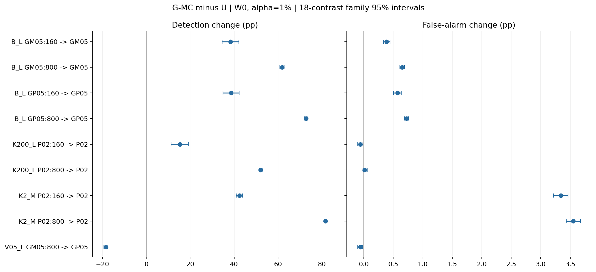
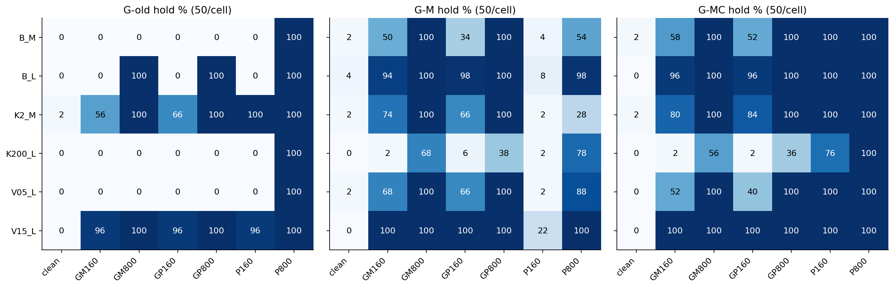
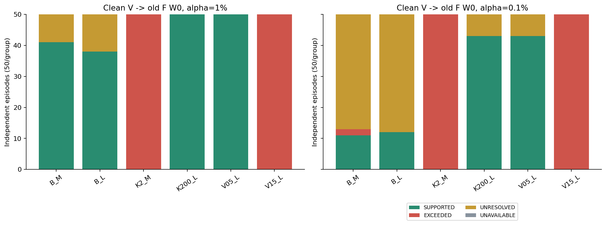
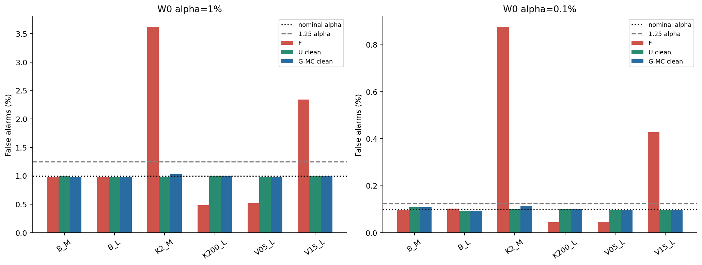
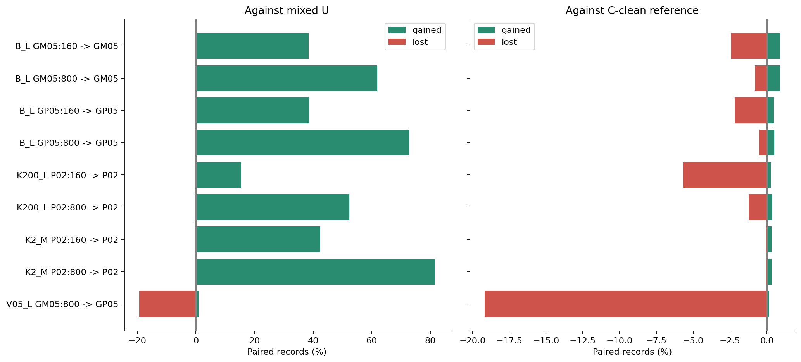
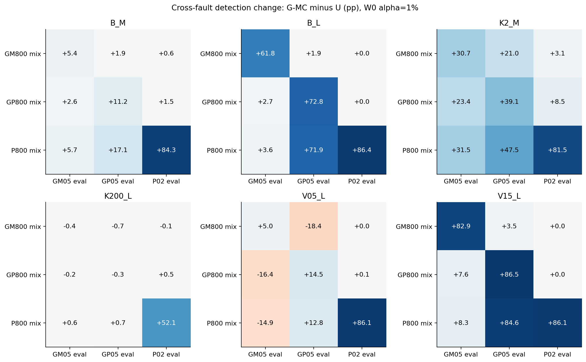
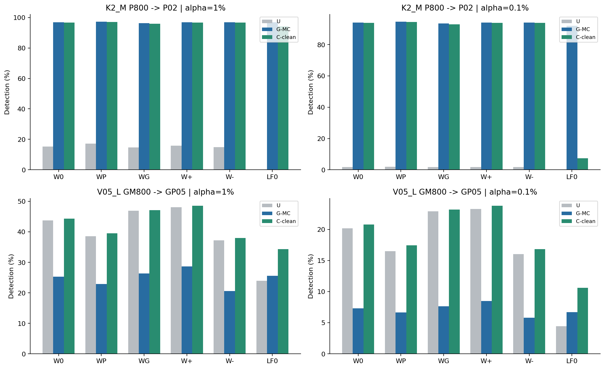
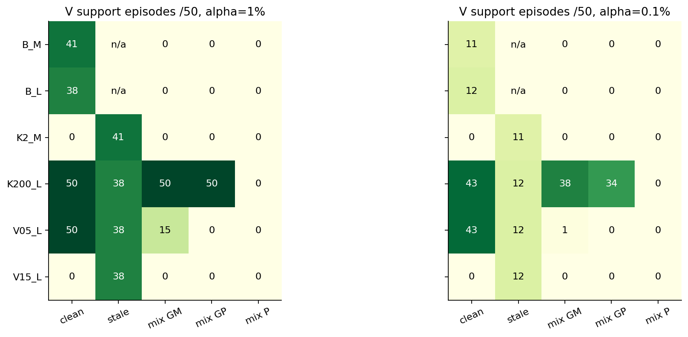

# PR-0009：混入保留と旧校正のFPR根拠を分けた独立確認

返却分析 v1／2026-10-18。run `9adfa7a8c6e0`。科学条件の正本は[PR-0009](../../../audits/prereg/PR-0009_two_axis_independent_confirmation.md)。元ZIPは[Pr0009](../../../docs/OMITTED_MATERIALS.md#item-9b3c2ec885aa)に保持。新規生成・融合則変更・論文改訂なし。

## 1. 結論

**事前指定した8セルの検出回復と、1セルの交差検出損失が、新しい50反復でも確認された。だが、混入を保留して旧閾値へ戻すことと、その旧閾値が現在の源で適切な誤警報率を持つことは別だった。** 二軸表示がこの違いを実測で分離した。

- G-MCは混入1515/1,800候補を保留し、285候補を通した。clean誤保留は2/300、UNKNOWNは0。候補間共有があるので1,800件を独立反復とみなさない。
- K2_M・P02 800混入では、G-MC−Uの検出差は81.540 pp、FPR差は3.553 pp。両方の主調整区間が正。回復した検出を、同じ実測FPRでの優越とは解釈しない。
- V05_L・負ゲイン800混入では、正ゲイン検出を18.442 pp失った。混入への防御が他故障の感度を一律に改善するわけではない。
- 独立したclean Vは旧FのFPRについて支持・超過・未解決を区別した。古い源の正常データをVへ流用すると、現在条件での超過を支持と誤表示し得る。正常という属性だけでなく、**現在の条件に対応する来歴**が必要である。

これは既知条件を選んだ後に固定した独立確認であり、過去25反復との合算でも、未知源一般への保証でもない。

## 2. 受領と再現性

12 ZIP＝10シャード＋2完了索引を照合した。2索引の科学データは同一で、後の索引には完了後のexisting再起動ログが加わる。50反復00–49は欠落・重複なし。最大ZIPは358,540,551 bytesで、全て十進1 GB未満。

全25,312索引メンバー出現のCRC／SHA-256／長さ、固定ソース26件、カード・仕様、全31,039,200保存記録を照合。100参照モデル・100旧校正・2,100更新校正・A/U各2,100候補を再構成し、評価E **1,008,000,000判定**、V **82,800,000判定**を別成分式から再計算して一致。全carryの整数集計と保存出力表も一致した。数値未成立・欠測・科学的除外は0。

実行GPUはNVIDIA RTX PRO 6000 Blackwell Server Edition（A100ではない）。fresh RUNの壁時計は124.75分、保存active時間は124.21分。実機CPU/GPU点検72件は合格し、科学標本には含めていない。ローカルでは保存統計だけを処理し、原時系列を再生成していない。

[受領照合](receipt.json)／[全件再計算](validation.json)／[実行ログ抜粋](runtime_evidence.json)／[解析範囲](PROTOCOL.md)。同一エージェントの自己監査で、第三者の独立レビューではない。実ファイルの到着は確認できたが、実VM消失からの復旧やブラウザ資源解放の実機保証とは別である。

## 3. 比較の読み方

50独立外側反復。固定LF方向と6方式（W0/WP/WG/W+/W−/LF0）、α=1%・0.1%。候補監査A、更新cal U、旧Fを調べるV、最終評価Eは独立な役割として取得。各役割内の候補は対応比較のためプールを共有する。歴史的開発Dの閾値を再調整していない。

G-old/G-M/G-MCは保留時に旧F、非保留時に候補Uを使う。Vラベルは警報を変更しない。C-cleanは同じ源の清浄Uを与えた実験参照で、混入を自動除去した運用方式や性能上限ではない。

主18対比はW0・1%のG-MC−U。区間は反復差のdf49 t区間にBonferroniを適用した族95%の近似区間。表の率は%、差はpp。副比較と条件付き表は記述的であり、主比較の追加成功へ昇格させない。

## 4. 主比較：利益と損失は両方再現

| ID | 群・混入→評価 | U % | G-MC % | 差 pp | 族95%区間 pp |
|---|---|---|---|---|---|
| P01 | B_L GM05 160 → GM05 | 33.852 | 72.247 | 38.395 | [34.571, 42.218] |
| P02 | B_L GM05 160 → normal | 0.580 | 0.968 | 0.388 | [0.330, 0.446] |
| P03 | B_L GM05 800 → GM05 | 12.051 | 73.885 | 61.834 | [60.826, 62.842] |
| P04 | B_L GM05 800 → normal | 0.332 | 0.982 | 0.650 | [0.610, 0.691] |
| P05 | B_L GP05 160 → GP05 | 45.296 | 83.922 | 38.626 | [34.905, 42.346] |
| P06 | B_L GP05 160 → normal | 0.386 | 0.957 | 0.570 | [0.506, 0.635] |
| P07 | B_L GP05 800 → GP05 | 12.852 | 85.610 | 72.758 | [71.998, 73.518] |
| P08 | B_L GP05 800 → normal | 0.259 | 0.982 | 0.723 | [0.689, 0.758] |
| P09 | K200_L P02 160 → P02 | 42.841 | 58.125 | 15.284 | [11.259, 19.309] |
| P10 | K200_L P02 160 → normal | 0.554 | 0.496 | -0.058 | [-0.101, -0.014] |
| P11 | K200_L P02 800 → P02 | 10.642 | 62.699 | 52.057 | [51.352, 52.762] |
| P12 | K200_L P02 800 → normal | 0.469 | 0.486 | 0.016 | [-0.028, 0.060] |
| P13 | K2_M P02 160 → P02 | 54.424 | 96.842 | 42.418 | [40.914, 43.921] |
| P14 | K2_M P02 160 → normal | 0.280 | 3.621 | 3.342 | [3.220, 3.463] |
| P15 | K2_M P02 800 → P02 | 15.302 | 96.842 | 81.540 | [81.052, 82.028] |
| P16 | K2_M P02 800 → normal | 0.068 | 3.621 | 3.553 | [3.432, 3.674] |
| P17 | V05_L GM05 800 → GP05 | 43.743 | 25.301 | -18.442 | [-19.421, -17.463] |
| P18 | V05_L GM05 800 → normal | 0.578 | 0.518 | -0.060 | [-0.102, -0.018] |

H1の8つの回復セルは全て区間下端>0、交差損失セルP17は上端<0。H2のP15/P16もともに正で、検出回復とFPR増加の共存を支持する。FPR差は回復と常に同方向ではなく、P10とP18は低下、P12はゼロをまたいで未解決である。検出だけの一括「成功」にはまとめない。

全50の値・SD・中央値は[主結果](primary18.json)、差を政策率から別計算した値は[独立算術照合](primary_independent.json)。

## 5. 候補ゲート：すり抜け、誤保留、非単調性

| ゲート | 混入保留 /1,800 | すり抜け /1,800 | clean誤保留 /300 | UNKNOWN |
|---|---|---|---|---|
| G-old | 855 | 945 | 1 | 0 |
| G-M | 1175 | 625 | 5 | 0 |
| G-MC | 1515 | 285 | 2 | 0 |

G-MCはG-Mに比べ、混入候補を386件追加保留した一方、G-Mが止めた46件を通した。MCの閾値も別に校正されており、単純な上位包含ではない。

| 群 | G-MC clean保留 /50 | 6群同時片側95%上限 |
|---|---|---|
| B_M | 1 | 12.922% |
| B_L | 0 | 9.131% |
| K2_M | 1 | 12.922% |
| K200_L | 0 | 9.131% |
| V05_L | 0 | 9.131% |
| V15_L | 0 | 9.131% |

cleanの観測保留率は低いが、50反復では全群の真の誤保留率≤5%を保証できない。0/50でも6群同時上限は約9.13%。群をまとめた2/300等を使って、この群別の保証不足を隠さない。

全42候補×3ゲートは[ゲート表](gate_summary.json)、生状態は[50反復状態](gate_results.json)。

## 6. 保留後の旧F：二軸を分ける意味

| 群 | α | V支持 /50 | V超過 /50 | V未解決 /50 | E旧F平均FPR | V支持→E超過 |
|---|---|---|---|---|---|---|
| B_M | 1% | 41 | 0 | 9 | 0.975% | 0 |
| B_M | 0.1% | 11 | 2 | 37 | 0.097% | 0 |
| B_L | 1% | 38 | 0 | 12 | 0.982% | 0 |
| B_L | 0.1% | 12 | 0 | 38 | 0.103% | 0 |
| K2_M | 1% | 0 | 50 | 0 | 3.621% | 0 |
| K2_M | 0.1% | 0 | 50 | 0 | 0.876% | 0 |
| K200_L | 1% | 50 | 0 | 0 | 0.486% | 0 |
| K200_L | 0.1% | 43 | 0 | 7 | 0.045% | 0 |
| V05_L | 1% | 50 | 0 | 0 | 0.518% | 0 |
| V05_L | 0.1% | 43 | 0 | 7 | 0.046% | 0 |
| V15_L | 1% | 0 | 50 | 0 | 2.343% | 0 |
| V15_L | 0.1% | 0 | 50 | 0 | 0.427% | 0 |

VのSUPPORTEDは**旧F・W0のFPRが1.25α以下という限定的な根拠**である。装置全体の正常性・故障感度・更新先Uを認証しない。EXCEEDEDとUNRESOLVEDも分ける。特にα=0.1%では正常V=20,000件の支持分解能が低く、未解決を不適合と読み替えない。

代表としてP800候補を示す。Vは群・反復ごとに一つで、7候補へ共有される。同じVを7回の独立根拠と数えない。

| 群（P800候補） | MC保留 /50 | うちFPR支持 | 超過 | 未解決 | 政策FPR | P02検出 |
|---|---|---|---|---|---|---|
| B_M | 50 | 41 | 0 | 9 | 0.975% | 97.854% |
| B_L | 50 | 38 | 0 | 12 | 0.982% | 100.000% |
| K2_M | 50 | 0 | 50 | 0 | 3.621% | 96.842% |
| K200_L | 50 | 50 | 0 | 0 | 0.486% | 62.699% |
| V05_L | 50 | 50 | 0 | 0 | 0.518% | 99.900% |
| V15_L | 50 | 0 | 50 | 0 | 2.343% | 100.000% |

保留は「候補Uを採用しない」という判断で、Fが今も適切という肯定的根拠ではない。K2_Mでは混入を止めても旧FのFPR超過が残る。一方、低いFPRやSUPPORTEDだけで故障感度を保証することもできない。全候補の[二軸クロス表](two_axis_table.json)、保留／非保留／V根拠別の[条件付き政策表](conditional_policy_summary.json)を分母付きで保持した。後者は選択後の記述値である。

## 7. 検出の回復、交差損失、警報配分

| 群 | 候補 | 政策 | FPR % | 指定故障検出 % |
|---|---|---|---|---|
| K2_M | P800 | F | 3.621 | 96.842 |
| K2_M | P800 | U | 0.068 | 15.302 |
| K2_M | P800 | G-MC | 3.621 | 96.842 |
| K2_M | P800 | C-clean | 0.980 | 96.585 |
| V05_L | GM800 | F | 0.518 | 25.301 |
| V05_L | GM800 | U | 0.578 | 43.743 |
| V05_L | GM800 | G-MC | 0.518 | 25.301 |
| V05_L | GM800 | C-clean | 0.988 | 44.344 |

左は混入Uに対する拾得／喪失、右はC-clean参照に対するもの。同じ正の純差でも両方向の入替があり得る。正常記録の拾得は追加誤警報、喪失は抑制誤警報として別計上した。

800件混入の3×3表は、同じ故障を回復させる政策が別の故障を見落とす場合を示す。全160/800・全方式・両αについて[対応得失](paired_summary.json)を保存。評価で最良配分を選択せず、W0を主表示のまま維持した。

配分とLF0の違いは残るが、この図は同じ名目αでの政策比較であり、完全に同じ実測FPRでのROC優越を示さない。全条件のFPR・検出・見逃し・正負差は[全政策表](ALL_POLICY_RESULTS.md)と[数値表](all_policy_summary.json)を参照。

## 8. Vの来歴破綻：正常でも古ければ別の根拠

| α | V副版 | 対象エピソード | cleanから変更 | 支持なのにE超過 |
|---|---|---|---|---|
| 1% | stale | 200 | 124 | 79 |
| 1% | mix_GM05 | 300 | 135 | 0 |
| 1% | mix_GP05 | 300 | 150 | 0 |
| 1% | mix_P02 | 300 | 200 | 0 |
| 0.1% | stale | 200 | 160 | 23 |
| 0.1% | mix_GM05 | 300 | 148 | 0 |
| 0.1% | mix_GP05 | 300 | 157 | 0 |
| 0.1% | mix_P02 | 300 | 198 | 0 |

STALE-Vは源変化4群の200エピソードだけに適用。MIX-Vは現在Vの固定5%を別故障プールへ置換した意図的な誤来歴で、正常FPRの正確二項区間とは呼ばない。clean→副版の全ラベル遷移と、支持されたVに対し独立EがEXCEEDEDとなる衝突を[遷移表](validation_transitions.json)へ保存した。Eも有限標本であり、Eを真のFPRそのものとは扱わない。

主1%では、STALE-Vによる支持と独立Eの超過が79/200エピソードで同居した。対して今回のMIX-Vは支持数を増やさず、主に支持を失わせる方向だった。この二つを「どちらも危険」という一語で潰さず、古い正常条件への誤移送と、混入による評価対象そのものの変化を区別する。

H3はラベルが来歴誤指定で変わるという記述的確認。支持数が増えたことを改善と呼ばず、減ったことも単独で正常性検査の成功としない。これは取得根拠の必要性を示すストレス試験であり、その根拠の現場取得法は未検証である。

## 9. 同じUで監査する対照と、LF0の非発火

| 群 | A/Uゲート不一致 /350 | cleanでの不一致 /50 |
|---|---|---|
| B_M | 52 | 2 |
| B_L | 11 | 0 |
| K2_M | 34 | 3 |
| K200_L | 66 | 0 |
| V05_L | 56 | 0 |
| V15_L | 0 | 0 |

Aを分けた主政策とU自身を監査した副対照では計219候補で判断が異なった。独立化を一律の性能改善とは解釈しない。全方式・α・候補でsame-U−separate-AのFPR・3故障検出差を[副比較](same_batch_comparison.json)へ残した。

W0・1%の記述例では、same-UはB_L・GM160の負ゲイン検出を分離版より1.5004 pp下げ、一方K2_M・GM160では1.2860 pp上げた。同じK2_M条件のFPRも0.2022 pp上がる。これらは全セルを見た後の例示であり、新たな主検定や方式選択には使わない。

| 群 | α | F LF0非発火 /50 | clean U非発火 /50 | W0 clean U P検出 % | LF0 clean U P検出 % | LF0 clean U FPR % |
|---|---|---|---|---|---|---|
| B_M | 1% | 0 | 0 | 97.874 | 97.861 | 0.983 |
| B_L | 1% | 0 | 0 | 100.000 | 100.000 | 0.972 |
| K2_M | 1% | 0 | 0 | 96.585 | 94.093 | 0.901 |
| K200_L | 1% | 0 | 0 | 63.549 | 70.320 | 0.995 |
| V05_L | 1% | 0 | 0 | 99.904 | 99.942 | 0.997 |
| V15_L | 1% | 0 | 0 | 100.000 | 100.000 | 0.963 |
| B_M | 0.1% | 1 | 0 | 95.022 | 94.550 | 0.088 |
| B_L | 0.1% | 1 | 0 | 100.000 | 100.000 | 0.078 |
| K2_M | 0.1% | 1 | 46 | 93.886 | 7.326 | 0.006 |
| K200_L | 0.1% | 1 | 0 | 40.062 | 45.859 | 0.098 |
| V05_L | 0.1% | 1 | 0 | 99.550 | 99.666 | 0.082 |
| V15_L | 0.1% | 1 | 22 | 100.000 | 56.000 | 0.043 |

LF0の順位上限による構造的非発火と、有限Eでたまたま0警報だった場合を区別した。FPRが低いだけでは有用な計器にならず、低αでは検出感度と併記する必要がある。W0のV根拠はLF0へ転用しない。

K2_M・clean U・0.1%ではLF0が46/50反復で構造的に非発火となり、私的入力検出は7.326%。W0は93.886%だった。ただし実測FPRも異なるため、これを同一実測FPRでの性能差とは呼ばない。

## 10. 今回確かめられたことと、残る判断

今回の確認は「不審な更新を止める」ことを否定しない。その効用と、停止後に使う校正の根拠を分けて測る必要を示した。既知6群において、混入保留・検出回復・交差損失・旧FのFPR超過を同じ固定実験で確認できた。

次に進めるなら、推奨は新しい融合式の追加より、**旧Fが超過／未解決のとき、現行条件の正常校正資源をどう取得し、得られるまで何を出力するか**を定めること。これは次の設計候補で、今回の結果から運用政策へ自動昇格しない。今回のVは外部正常来歴の理想化であり、未知源・非ガウス・A/U間の状態変化・連続監視・実機は未検証。

原ZIP・固定コード・過去の結果・統合論文・TeX/PDFは保持した。生成コードは[受領／再計算](../../scripts/analyze_pr0009_return.py)と[報告生成](../../scripts/report_pr0009_two_axis.py)。
