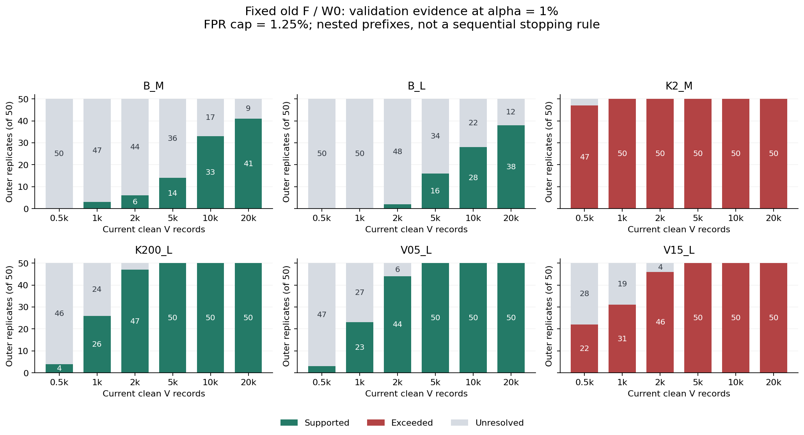
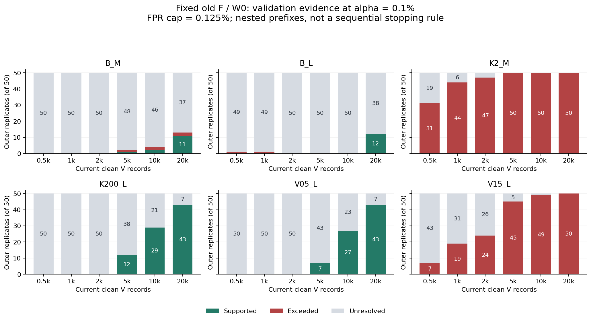
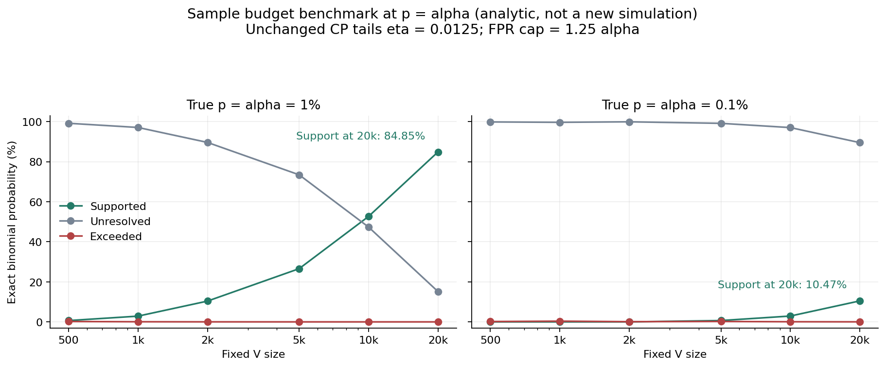
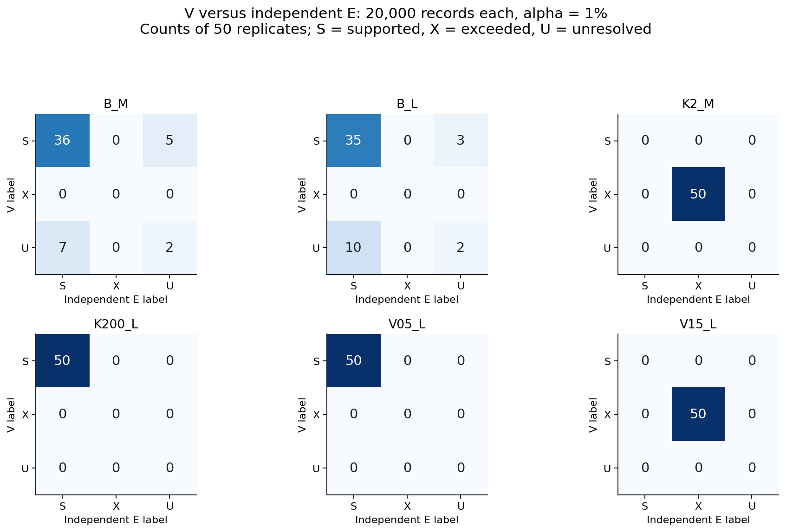
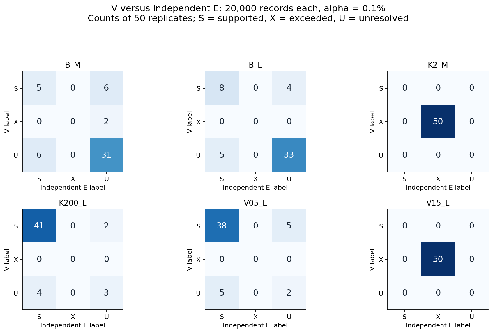
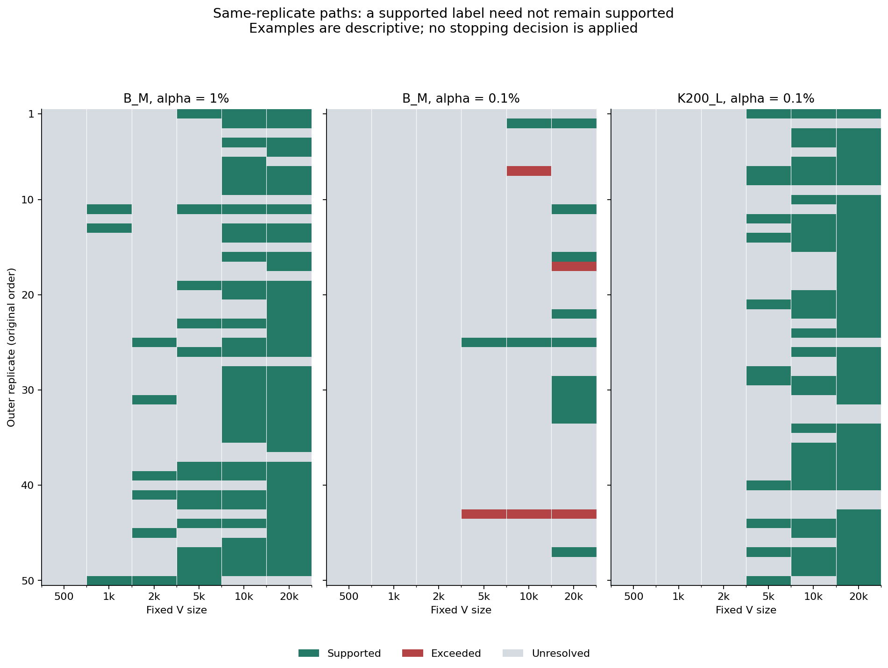

# 正常確認には何件必要か：PR-0009保存Vの資源曲線

2026-10-18／追加分析B v1。run `9adfa7a8c6e0`、50外側反復、6源条件。**旧F・W0を固定した保存データの事後分析**であり、新規シミュレーション・閾値の再調整・運用政策の変更は行っていない。

## 1. 結論

必要量は一つの数にはならない。**FPRが許容上限からどれだけ離れているか、支持を得たいのか超過を発見したいのか、そして1%と0.1%のどちらを確認するのかで大きく違う。**

- **1%水準の基準条件**：20,000件で支持はB_M 41/50、B_L 38/50。5,000件の14/50、16/50から改善したが、20,000件でも未解決が9/50、12/50残る。
- **1%水準でFPRに余裕がある条件**：K200_LとV05_Lは5,000件でともに50/50支持。逆に旧Fが不適合なK2_Mは1,000件、V15_Lは5,000件で50/50超過になった。Vの増量は旧Fを修復するのではなく、適合／不適合の根拠を明確にする。
- **0.1%水準の支持は資源負担が大きい**：2,000件以下は警報ゼロでも支持不可能。20,000件でも基準条件の支持は11/50、12/50で、未解決は37/50、38/50。現在の保存範囲で「20,000件あれば十分」とは言えない。
- **独立Eとの対応**：全6件数・全6群・両水準で、V支持とE超過、またはV超過とE支持の正反対の組は観測されなかった。ただし支持と未解決の相違は多く、Eも有限標本である。「衝突ゼロ」を完全な正しさや将来保証に読み替えない。

今回の要点は、**正常確認Vの量を増やす問題と、Vの正常な来歴を確保する問題は別**だということ。以下の結果は、現在源の清浄なVが与えられた条件でのFPR上限確認に限る。

## 2. 比較方法と読み方

[計算前の範囲記録](PROTOCOL.md)に従い、各反復・各群のVを元の記録ID順で先頭500／1,000／2,000／5,000／10,000／20,000件に切った。結果を見て並べ替えたり、良い部分集合を選んだりしていない。Eは別役割で生成された正常20,000件を全件固定したまま、同じ旧F・W0で比較した。旧参照／校正、候補監査A、更新候補Uには触れていない。

| 群 | 源の相関率κ | 源分散 | 記録窓T（秒） | 意味 |
|---|---|---|---|---|
| B_M | 20 | 1 | 2.048 | 基準・中窓 |
| B_L | 20 | 1 | 8.192 | 基準・長窓 |
| K2_M | 2 | 1 | 2.048 | 低速源・中窓 |
| K200_L | 200 | 1 | 8.192 | 高速源・長窓 |
| V05_L | 20 | 0.5 | 8.192 | 源分散半減・長窓 |
| V15_L | 20 | 1.5 | 8.192 | 源分散増加・長窓 |

正常記録n件中の警報数kから、元PR-0009と同じClopper–Pearson区間を計算する。片側の尾確率はη=0.0125、許容上限はc=1.25αで固定する。

\[
L=\mathrm{Beta}^{-1}(\eta;k,n-k+1),\qquad
U=\mathrm{Beta}^{-1}(1-\eta;k+1,n-k).
\]

k=0ではL=0、k=nではU=1とする。U≤cを**支持S**、L>cを**超過X**、それ以外を**未解決U**と表示する（区間上端UとラベルUは文脈で区別）。支持対象は「現在源で旧F・W0のFPRが上限以下」であり、源そのものの正常認定、故障検出能力、更新Uや他方式の認証ではない。

各図・表の分母は50外側反復。6つの件数は入れ子で独立ではなく、源群間にも参照／旧校正の共有がある。元のηを固定した**各件数時点の比較**であり、件数・群・反復を横断した同時保証ではない。支持が出るまで測る逐次停止には使わない。

## 3. 1%水準：基準FPR付近の支持には20,000件でも余白が残る

許容上限は1.25%。表は各セル「支持／超過／未解決」、合計50。

| 群 | 500 | 1,000 | 2,000 | 5,000 | 10,000 | 20,000 |
|---|---|---|---|---|---|---|
| B_M | 0/0/50 | 3/0/47 | 6/0/44 | 14/0/36 | 33/0/17 | 41/0/9 |
| B_L | 0/0/50 | 0/0/50 | 2/0/48 | 16/0/34 | 28/0/22 | 38/0/12 |
| K2_M | 0/47/3 | 0/50/0 | 0/50/0 | 0/50/0 | 0/50/0 | 0/50/0 |
| K200_L | 4/0/46 | 26/0/24 | 47/0/3 | 50/0/0 | 50/0/0 | 50/0/0 |
| V05_L | 3/0/47 | 23/0/27 | 44/0/6 | 50/0/0 | 50/0/0 | 50/0/0 |
| V15_L | 0/22/28 | 0/31/19 | 0/46/4 | 0/50/0 | 0/50/0 | 0/50/0 |



基準群の独立E平均FPRはB_M 0.9752%、B_L 0.9822%。1.25%上限との距離は大きくなく、500〜2,000件ではほとんどが未解決になる。対してK200_L／V05_LのE平均FPRは0.4857%／0.5179%で、同じ上限から離れているため支持を得やすい。

K2_M／V15_LのE平均FPRは3.6213%／2.3433%。こちらは上限超過が大きく、比較的少ないVでも超過を検出する。**「数千件で超過が分かる」と「数千件で上限内を確認できる」は同じ難易度ではない。** また、FPRが低いことだけから、その条件で故障検出も十分とは判断しない。

## 4. 0.1%水準：小さいVでは支持の選択肢自体が存在しない

許容上限は0.125%。表示と分母は前節と同じ。

| 群 | 500 | 1,000 | 2,000 | 5,000 | 10,000 | 20,000 |
|---|---|---|---|---|---|---|
| B_M | 0/0/50 | 0/0/50 | 0/0/50 | 1/1/48 | 2/2/46 | 11/2/37 |
| B_L | 0/1/49 | 0/1/49 | 0/0/50 | 0/0/50 | 0/0/50 | 12/0/38 |
| K2_M | 0/31/19 | 0/44/6 | 0/47/3 | 0/50/0 | 0/50/0 | 0/50/0 |
| K200_L | 0/0/50 | 0/0/50 | 0/0/50 | 12/0/38 | 29/0/21 | 43/0/7 |
| V05_L | 0/0/50 | 0/0/50 | 0/0/50 | 7/0/43 | 27/0/23 | 43/0/7 |
| V15_L | 0/7/43 | 0/19/31 | 0/24/26 | 0/45/5 | 0/49/1 | 0/50/0 |



警報が0件でも区間上端は \(1-\eta^{1/n}\)。これが0.00125以下となる最低件数は**3,504件**である。500／1,000／2,000件では、どんな実現値でも支持にならない。これはデータの不具合でも検出器の不成立でもなく、固定した確認規則の標本数制約である。5,000件では0警報の場合だけ支持できる。

20,000件で基準群の支持は22%／24%にとどまる。K200_L／V05_Lの支持はともに86%まで上がるが、各7/50は未解決。K2_Mは5,000件で50/50超過、V15_Lは20,000件で50/50超過になった。

B_Mの20,000件で超過した2反復も除外していない。対応するEは支持ではなく未解決（§6）。B_Lの少数件時点の超過も、後で未解決になったという経路をそのまま保存した。

## 5. 「支持可能な最小件数」と「支持を得やすい件数」は違う

次表は既存の判定規則を整数境界へ変換したもの。右列は**仮に真のFPR p=αが固定されているとき**、二項分布から求めた支持確率であり、今回の50反復の観測割合ではない。反復ごとに有限校正が変わる実験結果と同一視しない。

| α | n | 支持となる最大警報数 | 超過となる最小警報数 | p=αでの支持確率 |
|---|---|---|---|---|
| 1% | 500 | 0 | 13 | 0.66% |
| 1% | 1,000 | 4 | 22 | 2.87% |
| 1% | 2,000 | 14 | 38 | 10.37% |
| 1% | 5,000 | 45 | 82 | 26.57% |
| 1% | 10,000 | 100 | 152 | 52.66% |
| 1% | 20,000 | 214 | 287 | 84.85% |
| 0.1% | 500 | 支持不可能 | 4 | 0.00% |
| 0.1% | 1,000 | 支持不可能 | 5 | 0.00% |
| 0.1% | 2,000 | 支持不可能 | 8 | 0.00% |
| 0.1% | 5,000 | 0 | 13 | 0.67% |
| 0.1% | 10,000 | 4 | 22 | 2.92% |
| 0.1% | 20,000 | 14 | 38 | 10.47% |



0.1%では20,000件の期待警報数は20件だが、支持には14件以下が必要となる。したがって正常FPRが狙いどおり0.1%でも、多くの確認が未解決になるのは自然である。1%の20,000件とは利用可能な警報数の情報量が違う。

「警報ゼロなら支持できる最低3,504件」は十分な資源の目安ではない。必要量を定めるには、許容上限だけでなく、想定する真のFPRと欲しい支持確率も必要になる。今回はその運用目標を新たに決めず、20,000件超の性能も推測しない。

## 6. 独立Eとの対応：反対判定はないが、未解決を挟む違いは残る

Eは各反復・各源で正常20,000件を固定している。Vの件数を変えてもEは変えない。EのラベルにもVと同じCP規則を使う。

| 群 | α | E平均FPR | V 20,000のS/X/U | E 20,000のS/X/U |
|---|---|---|---|---|
| B_M | 1% | 0.9752% | 41/0/9 | 43/0/7 |
| B_L | 1% | 0.9822% | 38/0/12 | 45/0/5 |
| K2_M | 1% | 3.6213% | 0/50/0 | 0/50/0 |
| K200_L | 1% | 0.4857% | 50/0/0 | 50/0/0 |
| V05_L | 1% | 0.5179% | 50/0/0 | 50/0/0 |
| V15_L | 1% | 2.3433% | 0/50/0 | 0/50/0 |
| B_M | 0.1% | 0.0971% | 11/2/37 | 11/0/39 |
| B_L | 0.1% | 0.1028% | 12/0/38 | 13/0/37 |
| K2_M | 0.1% | 0.8763% | 0/50/0 | 0/50/0 |
| K200_L | 0.1% | 0.0452% | 43/0/7 | 45/0/5 |
| V05_L | 0.1% | 0.0462% | 43/0/7 | 43/0/7 |
| V15_L | 0.1% | 0.4272% | 0/50/0 | 0/50/0 |

平均FPRは50反復の記述値。これを一つの真のFPRと仮定して、全反復をまとめた二項認証をしてはいない。



1%・20,000件のB_Mは両方支持が36、Vだけ支持でE未解決が5、V未解決でE支持が7、両方未解決が2。B_Lではそれぞれ35／3／10／2である。Vの未解決をそのまま「実際には不適合だった」と扱うことも、Eの支持を真値としてVを誤り扱いすることもできない。



0.1%・20,000件では、B_MはV支持11とE支持11でも、**同じ反復で両方支持なのは5件**。B_LはV支持12とE支持13のうち、両方支持は8件だった。支持率の平均だけで両者の一致を判断してはいけない。

B_MのV超過2件（0始まり反復ID16／42）はV警報39／41件、対応するE警報21／26件で、Eはともに未解決だった。固定上限近傍の有限標本判定の差として報告し、正常／異常の真値を与えない。

500〜20,000件を通じてS対Xの反対判定は両方向とも0件。ただし同じEを6回参照しているため、「独立3,600検証で誤り0」とは数えない。全件数の3×3対応表は[全条件表](ALL_V_BUDGET_RESULTS.md)と[JSON](resource_curve.json)に残した。

## 7. 増量すると必ず一方向に確定するわけではない



支持の総数は概して増えるが、個別反復のラベルは単調とは限らない。B_M・1%では7/50反復に、ある件数で支持された後、より大きい件数で非支持になる経路があった。そのうち2反復は20,000件時点でも未解決だった。

| 0始まり反復ID | 500→1k→2k→5k→10k→20kのV警報数 | 同じ順のラベル | 独立E 20k |
|---|---|---|---|
| 5 | 10→15→25→46→98→217 | U→U→U→U→S→U | 206警報・S |
| 49 | 1→3→12→40→113→230 | U→S→S→S→U→U | 193警報・S |

K200_L・0.1%にも途中の支持から非支持へ戻る反復が2件あったが、両方とも20,000件では支持に戻った。これらを理由に規則や記録順を変えていない。個別経路と全60件の隣接件数間遷移表を保存した。

この結果は、**「一度支持が出たら終了」を今回の固定件数規則に後付けできない**ことを具体的に示す。逐次運用が必要なら、停止規則と全体の誤り制御を別に設計する必要がある。本解析では実装・評価していない。

## 8. 次の設計に持ち越す判断

現時点の推奨は、**1%と0.1%の正常確認予算を分け、未解決を正当な出力として残すこと**である。件数だけで一律のGO条件を作らない。

1%の基準FPR付近では、今回比較した範囲のうち20,000件が最も支持を得やすいが、それでも全反復は確定しない。一方、上限から十分離れた条件では数千件で多くが確定する。0.1%の基準条件では、20,000件までの資源では未解決が主要な結果であり、将来の設計で必要な確認確率・許容幅・資源上限を改めて裁定する余地が大きい。

源変化で旧Fが不適合なら、Vを増やすほど超過の根拠が強まる。これは旧Fへの復帰を正当化する資源ではなく、戻り先が適切でないと判断する資源になる。前回Aの「候補の混入検知」と「戻り先の妥当性」の分離を、今回のBは標本数の面から補強する。

ただし、清浄な現在源Vをどう入手・確認するか、支持／超過／未解決を運用の更新・待機へどう結びつけるか、故障検出の得失をどう扱うかは別の問題である。今回の集計から自動更新や自動停止政策へは進めない。

## 9. 証拠・点検・再現

元12 ZIPのサイズ／SHA-256を現在ファイルから再照合。今回読んだ3,050メンバーの索引SHA・サイズ・CRC、固定校正ハッシュ、V/E役割ID・開始位置・判定bitハッシュを照合した。正常V 6,000,000件と正常E 6,000,000件、W0・2αの計24,000,000記録水準判定を再計数。V 3,600ラベルとE 600ラベルを作成し、V/Eとも20,000件の値は元の集計・根拠ラベルに一致した。欠測・無効・除外は0。

beta分位点による区間分類を、別算術の二項CDF／整数境界と照合し、全4,200分類・12境界集合が一致した。元bitをヒストグラムでも再計数して一致確認。入れ子件数は直接合計と非重複区間の累積で確認し、本文の主要表・全72条件・60遷移表と元値を照合した。6図を表示して点検し、納品検証はPASS。同一エージェントの自己点検であり、第三者検証ではない。元波形の再生成やraw17列からの全検出器再計算は今回の範囲に含めず、元の全件監査と区別する。

- [解析検証](validation.json)／[納品検証](../../../docs/OMITTED_MATERIALS.md#item-6e905e8539e0)／[現在アンカー](../../../docs/OMITTED_MATERIALS.md#item-fd93349d320b)
- [全72条件・60遷移の付表](ALL_V_BUDGET_RESULTS.md)／[反復別の計数・区間NPZ](counts_and_intervals.npz)
- [資源曲線JSON](resource_curve.json)／[整数境界JSON](integer_boundaries.json)／[来歴JSON](provenance.json)
- [元PR-0009分析](../pr0009_9adfa7a8c6e0_two_axis_v1/PR0009_TWO_AXIS_REPORT_JA.md)／[追加分析A](../../../docs/OMITTED_MATERIALS.md#item-64e68008ba8a)

再現はプロジェクトルートで解析→図表生成→納品検証の順に実行する。解析済み出力は保持するため、再解析時は新しい出力版を指定するようコードを別版化する。Eや閾値を変更して既存レポートを上書きしない。

```text
python3 numerics/scripts/analyze_pr0009_v_budget.py
python3 numerics/scripts/report_pr0009_v_budget.py
python3 numerics/scripts/verify_pr0009_v_budget.py
```

THROUGHLINEに従い、元証拠・旧解析・科学コード・カード・論文を保持し、今回の承認範囲と検証を台帳へ追記する。新規科学生成0、融合則変更0、論文改訂0。
