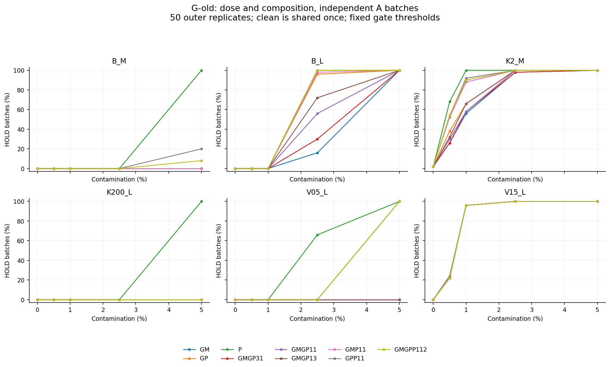
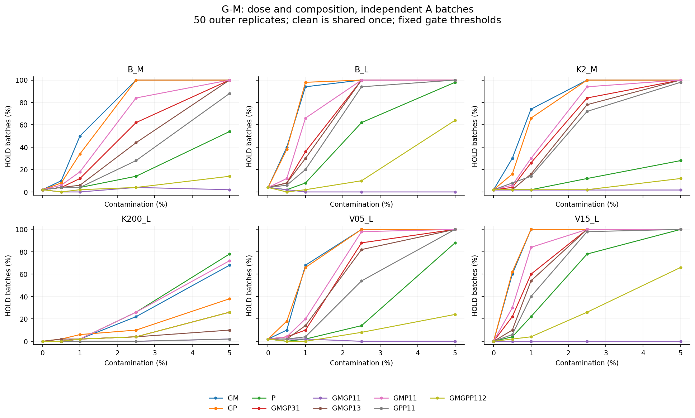
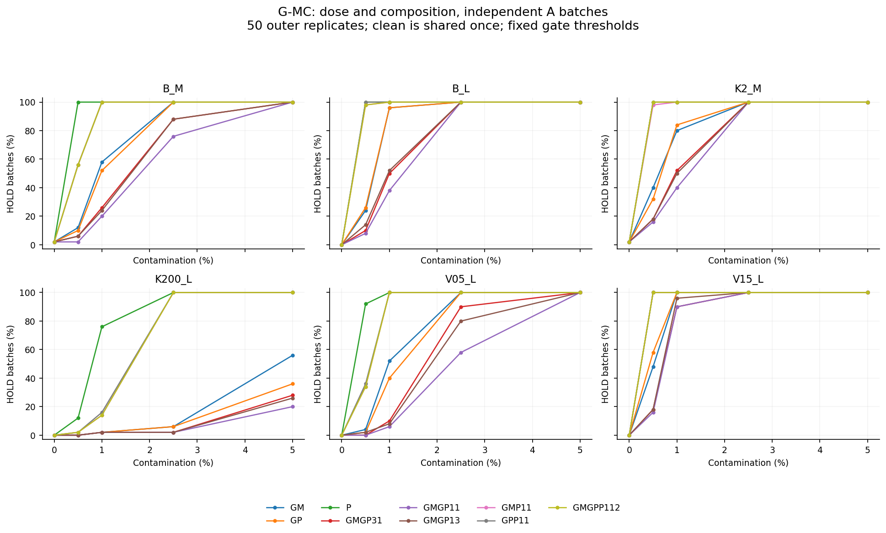
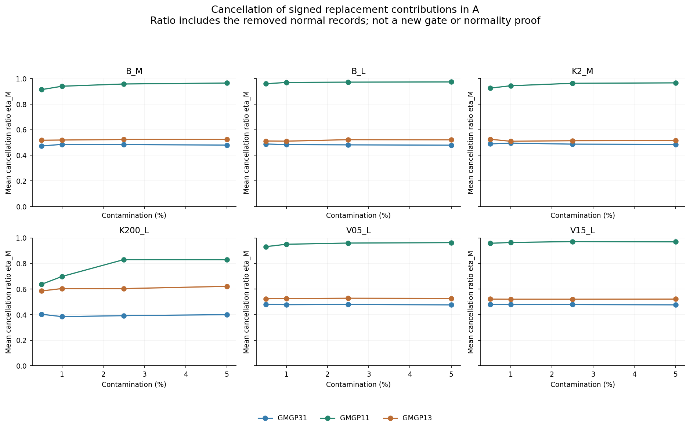
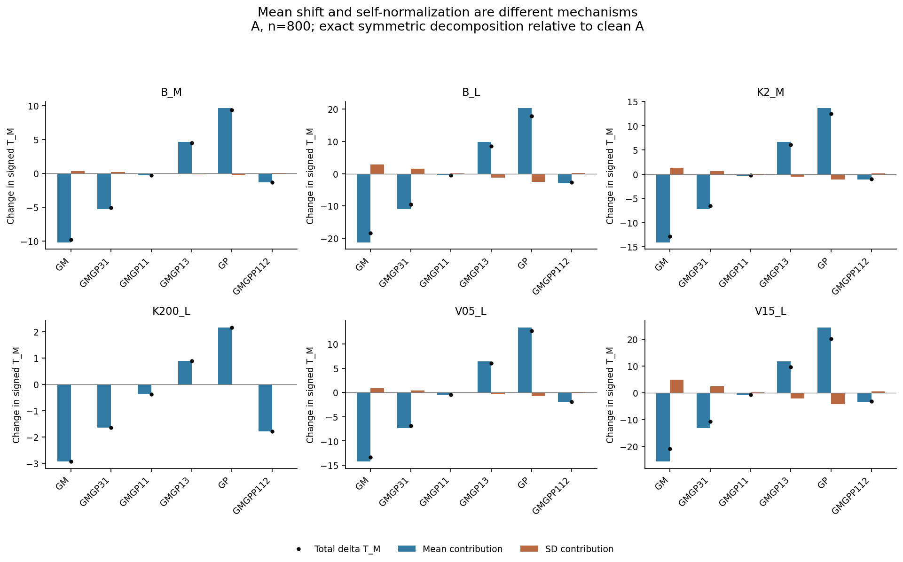
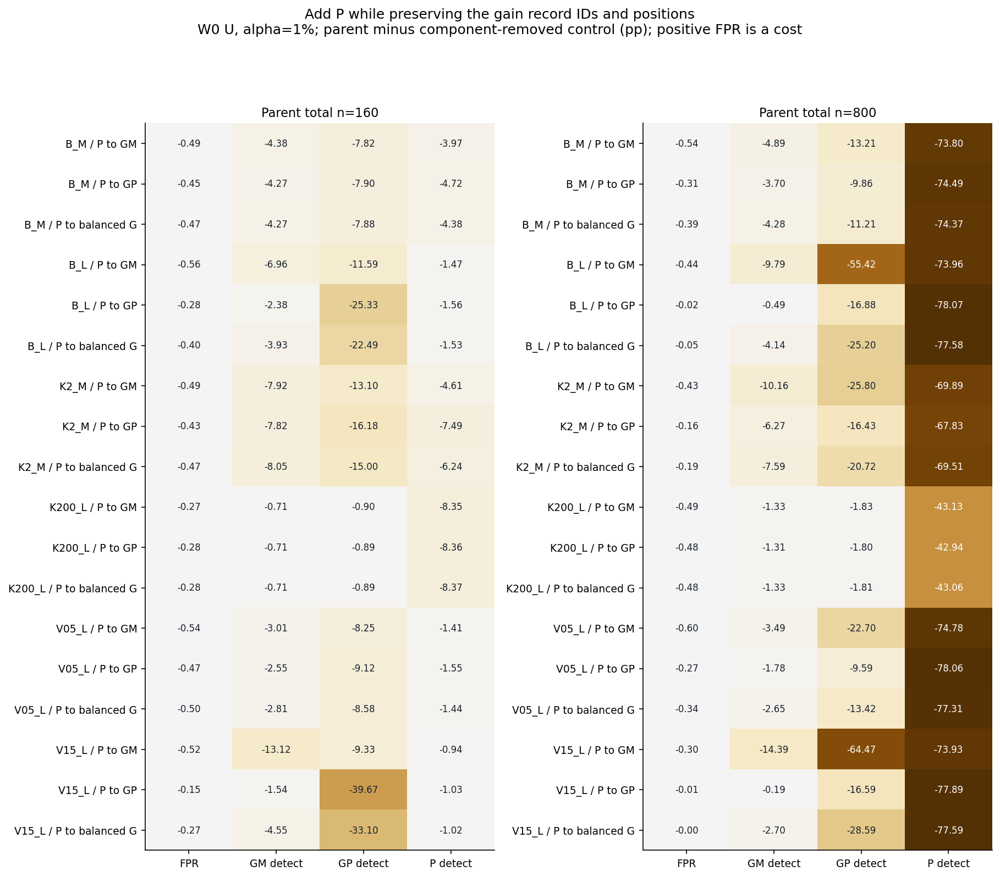
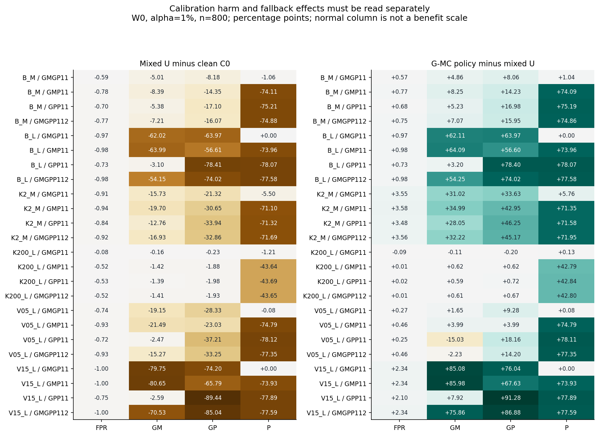
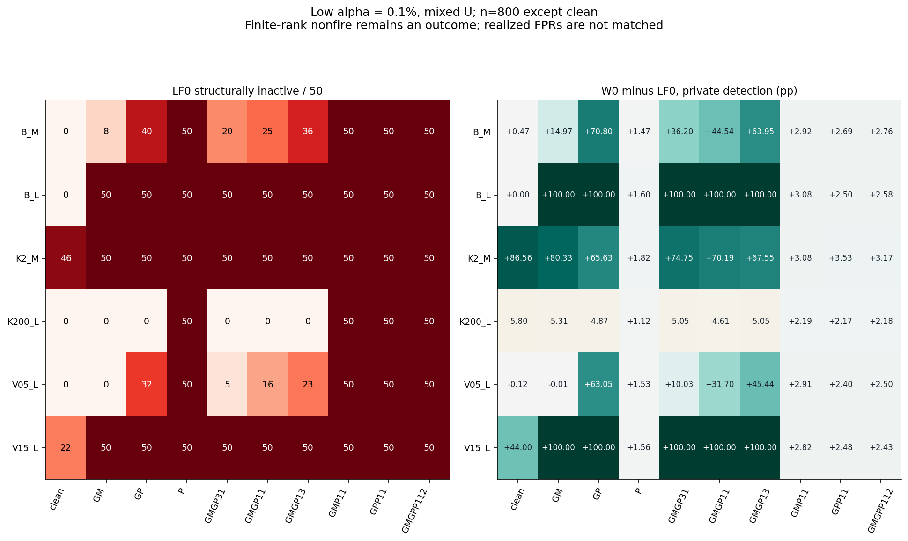

# PR-0010：混入量・異種混入の保存データ分析

2026-10-18／保存PR-0009 run `9adfa7a8c6e0`、50外側反復。D-Aを採択した[研究カードPR-0010](../../../audits/prereg/PR-0010_mixture_dose_saved_data.md)に基づく事後的ストレス分析。新規波形生成・再学習・配分最適化・論文改訂はない。

## 結果の要旨

**相殺は確認できた。ただし「Mが相殺する」「混入を保留できる」「保留後の計器が妥当」は三つの別問題だった。**

- 正負半々・総混入800では、G-Mの保留は全6群で0〜1/50まで落ちた。一方G-MCは5群で50/50を保留し、CR側に残る応答が働いた。高速源K200_Lだけは10/50で、40/50がすり抜けた。相殺比ηMの平均は0.8297〜0.9735。

- 同じGM200・GP200へP400を足すと、K200_LのG-MC保留は2/50→50/50になった。しかし混入Uをそのまま使ったP検出は62.9604%→19.8960%。P追加は監査を助ける一方、採用された校正の検出を損なう。W0・1%では、このP追加によるP検出の純損失が全6群で43.0644〜77.5860 ppあった。

- 保留後の旧Fも自動的には適切でない。V05_LでGM40・GP40へP80を足すとG-MCは0/50→50/50保留となり、政策全体の負／正ゲイン検出はそれぞれ14.5348／14.5976 pp低下した。K2_Mの同じ比較では検出が増える一方、政策FPRが1.2919%→3.6213%へ上昇した。

- 三種混合800のLF0はα=0.1%で全6群・全50反復が構造的非発火。W0は発火を残すが、同条件のP検出は約2〜3%まで落ちており、順位上端の問題だけを直せば混入校正の害が解消するわけではない。

## 1. 問いと比較の単位

校正バッチに負5%ゲイン・正5%ゲイン・私的入力P02の記録が混在すると、Aの混入監査と、別Uから作った閾値の性能がどう変わるかを調べた。一つの時系列に複合故障を作用させた実験ではない。P02の2%は私的信号の分散比で、バッチの混入率ではない。

AとUは独立原記録・独立保存順序。参照Rと旧校正Oは固定、Aで3ゲート、UでW0/LF0・2αの校正を確定・保存した後、共通Eで評価した。Eは正常20,000・各故障5,000件／群・反復。混入ラベルは候補の構成・事後の説明だけに使い、ゲートや閾値選択へ渡していない。Vは新Uや選択政策を認証しない。

バッチ総数15,999、混入80/160/400/800件（約0.5/1/2.5/5%）。単独3・正負3:1/1:1/1:3・GM/PとGP/P各1:1・GM/GP/P=1:1:2の9組成、cleanを加えて37主条件。成分除去24設計IDのうち4は同一配置の別名で、実体57配置とした。別名や用量を独立反復へ水増ししない。

基準源BはOU相関率κ=20 s⁻¹・源分散比1。M/L窓は2.048/8.192秒、K2_Mはκ=2、K200_Lはκ=200、V05_L/V15_Lは源分散比0.5/1.5で他の基準設定を保つ。τi=0.04秒・τj=0.01秒、標本間隔0.002秒。読出し雑音の絶対量は基準に固定しており、源変化後もSNRを揃えた比較ではない。

本文の率は50反復平均（%）、差はpercentage points（pp）。すべての源群・組成・方式・水準の値は[全条件表](ALL_MIXTURE_RESULTS.md)、対応95% t区間とSDは[結果JSON](results.json)にある。区間は点ごとの記述用で、同時保証・確認仮説の有意判定ではない。

## 2. 正負の相殺とゲート

均衡混在では期待値の一次ゲイン項が消える一方、二次項が残る。実現値の相殺比ηMは、追加故障から取り除いた正常値を引いた各成分の寄与で計算した。ηM=1はその二成分の平均寄与の完全相殺を表すが、正常分布への復帰やゲート通過を意味しない。

| 群 | GM800 MC保留 | GP800 MC保留 | 均衡800 M保留 | 均衡800 MC保留 | 均衡ηM | 三種800 MC保留 |
|---|---:|---:|---:|---:|---:|---:|
| B_M | 50/50 | 50/50 | 1/50 | 50/50 | 0.9650 | 50/50 |
| B_L | 50/50 | 50/50 | 0/50 | 50/50 | 0.9735 | 50/50 |
| K2_M | 50/50 | 50/50 | 1/50 | 50/50 | 0.9663 | 50/50 |
| K200_L | 28/50 | 18/50 | 1/50 | 10/50 | 0.8297 | 50/50 |
| V05_L | 50/50 | 50/50 | 0/50 | 50/50 | 0.9631 | 50/50 |
| V15_L | 50/50 | 50/50 | 0/50 | 50/50 | 0.9691 | 50/50 |

この表の単独800対均衡800は総混入数を揃えた組成交替。均衡800対三種800ではゲイン記録数が減るため、私的入力の純粋な追加比較ではない。次節では同じゲイン記録・位置を保持した対照を使う。

### 混入量の全曲線











平均移動とSD膨張は別の機序として残した。符号付きTの変化は両寄与の厳密和であるが、計器部品を交換した因果効果ではない。分散の群内／群間項、A/U別の成分寄与とηMの分母は[機序JSON](mechanisms.json)と各反復NPZに保存した。

## 3. 同じゲイン混在へ私的入力を加える

三種親n=160はGM40/GP40/P80、n=800はGM200/GP200/P400。それぞれからPだけを元正常へ戻した対照と比べる。残るゲインのID・位置は完全に同一。以下はW0・α=1%、親−成分除去対照。MC保留差の分母は50バッチ、性能差は同じE上の対応差。

| 群 | 親n | MC保留差 | ΔFPR pp | ΔGM検出 pp | ΔGP検出 pp | ΔP検出 pp | P拾得 % | P喪失 % |
|---|---:|---:|---:|---:|---:|---:|---:|---:|
| B_M | 160 | +48/50 | -0.4652 | -4.2700 | -7.8760 | -4.3820 | 0.0000 | 4.3820 |
| B_M | 800 | +13/50 | -0.3929 | -4.2804 | -11.2088 | -74.3720 | 0.0000 | 74.3720 |
| B_L | 160 | +46/50 | -0.3994 | -3.9292 | -22.4860 | -1.5292 | 0.0000 | 1.5292 |
| B_L | 800 | +0/50 | -0.0530 | -4.1440 | -25.1996 | -77.5780 | 0.0000 | 77.5780 |
| K2_M | 160 | +41/50 | -0.4651 | -8.0496 | -14.9968 | -6.2420 | 0.0000 | 6.2420 |
| K2_M | 800 | +0/50 | -0.1854 | -7.5892 | -20.7248 | -69.5072 | 0.0000 | 69.5072 |
| K200_L | 160 | +7/50 | -0.2757 | -0.7104 | -0.8888 | -8.3668 | 0.0004 | 8.3672 |
| K200_L | 800 | +48/50 | -0.4802 | -1.3276 | -1.8148 | -43.0644 | 0.0024 | 43.0668 |
| V05_L | 160 | +50/50 | -0.5033 | -2.8104 | -8.5764 | -1.4408 | 0.0000 | 1.4408 |
| V05_L | 800 | +21/50 | -0.3414 | -2.6544 | -13.4204 | -77.3112 | 0.0000 | 77.3112 |
| V15_L | 160 | +42/50 | -0.2682 | -4.5500 | -33.1032 | -1.0200 | 0.0000 | 1.0200 |
| V15_L | 800 | +0/50 | -0.0007 | -2.6996 | -28.5940 | -77.5860 | 0.0000 | 77.5860 |

Pの追加でP検出が低下しても計算矛盾ではない。ここで変わるのは評価故障でなく校正Uであり、Pの異常値を校正へ取り込むとP枝の閾値を押し上げうる。保留が増えれば、その後の政策は旧Fの適合性にも依存する。



同様にGMだけ、GPだけへPを加える対照も全群で実施した。全24親子ID・2α・2方式・4評価の対応拾得／喪失、3ゲート政策の親子差、W0の各枝閾値差は[成分除去対照JSON](parent_contrasts.json)にある。二つの方式・政策が異なる記録を拾う場合、純差だけで隠さない。

## 4. 混入Uの害と、旧Fへ戻す効果

次表は均衡ゲイン800と三種混合800、W0・1%の固定断面。C0は清浄な現在源Uからの参照校正で、運用中に自動で得られる正常認定ではない。NはFPR、他は検出率（%）。

| 群 | 組成 | 校正／政策 | N | GM | GP | P |
|---|---|---|---:|---:|---:|---:|
| B_M | GMGP11_n800 | C0 | 0.9905 | 13.0728 | 21.3824 | 97.8740 |
| B_M | GMGP11_n800 | U | 0.4037 | 8.0648 | 13.2064 | 96.8116 |
| B_M | GMGP11_n800 | G-MC | 0.9752 | 12.9272 | 21.2628 | 97.8540 |
| B_M | GMGPP112_n800 | C0 | 0.9905 | 13.0728 | 21.3824 | 97.8740 |
| B_M | GMGPP112_n800 | U | 0.2231 | 5.8616 | 5.3112 | 22.9948 |
| B_M | GMGPP112_n800 | G-MC | 0.9752 | 12.9272 | 21.2628 | 97.8540 |
| B_L | GMGP11_n800 | C0 | 0.9806 | 73.7872 | 85.6188 | 100.0000 |
| B_L | GMGP11_n800 | U | 0.0087 | 11.7720 | 21.6452 | 100.0000 |
| B_L | GMGP11_n800 | G-MC | 0.9822 | 73.8852 | 85.6104 | 100.0000 |
| B_L | GMGPP112_n800 | C0 | 0.9806 | 73.7872 | 85.6188 | 100.0000 |
| B_L | GMGPP112_n800 | U | 0.0019 | 19.6328 | 11.5944 | 22.4220 |
| B_L | GMGPP112_n800 | G-MC | 0.9822 | 73.8852 | 85.6104 | 100.0000 |
| K2_M | GMGP11_n800 | C0 | 0.9802 | 26.3196 | 37.8548 | 96.5848 |
| K2_M | GMGP11_n800 | U | 0.0732 | 10.5924 | 16.5352 | 91.0804 |
| K2_M | GMGP11_n800 | G-MC | 3.6213 | 41.6100 | 50.1620 | 96.8416 |
| K2_M | GMGPP112_n800 | C0 | 0.9802 | 26.3196 | 37.8548 | 96.5848 |
| K2_M | GMGPP112_n800 | U | 0.0613 | 9.3856 | 4.9936 | 24.8928 |
| K2_M | GMGPP112_n800 | G-MC | 3.6213 | 41.6100 | 50.1620 | 96.8416 |
| K200_L | GMGP11_n800 | C0 | 0.9970 | 2.1564 | 3.1312 | 63.5492 |
| K200_L | GMGP11_n800 | U | 0.9193 | 2.0004 | 2.9016 | 62.3420 |
| K200_L | GMGP11_n800 | G-MC | 0.8318 | 1.8856 | 2.6972 | 62.4720 |
| K200_L | GMGPP112_n800 | C0 | 0.9970 | 2.1564 | 3.1312 | 63.5492 |
| K200_L | GMGPP112_n800 | U | 0.4740 | 0.7504 | 1.2040 | 19.8960 |
| K200_L | GMGPP112_n800 | G-MC | 0.4857 | 1.3616 | 1.8724 | 62.6988 |
| V05_L | GMGP11_n800 | C0 | 0.9882 | 30.7940 | 44.3444 | 99.9044 |
| V05_L | GMGP11_n800 | U | 0.2443 | 11.6480 | 16.0164 | 99.8240 |
| V05_L | GMGP11_n800 | G-MC | 0.5179 | 13.3028 | 25.3012 | 99.8996 |
| V05_L | GMGPP112_n800 | C0 | 0.9882 | 30.7940 | 44.3444 | 99.9044 |
| V05_L | GMGPP112_n800 | U | 0.0628 | 15.5280 | 11.0980 | 22.5544 |
| V05_L | GMGPP112_n800 | G-MC | 0.5179 | 13.3028 | 25.3012 | 99.8996 |
| V15_L | GMGP11_n800 | C0 | 0.9955 | 90.8520 | 96.6088 | 100.0000 |
| V15_L | GMGP11_n800 | U | 0.0001 | 11.1008 | 22.4060 | 100.0000 |
| V15_L | GMGP11_n800 | G-MC | 2.3433 | 96.1780 | 98.4492 | 100.0000 |
| V15_L | GMGPP112_n800 | C0 | 0.9955 | 90.8520 | 96.6088 | 100.0000 |
| V15_L | GMGPP112_n800 | U | 0.0003 | 20.3180 | 11.5708 | 22.4140 |
| V15_L | GMGPP112_n800 | G-MC | 2.3433 | 96.1780 | 98.4492 | 100.0000 |



全条件で「ゲート政策−U＝保留頻度×保留時のF−U」を照合した。源変化後にFが適合していなければ、混入を正しく止めてもFPR増大や別故障の喪失が残る。保留率だけから政策の妥当性を認定しない。αと1.25αは参照線・比較基準であり、この事後評価から新たな認証ラベルを作らない。

正負の評価記録は別々なので、GP−GMは反復内の率差として扱う。全条件でG枝成分＋P-only成分への整数分解を照合した。[正負差JSON](gain_asymmetry.json)。

## 5. 低αとLF0の非発火

LF0では9,999件の有限参照順位の上端に、15,999件の校正中16件以上が集まると、α=0.1%のcutが最大順位になり、strict不等号の下で全枝が発火できない。これは技術的不成立や欠測ではない。

| 群 | 組成 | LF0非発火 /50 | W0 FPR % | LF0 FPR % | W0 P検出 % | LF0 P検出 % |
|---|---|---:|---:|---:|---:|---:|
| B_M | clean | 0 | 0.1088 | 0.0879 | 95.0220 | 94.5496 |
| B_M | GMGP11_n800 | 25 | 0.0190 | 0.0063 | 90.0924 | 45.5552 |
| B_M | GMGPP112_n800 | 50 | 0.0188 | 0.0000 | 2.7584 | 0.0000 |
| B_L | clean | 0 | 0.0941 | 0.0784 | 100.0000 | 100.0000 |
| B_L | GMGP11_n800 | 50 | 0.0000 | 0.0000 | 99.9976 | 0.0000 |
| B_L | GMGPP112_n800 | 50 | 0.0000 | 0.0000 | 2.5788 | 0.0000 |
| K2_M | clean | 46 | 0.1002 | 0.0059 | 93.8860 | 7.3264 |
| K2_M | GMGP11_n800 | 50 | 0.0006 | 0.0000 | 70.1868 | 0.0000 |
| K2_M | GMGPP112_n800 | 50 | 0.0003 | 0.0000 | 3.1676 | 0.0000 |
| K200_L | clean | 0 | 0.0993 | 0.0978 | 40.0620 | 45.8588 |
| K200_L | GMGP11_n800 | 0 | 0.0891 | 0.0731 | 38.5624 | 43.1704 |
| K200_L | GMGPP112_n800 | 50 | 0.0465 | 0.0000 | 2.1812 | 0.0000 |
| V05_L | clean | 0 | 0.0971 | 0.0823 | 99.5500 | 99.6656 |
| V05_L | GMGP11_n800 | 16 | 0.0073 | 0.0049 | 98.9308 | 67.2276 |
| V05_L | GMGPP112_n800 | 50 | 0.0007 | 0.0000 | 2.4968 | 0.0000 |
| V15_L | clean | 22 | 0.0988 | 0.0434 | 100.0000 | 56.0000 |
| V15_L | GMGP11_n800 | 50 | 0.0000 | 0.0000 | 100.0000 | 0.0000 |
| V15_L | GMGPP112_n800 | 50 | 0.0000 | 0.0000 | 2.4252 | 0.0000 |



W0とLF0は同じ公称αだが、実測FPRは揃っていない。検出率だけで等FPRの優越を主張しない。全条件の方式間拾得・喪失は[方式比較JSON](method_comparisons.json)、全枝の対応は反復NPZに残した。

## 6. 検証・件数・再現

主解析は50反復、34,200のA/Uバッチ、実体57配置。元A/U 11,039,400記録とE 10,500,000記録を再利用した。主解析の累積反復処理時間は9.98分。新規科学標本生成0、欠測0、UNKNOWN0、除外0。候補の延べ評価は2,394,000,000記録×方式水準、旧F再照合42,000,000。これは独立標本数ではない。

既存clean＋単独160/800の7候補は全50反復・全6群でゲート・校正・E枝bitと一致した。LF0順位判定と等価連続半平面も全新候補で一致した。原12ZIPのSHA／サイズ、読込メンバーのSHA／長さ／CRC、原記録ハッシュを照合した。[主解析検証](validation.json)。

検証は同一エージェントの自己点検であり、第三者の独立追試ではない。別経路では記録ごとの配置、スカラー射影、ソート閾値、add.at整数表を使い、34,200バッチ・34,200校正水準とE1,050万記録を再照合した。799,200枝対応表が厳密一致。実測の二座標恒等式最大差は6.9614e-15だった。[別経路検証](second_path_validation.json)と[納品点検](../../../docs/OMITTED_MATERIALS.md#item-046dd3422c37)はPASS。

技術fixtureは実行前の6件＋役割混線・不正メタデータ・SDゼロ・整数改変の負対照4件。初回のテスト側添字不備を保存・修正して全件通過した。主解析の`checks.q_identity_max`は更新されない初期値カウンタだったため最大誤差として解釈しない（恒等式assertion自体は実行済み）。実測最大誤差は別経路検証の`q_identity_measured_max`を用いる。いずれも統計的FP/FNへ混ぜない。

最初の図生成は、相殺図のadvanced indexingで用量軸と反復軸を取り違えて停止した。途中版ソースと3図を[失敗記録](attempts/report01/FAILURE.md)へ保持し、候補軸を明示した選択と形状assertへ修正した。元の成分値・JSON集計・科学判定は不変。全8図は修正後の反復平均から作り直した。

再現コマンド（新規実行先は旧成果を上書きしない版を用意する）：

```sh
python3 numerics/scripts/test_pr0010_mixture.py
python3 numerics/scripts/test_pr0010_negative_controls.py
python3 numerics/scripts/resume_pr0010_mixture.py
python3 numerics/scripts/verify_pr0010_mixture.py
python3 numerics/scripts/report_pr0010_mixture.py
python3 numerics/scripts/verify_pr0010_delivery.py
```

既存の完了receiptがある主解析は入力・コードハッシュを確認して再利用する。再開入口`resume_pr0010_mixture.py`は50反復完了済みなら検証だけで終了し、経過時間等の完了証拠を再上書きしない。改訂解析・再検証結果の保存は別出力版を用意する。各5反復の非累積ZIPは`bundles/`、固定A/U状態は`frozen_candidates/`、全反復値は`recomputed/`に保存。元科学ZIPを再同梱していない。

## 7. 解釈の境界

代数の閉合H1と性能の問いQ1–Q3を分ける。この解析は既知結果を踏まえた混合ストレス評価であり、独立確認への昇格、最適混合率や普遍的なゲート選択はしない。均衡平均だけから分布全体の識別不能は結論できず、正負比率を少し動かす探索や新しい複合故障の生成も行っていない。

扱ったのは固定3故障強度・6群のバッチ内混在。A/Uの混入率が違う場合、連続ドリフト、実機の故障頻度、旧F不適合時の停止・復旧政策は別の問いである。検出損失・非発火・FPR悪化を残したまま、次の問いを人間が選ぶ。今回の結果は論文へまだ反映していない。

