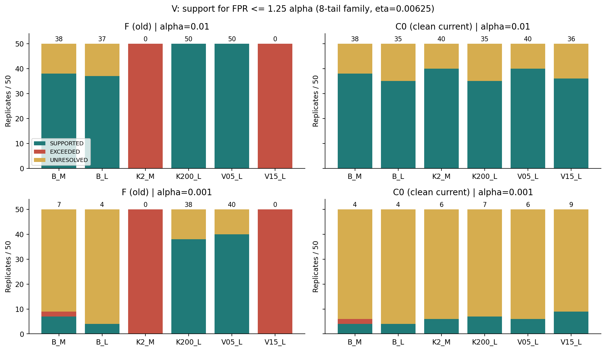
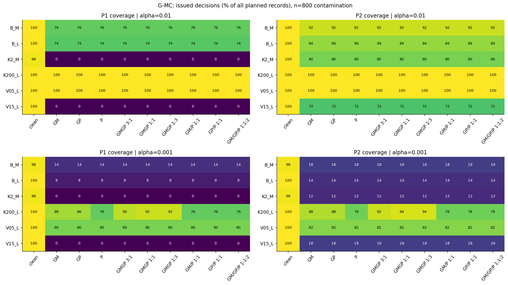
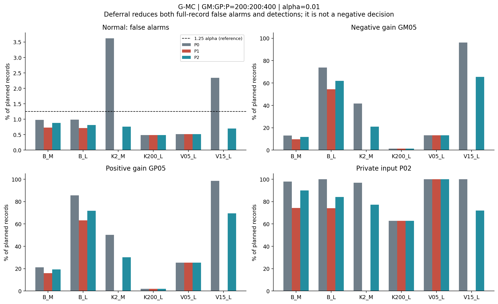
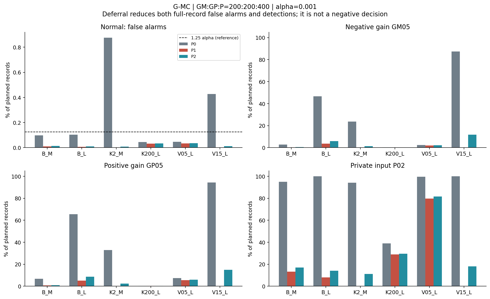
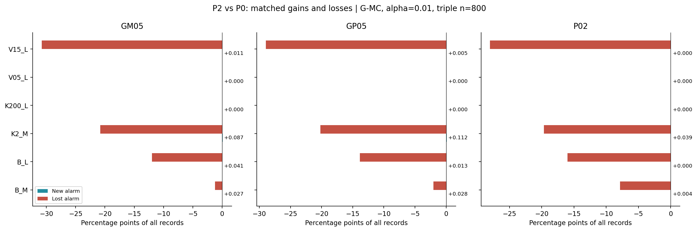
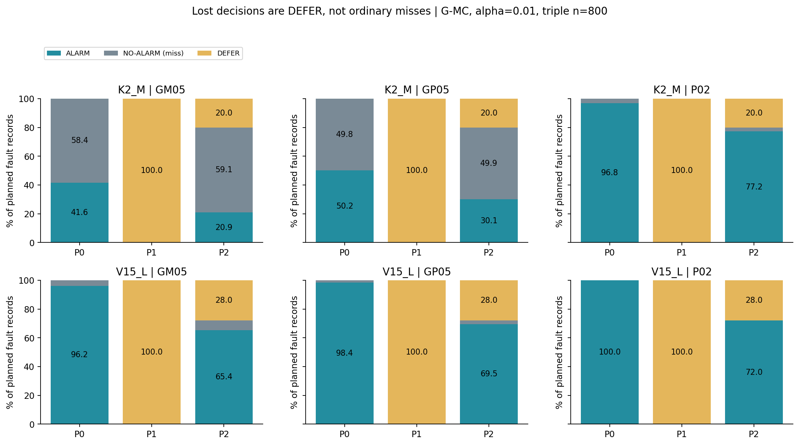
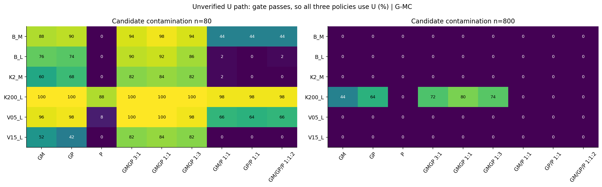
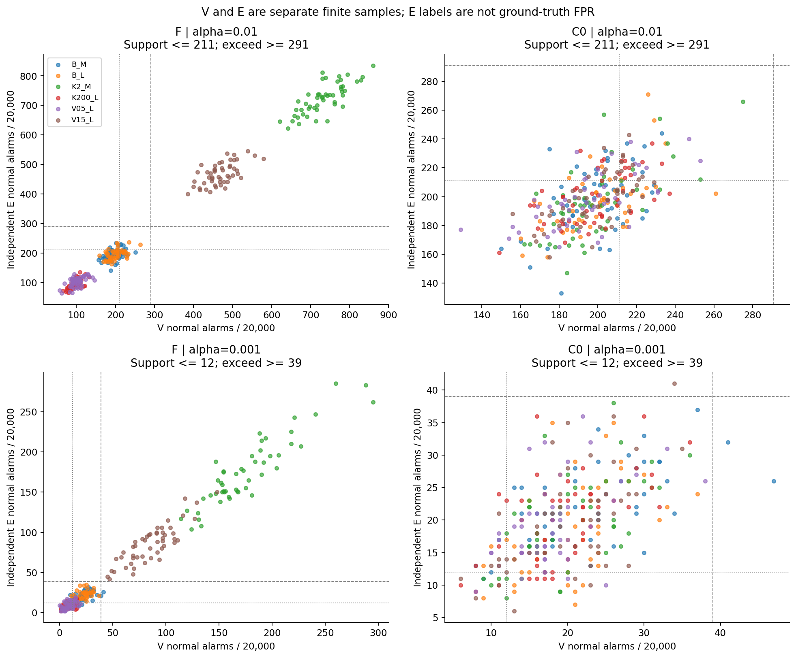

# PR-0011：判定停止と条件付き回復は、何を守り何を失うか

2026-10-18／保存run `9adfa7a8c6e0`・外側50反復の事後的政策評価。研究カード[PR-0011](../../../audits/prereg/PR-0011_stop_recovery_saved_data.md)を新政策の計算前に固定した。既知結果から着想した比較であり、新しい独立確認実験ではない。

## 1. 結論

**混入候補を保留した後に、旧校正を無条件に使い続ける必要はない。しかし、判定を止める費用と、回復のための正常確認資源は大きい。** 今回の3政策比較は、この交換関係を具体化した。

- **P1の停止は誤警報を減らすが、検出も判定提供も同時に失う。** 1%設定・三種混入800件では、K2_MとV15_Lは全50反復がDEFERになった。これは「正常を正しく判定した」結果ではない。
- **P2は清浄な現行校正C0が利用できれば部分回復できる。** 同条件の提供率はK2_Mで80%、V15_Lで72%。回復した反復だけの正常誤警報率は0.9468%、0.9653%で、正負ゲイン／私的入力の検出も戻る。ただし全体には20%、28%の未判定が残る。
- **0.1%設定では、V=20,000件による支持が足りず、回復が限られる。** P2の提供率は同じ2群で12%、18%。低い全件誤警報率を、それだけで成功と読むことはできない。
- **FPR支持は感度保証ではない。** 1%設定のK200_Lは旧Fが全50反復で支持されるため、三政策ともFを採用する。その負／正ゲイン検出は1.3616%／1.8724%にとどまる。
- **ゲートを通過したUは今回も未確認で使う。** この経路は三政策で共通であり、E-Aは全運転経路の妥当性認証ではない。

ここから言えるのは、P2の一律優越ではなく、**候補の混入検知、採用校正のFPR根拠、検出感度、判定提供率を別々に管理する必要がある**ということである。運用採用・論文反映は行っていない。

## 2. 固定した比較とデータの分離

|項目|今回の条件|
|---|---|
|対象|50反復、6源・窓条件、clean＋9組成×混入80/160/400/800件＝37主条件|
|検出器|固定LF-DC W0、枝配分1:1:2、α=1%／0.1%。再学習・最適化なし|
|ゲート|G-old、G-M、G-MC。主図はG-MC、全条件表は3ゲート全て|
|R/O|元の参照と旧校正Fを保持|
|A|候補のゲート判定にだけ使う監査プール|
|U|Aと別のプールで作る候補校正。混入条件はPR-0010のまま|
|C0|保存clean update_normal 15,999件の固定校正。Uの正常プールと共有、A/V/Eとは分離|
|V|現在正常20,000件。FとC0の支持／超過／未解決を判定|
|E|別の正常20,000件と負ゲインGM05、正ゲインGP05、私的入力P02各5,000件|

C0は**別途、正常来歴のある現行校正を確保できた場合**を模した資源である。混入Uから正常記録を自動発見して修復したわけではない。また、今回のC0を新たに取得した独立回復バッチとは呼ばない。シミュレーション上のclean資源を使えるという条件付き政策である。

群名はB_M/B_Lが基準κ=20・分散1、K2_M/K200_Lがκ=2/200、V05_L/V15_Lが分散0.5/1.5。Mは2.048秒、Lは8.192秒。全群でτ_i=0.04秒、τ_j=0.01秒、dt=0.002秒。故障の物理的定義・元データは[PR-0009](../../../audits/prereg/PR-0009_two_axis_independent_confirmation.md)を継承する。

Vで政策を選択した配列を各反復の`selected/`へ保存してから、Eの対応表へ接続した。混入の真値ラベルやEの成績を政策分岐へ渡していない。PR-0010の成分除去だけの20配置は、カードどおり最初から対象外である。

## 3. 3政策と「止める」の意味

|状況|P0：従来F復帰|P1：根拠なし停止|P2：条件付き回復|
|---|---|---|---|
|ゲート非保留|U|U|U|
|保留、FがVで支持|F|F|F|
|保留、F未支持、C0利用可・支持|F|DEFER|C0|
|保留、F未支持、C0も未支持／利用不可|F|DEFER|DEFER|

Fを優先し、回復機会は一回。支持されるまでデータを取り直す規則ではない。UNKNOWNや予期しない破損は技術不成立INVALIDとして区別するが、今回の成立データでは0件だった。

ここで停止とは**計器の二値判定を提供しないこと**であり、工場設備や装置を停止する操作ではない。記録ごとの出力を、警報A／提供非警報Q／政策保留D／技術不成立Xの4状態で保存した。

\[
N=A+Q+D+X,\qquad
\text{全件警報率}=A/N,\quad
\text{提供率}=(A+Q)/N,\quad
\text{提供時警報率}=A/(A+Q).
\]

故障評価でのQ/Nが提供見逃し、D/Nは未判定である。Dを陰性・成功へ読み替えない。提供0なら提供時率はNA。正常記録にも同じ分母規則を使う。

## 4. FとC0をどこまで支持できたか

確認族はF/C0×2α×上下端の8端、各尾η=.00625。Clopper–Pearson上端≤1.25αならSUPPORTED、下端>1.25αならEXCEEDED、それ以外UNRESOLVED。元解析のFだけのη=.0125ラベルは変更せず別に保持した。

表は各セル「支持／超過／未解決」の反復数、分母50。UNAVAILABLEは全セル0。

|群|1%・F|1%・C0|0.1%・F|0.1%・C0|
|---|---|---|---|---|
|B_M|38/0/12|38/0/12|7/2/41|4/2/44|
|B_L|37/0/13|35/0/15|4/0/46|4/0/46|
|K2_M|0/50/0|40/0/10|0/50/0|6/0/44|
|K200_L|50/0/0|35/0/15|38/0/12|7/0/43|
|V05_L|50/0/0|40/0/10|40/0/10|6/0/44|
|V15_L|0/50/0|36/0/14|0/50/0|9/0/41|

図1：棒上の数字は支持反復数。旧η=.0125からのFラベル変化は1%で4件、0.1%で20件（各300群・反復）。データやFが変わったのではなく、固定確認族を拡張した影響である。

1%では20,000件中211警報以下が支持、291件以上が超過。0.1%では12警報以下が支持、39件以上が超過となる。名目0.1%なら平均20警報程度なので、上限を1.25倍までに抑えることをこの件数で支持するのは容易ではない。未解決を違反確定とは扱わない。

## 5. 停止と回復の全体像

図2：主G-MC、各混入800件（clean列だけ0件）。各値は予定記録に対する提供率%。同じ政策選択を各評価故障へ適用するため、提供率は正常／故障で共通である。

以下は、負ゲイン200＋正ゲイン200＋私的入力400の三種混入を例に、全体の得失を読む。これは図示用の固定対比で、他条件を除外したものではない。[全15,984行](ALL_CONDITIONS.md)に全37条件・3ゲート・2αを残した。

### 5.1 1%：回復は有効だが完全ではない

数値は%、全件率。正常列は誤警報、他3列は検出。P1が0の場合も正常判定ではなく、提供率を見る。

|群|政策|提供率|正常警報|負ゲイン|正ゲイン|私的入力|
|---|---|---:|---:|---:|---:|---:|
|B_M|P0|100|0.9752|12.9272|21.2628|97.8540|
|B_M|P1|76|0.7258|9.6608|15.9652|74.3384|
|B_M|P2|92|0.8798|11.7188|19.2556|90.0000|
|B_L|P0|100|0.9822|73.8852|85.6104|100.0000|
|B_L|P1|74|0.7143|54.4708|63.2708|74.0000|
|B_L|P2|84|0.8090|61.9360|71.7760|84.0000|
|K2_M|P0|100|3.6213|41.6100|50.1620|96.8416|
|K2_M|P1|0|0.0000|0.0000|0.0000|0.0000|
|K2_M|P2|80|0.7574|20.9044|30.0876|77.2188|
|K200_L|P0/P1/P2|100|0.4857|1.3616|1.8724|62.6988|
|V05_L|P0/P1/P2|100|0.5179|13.3028|25.3012|99.8996|
|V15_L|P0|100|2.3433|96.1780|98.4492|100.0000|
|V15_L|P1|0|0.0000|0.0000|0.0000|0.0000|
|V15_L|P2|72|0.6950|65.4072|69.5148|72.0000|

図3：横破線は1.25αの参考線で、全件率がこれ以下というだけで政策認証した線ではない。

K2_MのP1はP0の私的入力検出96.8416%を全て未判定へ移す。P2では77.2188%を検出するが、20%の未判定が残る。V15_LでもP1の全停止からP2の72%提供へ戻るが、P0の100%私的入力検出には戻らない。停止で減った誤警報だけを利益に計上しない。

### 5.2 0.1%：低誤警報と低提供率が同居する

|群|P0/P1/P2提供率|P2正常警報%|P2負ゲイン%|P2正ゲイン%|P2私的入力%|
|---|---|---:|---:|---:|---:|
|B_M|100/14/18|0.0128|0.4176|1.0284|16.9948|
|B_L|100/8/14|0.0094|5.8996|8.6228|14.0000|
|K2_M|100/0/12|0.0069|1.2748|2.4668|11.1972|
|K200_L|100/76/78|0.0328|0.1276|0.2164|29.6228|
|V05_L|100/80/82|0.0349|2.1412|5.9116|81.6104|
|V15_L|100/0/18|0.0116|11.7144|14.9572|18.0000|

図4：小さい青棒は、回復時の検出力がゼロという意味ではない。そもそも回復できない反復が多く、全予定分母の検出率が小さくなっている。

## 6. 回復した反復だけを見るとどうか

以下はP2が実際にC0を使った反復だけでの提供時率。F支持でFを使った反復とは混ぜない。分母の選択はVだけで決め、Eは独立のまま。全体の成績は§5と併読する。

|α|群|C0回復反復/50|正常誤警報%|負ゲイン検出%|正ゲイン検出%|私的入力検出%|
|---|---|---:|---:|---:|---:|---:|
|1%|B_M|8|0.9625|12.8625|20.5650|97.8850|
|1%|B_L|5|0.9470|74.6520|85.0520|100.0000|
|1%|K2_M|40|0.9468|26.1305|37.6095|96.5235|
|1%|V15_L|36|0.9653|90.8433|96.5483|100.0000|
|0.1%|B_M|2|0.0600|1.8800|6.0600|94.4400|
|0.1%|B_L|3|0.0633|39.6133|59.5200|100.0000|
|0.1%|K2_M|6|0.0575|10.6233|20.5567|93.3100|
|0.1%|K200_L|1|0.0650|0.3000|0.4600|35.3400|
|0.1%|V05_L|1|0.0750|14.8600|15.5600|99.5000|
|0.1%|V15_L|9|0.0644|65.0800|83.0956|100.0000|

1%のK200_L/V05_LはF優先なのでC0回復0反復、回復時率はNA。0.1%の1〜3反復の成績を安定した性能推定とは扱わない。提供反復2未満、または変動を評価できない場合の区間はNAとした。[回復層別の整数表・区間](RECOVERY_STRATA.md)に全48行を保存した。

K2_Mの1%では、回復時の私的入力検出96.5235%に対し、全件では77.2188%。この差は主に「回復した計器が弱い」からではなく、20%の反復を提供できなかったためである。一方、回復時の負／正ゲイン検出26.1305%／37.6095%はP0全体の41.6100%／50.1620%より低い。ただし選択反復が違うので、因果的な同条件差は次節の対応表で見る。

## 7. 停止で失った検出と、校正切替で変わった判定

全評価記録について4×4の状態対応表を作り、同じ記録の新規警報と喪失警報を別々に数えた。P1−P0は判定をDEFERへ移すだけで、新規警報0。P2−P1はDEFERからだけ回復し、既存警報の喪失0。これは政策の構造であって、実験による優越発見ではない。

図5：三種800件・G-MC・1%。小さな正の値も併記。喪失には校正切替による非警報化と、残存DEFERへの移行の両方が含まれる。

|群・評価|P2新規警報 pp|P2喪失警報 pp|差 pp（点ごと95%区間）|
|---|---:|---:|---|
|K2_M・負ゲイン|0.0868|20.7924|−20.7056 [−23.7044, −17.7068]|
|K2_M・正ゲイン|0.1116|20.1860|−20.0744 [−24.4488, −15.7000]|
|K2_M・私的入力|0.0388|19.6616|−19.6228 [−30.7280, −8.5176]|
|V15_L・負ゲイン|0.0112|30.7820|−30.7708 [−42.4904, −19.0512]|
|V15_L・正ゲイン|0.0048|28.9392|−28.9344 [−41.3819, −16.4869]|
|V15_L・私的入力|0.0000|28.0000|−28.0000 [−40.8900, −15.1100]|

一方、P2−P1の私的入力検出回復はK2_Mで+77.2188 pp [66.1346, 88.3030]、V15_Lで+72.0000 pp [59.1100, 84.8900]。同時に正常警報も+0.7574 pp、+0.6950 ppだけ戻る。全停止を比較対象にすると回復が大きく見えるため、P0との損失も必ず並べる。

図6：K2_MのP2・負ゲインは検出20.9044%、提供見逃し59.0956%、未判定20%。V15_LのP2・負ゲインは検出65.4072%、提供見逃し6.5928%、未判定28%。この分解を保つことで、「非警報が増えた」の中身を混同しない。

全条件の4×4表と差の区間は[paired_all.json](paired_all.json)、DEFER時にU/F/C0が出したはずの警報数は[rates_all.json](rates_all.json)の`suppressed_shadow_alarms_U_F_C0`に保存している。読みやすい回復層別表では、C0切替による追加／喪失と、DEFERへ失ったP0警報／非警報を整数で分けた。

## 8. 源変化と残る二つの経路

第一は**Fが支持されるが感度が足りない経路**。K200_Lでは低い正常FPRを根拠にFを保持し、三種混入800件・1%で負ゲイン1.3616%、正ゲイン1.8724%、私的入力62.6988%となる。FPRを確かめても、目的故障への最低感度を満たしたことにはならない。今回の政策に感度基準を後付けして切り替えることはしていない。

第二は**ゲートが混入候補を通す経路**。三政策ともUを使うので、停止・回復策の差はここでは生じない。

図7：G-MC非保留率。800件の均衡ゲイン混在でもK200_Lでは40/50=80%がUへ進む。少量80件では、たとえばB_Mの均衡混在が49/50=98%。Uの通過は正常性の証明ではない。cleanでもB_MとK2_Mで各1/50をゲートが保留し、他4群は0/50だった。

三種800件は全6群でG-MCが50/50保留するため、停止・回復の交換関係が見えやすい例である。これだけで全混入条件の性能を代表させず、図2・図7と全条件表を組み合わせて読む。

## 9. Vの支持は独立Eとどう対応したか

図8：各点は1群・1反復・固定校正。点線は支持の最大整数件数、破線は超過の最小整数件数。同じ確認族をEにも記述的に適用したが、Eラベルで政策を変更していない。

Vで支持されたF/C0の群・反復は1%で399セル、0.1%で125セル（各600セル中）。その独立Eは、1%が支持355／超過0／未解決44、0.1%が支持85／超過0／未解決40だった。明瞭な支持対超過の食い違いはこの向きでは0だが、未解決を挟む相違は残る。Eも有限標本で、真のFPRの判定器ではない。候補37個やゲート3個に重複展開して確認標本数を水増ししない。

## 10. 不確実性と主張の範囲

独立単位は外側50反復。6群×37条件×3ゲート×2αの66,600機会は、独立な実験回数ではない。同じ反復・源・Eを共有する条件間の依存を保持した。

全件率差には反復ごとの対応差から点ごとの95% t区間（df49）を付けた。多重同時優越の区間ではない。提供時率θ=Σa_r/Σb_rには、`sd(a_r−θb_r)/(√50 mean(b_r))`による比のデルタ法を用いた。少数提供時は不安定、分母0／提供反復2未満／変動評価不可では区間NA。境界付近の近似区間を自動で[0,1]へ切り詰めて保証と見せない。

本結果は固定時点の静的リプレイである。停止時間、回復待ち時間、連続更新、繰返し確認、現場の正常来歴確保、装置の安全な停止手順は測っていない。未知の源分布や未評価故障への一般化も未確認。回復用資源を選別する費用を0とした経済的最適性は主張しない。

## 11. 研究カードへの答えと次の判断材料

Q1（停止の費用）：不支持Fからの警報を差し控えると、正しい故障警報と非警報もまとめてDEFERへ移る。FPR低下だけでは採用根拠にならない。

Q2（回復の利益）：清浄C0が利用でき、独立Vで支持された場合、P1に対して提供と検出が回復した。1%では大きいが、0.1%ではV資源の制約が強い。C0がcleanでも全反復で支持されるわけではなかった。

Q3（残る損失）：P0との比較では未判定と閾値切替の損失が残る。F優先による低感度と、ゲート通過Uの未確認性も残った。三政策に普遍的な勝者を付けない。

H-accounting：全50反復、799,200対応表で整数の会計・周辺和・追加−喪失=警報差を確認した。科学的欠測・事後除外・UNKNOWN・INVALIDは0。未解決や低検出を除外していない。

次に決めるなら、「更に複雑な融合則」より先に、**どの故障感度を最低限必要とするか、未判定を何%まで許すか、正常確認をどれだけ確保できるか**が政策選択の条件になる。ただし、最低感度や全経路確認E-Cの追加は今回の範囲外で、ここでは実装も採用もしない。

## 12. 実装・検証・成果物

主処理は新規物理標本0。元12ZIPのSHA/サイズ、使用メンバーのSHA/サイズ/CRCを再照合し、V600万件×F/C0×2α＝2,400万判定を別算術経路とも照合した。旧Fの保存bit1,200万件も一致。A/Uの来歴300群・反復、C0とclean Uの一致、V選択保存後のE参照を確認した。

別の点検スクリプトは元の保存E判定1,050万記録からF–C0の2,400枝表を再計数し、全政策対応表799,200個とCPラベルを二項尾確率で照合した。混入Uのraw全件再計算は今回繰り返さず、PR-0010で検証済みの対応表をSHA固定して使った。同一エージェントの別計算経路による点検で、第三者再現ではない。

主反復処理累積28.86秒、別経路点検18.96秒。前処理・初回フォント準備・図表作成を除くローカル実測で、元時系列生成の所要時間ではない。5反復ごとの非累積ZIP10個は各約238〜244 kBで、元ZIPを再同梱していない。

初回v1はNumPy複合添字で軸が移動し、第1反復のE表参照で停止した。v1のソース・途中選択・失敗記録を保持し、軸形状テストを追加してv2へ移した。科学条件は変更していない。また、追加層別集計の完了前に一時読出しを試みたFileNotFoundErrorを作業側の順序ミスとして保存した。いずれも科学的除外や元実験の故障には数えない。

- [全条件MD](ALL_CONDITIONS.md)、[全件率・提供時率・区間JSON](rates_all.json)、[4×4対応表JSON](paired_all.json)
- [回復層別MD](RECOVERY_STRATA.md)、[V/Eラベルと旧族からの遷移](validation_evidence_summary.json)
- [実装](../../scripts/analyze_pr0011_recovery.py)、[9技術試験](../../scripts/test_pr0011_recovery.py)、[別経路点検](../../scripts/verify_pr0011_recovery.py)、[図・集計](../../scripts/report_pr0011_recovery.py)、[回復層別](../../scripts/summarize_pr0011_strata.py)
- [主処理検証](validation.json)、[別経路検証](second_path_validation.json)、[納品点検](../../../docs/OMITTED_MATERIALS.md#item-1651e931dc71)、[現在アンカー](../../../docs/OMITTED_MATERIALS.md#item-e230b182a79a)

論文MD・TeX・PDF、旧結果、元ZIPは変更していない。今回の成果は、採用可否を判断するための保存データ分析である。
