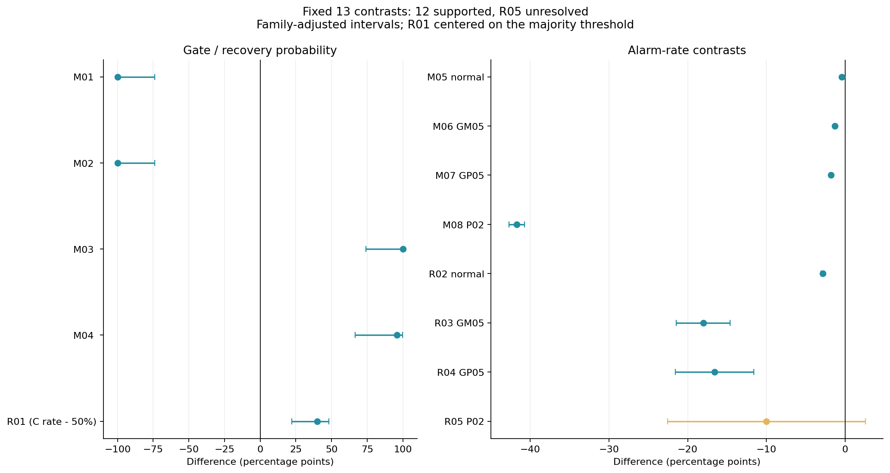
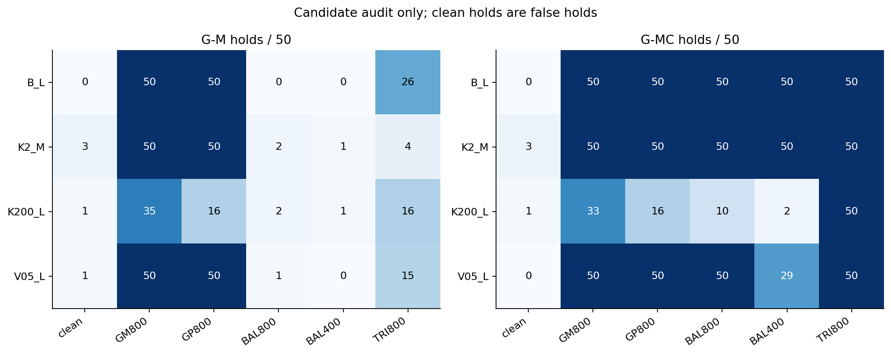
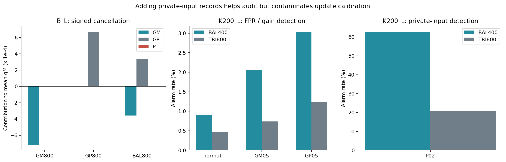
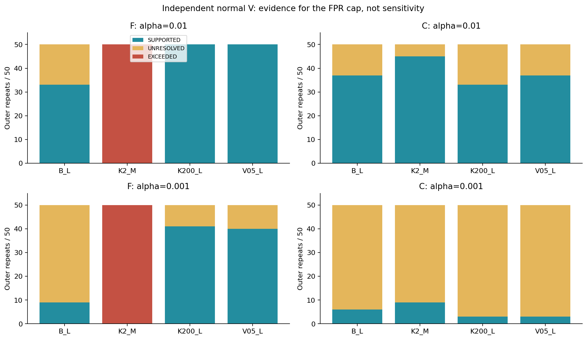
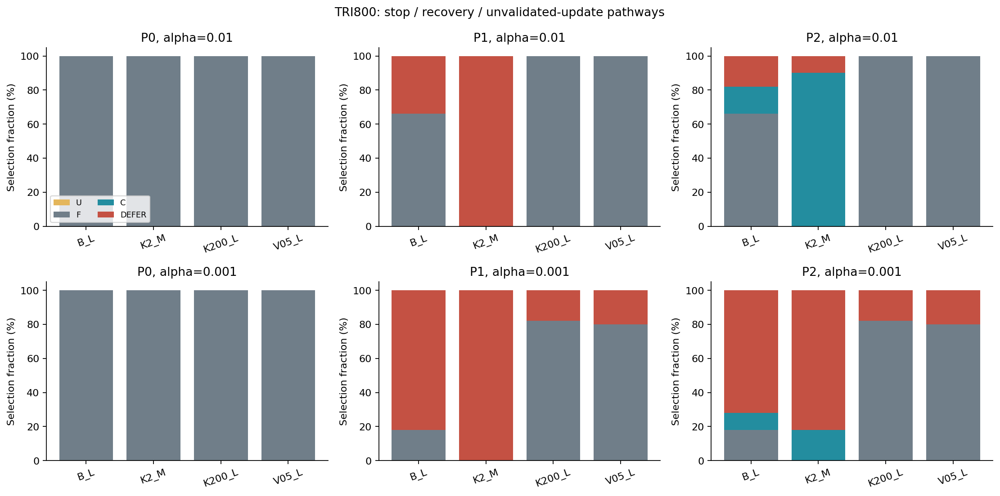
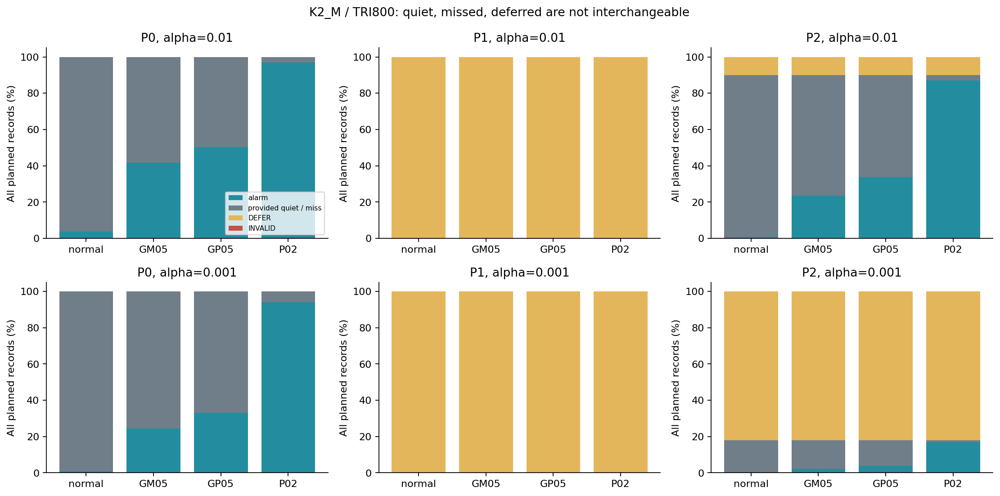
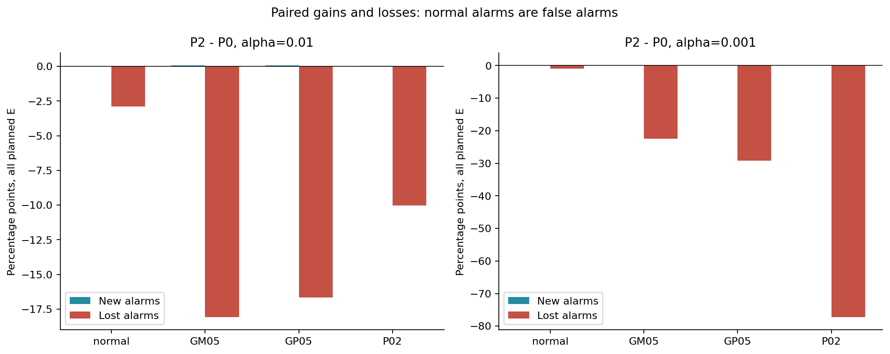
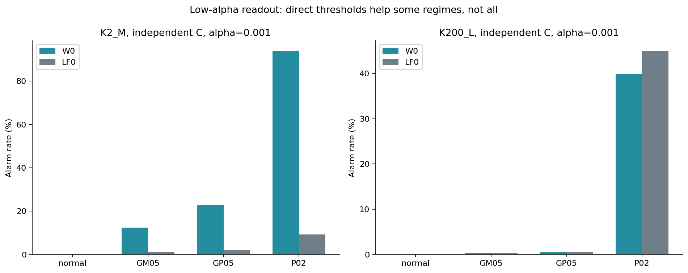

# PR-0012：混合相殺と条件付き回復の独立確認

2026-10-18／run `64bf0f2c7697`／FIX1 cell `d41a11833edd6d21`／新しい独立50反復。

## 1. 結論

返却データは分析に使える。SHARD 10個＋最終INDEXを全照合し、23,999,200保存記録から校正・ゲート・V判定・E判定・政策集計を再構成した。元集計との不一致、科学的欠損、非有限行、INVALIDは0だった。

事前固定の主13対比は**12件支持、1件未解決、逆方向0、技術未成立0**。この「支持」は性能向上を意味せず、事前に予想した検出損失の確認も含む。核心は次の三点である。

1. **正負混合は符号付き平均の監査をすり抜けうる。** B_Lの均衡混合BAL800はG-M保留0/50、G-MC保留50/50。単独の負・正ゲイン混入はG-Mでも各50/50保留された。別の物理座標を残す意味が新標本でも確認できた。
2. **候補を見つけやすいことと、その候補で作る校正がよいことは別。** K200_LでBAL400に私的入力400件を追加すると、G-MC保留は2/50から50/50へ増える。一方、その混入Uを採用した場合の私的入力検出は62.6496%から20.9316%へ落ちる。
3. **誤警報根拠に基づく回復は可能だが、感度と提供率を別に払う。** K2_M／TRI800／α=1%でP2は45/50反復が独立Cへ回復し、過半回復の事前基準を満たした。しかし残る10%は未判定、正負ゲインの全件検出はP0より低下した。私的入力の全件検出差R05は平均−9.9968 ppだが、事前調整区間がゼロをまたぎ**未解決**である。

今回の目的であった「既知の現象を固定条件・新しい乱数で再確認する」単位は閉じられる。主張をこの範囲に保つなら、未解決1件を埋めるための追加増数は不要。次は実験を増やすより、既存証拠との対応と論文構成を決める段階である。論文MD・TeX/PDFは変更していない。

## 2. 受領・再現監査

| 項目 | 確認結果 |
|---|---|
| ZIP | 11個、5反復ごとの非累積10シャード＋索引 |
| 最大ZIP | 268,581,676 bytes、全て十進1 GB未満 |
| 完全性 | 延べ18,966索引メンバーのsize・SHA-256・CRC、重複整合、catalog照合 |
| 条件 | 本体PR-0012＋技術追補A01、FIX1埋込ソースとローカル凍結ソース一致 |
| 反復・保存値 | 00–49、7,500 rawチャンク、23,999,200記録 |
| 再構成 | 100参照モデル、1,500校正、A/U合計2,400候補 |
| 判定再照合 | V 16,000,000、E-W0 112,000,000、E-LF0 42,000,000方式判定 |
| 別経路確認 | 主13区間・分類、800 V分類、28,800政策4×4対応表の周辺和と得失 |
| 分離 | A/U別プール・別順序、Cとclean U別取得、V選択receiptはE生成前 |
| 実環境 | NVIDIA RTX PRO 6000 Blackwell Server Edition、float64、NumPy 2.1.3／SciPy 1.16.3／CuPy 14.2.0 |
| 計時 | 保存active 98.2886分、50反復stage合計96.4791分、1反復114.15–118.03秒 |

方式判定件数は同じ記録の再利用を含み、独立標本数ではない。active時間はブラウザからMacへの全転送時間ではない。保存deliveryはqueuedのままだが、今回Mac上の11ファイルを読み切って完全性を確認したので、少なくとも本runの手元到着は確認済み。実VM消失後の復元は今回試験していない。

preflightは`PASS_WITH_BOUNDARY_AMBIGUITY`。技術1,088記録のCPU/GPU最大差は8.8818×10⁻¹⁶、説明不能差0、W0判定差0、LF0の参照順位境界に限る2bit差が記録されている。A01に従う技術上の分類で、科学閾値の緩和ではない。本番保存値からの全判定再計算は一致した。rawは保存された二次統計量であり、全時系列波形を再生成・再監査したという意味ではない。

監査は同一エージェントの別算術経路による自己点検であり、独立査読ではない。証拠は`receipt.json`、`validation.json`、`second_path_validation.json`、`runtime_evidence.json`に保存した。会話途中の「13件すべて支持」という誤要約はR05読了後に訂正し、QA-026へ記録した。元の実験結果は初めから12支持・1未解決で変更していない。

## 3. 比較の読み方

### 条件と役割

公称デジタル一次プローブ、dt=.002秒、τi=.04秒、τj=.01秒。故障は信号側のjゲイン−5%（GM05）・+5%（GP05）、私的入力分散比2%（P02）。

| 群 | OU相関率κ | 源分散比 | 窓秒 |
|---|---:|---:|---:|
| B_L | 20 | 1 | 8.192 |
| K2_M | 2 | 1 | 2.048 |
| K200_L | 200 | 1 | 8.192 |
| V05_L | 20 | .5 | 8.192 |

候補は各15,999件。clean、GM800、GP800、BAL800（GM400＋GP400）、BAL400（GM200＋GP200）、TRI800（GM200＋GP200＋P400）の6組成。混合は**異なる故障記録の混在**であり、一つの波形内の複合故障ではない。私的入力追加の対照はTRI800−BAL400で、ゲイン記録と位置を保持する。BAL800との比較を純粋なP追加と呼ばない。

Rは射影、Oは旧校正F、Aは候補監査、別のUは更新候補校正、独立Cは外部由来の清浄な回復校正、Vは正常性根拠、Eは最後の評価に使う。CとVが正常であることは本実験の資源仮定であり、ゲートが証明した事実ではない。A/Uは同組成だが別記録で、実運用の組成不一致は試験していない。

主読出しW0は固定LF射影＋直接校正、G+／G−／Pの警報予算1:1:2。旧LF0は順位読出しの補助対照。主政策はG-MCを使い、G-Mは相殺機序の対照。両ゲートは別々に固定した閾値なので、G-MCはG-Mの集合論的な上位互換ではない。

### 三政策と二つの分母

候補通過時は三政策とも対応Uを使う。保留時、P0はFへ戻る。P1はFのV支持があればF、なければDEFER。P2はF支持を優先し、それがなくC支持があればC、一方もなければDEFER。通過UはV認証の対象外である。

正常Vは各群20,000件、F/C×2α×両側8端を固定しη=.00625、FPR許容上限1.25α。α=1%では警報数211以下が支持、291以上が超過、間は未解決。α=.1%では12以下／39以上。これは各群・各反復内のF/Cに関する根拠で、全群・全政策・連続運転の同時認証ではない。

全予定Eの分母をN、警報a、提供下非警報q、未判定d、技術無効xとし、N=a+q+d+xを保持する。全件警報a/N、提供率(a+q)/N、提供時警報a/(a+q)、故障時の提供下見逃しq/N、未判定d/Nを別々に示す。DEFERは正しい非警報でも、提供下見逃しでもない。提供0では提供時率はNA。

主13は単一族.05/13の事前規則。M01–04は保守的な対応二値CP差区間、R01はCP回復確率区間、率差は外側50反復の対応t近似（df49）を使用。その他は指定副分析・記述分析で、JSONの95%区間は非多重調整。提供時率／選択層は反復を単位とするratio/delta近似で、分母0・退化時は区間NA。評価記録を大量の独立反復として扱わない。

## 4. 主13対比

差は百分率ポイント（pp）、R01のみ確率%。支持は事前指定した方向の支持。

| ID | 対比 | 推定値 | 事前調整区間 | 判定 |
|---|---|---:|---|---|
| M01 | B_L G-M保留：BAL800−GM800 | −100.0000 | [−100.0000, −74.0561] | 支持 |
| M02 | B_L G-M保留：BAL800−GP800 | −100.0000 | [−100.0000, −74.0561] | 支持 |
| M03 | B_L BAL800保留：G-MC−G-M | +100.0000 | [74.0561, 100.0000] | 支持 |
| M04 | K200_L G-MC保留：TRI800−BAL400 | +96.0000 | [66.4625, 99.9101] | 支持 |
| M05 | K200_L U：TRI800−BAL400、正常 | −0.4580 | [−0.4880, −0.4280] | 支持 |
| M06 | 同、負ゲイン | −1.3180 | [−1.4133, −1.2227] | 支持 |
| M07 | 同、正ゲイン | −1.8012 | [−1.9210, −1.6814] | 支持 |
| M08 | 同、私的入力 | −41.7180 | [−42.7025, −40.7335] | 支持 |
| R01 | K2_M TRI800 P2のC回復確率 | 90.0000% | [72.0564%, 98.2247%] | 過半を支持 |
| R02 | K2_M TRI800 P2−P0、正常全件警報 | −2.8713 | [−3.0357, −2.7069] | 支持 |
| R03 | 同、負ゲイン全件検出 | −18.0268 | [−21.4257, −14.6279] | 支持 |
| R04 | 同、正ゲイン全件検出 | −16.5776 | [−21.5738, −11.5814] | 支持 |
| R05 | 同、私的入力全件検出 | −9.9968 | [−22.5661, 2.5725] | **未解決** |

図1ではR01だけ50%基準を引いて表示した。R05の平均低下を無効果や同等性と読むことも、確定した低下と読むこともできない。停止の有無が反復単位で変わり、外側SDは29.2866 ppと大きい。選択層の記述を追加しても、主判定を置き換えない。

## 5. 混合相殺と私的入力追加

B_L／BAL800のAにおいて、各故障成分の「置換前cleanからの平均差」を足し合わせた符号付きM変化は、絶対寄与和の平均3.1282%に留まった。別Uでも2.7837%。正負の寄与が互いに消える一方、CR側の寄与は同符号で残り、G-MCの50/50保留と整合する。この比は「除かれた情報の割合」や因果寄与率ではなく、固定混合の記述量である。

G-MCでもK200_L／BAL800は10/50しか保留せず、40/50は通過する。GM800でも33/50、GP800は16/50。clean誤保留はG-MCでB_L 0/50、K2_M 3/50、K200_L 1/50、V05_L 0/50。0件の群も群別5%以下の誤保留を認証するものではない。K200_LのGM800でG-M35/50に対しG-MC33/50なのは、固定閾値が違うためである。

| K200_L、α=1%、混入Uの影評価 | BAL400 | TRI800 | 差 pp |
|---|---:|---:|---:|
| 正常誤警報 % | 0.9152 | 0.4572 | −0.4580 |
| 負ゲイン検出 % | 2.0552 | 0.7372 | −1.3180 |
| 正ゲイン検出 % | 3.0344 | 1.2332 | −1.8012 |
| 私的入力検出 % | 62.6496 | 20.9316 | −41.7180 |

私的入力追加でP枝の裾が校正に取り込まれる。私的入力EのP枝発火は62.3532%→20.1916%、Pのみ発火は61.4736%→19.8036%。ゲインEでもPのみ追加検出が減る。正常FPR低下だけを改善と呼べない。

ただし、この表は**混入Uを使った場合の影評価**である。TRI800は実際の政策では全群G-MCに50/50保留され、そのUは採用されない。監査の効用と、監査されず更新した場合の損失を混同しない。

## 6. FPR根拠と回復の限界

| 群 | F支持 /50（1%） | C支持 /50（1%） | F支持 /50（.1%） | C支持 /50（.1%） |
|---|---:|---:|---:|---:|
| B_L | 33 | 37 | 9 | 6 |
| K2_M | 0 | 45 | 0 | 9 |
| K200_L | 50 | 33 | 41 | 3 |
| V05_L | 50 | 37 | 40 | 3 |

K2_MのFは両αでV超過50/50、独立Eでも50/50超過。Cは主αで45/50支持となるが、低αでは9/50に下がる。閾値が清浄データから作られていても、有限Vで支持を得ることは別の要件である。

F/CのVとEを同じCP規準で記述すると、V支持→E超過、V超過→E支持はいずれも0。ただし支持↔未解決は存在する。K200_L／C／α=.1%にはV未解決→E超過が1件あり、隠していない。Eも有限標本による評価で真のFPRそのものではなく、Vと同じ判定にならないこと自体を破損としない。

TRI800では全候補が保留されるので、主αのP2経路はB_LがF33／C8／DEFER9、K2_MがC45／DEFER5、K200_LとV05_LはF50である。Cが存在すれば常に更新する政策ではなく、F支持を優先する。低αではB_LのDEFER36/50、K2_M41/50、K200_L9/50、V05_L10/50が残る。

### 主回復条件：K2_M／TRI800／α=1%

| 政策 | 提供率 % | 正常 全件警報 % | 正常 提供時FPR % | 負ゲイン 全件検出 % | 正ゲイン 全件検出 % | 私的入力 全件検出 % | 未判定 % |
|---|---:|---:|---:|---:|---:|---:|---:|
| P0 | 100.0000 | 3.7304 | 3.7304 | 41.5476 | 50.2792 | 96.9272 | 0.0000 |
| P1 | 0.0000 | 0.0000 | NA | 0.0000 | 0.0000 | 0.0000 | 100.0000 |
| P2 | 90.0000 | 0.8591 | 0.9546 | 23.5208 | 33.7016 | 86.9304 | 10.0000 |

P1の0%警報は「誤警報なく高品質に動作」ではなく、全停止である。P2の全件警報0.8591%にも停止10%が入るので、提供時FPR0.9546%と併記する。P0の高検出はFPR3.7304%を伴い、等FPRでP0が優れると主張しない。

P2で判定を提供した故障の全件分母に対する見逃しは、負66.4792%、正56.2984%、私的入力3.0696%。それぞれ別に未判定10%がある。C回復45反復だけを見ると、P0→P2の負検出41.5858%→26.1342%、正50.2027%→37.4462%、私的入力96.9222%→96.5893%。私的入力の提供層内低下は0.3329 ppで、全件低下の大部分は残る停止に対応する。ただしこの層別はV選択後の記述で、R05の未解決を覆す確認検定ではない。

| 主回復条件 P2対P0 | 新たな警報 pp | 失う警報 pp | 差 pp |
|---|---:|---:|---:|
| 正常 | 0.0124 | 2.8837 | −2.8713 |
| 負ゲイン | 0.0636 | 18.0904 | −18.0268 |
| 正ゲイン | 0.0744 | 16.6520 | −16.5776 |
| 私的入力 | 0.0220 | 10.0188 | −9.9968 |

正常の「新たな警報」は誤警報増、失う警報は誤警報減である。P2−P1の回復検出は、P1がDEFERだった層でのみ増える構造であり、新たな最適性定理ではない。

α=.1%ではP2の提供率18%、未判定82%。提供時FPRは0.0794%だが、全件の負／正／私的入力検出は2.0720%／3.8844%／16.8696%に留まる。低誤警報要求は、判定提供の資源負担としても現れる。

### 指定副分析：FPR支持があっても感度は保証されない

K200_LのFは主αでV支持50/50だが、負・正ゲイン検出は1.3996%・1.9012%。「正常に警報を出しすぎない」と「故障を拾える」は別である。

V05_L／GM800では保留後Fへ戻すと、正ゲイン検出は混入U影評価43.2636%から25.2668%へ下がる（−17.9968 pp）。負ゲインの混入を止める処理が別の正ゲインの検出にも影響することを確認した。ただし混入Uを採用すべきという推奨ではなく、復帰先の感度も別途報告すべきという結果である。

## 7. 読出し表現：直接校正の利点と非優越

補助比較K2_M／独立C／α=.1%ではLF0が45/50反復で構造的に非発火となった。W0は同じ固定射影を直接校正し、私的入力検出93.9660%を保ち、LF0は9.1440%。正常FPRはW0 .1001%、LF0 .0089%である。低いFPRだけでLF0を良好と評するのも、同じ実測FPRでW0が優位と評するのも不適切である。

逆にK200_L／C／同αでは私的入力検出W0 39.8824%、LF0 44.9924%でLF0が5.1100 pp高い。正常FPRは.0951%／.0848%。順位読出しの障害は条件依存であり、直接校正の一様優越は示していない。全条件の枝発火・Pのみ発火・W0のみ／LF0のみ・非発火反復は付表へ残した。

## 8. 論文へ持ち込める主張と持ち込まない主張

| 採択済みの主張 | 今回得た根拠 | 限界 |
|---|---|---|
| 指示値の表現・読出し・校正の版を分けると失敗を監査できる | 保存二座標→固定射影→閾値→枝→ORを再構成、低αの順位非発火と直接校正の得失を新標本で確認 | 最小十分性・全源への一般化・W0一律優越ではない |
| 候補監査と採用校正の評価は別 | 正負混合の相殺、CR側による補完、P追加で保留増とU検出損失が同時に現れる | 通過Uの正常認定・未知混合の万能検知ではない |
| FPR根拠と感度・提供率を分けて報告する | 45/50の条件付き回復と、正負検出損失・未判定・低αの提供減を同時に評価 | 全経路FPR認証、C/V調達、最適政策・産業運用の実証ではない |

旧PR-0009は独立確認、A〜Eは同じ保存標本を使った事後分析、PR-0012はその知見で条件を選んでから固定した**新標本での確認**である。古い50反復と今回50反復を一つの独立確認100反復へ合算しない。今回の主13と、副分析・選択層の記述を分ける。

追加実験なしに閉じる範囲は、固定4群・6組成・定常OU・公称一次応答・有限正常資源の下での監査方法論である。A/U組成不一致、非ガウス源、未知ドリフト、共有雑音の不可識別性への新対処、全経路U確認、逐次監視、現場データ・実機、費用最適化は未検証。これらを将来扱えることと、今回扱ったことは別である。

**推奨は、ここで追加の大規模性能実験を止め、論文の主張・図表の採用を裁定すること。** R05を未解決として残し、主張を上表の三本へ揃える。次に必要なのは、関連研究との対応表、本文／補足の配置、再現パッケージの整理である。運用保証まで主張を拡張したい場合だけ、別カードで追加実験を設計する。今回は原稿化・公開を実行していない。

## 9. 再現資料

- `ALL_POLICIES.md`：全576政策行＋576対応得失行。4×4計数は`paired_summary.json`。
- `ALL_CALIBRATIONS.md`：全352校正読出し行＋96 W0/LF0対応行。
- `ALL_GATES_AND_SUPPORT.md`：24ゲート行、144政策選択行、16 V/E対応行。
- `mechanism_summary.json`：A/Uの成分寄与・相殺比、`strata_summary.json`：選択層別の率と区間。
- `primary13.json`：凍結主推論、`outer_arrays.npz`と`recomputed/`：外側50反復の整数計数。
- 解析実装：`numerics/scripts/analyze_pr0012_return.py`、`summarize_pr0012_confirmation.py`。保存元ZIPを読んで再計算し、新しい物理標本は生成していない。

THROUGHLINEに従い、元ZIP・旧結果・凍結コード／カード・論文を保持し、新しい分析v1へ分離保存した。主結果の昇格・論文への採用は人間の裁定として残す。
