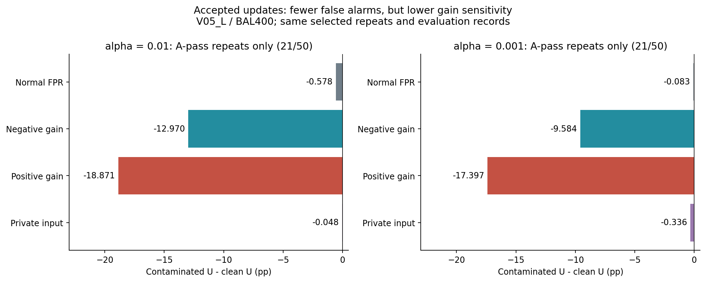
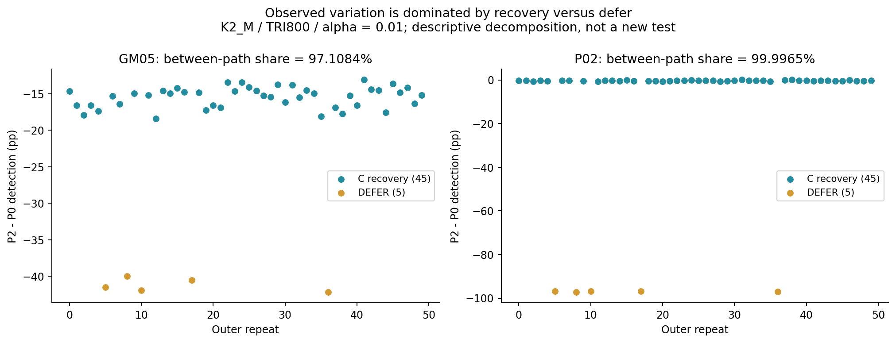
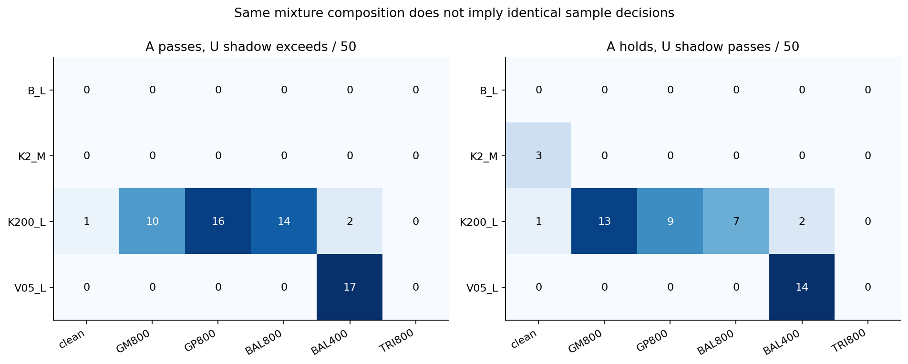
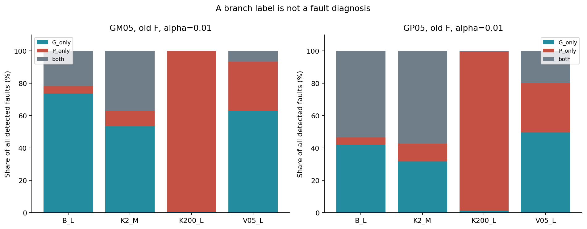

# PR-0012を別の角度から読む：警報の少なさ、感度、回復の不確実性

2026-10-18／保存run `64bf0f2c7697`／同じ50反復の探索的分析。新規シミュレーション・方式変更・論文改訂なし。

## 1. 結論：追加で見えたのは、計器の性能を一つの数字にできない理由

今回の掘り直しには意味があった。最も重要なのは、**混入監査を通過し、誤警報率も低いのに、正負ゲインの検出能力を大きく失う更新**を具体的に取り出せたことである。停止したために検出できない問題とは別に、判定を出し続けながら感度を失う問題がある。

もう一つは、R05の広い不確実性の内訳である。私的入力の全件検出差のばらつきは、今回の50反復ではほぼ「Cへ回復できたか、DEFERになったか」の違いで説明された。評価記録をさらに大量に集めることと、回復経路の不確実性を減らすことは同じではない。

追加で得た四つの読み取りは次の通り。

| 読み取り | 今回の具体例 | 論文への意味 |
|---|---|---|
| 低FPRと感度維持は別 | V05_L・BAL400のA通過21反復で、正ゲイン検出がclean U比−18.8714 pp | FPRだけでは更新後の計器の十分性を判定できない |
| 平均損失と不確実性の所在は別 | K2_M・TRI800のR05で、経路間分散の比率99.9965% | 回復の有無と、回復後の感度を分けて報告する |
| 同組成の別バッチでも監査結果は変わる | V05_L・BAL400でAとUの固定境界判定が31/50不一致 | Aの通過をU一個一個の正常証明にしない |
| 枝の名称と故障の名称は別 | K200_Lの負ゲイン警報の99.3141%がP枝のみ | 枝別警報は応答の説明であって故障分類ではない |

これらは新しい四本の主張を追加する提案ではなく、既に選んだ三本の主張を説明する材料である。主13の結果は**12支持・R05未解決**のまま。今回の探索でその判定を置き換えない。

## 2. データと比較方法

入力は[既存の独立確認分析](../pr0012_64bf0f2c7697_confirmation_v1/PR0012_CONFIRMATION_REPORT_JA.md)で再構成済みの反復別整数表、政策選択、A/U監査スコアである。今回、これらと現在の保護対象1,177件のSHA-256を再照合した。元ZIPの全CRC検査・全保存記録の判定再計算は前回の証拠であり、今回はその全処理を繰り返していない。

四群はB_L（基準）、K2_M（遅い源・中窓）、K200_L（速い源・長窓）、V05_L（源分散半分・長窓）。各候補は15,999件で、BAL400は負・正ゲイン各200件、BAL800は各400件、TRI800はBAL400と同じゲイン記録に私的入力400件を追加したもの。GM800／GP800は片側ゲイン800件である。

Aは候補の監査用、Uは同組成・別記録の更新校正用。Fは旧校正、Cは独立に取得した清浄な回復校正、Vは正常確認用、Eは独立評価用である。G-MCを主ゲートとし、通過時はUを採用する。保留時のP0はF、P2はV支持のあるFを優先し、なければV支持のあるC、両方なければDEFERを選ぶ。通過UはV認証の対象ではない。

主読出しW0、固定LF射影、G+／G−／Pの予算1:1:2をそのまま使った。閾値・射影・ゲート・政策の再学習や最適化はしていない。全四群・六候補・二つのαを集計し、目立った条件だけで結論を作らないため[全条件1,104行](ALL_EXPLORATORY_RESULTS.md)を残した。

以下の値は同じ50反復の事後的な記述で、新しい多重調整検定や独立確認ではない。選択層にはその件数を付け、同じ層・同じEで比較する。率の差は百分率ポイント（pp）。反復内の大量の記録を独立の外側反復へ水増ししない。

## 3. 通過した更新でも、低FPRの裏でゲイン感度が下がる

V05_L・BAL400ではG-MCが29/50反復を保留し、21/50を通過させた。この**通過した同じ21反復**だけで、実際に採用される混入Uと、保存されたclean Uを同じEへ適用した結果を比較する。

| α | 評価対象 | clean U（%） | 混入U（%） | 差（pp） |
|---|---|---:|---:|---:|
| 1% | 正常FPR | 0.9840 | 0.4062 | −0.5779 |
| 1% | 負ゲイン検出 | 30.9343 | 17.9638 | −12.9705 |
| 1% | 正ゲイン検出 | 43.7686 | 24.8971 | −18.8714 |
| 1% | 私的入力検出 | 99.9038 | 99.8562 | −0.0476 |
| 0.1% | 正常FPR | 0.0981 | 0.0148 | −0.0833 |
| 0.1% | 負ゲイン検出 | 11.8895 | 2.3057 | −9.5838 |
| 0.1% | 正ゲイン検出 | 21.4552 | 4.0581 | −17.3971 |
| 0.1% | 私的入力検出 | 99.5571 | 99.2210 | −0.3362 |

両αで、通過21反復すべての正常Eの経験FPRは1.25α以下だった。同時に21反復すべてで、負・正ゲインの検出率はclean Uより低かった。これはVの区間によるFPR支持を意味せず、独立Eで観測された率についての記述である。

この層では三政策ともUを採用し、提供率は100%。したがって表の検出低下はDEFERによるものではない。特に正ゲインでは、既存の「保留後に旧Fへ戻すと感度を失う」という経路に加え、**保留をすり抜けたUを使い続ける経路でも感度を失う**ことが分かった。

clean Uはシミュレーションで確保した比較対照であり、実運用で自動的に手に入るものではない。また、FPRを同じ実測値へ揃えたROC比較ではない。これは固定運用点での更新コストであり、方式の一様な優劣を示さない。

他群も調べると、非clean候補がG-MCを通るのはK200_Lの四候補と、このV05_L・BAL400だった。K200_Lではα=1%の通過層で私的入力検出がclean U比およそ0.62–1.52 pp下がった。V05_Lほど大きなゲイン損失ではなく、感度への影響は源条件と故障種類に依存する。[K200_Lの補助図](figures/05_accepted_U_cost.png)と全条件表に保持した。

**示唆**：正常記録だけでFPR上限を確認する手順は有用だが、それだけでは更新後の感度を確認できない。今回の結果は「より低いFPR」を単独の改善指標にしない理由になる。感度の運用要件を保証するには、別の対照資源または故障モデル上の下限が必要であり、その方法を今回のEから選んで実装することはしていない。

## 4. R05は「少しずつ見逃す」のではなく、回復と停止の混合だった

K2_M・TRI800・α=1%では、P2がCへ回復したのは45反復、DEFERは5反復。P0は全50反復でFを使う。P2−P0の全件警報／検出差を、C経路とDEFER経路の寄与に分ける。

| E | 全体差（pp） | C経路の加重寄与（pp） | DEFER経路の加重寄与（pp） | 経路間分散／全分散（%） |
|---|---:|---:|---:|---:|
| 正常 | −2.8713 | −2.4933 | −0.3780 | 63.7816 |
| 負ゲイン | −18.0268 | −13.9064 | −4.1204 | 97.1084 |
| 正ゲイン | −16.5776 | −11.4808 | −5.0968 | 98.9492 |
| 私的入力 | −9.9968 | −0.2996 | −9.6972 | 99.9965 |

寄与は「経路の出現比率×その経路内の平均差」であり、全体差へ足し戻せる。私的入力では全体の減少量の約97.0%がDEFER経路の寄与だった。C回復45反復だけの検出差は−0.3329 ppと小さいが、DEFERではP2が何も判定しないため全件検出率は0になる。未判定を提供下見逃しへ言い換えてはいない。

反復別差をΔ、選択経路をSとし、今回の50個を等重みとした経験分布で

\[
\operatorname{Var}(\Delta)
=\mathbb E[\operatorname{Var}(\Delta\mid S)]
+\operatorname{Var}(\mathbb E[\Delta\mid S])
\]

を計算した。最後の列は第二項の割合である。分散分解に使う分母は50で、事前の外側t区間で使う標本分散とは役割が異なる。

私的入力では「ほぼ損失なしの回復」と「約97 ppの全件検出損失を伴う停止」の二群が見える。これは今回のばらつきの記述であり、未知の将来反復でも同じ分解割合になるという保証ではない。

α=0.1%ではC回復9、DEFER41に変わり、私的入力の全体差−77.2712 ppのうち−77.2156 ppがDEFER経路の寄与だった。[両αの寄与図](figures/01_path_contributions.png)に全対象を残した。

**示唆**：R05を単に「評価件数が足りない」と解釈するのは適切でない。今回観測された変動の中心は外側の選択経路にある。追加資源を検討するなら、Eの件数と、外側反復・正常確認V・校正資源の役割を分けて設計する必要がある。ただし、この分解だけからV増数の有効性や最適配分は決められない。R05の事前区間[−22.5661, 2.5725] ppと未解決判定は維持し、別の検定で支持に取り直さない。

## 5. AとUは同組成でも、個々のバッチの判定は一致しない

保存Uに、Aと同じ固定G-MC境界を影で当てた。U側の結果は実政策の選択に使わず、新しい二段ゲートも作っていない。

| 群・候補 | A保留／50 | U影超過／50 | A通過・U影超過 | A保留・U影通過 | 不一致／50 |
|---|---:|---:|---:|---:|---:|
| K200_L・GM800 | 33 | 30 | 10 | 13 | 23 |
| K200_L・GP800 | 16 | 23 | 16 | 9 | 25 |
| K200_L・BAL800 | 10 | 17 | 14 | 7 | 21 |
| K200_L・BAL400 | 2 | 2 | 2 | 2 | 4 |
| V05_L・BAL400 | 29 | 32 | 17 | 14 | 31 |

V05_L・BAL400のA通過21反復のうち、U自身に同じ境界を当てると17反復が超過する。A/Uの混入構成が違ったためではなく、同組成でも別々の有限標本であるため、バッチ単位の判定は一致しない。逆向きの不一致も14反復あり、Aが一方的に甘いという説明でもない。

不一致が大きい条件だけではない。B_Lではcleanが両側通過50/50、全混入候補が両側保留50/50だった。K200_L・TRI800も両側保留50/50である。したがって「監査が常に不安定」ではなく、検出の境界付近ではバッチ単位の揺らぎが大きいという読み方になる。

**示唆**：Aは候補取得過程に関する証拠であり、別バッチUの正常性証明書ではない。もっともUの影通過も真の正常を意味しない。今回の混入候補は構成上すべて混入している。Uにも監査をかければよいと即断すると、校正と選別の依存・正常時の保留増加・性能選択の問題が新たに生じるため、その政策評価は今回行っていない。

## 6. P枝が発火しても、私的入力だとは言えない

旧F・α=1%で、正負ゲインの検出警報を「G枝のみ」「P枝のみ」「両方」へ分解した。G枝はG+またはG−をまとめたもの。

| 群 | 負ゲイン全体検出（%） | その警報中Pのみ（%） | 正ゲイン全体検出（%） | その警報中Pのみ（%） |
|---|---:|---:|---:|---:|
| B_L | 73.6792 | 4.4713 | 85.5704 | 4.3609 |
| K2_M | 41.5476 | 9.8432 | 50.2792 | 10.8808 |
| K200_L | 1.3996 | 99.3141 | 1.9012 | 98.5693 |
| V05_L | 13.0544 | 30.5430 | 25.2668 | 30.5888 |

K200_Lでは負ゲイン警報3,499件中3,475件、正ゲイン警報4,753件中4,685件がP枝のみだった。ただし全体検出率は1.3996%／1.9012%と低い。「99%」は検出率ではなく、少数の警報の内訳である。

この交差感度は、私的入力向けの枝や閾値を変えるとゲイン検出にも影響しうる理由になる。枝名は設計上の応答方向を表すが、故障を一意に割り当てるラベルではない。ここから、全時系列や他の物理量も含めて故障が原理的に識別不能だとまでは言えない。今回確認したのは、現在の枝発火だけではそのような分類を支えられないという範囲である。

## 7. 論文へ進む前の整理

推奨は、今回の探索を新しい研究方向へ広げず、既存の三主張の説明へ組み込むことである。まだ原稿や構成ファイルは編集していない。

| 既に選んだ主張 | 今回足せる説明 | 採用候補 |
|---|---|---|
| 読出しを監査できる | 枝の応答と故障名を混同しない | 枝構成は補足図・計器仕様の注意 |
| 候補監査と採用校正の妥当性は別 | A/Uの有限バッチ差、通過Uでの感度低下 | V05_L通過層を本文の具体例、A/U表は補足 |
| FPR根拠・感度・提供率は別 | 低FPRでも感度低下、R05の回復／停止分解 | 本文で一組の図として説明 |

本文の中心候補は§3と§4である。「監査を通ったから安全」「FPRが低いから良い」「回復できたから性能が戻った」という三つの短絡を、同じ固定系のデータで分けて示せる。一方、全条件表や枝比率を全部本文へ持ち込むと焦点が散る。

論文を現在の条件付き方法論として閉じるなら、今回の追加分析から新たな大規模実験を必須とする理由は出ていない。より強い運用主張を目指す場合だけ、次を別設計にする。

- 更新後の感度を保証したい：評価Eで閾値を選ばず、感度確認に使う独立資源と最低要件を先に固定する。
- 新しい二段ゲートを提案したい：A/U選別の依存、正常変化の誤保留、最終FPR・感度・提供率を新標本で評価する。
- 回復の必要資源を最適化したい：外側反復、校正、V、Eの予算を区別する。今回の分散分解だけで最適な件数は決めない。

いずれも今回採択・実装していない。未解決R05を埋めるための自動増数も行わない。

## 8. 再現物と検証範囲

[結果JSON](results.json)、[全条件表](ALL_EXPLORATORY_RESULTS.md)、[集計点検](validation.json)、[納品照合](../../../docs/OMITTED_MATERIALS.md#item-fce6d37eeb06)、[終了アンカー](../../../docs/OMITTED_MATERIALS.md#item-02a7e0556daf)を保存する。計算コードは[保存データ分析](../../scripts/explore_pr0012_saved.py)と[追加図](../../scripts/plot_pr0012_exploration_addendum.py)。

四面の範囲は[計算前メモ](../../../docs/OMITTED_MATERIALS.md#item-b9ebd6607096)に固定した。v1の点検JSONに未更新の初期値0のカウンタが二つ残っていたため、旧v1・ソースを保持し、測定していない欄を削除したv2を正本にした。[訂正記録](../../../docs/OMITTED_MATERIALS.md#item-7c2d411a0629)。v1とv2の科学集計は完全一致し、元実験結果・主13・閾値は不変。監査側の不備はQA-027として統計的FP/FNとは分離する。

全条件の経路寄与と分散分解、枝計数の整数閉合、A判定の保存値一致を点検した。表示図は全7枚を実際に開いて確認し、R05分散図は厳密な100%と誤読されない追加版を本文に使った。同一エージェントの自己点検であり、第三者レビューではない。THROUGHLINEに従って原証拠・旧分析・論文を保持し、今回の探索と今後の主張採択を分けて記録する。
